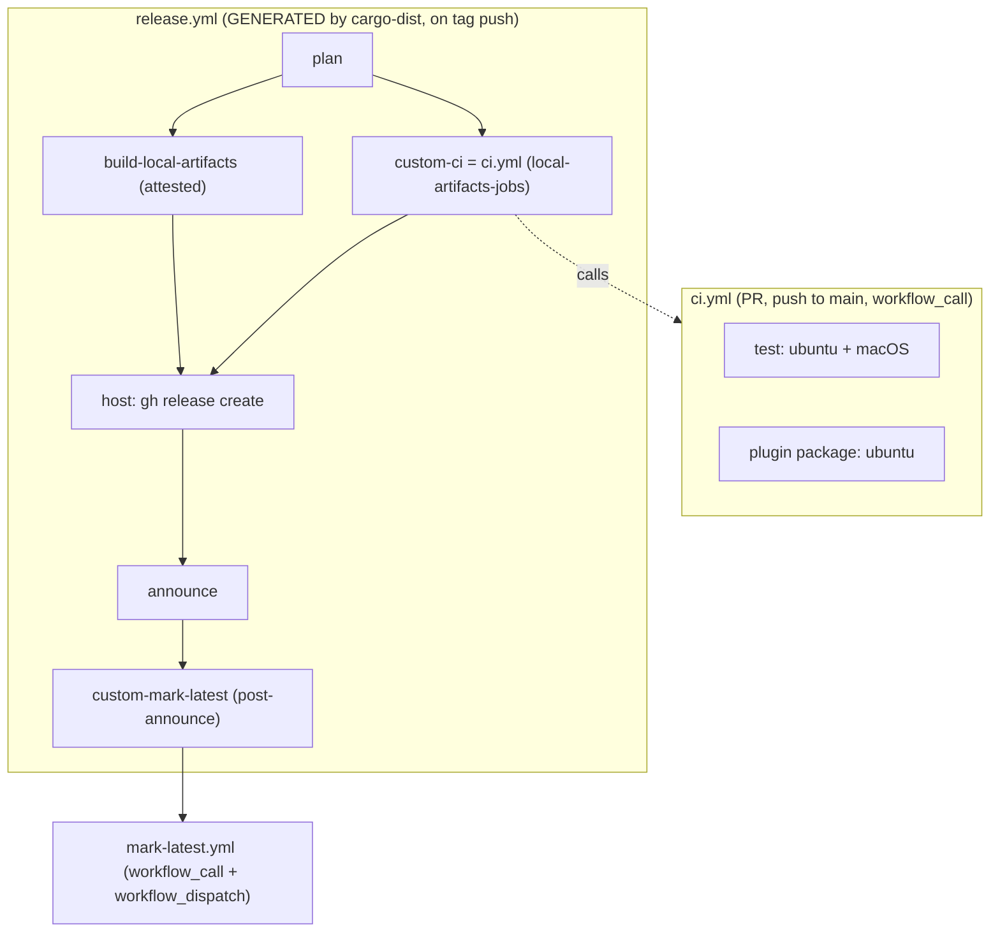

# .github – CI and release workflows

Scope: `.github/workflows/` (`ci.yml`, `release.yml`, `mark-latest.yml`) and the cargo-dist facts that shape them.
Repository-wide rules live in the root [CLAUDE.md](../CLAUDE.md).
Code rules for release and CI shape live in the Release/CI section of [CODING_STANDARDS.md](../CODING_STANDARDS.md).

## Workflows

- `ci.yml` runs on every PR commit and every push to `main`, and is also called by `release.yml` as the release gate.
- `release.yml` is **generated** by cargo-dist and never hand-edited. After any `dist-workspace.toml` change, regenerate it and keep `dist generate --check` green.
- `mark-latest.yml` is cargo-dist's post-announce job, also dispatchable by hand.

### ci.yml

Workflow-level `concurrency` cancels superseded runs on a PR only (tag-triggered release invocations have unique refs and never cancel each other). `workflow_call` declares an optional string input `plan` – see the release gate below for why.

**`test (ubuntu-latest | macos-latest)`**, `fail-fast: false`, 15 minute timeout (it gates releases, so a wedged run must fail fast):

- `cargo test --workspace --locked`
- macOS only: `/bin/bash scripts/test-bootstrap.sh` and `/bin/bash scripts/test-mark-latest.sh`. macOS ships bash 3.2 (no associative arrays, no `${var^^}`, no `mapfile`), and this leg is the only proof the shell scripts work on the older shell. The plugin job runs the same suites under Linux bash 5, which would let a bash-4 construct pass unnoticed.

**`plugin package`** (ubuntu, 10 minute timeout, `fetch-depth: 0` because the bump check needs the history and tags). Steps, in order:

1. **Release tag shape** – on a tag build, refuses any tag matching neither `^v[0-9]+\.[0-9]+\.[0-9]+$` (CLI) nor `^ss-magic-plugin-v[0-9]+\.[0-9]+\.[0-9]+$` (plugin). A prefixed CLI tag such as `ss-magic-v0.11.1` would publish a release the updater's anchored filter and every installed binary ignore, stranding the line with no error anywhere. Non-tag builds pass.
2. **Builder selftest** – `python3 scripts/build-plugin-zip.py --selftest` (the builder's own reproducibility and refusal tests).
3. **Release assertions** – `python3 scripts/build-plugin-zip.py --check`. It enumerates its own assertion lines; do not work from a remembered count. Current lines: marketplace `sha256` key, version surfaces per release line, distinct release lines, hooks spawn through the shim, workspace shape, release gate blocks publishing, committed digest pin.
4. **The plugin links no updater, no TUI and no YAML parser** – `cargo tree --locked -p ss-magic-plugin -i <crate>` for `self_update`, `inquire`, `ratatui`, `saphyr`. A build can only prove a dependency PRESENT, so this is the only evidence of absence. Exit codes run backwards: a match exits 0 and fails the job; only the explicit "did not match any packages" message passes, so an unrelated cargo failure is reported rather than read as proof of absence.
5. **Content change requires a version bump** (R98: the resolved version, not the digest, is the harness's update signal) – finds the newest release tag of EITHER line reachable from HEAD that is not HEAD itself (sorted by `-creatordate`; the two tag shapes do not sort against each other as versions; tag filter anchored, never a shell glob) and runs `python3 scripts/build-plugin-zip.py --check-bump <tag>`.
6. **No skill body names `CLAUDE_PLUGIN_DATA`** – `grep` over `plugin/skills/`. The variable is not exported to the Bash tool, so it would expand to nothing and yield a path at the filesystem root.
7. **No document spells the retired `ss-magic` + `plugin` subcommand form** – a `grep` for the verb form with its trailing space, over `plugin/skills/`, `docs/explainers/`, `docs/solutions/`, `README.md`, `CONTRIBUTING.md`, `CONCEPTS.md`, `.cursor/BUGBOT.md` and the CLAUDE.md / CODING_STANDARDS.md / REVIEW.md files (the caller widens the step's file list to cover every one of them). `docs/plans/` is deliberately out of scope: plans are historical records. Never write the literal form in any doc.
8. **README pins the installer to a release** – refuses `releases/latest/download/` in `README.md`: `latest` is repository-wide and can resolve to a plugin release that carries no installer, which would 404 the documented one-liner.
9. **Latest-mark selection** – `bash scripts/test-mark-latest.sh`.
10. **Plugin bootstrap failure-path tests** – `bash scripts/test-bootstrap.sh`.
11. **Build the asset cargo-dist will publish** – reads the `ss-magic-plugin-vX.Y.Z.zip` name from the plugin crate's `extra-artifacts` entry (falling back to `dist-workspace.toml`), runs `python3 scripts/build-plugin-zip.py`, and asserts the file exists, has no deflated entries, has `.claude-plugin/plugin.json` at the zip root, and that its SHA-256 equals the `marketplace.json` pin. A name mismatch publishes no plugin asset and 404s the marketplace URL for every user.

What each shell suite asserts lives in [scripts/CLAUDE.md](../scripts/CLAUDE.md).

### mark-latest.yml

After a PLUGIN release the repository-wide `releases/latest` mark must name a bare `v*` release again (R12): `gh release create` marks whatever it just published as latest, and every `ss-magic` binary released before the per-line check (0.11.0) polls that mark and parses only a bare `vX.Y.Z`. A plugin release holding it makes those installs report "up to date" until the next CLI release.

- Wiring: `dist-workspace.toml` sets `post-announce-jobs = ["./mark-latest"]`, so the generated `release.yml` gains `custom-mark-latest` (needs `plan` and `announce`, `uses: ./.github/workflows/mark-latest.yml` with the plan manifest as `plan`, `secrets: inherit`). Its one step reads `announcement_tag` from the plan and runs `scripts/mark-latest.sh`.
- Fallback: also `workflow_dispatch`-able with the tag as required input (a plugin tag re-marks the newest `v*` release; a `v*` tag is a no-op).
- Permissions: `contents: write`, which `release.yml` grants at workflow level and this reusable workflow asks nothing beyond.
- Selection logic, edge cases and `MARK_LATEST_DRY_RUN=1` are in [scripts/CLAUDE.md](../scripts/CLAUDE.md). The script reads `releases/latest` back and fails the job if it does not name the chosen tag, so a token that cannot edit shows up red.

## The release test gate must block the PUBLISH, not only the builds

Mechanism:

- cargo-dist's `host` job (the one that runs `gh release create`) publishes when `plan` succeeded and each build job succeeded OR WAS SKIPPED.
- A `plan-jobs` entry is upstream of `build-local-artifacts` and absent from `host`'s `needs` and `if`. It can fail, skip every build, and still let `host` publish a release with no assets.
- `local-artifacts-jobs` is the correct registration: cargo-dist adds such a job to `host`'s `needs` AND checks its result in `host`'s `if`, so a red or cancelled suite skips `host`, `announce` and `custom-mark-latest`.
- Current config: `local-artifacts-jobs = ["./ci"]` in `dist-workspace.toml`, which makes the generated `custom-ci` job call `ci.yml`.
- `ci.yml` declares the optional `plan` input cargo-dist passes to such a job (GitHub rejects an undeclared one). Keep the declaration.
- The builds run alongside the tests, so a red gate still spends build minutes and leaves attested archives in Actions storage, but uploads nothing.
- The pinned cargo-dist is 0.32.0 and its template treats a skipped build as fine; do not assume a cargo-dist upgrade changes this, and re-check the generated `host` condition after any upgrade.

Enforcement: `build-plugin-zip.py --check` asserts `release gate blocks publishing` on the GENERATED `release.yml`:

- `custom-ci` must call `ci.yml`.
- `host` must need it and check its result.
- Every job `build-local-artifacts` waits on must appear as `needs.<job>.result` in `host`'s `if`, so any future `plan-jobs` entry fails there rather than in a release.

Incident (2026-09-30): the gate (then `plan-jobs = ["./ci"]`) failed on a date-dependent test and `host` published `v0.11.1` and `ss-magic-plugin-v1.0.0` holding only `dist-manifest.json`. Release immutability forbids adding assets, GitHub never lets a deleted immutable release's tag be reused, and the tag ruleset forbids moving or deleting tags, so both versions were lost; the fixes shipped as 0.11.2 and 1.0.1. The two empty releases remain, marked pre-release (so neither updater selects them) and titled "broken – no assets, do not use". See [docs/solutions/logic-errors/cargo-dist-plan-job-failure-publishes-empty-release.md](../docs/solutions/logic-errors/cargo-dist-plan-job-failure-publishes-empty-release.md).

Independently of the gate, push a release tag only after CI on `main` is green for that exact commit. A red release still burns its version number: nothing is published, but the tag is protected and cannot move.

## cargo-dist configuration facts

- Config: `dist-workspace.toml` for workspace defaults plus per-package `[package.metadata.dist]` tables. Releases go to GitHub Releases; only `ss-magic` self-updates from there.
- Per-target archives: `ss-magic-<target>.tar.gz` (containing `ss-magic-<target>/ss-magic`) and `ss-magic-plugin-<target>.tar.gz` (containing `ss-magic-plugin-<target>/ss-magic-plugin`).
- Tag parsing: cargo-dist reads a tag as `[PACKAGE_NAME-]VERSION`. A bare `vX.Y.Z` selects every dist-able package at that version, so it picks the CLI alone only because the two crate versions always differ. The CLI's bare shape is fixed by the updater's anchored filter and every installed binary.
- The plugin crate sets `installers = []`: the marketplace is its only delivery path, so an installer script would be a second, unpinned one.
- The plugin zip is declared as the plugin crate's own `[[package.metadata.dist.extra-artifacts]]` entry, so it rides the PLUGIN's tag. Do not move it to workspace level: it would attach to every release, the CLI's included. The literal zip filename in that entry is not templated by cargo-dist and is a version surface.
- **`working-dir = "../.."` is mandatory on that entry.** A package-level extra-artifact's build command resolves its working directory against the CRATE root, so without it cargo-dist looks for the script under `crates/ss-magic-plugin/scripts/` and fails in `build-global-artifacts` – after the tag is pushed, and invisibly to `dist plan`. Verify any change there with `dist build --artifacts=global`, never `dist plan`.
- Attestations: per-target archives are attested via cargo-dist `github-attestations` → `actions/attest` in `build-local-artifacts` (Sigstore/Rekor provenance). The installer script and checksum files are not attested. Users verify with `gh attestation verify` (see [docs/explainers/installation-and-updates.md](../docs/explainers/installation-and-updates.md), which covers both archive names). The self-update path trusts the TLS-authenticated download alone: it reads neither the published `.sha256` files nor the attestations.
  - The attesting build job necessarily runs third-party build scripts with `id-token: write` live; this is inherent to the feature.
  - The default build-local phase is deliberate: it signs same-job build output before artifacts transit Actions storage. Changing the phase is a security decision.
- The installer one-liner lives in `README.md` (its pinned tag is a version surface); manual download and release verification live in `docs/explainers/installation-and-updates.md`; from-source builds, tests, PR expectations and the per-line release procedure live in `CONTRIBUTING.md`.

## Forge protection

[docs/runbooks/forge-tag-and-release-protection.md](../docs/runbooks/forge-tag-and-release-protection.md) records the tag ruleset and release immutability on the forge (applied and verified against the live repository). The ruleset also carries `required_signatures`, which checks the tagged COMMIT's signature, not the tag object's. Two disposable non-version tags from the proofs exist permanently.
