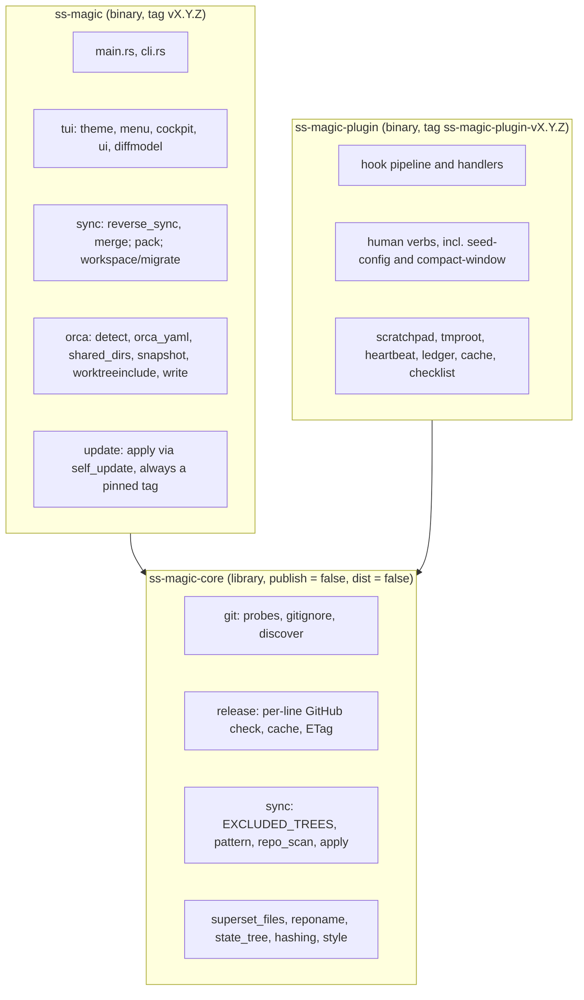

# ss-magic

Two Rust binaries for the Superset workspace contract, sharing one library crate
(standalone repo: `ViktorStiskala/superset-magic`): `ss-magic`, the interactive
sync CLI, and `ss-magic-plugin`, the Claude Code plugin. See
[README.md](./README.md) for user-facing docs.

## Where things are documented

This file holds only what is cross-cutting. A subdirectory `CLAUDE.md` loads
only when files in its subtree are read – read the owning one before a change.

| File | Scope |
|---|---|
| [crates/ss-magic-core/CLAUDE.md](./crates/ss-magic-core/CLAUDE.md) | The shared library: git probes and `git::discover`, gitignore helpers, `superset_files`, the pure sync engine (`EXCLUDED_TREES`, `pattern`, `repo_scan`, `apply`), `style`, `release`, `hashing`, `reponame`, `state_tree`, and the `testutil` helpers with the child-process test pattern |
| [crates/ss-magic/CLAUDE.md](./crates/ss-magic/CLAUDE.md) | The CLI crate: `cli.rs`, `main.rs`, `workspace/migrate.rs`, `pack.rs`, `update/`, `assets/magic.sh`, the `saphyr` rule |
| [crates/ss-magic/src/tui/CLAUDE.md](./crates/ss-magic/src/tui/CLAUDE.md) | The menu, `inquire` pickers, theme, the merge cockpit and `diffmodel` |
| [crates/ss-magic/src/sync/CLAUDE.md](./crates/ss-magic/src/sync/CLAUDE.md) | The interactive half of sync: `reverse_sync.rs` and `merge.rs` |
| [crates/ss-magic/src/orca/CLAUDE.md](./crates/ss-magic/src/orca/CLAUDE.md) | Orca compatibility (`orca.yaml`, `.worktreeinclude`, Orca-mode forward sync) |
| [crates/ss-magic-plugin/CLAUDE.md](./crates/ss-magic-plugin/CLAUDE.md) | The plugin crate (postures, entry point, state modules, human verbs) AND the packaged `plugin/` tree (`bootstrap.sh`, `run-hook.sh`, `execguard.sh`, the `bin/` wrapper, the content pin) |
| [crates/ss-magic-plugin/src/hook/CLAUDE.md](./crates/ss-magic-plugin/src/hook/CLAUDE.md) | The hook pipeline and its handlers |
| [crates/ss-magic-plugin/src/checklist/CLAUDE.md](./crates/ss-magic-plugin/src/checklist/CLAUDE.md) | The operator checklist submodules |
| [scripts/CLAUDE.md](./scripts/CLAUDE.md) | `build-plugin-zip.py`, `test-bootstrap.sh`, `test-mark-latest.sh`, `mark-latest.sh`, `lib/test-harness.sh` |
| [.github/CLAUDE.md](./.github/CLAUDE.md) | CI jobs and checks, the `release.yml` gate shape, the mark-latest workflow, cargo-dist config, attestations, the forge runbook |

There is deliberately NO `CLAUDE.md` under `plugin/`: the zip builder packs
every file there (only `.DS_Store` excluded) into the shipped, digest-pinned
marketplace zip, so a doc in that tree would ship to every user and force a
plugin release. The `plugin/` tree is documented in
[crates/ss-magic-plugin/CLAUDE.md](./crates/ss-magic-plugin/CLAUDE.md) – read it
BEFORE editing anything under `plugin/`.

[CODING_STANDARDS.md](./CODING_STANDARDS.md) – the code rules this repository follows (subtree files add rules under crates/ss-magic-plugin/ and crates/ss-magic/src/orca/); read it before writing or reviewing code, and update it when a change establishes or retires a rule.\
[REVIEW.md](./REVIEW.md) – how code review behaves here (severity, evidence); read it before reviewing.

## Build

```plaintext
make build     # cargo build --release --workspace   (all three crates)
make install   # cargo install --path crates/ss-magic
make test      # cargo test --workspace --locked
make clean     # cargo clean
```

The Rust toolchain is provided by `rustup` (cargo on `~/.cargo/bin`).

The repository is a Cargo workspace with three members. The root `Cargo.toml`
is a virtual manifest (no `[package]`) owning `[workspace.package]` (edition,
repository, license) and BOTH profiles: `[profile.release]` with
`opt-level = "z"` and `[profile.dist]` inheriting it. `opt-level = "z"` is a
measured decision – do not tune it per crate. Members live under `crates/`
(each `Cargo.toml` is the source of its version):

- `crates/ss-magic-core` – the shared library; `publish = false`,
  `dist = false`, never tagged.
- `crates/ss-magic` – binary `ss-magic`, the sync CLI.
- `crates/ss-magic-plugin` – binary `ss-magic-plugin`, hook runtime and verbs.

Every `cargo` command runs from the root with `--workspace`; `cargo install
--path` needs a `[package]`, so it names `crates/ss-magic`. `make install`
installs the CLI ALONE, deliberately: the marketplace delivers the plugin binary
into `${CLAUDE_PLUGIN_DATA}/bin/ss-magic-plugin` and nothing looks for it on
`PATH`, so a development copy there would be picked up by nothing.

### Two release lines

- `ss-magic` releases on bare `vX.Y.Z` tags; `ss-magic-plugin` on
  `ss-magic-plugin-vX.Y.Z`.
- **Their versions must always DIFFER.** cargo-dist parses a tag as
  `[PACKAGE_NAME-]VERSION`, so a bare tag names "every dist-able package at that
  version" – it selects the CLI alone only because the two numbers are never
  equal. `scripts/build-plugin-zip.py --check` refuses a tree where they match.
- The CLI's bare shape is not negotiable: the updater's anchored filter and
  every installed binary look for `vX.Y.Z`, so a prefixed `ss-magic-vX.Y.Z` tag
  would publish a release the whole installed base ignores.
- Archives: `ss-magic-<target>.tar.gz` (holding `ss-magic-<target>/ss-magic`)
  and `ss-magic-plugin-<target>.tar.gz` (holding
  `ss-magic-plugin-<target>/ss-magic-plugin`), published to GitHub Releases by
  cargo-dist; only `ss-magic` self-updates from there.
- The plugin crate sets `installers = []` (the marketplace is its only delivery
  path) and declares the plugin zip as a PACKAGE-level
  `[[package.metadata.dist.extra-artifacts]]` entry with `working-dir = "../.."`,
  so the zip rides the plugin's tag only. Verify a change there with
  `dist build --artifacts=global`, never `dist plan` – detail in
  [.github/CLAUDE.md](./.github/CLAUDE.md).
- The per-target archives are attested, but self-update trusts TLS + cargo-dist
  checksums, not attestations. Changing the attestation phase is a security
  decision.

The per-line release procedure and other contributor docs live in
[CONTRIBUTING.md](./CONTRIBUTING.md); end-user install docs in the README.

### Version surfaces

`.claude-plugin/marketplace.json` pins the plugin zip by SHA-256. Version
surfaces are GROUPED BY RELEASE LINE, and a surface belongs to exactly one
group:

| Group | Surfaces |
|---|---|
| `ss-magic` | `crates/ss-magic/Cargo.toml`; the `ss-magic` entry in `Cargo.lock`; `README.md`'s pinned installer tag (compared `<=`, not `==`) |
| `ss-magic-plugin` | `crates/ss-magic-plugin/Cargo.toml`; the `ss-magic-plugin` entry in `Cargo.lock`; `plugin/.claude-plugin/plugin.json`; `plugin/ss-magic-plugin.version`; BOTH the tag and the asset name in `marketplace.json`'s release URL; the literal zip filename in the plugin crate's `extra-artifacts` (cargo-dist does not template it) |

- The README pin names the last PUBLISHED CLI release, so `--check` requires
  only a well-formed `v` + triple not exceeding the crate version. Equality
  would be wrong: the procedure is bump → merge → tag, so main's README would
  name an unreleased tag (and 404 the install command) until the release lands.
- Do not work from a remembered count – `python3 scripts/build-plugin-zip.py
  --check` enumerates the surfaces and is the authority.
- After any change under `plugin/`, re-pin with `--update-manifest`, then re-run
  `--check`.
- `.gitattributes` marks `plugin/**` as `-text`, so line-ending conversion on
  checkout can never move the digest.

## Architecture

Layered so the pure logic is unit-testable apart from the interactive layer;
three crates so the plugin shares the plumbing without the updater or a TUI.



- The two binaries depend on core and NEVER on each other.
- The plugin crate links neither `self_update` nor `inquire`/`ratatui` nor
  `saphyr`, so it cannot self-update, open a TUI or parse YAML even by mistake.
  `--check`'s `workspace shape` assertion and CI's `cargo tree -i` loop assert
  that mechanically.
- `saphyr` is a dependency of the CLI crate alone, and all Orca code lives in the
  CLI's `orca/` module; core holds only the generic plumbing Orca calls, so the
  parser can never reach the plugin through core.
- Both binaries re-export core's `git` and `hashing` under `crate::`; the plugin
  reaches `style` and `reponame` by `ss_magic_core::` paths (it has no `tui/`
  or `pack` module to borrow them through).

## Conventions

- **Git plumbing.** All git and gh commands shell out via `std::process::Command`
  through core's `git_raw` helper, in every crate. `git::discover` is the one
  filesystem-only exception (it answers the two roots and nothing more) and is
  wired into the plugin crate alone. No git-binding crate (`git2`, `gix`).
- **Never run `cargo fmt`.** The tree is not rustfmt-clean, and a format pass
  rewrites ~86 unrelated files.
- **Test layout.** Each module declares `#[cfg(test)] mod tests;` with the body
  in a sibling `<module>/tests.rs`, in all three crates. Shared helpers are
  `ss_magic_core::testutil`, enabled by a binary's `[dev-dependencies]` ONLY, so
  no release build contains them. A test whose subject is the process
  environment (`PATH`, a `GIT_*` variable, the cwd) runs its assertion in a
  child process – detail in
  [crates/ss-magic-core/CLAUDE.md](./crates/ss-magic-core/CLAUDE.md).
  `cargo test` starts a test binary in its PACKAGE root (`crates/<name>`), not
  the repository root.
- **Manual smoke.** Tests use `tempfile` plus shell-invoked `git init` /
  `git worktree add`. Final-action git ops and the interactive menu and pickers
  are manual-smoke only; the cockpit's `draw` and `handle_key` ARE unit-tested.
- **`cargo test --workspace` is not the whole suite.** CI also runs:\
  `python3 scripts/build-plugin-zip.py --selftest` and `--check` (eight
  assertion lines) and `--check-bump <baseline tag>` (a content change needs a
  version bump);\
  `cargo tree --locked -p ss-magic-plugin -i <crate>` for `self_update`,
  `inquire`, `ratatui`, `saphyr` (a build can prove a dependency present, never
  absent);\
  `/bin/bash scripts/test-bootstrap.sh` and `/bin/bash scripts/test-mark-latest.sh`
  (bash 3.2);\
  the doc greps (no skill body names `CLAUDE_PLUGIN_DATA`, no document spells
  the retired `ss-magic` + `plugin` subcommand form, the README installer pinned
  to a release, never `latest`);\
  the release-tag-shape gate (a tag must match `^v[0-9]+\.[0-9]+\.[0-9]+$` or
  `^ss-magic-plugin-v[0-9]+\.[0-9]+\.[0-9]+$`).\
  Details in [.github/CLAUDE.md](./.github/CLAUDE.md) and
  [scripts/CLAUDE.md](./scripts/CLAUDE.md).
- **The plugin tree is content-pinned.** Any change under `plugin/` moves the
  zip's digest: run `--update-manifest` then `--check`, and bump every surface of
  the `ss-magic-plugin` group (table above). The resolved VERSION, not the
  digest, is the harness's update signal – a new zip and `sha256` without a
  version bump leaves every installed user silently on the cached copy.
- **Version bumps follow the GROUP, never the repository.**\
  Bump the CLI group on any change that alters CLI behavior (a fix, a
  new/changed command or flag, different output) – it self-updates keyed on
  version, so a stale version means users never receive the change.\
  Bump the plugin group on any change under `plugin/` or in
  `crates/ss-magic-plugin/`. `crates/ss-magic-core/Cargo.toml` is not a surface.\
  The two groups' versions must never be equal (`--check`'s `distinct release
  lines`).\
  Bug fixes bump patch; new/changed user-visible behavior bumps minor (pre-1.0 on
  the CLI line; ordinary semver on the plugin line, whose first release with
  assets is `1.0.1`).
- **After a plugin release, `releases/latest` must name a bare `v*` release
  again.** `gh release create` marks whatever it published as latest, and every
  `ss-magic` binary older than 0.11.0 polls that mark and parses only a bare
  `vX.Y.Z`, so those installs would report "up to date". cargo-dist's
  post-announce `mark-latest` job hands the mark back – detail in
  [.github/CLAUDE.md](./.github/CLAUDE.md). `release.yml` is REGENERATED
  (`dist generate --check` stays green), never hand-edited.
- **The release test gate must block the PUBLISH.** The gate is
  `local-artifacts-jobs = ["./ci"]`, never `plan-jobs`: a `plan-jobs` entry is
  invisible to cargo-dist's `host` job, and on 2026-09-30 a failed gate let
  `host` publish `v0.11.1` and `ss-magic-plugin-v1.0.0` with no assets, losing
  both versions for good. Push a release tag only after CI on `main` is green for
  that exact commit – a red release still burns its version. See
  [docs/solutions/logic-errors/cargo-dist-plan-job-failure-publishes-empty-release.md](./docs/solutions/logic-errors/cargo-dist-plan-job-failure-publishes-empty-release.md).
- **Docs sync.** A change is done only when the docs describe the code as it is
  now: update [README.md](./README.md) (command list, prose) and the
  `CLAUDE.md` that owns the area (this file or a subdirectory one);\
  update the owning `CODING_STANDARDS.md` when a code rule is established or
  retired;\
  update [CONTRIBUTING.md](./CONTRIBUTING.md) when build, test or release facts
  change.
- **`.cursor/BUGBOT.md`** holds the Cursor Bugbot review rules. It must stay
  self-contained – it cannot reference any `CLAUDE.md`, `CODING_STANDARDS.md`,
  `REVIEW.md`, `docs/solutions/` or a skill, so it restates conventions inline –
  and it is updated in the same change whenever a convention in any `CLAUDE.md`
  or `CODING_STANDARDS.md` changes.

## Secret safety

The unified sync engine is the one path that writes untracked (secret) files
into the shared main checkout, `pack` archives the configured files, and Orca's
`.worktreeinclude` refresh writes into the shared main checkout too – all three
are secret-leak surfaces. The rules (positive tracked determination that fails
closed; the excluded-trees filter applied at the point of final enumeration)
live in [CODING_STANDARDS.md](./CODING_STANDARDS.md) under "Secret safety and sync", and
violating them is a secret leak, not a cosmetic bug.

## Documented Solutions

`docs/solutions/` – documented solutions to past problems (bugs, best
practices, design patterns, workflow learnings), organized by category
with YAML frontmatter (`module`, `tags`, `problem_type`, `component`).
Relevant when implementing or debugging in documented areas.

After a solved, verified problem, offer once to invoke the `ce-compound` skill at the completion checkpoint only when the work produced durable project reasoning that is not readily recoverable from the final code, tests, types, comments, or existing documentation, and losing it would plausibly cause recurrence, material risk, or substantial rediscovery. Apply this counterfactual: if the learning document disappeared, would a future engineer reading the final implementation still be likely to repeat the mistake or redo substantial investigation? If not, do not offer. Completion, effort, and diff size alone are not enough. Offer at the checkpoint so a qualifying learning can ship in the PR that produced it, and only where the repository treats captured learnings as tracked, committed knowledge.

Write every report, summary, or handoff to the user through the `ce-noslop` skill. This applies when you are the top-level agent writing to the user, not when you are a subagent reporting to its caller. Do not apply it to code, config, verbatim quotes, or text the user asked to post as written.

`CONCEPTS.md` (repo root) – shared domain vocabulary (the sync model:
main checkout, forward/reverse sync, sync patterns, candidates).
Relevant when orienting to the codebase or discussing domain concepts.
