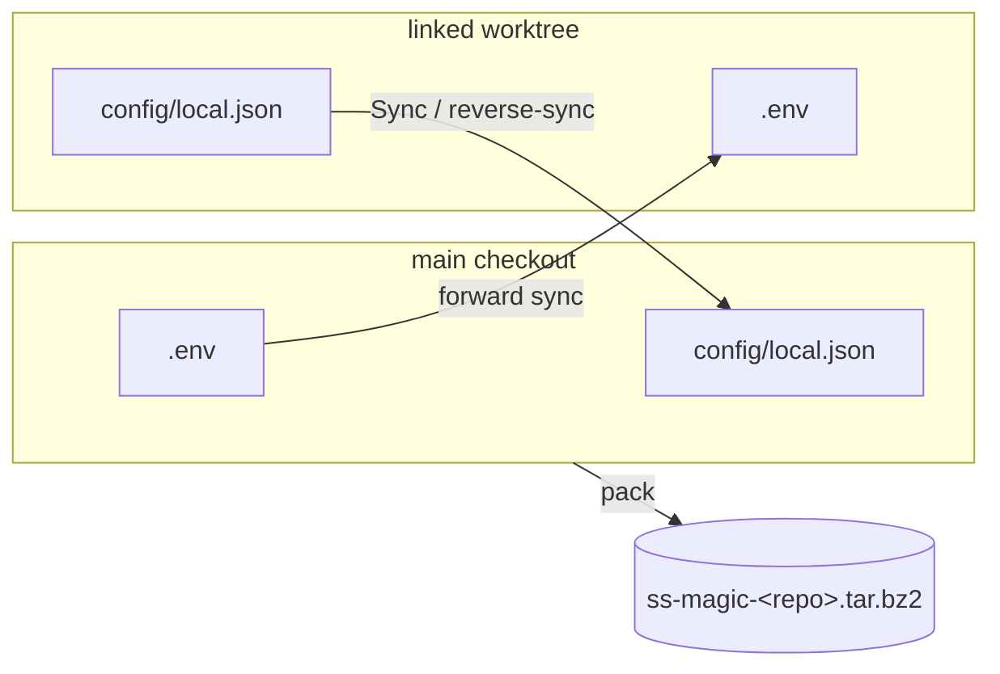

# ss-magic

Keep gitignored files – `.env` secrets, local overrides, machine-specific
config – in sync across git worktrees: automatically when a
[Superset](https://superset.sh) workspace or an [Orca](https://www.onorca.dev)
worktree is created, on demand from the command line anywhere else.

## The problem

Git worktrees share your repo's history, branches, and objects – but not its
gitignored files. Create a new worktree and every file git ignores stays
behind in the original checkout: `.env`, `.dev.vars`, local database configs,
per-developer overrides. The new tree is "clean" in the worst way – nothing
runs until you hand-copy your secrets in, and you re-do that copy for every
worktree you create.

The same asymmetry bites in reverse: add or rotate a secret *inside* a
worktree and it's stranded there. Gitignored files never travel through a
merge, so the main checkout – and every future worktree created from it –
silently misses the update.

## What ss-magic does

You declare the files once, as glob patterns in a committed
`.superset/magic.json`. ss-magic then gives you three operations over that one
file set:

- **Forward sync** (`ss-magic sync`) – copy every matching file from the
  repo's main checkout into the current worktree, backing up whatever it
  overwrites. Superset and Orca run it automatically when a workspace or
  worktree is created.
- **Sync** (interactive, worktree menu) – reconcile every configured file
  against the main checkout in either direction through a full-screen merge
  cockpit, with a backup taken before every overwrite or delete. For scripted
  use, `ss-magic reverse-sync` bulk-pushes every git-untracked file matching
  your patterns that differs from main.
- **Pack** (`ss-magic pack`) – snapshot the whole configured file set into a
  single `ss-magic-<repo>.tar.bz2` for backup, machine migration, or handing
  to a teammate.



Tracked files are deliberately out of scope – they
already travel through normal git commits and merges. And ss-magic is not a
secrets manager: the files remain ordinary files on disk, and you decide which
paths may be copied or packed.

If you work with git worktrees and carry per-developer gitignored files, this
tool is for you. It is built for Superset's workspace lifecycle and Orca's
worktree lifecycle, but every command works in any worktree setup.

ss-magic also ships an optional **Claude Code plugin** built on the same
`.superset/magic.json` contract – see [The Claude Code plugin](#the-claude-code-plugin).

## How it fits Superset and Orca

**Superset** runs the `setup` commands from `.superset/config.json` inside every
new workspace. ss-magic's init adds `./.superset/magic.sh sync` there, a small
committed wrapper that runs the installed binary – and exits 0 with an install
hint when it is missing, so it never blocks Superset's pipeline. Details:
[docs/explainers/superset-contract.md](./docs/explainers/superset-contract.md).

**Orca** reads its own two files from the repository root. ss-magic generates
both from the same `magic.json`: a committed `orca.yaml` (the setup script plus
the dependency directories Orca shares, such as `node_modules`) and a
gitignored `.worktreeinclude` snapshot of the files Orca copies itself. One
maintained list serves both apps. Details:
[docs/explainers/orca.md](./docs/explainers/orca.md).

## Install

```sh
curl -sSfL https://github.com/ViktorStiskala/superset-magic/releases/download/v0.12.1/ss-magic-installer.sh | sh
```

The installer puts the right prebuilt `ss-magic` binary for your platform on
your `PATH`; from then on the binary keeps itself current with a daily check.

**Supported platforms:** macOS (Apple Silicon and Intel) and Linux (x86-64 and
arm64). Windows is not in the release matrix yet.

> [!NOTE]
> The URL names a version on purpose rather than `latest`: this repository
> publishes two release lines, and GitHub's "latest" mark can point at a plugin
> release that has no installer. The pinned version may lag the newest release;
> the binary updates itself to the newest one within a day, or immediately with
> `ss-magic update`.

Manual download, verifying a release with `gh attestation verify`, and how
self-update works are covered in
[docs/explainers/installation-and-updates.md](./docs/explainers/installation-and-updates.md).
Building from source is covered in [CONTRIBUTING.md](./CONTRIBUTING.md).

## Getting started

In your repo's **main checkout** (the primary checkout your worktrees are
linked to), run:

```sh
ss-magic
```

and pick **init** from the menu. It walks you through selecting the file
patterns to sync and the dependency directories Orca should share, writes the
`.superset/` contract and the Orca files, then offers to commit and push, open
a PR, or leave the changes on disk.

For scripted provisioning there's a non-interactive form (quote the globs so
your shell doesn't expand them):

```sh
ss-magic init '.env' '**/.dev.vars' 'config/local/*'
```

It writes the files but does not commit them; commit the result (`.superset/`,
`.gitignore` and `orca.yaml`) yourself.

Once the contract is committed, every worktree created through the Superset
app or through Orca gets the matching files copied in automatically. In a
worktree created any other way, run `ss-magic sync` yourself.

## Commands

```plaintext
ss-magic              # interactive operation menu (location-aware)
ss-magic sync         # non-interactive forward copy: main → current worktree
ss-magic reverse-sync # non-interactive bulk copy: current worktree → main,
                       # for git-untracked files matching the configured
                       # patterns
ss-magic pack         # archive the configured files into ss-magic-<repo>.tar.bz2
ss-magic orca         # regenerate the Orca files (orca.yaml shared directories,
                       # .worktreeinclude) in the main checkout from magic.json
ss-magic update       # force a self-update to the newest CLI release
ss-magic init [PATTERN...]   # non-interactively seed .superset (magic.json
                             # layout); extra args become magic.json `files`
ss-magic --help       # usage
ss-magic --version    # print the version and exit
```

`sync` and `reverse-sync` back up every file they overwrite unless
`-n`/`--no-backup` is given. `sync` also takes `--no-orca-skip`, which matters
only inside an Orca worktree. `SS_MAGIC_NO_UPDATE=1` disables the auto-update
gate.

There is no `plugin` subcommand: the Claude Code plugin is a separate binary,
`ss-magic-plugin`, delivered by the marketplace and reached from inside a
Claude Code session.

| Command | What it is for | Details |
| --- | --- | --- |
| `ss-magic` | The menu: init, migrate or edit config in the main checkout; the **Sync** merge cockpit in a worktree; **Pack** wherever `magic.json` exists | [interactive-sync.md](./docs/explainers/interactive-sync.md), [superset-contract.md](./docs/explainers/superset-contract.md) |
| `ss-magic sync` | The forward copy Superset and Orca run in a new worktree | [forward-and-reverse-sync.md](./docs/explainers/forward-and-reverse-sync.md) |
| `ss-magic reverse-sync` | Push new or changed untracked files (secrets) back to main | [forward-and-reverse-sync.md](./docs/explainers/forward-and-reverse-sync.md) |
| `ss-magic pack` | One `.tar.bz2` of the whole configured file set | [pack.md](./docs/explainers/pack.md) |
| `ss-magic orca` | Refresh `orca.yaml`'s shared directories and the `.worktreeinclude` snapshot | [orca.md](./docs/explainers/orca.md) |
| `ss-magic init` | Write the contract without prompts, for CI or provisioning | [superset-contract.md](./docs/explainers/superset-contract.md) |
| `ss-magic update` | Check for and install a newer CLI release now | [installation-and-updates.md](./docs/explainers/installation-and-updates.md) |

Every command expands the same patterns with the same rules – see
[docs/explainers/sync-patterns.md](./docs/explainers/sync-patterns.md).

## The Claude Code plugin

An optional [Claude Code](https://claude.com/claude-code) plugin, published from
this repository and built on the same `.superset/` contract. Its binary is
`ss-magic-plugin`, on its own `ss-magic-plugin-vX.Y.Z` release line. It is off
until you turn it on, and it does four things:

- **A durable session scratchpad** per worktree, so working state survives a
  context compaction by living on disk.
- **A read gate with a conclusion cache** that keeps oversized files out of the
  context window and answers repeat reads from a recorded conclusion.
- **An operator checklist** of the steps a change needs before it ships, which a
  GitHub Actions workflow can render into a pull-request comment.
- **A cost ledger** with one row per ended session – a relative signal, never an
  authoritative bill.

### Install and enable

The marketplace is the only delivery path. In Claude Code:

```plaintext
/plugin marketplace add ViktorStiskala/superset-magic
/plugin install ss-magic
```

On the first session after install, a `SessionStart` hook downloads the pinned
`ss-magic-plugin` binary and folds a `plugin` block of defaults into your
existing `.superset/magic.json`. **To turn the plugin on for a repository, add
`"enabled": true` to that block** and commit it (or set it in the main
checkout's gitignored `.superset/magic.local.json` to turn it on for you alone):

```json
{
  "plugin": {
    "enabled": true,
    "gate": { "threshold_lines": 3000 }
  }
}
```

The hooks also need git to report `.superset/.magic/` as ignored. The
`ss-magic` init, migration and edit config flows write that rule, and so does
`ss-magic-plugin enable`; a hand edit of `enabled` does not. A contract created
before the plugin existed may lack the rule, and `ss-magic-plugin status`
reports the case.

> [!IMPORTANT]
> The first session after installing does nothing – the binary is still
> downloading. Start a new session and the plugin is live. `/reload-plugins`
> alone is not enough: it emits no session-start event, so after a version bump
> the old binary keeps serving hooks until a fresh session's bootstrap swaps it.

### Verbs and hooks

**You are not expected to type any of these in a terminal.** The binary lives
in Claude Code's plugin data directory, off your `PATH`. Every verb is reached
from *inside* a Claude Code session – the shipped skills invoke them, the hooks'
messages point the model at them, and you can ask Claude to run one. The first
one to ask for when nothing seems to happen is `ss-magic-plugin status`.

```plaintext
ss-magic-plugin status            # what the plugin sees, and why it is or isn't acting
ss-magic-plugin cost              # what recorded sessions cost, across every worktree
ss-magic-plugin spill-index       # list the harness's own oversized-output files
ss-magic-plugin scratchpad ensure # create/refresh this worktree's state tree
ss-magic-plugin conclude <FILE>   # record a conclusion about a file
ss-magic-plugin conclusions [KEY] # list or show recorded conclusions
ss-magic-plugin gc                # prune expired plugin state
ss-magic-plugin bypass <FILE>     # let the next Read of that file through, once
ss-magic-plugin expect-artifact <FILE> [--note TEXT]
                                  # require the next subagent to produce a file
ss-magic-plugin enable  [--local] # turn the hooks on for this repository
ss-magic-plugin disable [--local] # stop them acting (leaves the install alone)
ss-magic-plugin config get <plugin.DOTTED.KEY>      # e.g. plugin.gate.threshold_lines
ss-magic-plugin config set <plugin.DOTTED.KEY> <VALUE> [--local]
ss-magic-plugin seed-config       # fold the gate defaults into an existing
                                  # magic.json (what the bootstrap runs once)
ss-magic-plugin compact-window --recommend [--json]
                                  # size an auto-compaction window; writes nothing
ss-magic-plugin compact-window --set <TOKENS>
                                  # opt into an absolute auto-compaction window
ss-magic-plugin release-check [--refresh] [--json]
                                  # newest known plugin release vs. the pin;
                                  # --refresh re-reads GitHub's list once
ss-magic-plugin setup-github-ci [--check] [--force]
                                  # write the checklist PR-comment workflow
ss-magic-plugin checklist <SUBVERB>
                                  # init, add-item, add-entry, set, done, list,
                                  # verify, render-md – the only write path
ss-magic-plugin --help
ss-magic-plugin --version         # prints `ss-magic-plugin <version>`; the
                                  # bootstrap gates every install on it
```

The plugin registers five hook events – `SessionStart`, `PreToolUse`,
`PreCompact`, `SubagentStop` and `SessionEnd` – and every hook fails open: an
error or a timeout looks to Claude Code like a hook that decided to do nothing.

| Topic | Explainer |
| --- | --- |
| Install, bootstrap, enabling, configuration, every verb, what it stores, update notices | [claude-code-plugin.md](./docs/explainers/claude-code-plugin.md) |
| The hook events, the read gate and conclusion cache, subagent salvage | [plugin-hooks.md](./docs/explainers/plugin-hooks.md) |
| The scratchpad, the operator checklist, the cost ledger, sizing the auto-compact window | [plugin-session-state.md](./docs/explainers/plugin-session-state.md) |

## Documentation

Detailed explainers live under [docs/explainers/](./docs/explainers/):

| Explainer | Covers |
| --- | --- |
| [installation-and-updates.md](./docs/explainers/installation-and-updates.md) | Installer, manual download, verifying releases, the self-update gate |
| [superset-contract.md](./docs/explainers/superset-contract.md) | The `.superset/` files, init, migration, edit config, scripted init |
| [sync-patterns.md](./docs/explainers/sync-patterns.md) | How `magic.json` patterns are expanded, and the trees no operation touches |
| [forward-and-reverse-sync.md](./docs/explainers/forward-and-reverse-sync.md) | `ss-magic sync` and `ss-magic reverse-sync`, backups, the gitignore-safety gate |
| [interactive-sync.md](./docs/explainers/interactive-sync.md) | The menu and the Sync merge cockpit |
| [pack.md](./docs/explainers/pack.md) | `ss-magic pack` and archive naming |
| [orca.md](./docs/explainers/orca.md) | `orca.yaml`, `.worktreeinclude`, sync inside an Orca worktree, `ss-magic orca` |
| [claude-code-plugin.md](./docs/explainers/claude-code-plugin.md) | The Claude Code plugin: install, enable, configure |
| [plugin-hooks.md](./docs/explainers/plugin-hooks.md) | The plugin's hooks and read gate |
| [plugin-session-state.md](./docs/explainers/plugin-session-state.md) | The plugin's scratchpad, checklist, ledger and compaction window |

Domain vocabulary (main checkout, forward/reverse sync, candidates) is defined
in [CONCEPTS.md](./CONCEPTS.md).

## Environment variables

| Variable | Effect |
| --- | --- |
| `NO_COLOR` | Disable ANSI color output. Stdout is also checked for TTY support and color is auto-disabled when piping. |
| `SS_MAGIC_NO_UPDATE` | Skip the daily self-update gate when set to any non-empty value other than `0`. `ss-magic update` ignores it. |
| `SS_MAGIC_UPDATED` | Internal re-exec guard preventing update loops – not meant to be set by hand. |
| `ORCA_WORKTREE_PATH` | Set by Orca for setup-script runs; read (not set) by `ss-magic sync`. When it names the worktree ss-magic runs in, that worktree is treated as an Orca worktree. |
| `ORCA_WORKTREE_ID` | Set by Orca in its terminals as `<repo id>::<worktree path>`; read the same way, by the path after the first `::`. |
| `CLAUDE_CONFIG_DIR` | Read (not set) by `ss-magic-plugin` to locate Claude Code's own state when it is not at `~/.claude`. |
| `CLAUDE_PLUGIN_ROOT` | Set by Claude Code for a running plugin; read to find the version pin (`ss-magic-plugin.version`). Not meant to be set by hand. |
| `CLAUDE_PLUGIN_DATA` | Set by Claude Code for hook processes; where the bootstrap installs `bin/ss-magic-plugin`. It is *not* exported to the Bash tool, which is why skills reach the binary through the `ss-magic-plugin` wrapper. |

## Contributing

Bug reports and PRs are welcome. Building from source, running the test suite,
and the release/versioning rules are covered in
[CONTRIBUTING.md](./CONTRIBUTING.md).

## License

Licensed under either of

- Apache License, Version 2.0 ([LICENSE-APACHE](./LICENSE-APACHE) or
  <https://www.apache.org/licenses/LICENSE-2.0>)
- MIT license ([LICENSE-MIT](./LICENSE-MIT) or
  <https://opensource.org/licenses/MIT>)

at your option.

Unless you explicitly state otherwise, any contribution intentionally
submitted for inclusion in the work by you, as defined in the Apache-2.0
license, shall be dual licensed as above, without any additional terms or
conditions.
