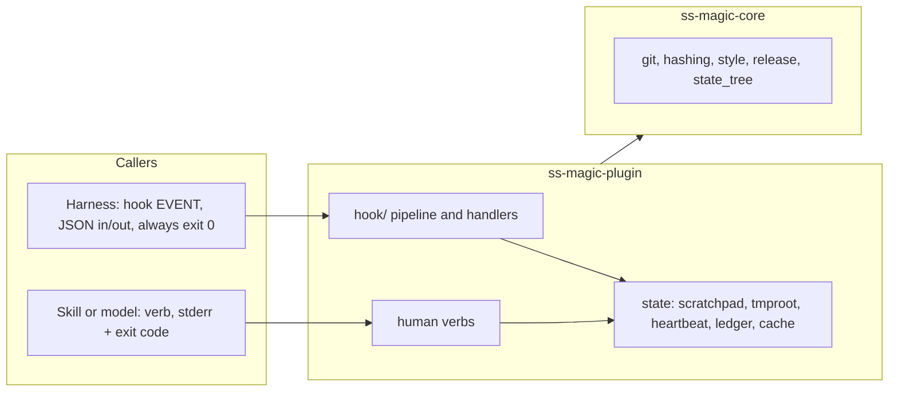
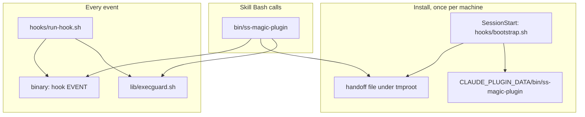

# ss-magic-plugin (crate and packaged plugin tree)

Scope: the `ss-magic-plugin` binary (`crates/ss-magic-plugin/src/`, tag `ss-magic-plugin-vX.Y.Z`) and the packaged tree `plugin/` at the repository root. Repository-wide rules: the root [CLAUDE.md](../../CLAUDE.md).

Code rules: [CODING_STANDARDS.md](./CODING_STANDARDS.md) (read before writing or reviewing code here; update when a rule is established or retired), plus the root [CODING_STANDARDS.md](../../CODING_STANDARDS.md).

Subtree docs:

- [src/hook/CLAUDE.md](./src/hook/CLAUDE.md) – the hook pipeline and handlers
- [src/checklist/CLAUDE.md](./src/checklist/CLAUDE.md) – the operator checklist
- [scripts/CLAUDE.md](../../scripts/CLAUDE.md) – the zip builder and shell test suites that guard `plugin/`

`ss-magic-plugin <VERB>` depends on `ss-magic-core` (git, hashing, gitignore, release-check plumbing), never on the CLI crate. Module paths below are relative to `crates/ss-magic-plugin/src/`.

## Three facts that shape every module

- **Two callers, two postures.**
  - The harness invokes `ss-magic-plugin hook <event>`: envelope on stdin, JSON on stdout (nothing else may be printed there), exit 0 even when the hook cannot do its job.
  - A skill – or the person, by asking the model – invokes a named verb (`status`, `checklist`, ...): problems go to stderr with a non-zero exit.
  - **Nobody types a verb in a terminal.** The binary lives under `${CLAUDE_PLUGIN_DATA}`, off `PATH`; the Bash tool carries the `bin/ss-magic-plugin` wrapper instead, so every `Usage:` string and model-facing command spells `ss-magic-plugin`.
  - Safety boundary: no hook reaches anything that can set `plugin.enabled` (`enable`, `disable`, `config set`), so a repository cannot enable itself by firing a hook. The two hook-side invocations are safe: the bootstrap runs `seed-config`, which has no code path to `enabled`; `SessionStart` spawns `release-check --refresh --quiet`, which writes only the plugin release cache and reads no configuration.
- **No update gate, no TUI, no install verb.**
  - The marketplace is the only delivery path, and the binary is pinned with the skills, hooks and Markdown it ships with; a self-update would make them disagree.
  - Structural: the crate links none of `self_update`, `inquire`, `ratatui` or `saphyr` (the CLI's YAML parser), asserted by `build-plugin-zip.py --check` and `cargo tree --locked -p ss-magic-plugin -i <crate>`.
  - Releases are only advised on (R29–R33): `release-check` reports the newest known plugin release against the pin; `SessionStart` reads the cache and tells the operator once per release, on `systemMessage`, that `/plugin` has a newer one. Nothing in the crate downloads a binary.
- **Fail-open, but fail-CLOSED on anything that could leak.** A hook that errors, panics or times out looks exactly like one that did nothing; secret-protecting gates refuse on an unknown answer. See [CODING_STANDARDS.md](./CODING_STANDARDS.md) (Hook posture).

## Entry point

- `main.rs` (crate root) – the argv parse and the dispatch table, nothing else.
  - `HookEvent::from_token` and `HumanVerb::from_token` are the two closed vocabularies. `HookEvent::{Unknown, Missing}` are VALUES, not parse errors, so a newer manifest's unknown event name reaches the binary, which exits 0, prints nothing and records it.
  - `parse` returns `Parsed::{Invocation, Version, Help, MissingVerb, UnknownVerb}`. `run` calls `style::init_no_color()` for a hook invocation (an ANSI escape would break the JSON) and `style::init()` otherwise.
  - `HookEvent::FileChanged` parses and routes, but the shipped manifest declares no `FileChanged` entry (see [src/hook/CLAUDE.md](./src/hook/CLAUDE.md)).
  - `-V`/`--version` prints `version_line()` – `ss-magic-plugin <version>` on ONE line, exit 0 – only as the FIRST token (every verb parses its own flags). The version must stay LAST on line one and the flag must never answer with usage text. Contract: `hooks/bootstrap.sh` gates installs on `"$staged_bin" --version | head -1 | awk '{print $NF}'` equalling the pin, and `status.rs` probes it for drift.
  - `writes_config` is `Enable | Disable | Config | SeedConfig`; `can_set_enabled` (`Enable | Disable | Config`) is the safety property. `no_hook_invoked_verb_can_set_enabled` asserts it over the hook-invoked `SeedConfig` and `ReleaseCheck`.

## State: where the plugin keeps things, and why there

- `atomic.rs` – `write_atomically(path, body, prefix, suffix, what, mode, sync)`: temp file in the target's directory, write, flush, optional chmod and fsync, rename over the target. Every plugin writer uses it (heartbeat, ledger, cache, bypass, expect_artifact, scratchpad pointer, compact_window, setup_ci, checklist verbs).
- `pathnorm.rs` – the lexical path reduction every path gate shares, behind the R88 checklist deny (the PreToolUse block on reading or editing checklist files). Rules: [CODING_STANDARDS.md](./CODING_STANDARDS.md) (Path gates).
  - `normalize` removes `.` and cancels `..` TEXTUALLY; the caller canonicalizes afterwards (symlinks). The order matters: the filesystem cancels a `..` AFTER resolving a symlink. An uncancellable leading `..` is COUNTED, not pushed.
  - `process_view` classifies the COMPONENT SEQUENCE: `…/proc/<selector>/cwd/<rest>` is the one re-rootable form (`Cwd(rest)`); anything else below a process selector (`root`, `fd/<n>`, `task/<tid>`, `ns/…`) is `Opaque`; the FIRST selector wins; the whole sequence is scanned because procfs is mountable anywhere.
  - `home_relative` classifies a LEADING `~`: `Own(rest)` for the current user's home (process-independent, since the hook inherits the harness's `HOME`) and `Other` for `~name`, reported unexpandable rather than guessed at `/home/<name>`. It tests the leading byte through `to_string_lossy`, so a non-UTF-8 `~name` is still caught.
- `tmproot.rs` – the private, per-machine, cross-session temp root (R80) for coordination that predates any repository or session context.
  - `resolve_root()` is `/tmp/ss-magic-plugin/<identifier>/`, falling back to `$TMPDIR`. `identifier(home)` is the first 16 hex chars of SHA-256 of `$HOME` exactly as read, matching the shell bootstrap's `shasum -a 256` byte for byte.
  - A predictable path is not ownership: each managed component is `lstat`ed and must be a real directory owned by this euid (raw `geteuid()`, not `id -u`) at exactly 0700, else that base is unusable.
  - `with_lock` BLOCKS (concurrent hook handlers must coordinate, not skip); `try_with_lock` does not. `flock` releases on process death, so no stale-lock reclaim.
- `identity.rs` – the `<repo>-<branch>` slug, from git alone, never the (renameable) Superset workspace name. `resolve(cwd)` is `None` outside a git repo, and then the plugin does nothing. Repo half: `ss_magic_core::reponame::repo_name_stem`, shared with the CLI's `pack.rs`. Branch half: slugified HEAD, else `detached-<short-sha>`, diacritics stripped so precomposed and NFD names give the SAME directory.
- `scratchpad.rs` – the per-worktree state tree at `.superset/.magic/` (`STATE_REL`): `sessions/<slug>/` with the six model-owned `STATE_FILES` (`CONTEXT.md`, `DECISIONS.md`, `LEARNINGS.md`, `OPERATOR-CHECKLIST.md`, `STATUS.md`, `TASKS.md`), the `current.json` pointer, and the `conclusions/`, `bypass/` and `expect-artifact/` stores. The write rules (scaffold with `create_new`, never adopt a tracked path, wait for git's word via `git::is_ignored_no_index_str`, containment, 0700/0600) are in [CODING_STANDARDS.md](./CODING_STANDARDS.md) (Enablement and config writes).
  - Only `current.json` is rewritten each run, under an fd-lock plus temp-file-then-rename, so a lock-free reader never sees a half file.
  - Tracked-ness comes from `git::tracked_files`; `verify_contained` checks the `.superset` and `.superset/.magic` ancestors before creation.
  - `Refusal` and `Report` carry the outcome. `STATE_REL` and `ensure_state_ignored` re-export core's `state_tree` (the ignore rule's one writer: init/migrate eagerly, `enable` / `config set` lazily, no hook). A core test pins `STATE_REL` to the `.superset/.magic` entry of `sync::EXCLUDED_TREES`.
- `claim.rs` – `take(dir, path)`, the exactly-once claim both one-shot stores use: `fs::rename` the claim onto a private landing file in the SAME directory; `rename` needs its source to exist, so one racing caller wins. Never `unlink`'s `ENOENT` (see [unlink-is-not-an-exclusive-claim.md](../../docs/solutions/logic-errors/unlink-is-not-an-exclusive-claim.md)).
- `heartbeat.rs` – the append-only machine-level `hooks.jsonl`: one `Row` per hook invocation (no-ops and failures too), the source of `status`'s last-fired-at and outcome counts.
  - In `directories`' DATA dir, not the cache dir (disk cleanup must not sweep the history), outside any worktree so rows outlive it.
  - `append` holds `tmproot::with_lock` over append AND prune (a prune rewrites the file).
  - `prune` keeps the newest `ROWS_KEPT` (2000) rows and drops rows older than 30 days, but keeps FUTURE-stamped rows (a backward clock jump). It fires only past `PRUNE_TRIGGER_BYTES` (256 KiB), so the common case costs one `stat`. A prune failure never fails the append.

## Human verbs

- `config.rs` – the typed `plugin` key in the overlaid `magic.json` and the write path behind `enable` / `disable` / `config get` / `config set [--local]`.
  - `resolve` is infallible: malformed fields degrade to safe defaults, out-of-range numbers CLAMP.
  - `enabled` is read from the MAIN CHECKOUT's overlay; `gate` from the cwd root. `resolve(cwd_root)` finds the main checkout via `git rev-parse --git-common-dir` (human verbs); `resolve_with_roots(cwd_root, main_root)` takes roots already discovered (the hook pipeline, so the enablement gate costs no subprocess on the fast path). `None` falls back to the cwd root's overlay.
  - Every write goes through `write_plugin_key` (one-file load-modify-write, unknown keys kept): `landing(target_root, local)` refuses a target outside the repository, then `magic-json.lock` under the tmproot is taken (`write_locked`; verbs block, `seed-config` uses `try_with_lock` and defers). Why: [CODING_STANDARDS.md](./CODING_STANDARDS.md) (Enablement and config writes).
  - `enable` then prints `compact_window::enable_tip` (one line naming `compact-window --recommend`) when neither project settings file configures a window.
  - `seed-config` (R3a, one-time gate defaults) exists because no terminal path reaches the config verbs, so the install surfaces the settings in the tracked file. `seed_block()` alone decides the shape – `{"gate": {"threshold_lines", "inline_byte_budget", "exemptions"}}`, a literal map from `GateConfig::default()`, so it cannot emit `enabled`. `seed_config_at` is the pure half; each bound is a test:
    - never writes `enabled` (absent already reads as off; writing `false` would look like a hook making an enablement decision);
    - never stages (the block shows in `git status` as an ordinary edit);
    - writes only when `load_magic_json` returns no `plugin` key at all, so strictly once;
    - never creates the file – absent OR unparseable is `SeedOutcome::NotAWorkspace` (unparseable is likely a merge conflict);
    - `landing`'s `Outside` is `SeedOutcome::OutsideRepository`, `Existing` seeds, `Fresh` is `NotAWorkspace`;
    - `MagicConfig`'s flattened `extras` keep other keys (values, not byte order).
    - every `SeedOutcome` is a normal result, never an error; it seeds `root`, the CURRENT checkout, not the main checkout, because `gate` resolves against the cwd root's overlay.
- `cache.rs` – the conclusion cache behind `conclude` / `conclusions` / `gc`. `identify` keys on `(realpath, size, stamp)`, NEVER offset or limit, so one conclusion answers every later read. `envelope` (nonce-keyed untrusted-data markers) is shared with the checklist renderer and transcript salvage. `prune`/`gc` are best-effort.
- `bypass.rs` / `expect_artifact.rs` – the two one-shot stores built on `claim::take`.
  - `bypass <FILE>` lets exactly the next gated Read of a resolved path through (`MAX_AGE_SECS` 24 h; an expired claim is consumed but does NOT open the gate).
  - `expect-artifact <FILE> [--note TEXT]` declares an output a later subagent must produce (6 h, shorter because it waits only for a machine-paced stop; an expired record is dropped, not enforced, since blocking an unrelated agent hours later is worse).
  - Both resolve and containment-check at DECLARE time, write atomically at 0600, and inherit the scratchpad's ignore gate.
- `ledger.rs` – the machine-level `cost.jsonl` and `cost [--here] [--backfill REF] [--json]`.
  - One row per session id, under an fd-lock held for the commit only (the scan runs outside it). The scan is incremental via a byte-offset store keyed on inode plus size, so a rotated transcript forces a full rescan.
  - Pricing: the harness's `cost-state` is a cumulative FLOOR (take the max; table-price the main thread only without a harness figure, or it double-counts). Cache writes split 5 m (1.25x) / 1 h (2x); the flat total undercounts. `Basis` records which priced a row.
  - `peak_context_tokens` (R26): the largest `input + cache_read + cache_creation` of any ONE assistant message on the MAIN transcript (subagents have their own windows), a running maximum across incremental scans (`build_row` folds `max(prior, tail)`; a full rescan starts over). `None` (older row, or no assistant message) is ignored, never read as zero.
  - `rows_for_repository(store, main_root, limit)`, newest first: rows whose `root` (or any `also_roots`) `git::discover`s to the same main checkout, so a repository's worktrees pool and a deleted worktree drops out (a root that is no longer a directory is answered before discovery could spawn a fallback probe).
- `status.rs` – answers "why is the plugin not doing anything": config disabled, harness registration missing or disabled, state tree not gitignored, binary not installed, manifest-versus-binary drift.
  - Read-only: paths come from the non-creating `release_check::existing_cache_file` (core's `release::existing_cache_dir`) and `heartbeat::existing_store_dir` (shared with `--recommend`). Exit 0 with a report; every null has a `note`; `acting` is `None` when the harness layer is unknown; harness and binary probes are time-bounded.
  - `DECLARED_EVENTS` lists the five registered events and excludes `file-changed`. `PIN_FILE` is `ss-magic-plugin.version`, `BINARY_REL` is `bin/ss-magic-plugin`; the drift probe reads the LAST field of the FIRST `--version` line.
  - The `compaction` section (R27) is `compact_window::recommend_report` as four `Field`s (override and where found, the two windows, recommendation with basis), plus ONE `problems` line only when the override is set AND no window is configured. `Inputs.compaction` carries the `Sources` so tests use a fake home.
  - `Versions.newest_release`: the release cache's tag with "checked <when>, fresh/stale", or a note. `update_available: Option<bool>` against the pin, from `Inputs.release_cache` at `Inputs.now`, never refreshed, never a `problems` line.
  - `SCHEMA_VERSION` is `2` (`versions.running`, `newest_release`, `update_available`, top-level `compaction`).
- `spill_index.rs` – read-only listing of the harness's oversized-tool-output files for this worktree; an empty result's note tells "nothing found" from "directory not located".
- `release_check.rs` – the plugin line's release cache, the `release-check [--refresh] [--json] [--quiet]` verb (R32, R33), and the pure pieces of the `SessionStart` suggestion.
  - The cache is core's `PLUGIN_LINE.cache_file` (`plugin-release-check.json`) in the shared `ss-magic` cache dir, written ONLY via `write_cache` (0600); writers: the refresh and the hook's `suggested` marker.
  - `LOCK_NAME` (`release-check.lock`, under the tmproot), taken by both writers with `try_with_lock`: a hook must not wait on a 5 s fetch; a skipped refresh runs next session.
  - `refresh_with(client, lock_root, cache_file, now)` reads the prior record INSIDE the lock (keeping a just-written marker), runs core's `refresh_cache`, writes, returns `Ran(outcome)` or `Busy`. `record_suggested(lock_root, cache_file, tag)` re-reads under the lock and returns `Written`, `AlreadyRecorded`, `Superseded` (the tag moved) or `Busy`.
  - `spawn_detached(exe, args)` (R30): own process group, stdio null, child dropped, pid returned. `spawn_refresh` points it at `current_exe()` with `REFRESH_ARGV` (`release-check --refresh --quiet`), the argv shared by the hook and the verb's parser.
  - The verb is the ONLY place an HTTP client is built (`UreqReleaseClient::for_product("ss-magic-plugin", …)`), only under `--refresh`. `--quiet` prints nothing; exit 0 on every path that produced a report, a failed fetch included (R33); only an unknown argument exits 2.
  - The report: newest known tag, cache age and freshness, the pin (`${CLAUDE_PLUGIN_ROOT}`, else the harness registration's `installPath`, probed only when the variable is absent, as in `status`), running version, update availability, whether the notice was shown, and what `--refresh` did.
  - `REMEDY`, shared by notice and report, ends in "start a new session" (`/reload-plugins` alone keeps the old binary).
- `setup_ci.rs` – writes `.github/workflows/ss-magic-checklist.yml` from the embedded `assets/workflow/checklist.yml`, pinning the running binary's version.
  - `classify` returns `State::{Absent, Identical, PinStale, Differs}`; only `Differs` (a local edit) needs `--force`; `--check`/`-n` reports without writing. `PinStale` means re-rendering the template at the file's version matches byte for byte. Written 0644.
  - On the PLUGIN's line: `VERSION_PLACEHOLDER` is `@SS_MAGIC_PLUGIN_VERSION@`, `PIN_KEY` is `SS_MAGIC_PLUGIN_VERSION:`; the workflow downloads `ss-magic-plugin-<target>.tar.gz` from an `ss-magic-plugin-v$VERSION` release (checking its `.sha256` sibling) and runs `ss-magic-plugin checklist verify` / `render-md`. A `v$VERSION` tag would name a different release, since the two lines' versions never match.
- `compact_window.rs` – two halves, and the split IS the safety story (R28); the read-only and single-write rules are in [CODING_STANDARDS.md](./CODING_STANDARDS.md) (Enablement and config writes).
  - `compact-window --set <TOKENS>` writes an absolute `autoCompactWindow` into the gitignored `.claude/settings.local.json`, never the tracked `.claude/settings.json`, and adds its ignore rule to `.gitignore`. It load-modify-writes so unrelated harness keys survive. No flag prints usage; an explicit `null` reads as unset (as in `read_window`).
  - `compact-window --recommend [--json]` (R24) writes nothing. It reports whether `CLAUDE_AUTOCOMPACT_PCT_OVERRIDE` is set and WHERE (process environment, then the `env` block of `${CLAUDE_CONFIG_DIR:-~/.claude}/settings.json`, the project's two files, the platform managed-settings file – `Sources` carries the paths for tests), each project file's window, and a recommendation with the exact `--set` command.
  - `recommend(peaks)` (R25, KTD11): over the newest `RECOMMEND_ROWS` (20) repository ledger rows carrying `peak_context_tokens`, `clamp(ceil_to_10000(1.25 × max_peak), 100000, 1000000)` in integer arithmetic (`(max*5).div_ceil(4)`). Three or more rows is `high` confidence, one or two `low`, none gives generic range guidance and no number.
  - `recommend_report` backs `status`'s compaction section; `window_configured` / `enable_tip` serve the other advisory surfaces, all of which say the override is the person's to remove.

## The packaged plugin/ tree

No doc file may live inside `plugin/`: `scripts/build-plugin-zip.py` packs every file there (except `.DS_Store`) into the digest-pinned zip, so it would ship to users and force a release. Rules for these files: [CODING_STANDARDS.md](./CODING_STANDARDS.md) (Packaged plugin/ tree shell assets); the builder and its tests: [scripts/CLAUDE.md](../../scripts/CLAUDE.md).

Inventory: `.claude-plugin/plugin.json`, `hooks/hooks.json`, `hooks/bootstrap.sh`, `hooks/run-hook.sh`, `bin/ss-magic-plugin`, `lib/tmproot.sh`, `lib/execguard.sh`, `skills/`, `ss-magic-plugin.version`. The root `.claude-plugin/marketplace.json` pins the packed zip by SHA-256; `assets/workflow/checklist.yml` is embedded by `setup_ci.rs`, not shipped from `plugin/`.

- `hooks/bootstrap.sh` installs the pinned binary into `${CLAUDE_PLUGIN_DATA}` – never `${CLAUDE_PLUGIN_ROOT}`, which is version-scoped and replaced on each plugin update.
  - Fetches `ss-magic-plugin-<triple>.tar.gz` from `.../download/ss-magic-plugin-v$pin/` (binary at `ss-magic-plugin-<triple>/ss-magic-plugin`), verifies its `.sha256` before extracting, and refuses unless the staged `--version` is exactly the pin. Never pipes `ss-magic-installer.sh` into a shell.
  - `seed_config` runs `"$bin_path" seed-config` (R3a), discarding streams and status, at each point a usable pinned binary is known: the already-installed fast path, the re-check under the install lock, the end of a fresh install. Three sites because the binary installs once per MACHINE but seeding is per REPOSITORY, and `already_installed && exit 0` returns early. The binary owns the once-ness, so no marker file. `scripts/test-bootstrap.sh` asserts a second repository IS seeded and a failed install or upgrade seeds nothing.
- `hooks/run-hook.sh` – the shim the five EVENT hooks spawn through (every `hooks.json` entry except the `SessionStart` bootstrap).
  - Why: `${CLAUDE_PLUGIN_DATA}/bin/ss-magic-plugin` does not exist until the bootstrap fetches it, and hooks on one event fire CONCURRENTLY, so naming the binary in the manifest makes the harness `posix_spawn` a missing path and the session dies with ENOENT on a first install.
  - The bootstrap must NOT go through it (the shim does nothing without a binary, so the plugin would stay inert forever); `--check`'s `hooks spawn through the shim` and `test-bootstrap.sh` assert it.
  - Contract (R77): with no binary, every hook is INERT for the session – which the binary's own fail-open cannot give, so a script in `${CLAUDE_PLUGIN_ROOT}` does. Silent on BOTH streams (unlike the wrapper): `PreToolUse` fires on nearly every tool call. Uses `lib/tmproot.sh` for the handoff lookup.
- `lib/execguard.sh` – `ss_magic_is_loadable_executable` ("will the kernel run this file"), sourced by the shim and the wrapper; it matches the magic number (ELF, Mach-O 32/64 and universal, or `#!`). Why `[ -x ]` is not enough (ENOEXEC: over 30 corrupted binaries on bash 3.2, exit 2 – a `PreToolUse` BLOCK – about half the time) and its failure directions: [CODING_STANDARDS.md](./CODING_STANDARDS.md).
- `bin/ss-magic-plugin` – the wrapper skills invoke; it `exec`s the installed binary with argv VERBATIM. It finds the binary through a durable handoff file under the tmproot, because `${CLAUDE_PLUGIN_DATA}` is exported to hook and MCP processes but NOT to the Bash tool. Why it is not named `ss-magic`: [CODING_STANDARDS.md](./CODING_STANDARDS.md).

### Content pin and version bumps

- Any change under `plugin/` moves the zip's digest: run `python3 scripts/build-plugin-zip.py --update-manifest`, then `--check`, and bump every surface of the `ss-magic-plugin` group (also for any change in `crates/ss-magic-plugin/`): `crates/ss-magic-plugin/Cargo.toml`, the `ss-magic-plugin` entry in `Cargo.lock`, `plugin/.claude-plugin/plugin.json`, `plugin/ss-magic-plugin.version`, the tag and asset name in `.claude-plugin/marketplace.json`'s release URL, and the literal zip filename in this crate's `[[package.metadata.dist.extra-artifacts]]`. `--check` enumerates the surfaces; do not work from a count.
- The resolved VERSION, not the digest, is the harness's update signal: a new zip without a version bump leaves installed users silently on the cached copy.
- The plugin version never equals the CLI's (`--check`'s `distinct release lines`; see the root [CLAUDE.md](../../CLAUDE.md)).
