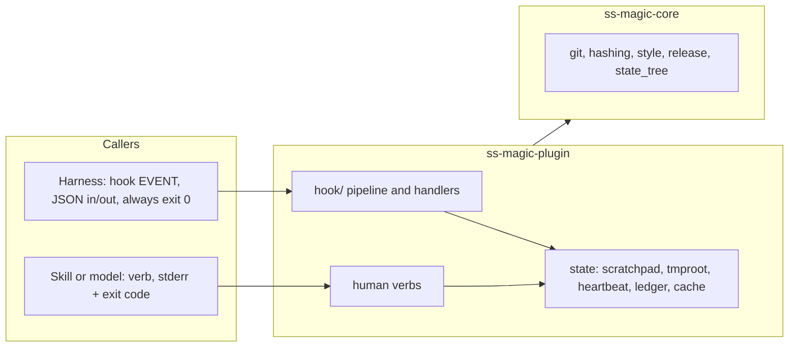
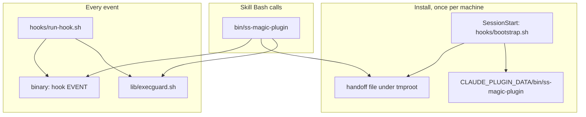

# ss-magic-plugin (crate and packaged plugin tree)

Scope: the `ss-magic-plugin` binary (`crates/ss-magic-plugin/src/`, tag `ss-magic-plugin-vX.Y.Z`) and the packaged marketplace tree `plugin/` at the repository root, which this file documents because no doc file may live inside `plugin/`. Repository-wide rules live in the root [CLAUDE.md](../../CLAUDE.md).

Code rules for this subtree: [CODING_STANDARDS.md](./CODING_STANDARDS.md) – read it before writing or reviewing code here, and update it when a change establishes or retires a rule. The root [CODING_STANDARDS.md](../../CODING_STANDARDS.md) applies too.

Subtree docs:

- [src/hook/CLAUDE.md](./src/hook/CLAUDE.md) – the hook pipeline and handlers
- [src/checklist/CLAUDE.md](./src/checklist/CLAUDE.md) – the operator checklist
- [scripts/CLAUDE.md](../../scripts/CLAUDE.md) – the zip builder and shell test suites that guard `plugin/`

`ss-magic-plugin <VERB>` is a second, largely independent program. It depends on `ss-magic-core` (git, hashing, gitignore, release-check plumbing) and never on the CLI crate. Module paths below are relative to `crates/ss-magic-plugin/src/`.

## Three facts that shape every module

- **Two callers, two postures.**
  - The harness invokes `ss-magic-plugin hook <event>`: the envelope arrives on stdin, the answer is JSON on stdout (nothing else may be printed there), and a hook that cannot do its job exits 0 anyway.
  - A skill – or the person, by asking the model – invokes a named verb (`status`, `checklist`, ...): problems go to stderr with a non-zero exit, the ordinary CLI contract.
  - **Nobody types a verb in a terminal.** The binary is installed under `${CLAUDE_PLUGIN_DATA}` and kept off `PATH`; the Bash tool in a session carries the `bin/ss-magic-plugin` wrapper instead. Every `Usage:` string and every model-facing command spells `ss-magic-plugin`.
  - Keeping the postures apart is a safety boundary: no hook reaches anything that can set `plugin.enabled` (`enable`, `disable`, `config set`), so a repository cannot arrange its own enablement by getting a hook to fire. Exact shape of the claim: the bootstrap DOES invoke one config-writing verb, `seed-config`, which is safe because it has no code path to the `enabled` key; and the `SessionStart` handler spawns `release-check --refresh --quiet`, which writes only the plugin release cache in the OS cache directory and reads no configuration.
- **No update gate, no TUI, no install verb.**
  - The marketplace is the only delivery path and the binary is pinned alongside the skills, hooks and Markdown shipped with it; a mid-session self-update would leave the two describing different behavior.
  - This is structural: the crate links none of `self_update`, `inquire`, `ratatui` or `saphyr` (the CLI's YAML parser). `build-plugin-zip.py --check` plus `cargo tree --locked -p ss-magic-plugin -i <crate>` assert it mechanically.
  - What the plugin DOES do about releases is advise (R29–R33, the release-advice requirements): `release-check` reports the newest known plugin release against the pin; `SessionStart` reads the cache and tells the operator once per release, on `systemMessage`, that `/plugin` has a newer one. Nothing in the crate downloads a binary.
- **Fail-open, but fail-CLOSED on anything that could leak.** A hook that errors, panics or times out must look exactly like a hook that decided to do nothing. The gates that protect secrets invert that: an unknown answer is the refusing answer. The rules behind both halves are in [CODING_STANDARDS.md](./CODING_STANDARDS.md); do not "simplify" either half toward the other.

## Entry point

- `main.rs` (crate root) – the argv parse and the dispatch table, nothing else.
  - `HookEvent::from_token` and `HumanVerb::from_token` are the two closed vocabularies. `HookEvent::{Unknown, Missing}` are VALUES, not parse errors: a manifest from a newer plugin build can name an event this binary never heard of, and the contract is "exit 0, print nothing, record the unroutable name", which the wrapper can only do if the name reaches the binary.
  - `parse` returns `Parsed::{Invocation, Version, Help, MissingVerb, UnknownVerb}`. `run` calls `style::init_no_color()` for a hook invocation (an ANSI escape would make the JSON unparseable) and `style::init()` otherwise.
  - `HookEvent::FileChanged` parses and routes, but the shipped manifest declares no `FileChanged` entry (see [src/hook/CLAUDE.md](./src/hook/CLAUDE.md)).
  - `-V`/`--version` prints `version_line()` – `ss-magic-plugin <version>` on ONE line, exit 0 – ahead of verb parsing, and is recognized only as the FIRST token (unlike the CLI's whole-argv scan, because every verb parses its own flags). The line's shape is a contract: `hooks/bootstrap.sh` gates every install on `"$staged_bin" --version | head -1 | awk '{print $NF}'` equalling the pin, and `status.rs` probes the same flag for drift. The version must stay LAST on line one and the flag must never answer with usage text.
  - Two predicates over `HumanVerb` say different things. `writes_config` is `Enable | Disable | Config | SeedConfig`; `can_set_enabled` is `Enable | Disable | Config`. Only the second carries the safety property, because `SeedConfig` is invoked by the `SessionStart` bootstrap and `ReleaseCheck` by the `SessionStart` handler. The test `no_hook_invoked_verb_can_set_enabled` lists exactly those two as hook-invoked and asserts neither can set `enabled`. Do NOT derive "hook-reachable" from `writes_config`.

## State: where the plugin keeps things, and why there

- `atomic.rs` – the one atomic-write primitive: `write_atomically(path, body, prefix, suffix, what, mode, sync)` creates a temp file in the target's own directory, writes and flushes it, chmods when a mode is given, fsyncs when asked, then renames over the target. A reader never sees a half-written file and a crash leaves the previous file untouched. Every plugin writer (heartbeat, ledger, cache, bypass, expect_artifact, scratchpad pointer, compact_window, setup_ci, checklist verbs) goes through it.
- `pathnorm.rs` – the lexical path reduction every path-deciding gate shares, and the reason the R88 checklist deny (the PreToolUse block on reading or editing checklist files) stopped growing new bypasses.
  - `normalize` removes `.` and cancels `..` TEXTUALLY; the caller canonicalizes afterwards (that handles symlinks). The order is not interchangeable: the filesystem cancels a `..` AFTER resolving a symlink.
  - A leading `..` that cannot be cancelled is COUNTED, not pushed – a pushed one is poppable by the next `..`, so `../../x` would collapse to `x` and a path escaping its tree would quietly become one inside it. Do NOT reimplement by walking `parent()`/`file_name()`: `file_name()` is `None` for a `..` component, so such a walk skips the hop instead of cancelling it.
  - `process_view` answers whether resolving a path here means the same as resolving it there, as a property of the COMPONENT SEQUENCE, not a prefix list. `…/proc/<selector>/cwd/<rest>` is the one re-rootable form (`Cwd(rest)`); everything else below a process selector (`root`, `fd/<n>`, `task/<tid>`, `ns/…`) is `Opaque`. The FIRST selector wins, so `/proc/self/root/proc/self/cwd/…` cannot be re-rooted on another process's mount namespace. The scan covers the whole sequence because procfs is mountable anywhere.
  - `home_relative` classifies a LEADING `~`: `Own(rest)` for the current user's home (safe to expand: the hook inherits the harness's `HOME`, so the expansion is process-independent) and `Other` for `~name`, whose location only a user database knows, so it is reported unexpandable rather than guessed at `/home/<name>`. It tests the leading byte through `to_string_lossy`, so a non-UTF-8 `~name` is still caught (missing one leaves it unexpanded, the unsafe direction).
- `tmproot.rs` – the private, per-machine, cross-session temp root (R80) for coordination that predates any repository or session context.
  - `resolve_root()` is `/tmp/ss-magic-plugin/<identifier>/`, falling back to `$TMPDIR`. `identifier(home)` is the first 16 hex chars of SHA-256 of `$HOME` exactly as read, matching the shell bootstrap's `shasum -a 256` byte for byte.
  - A predictable path is NOT evidence of ownership: each managed component is `lstat`ed (never followed) and must be a real directory owned by this process's euid (raw `geteuid()`, not a shelled `id -u`) at mode exactly 0700. Any failure makes that base entirely unusable rather than writing into a root someone else could control.
  - `with_lock` BLOCKS (unlike the self-updater's skip-on-contention lock) because concurrent hook handlers must coordinate, not silently skip; `try_with_lock` is the non-blocking variant. `flock` releases on process death, so there is no stale-lock reclaim.
- `identity.rs` – the deterministic `<repo>-<branch>` slug, derived from git alone, never from the Superset workspace name (which can be silently renamed). `resolve(cwd)` returns `None` outside a git repo: no fallback identity, the plugin does nothing. The repo half is `ss_magic_core::reponame::repo_name_stem`, the same derivation the CLI's `pack.rs` uses, so the two cannot disagree. The branch half slugifies HEAD, falls back to `detached-<short-sha>`, and strips diacritics so a precomposed and an NFD-decomposed branch name resolve to the SAME directory.
- `scratchpad.rs` – the per-worktree state tree at `.superset/.magic/` (`STATE_REL`): `sessions/<slug>/` with the six model-owned `STATE_FILES` (`CONTEXT.md`, `DECISIONS.md`, `LEARNINGS.md`, `OPERATOR-CHECKLIST.md`, `STATUS.md`, `TASKS.md`), the `current.json` pointer, and the `conclusions/`, `bypass/` and `expect-artifact/` stores.
  - **Scaffold, never rewrite**: an existing state file is left byte-for-byte alone and only a missing one is created (`create_new`, so a race cannot clobber). Only `current.json` is rewritten each run, under an fd-lock plus temp-file-then-rename so a lock-free reader never sees a half file.
  - **Never adopt a tracked path**: POSITIVE tracked determination via `git::tracked_files`, so an unenumerable name fails closed as tracked-and-skipped.
  - **Write nothing until git says the tree is ignored**: `ensure` refuses on "git says no" AND "git could not be asked", using `git::is_ignored_no_index_str` so a tracked file inside the tree does not trigger a blanket refusal.
  - Every path is containment-checked (`verify_contained`: an existing symlink must canonicalize inside the worktree root or the write is refused; checked for the `.superset` and `.superset/.magic` ancestors before creation). Dirs are 0700, files 0600 – defense in depth, NOT the sync-exclusion control, which is `sync::EXCLUDED_TREES` in core.
  - `Refusal` and `Report` carry the outcome outward. `STATE_REL` and `ensure_state_ignored` are re-exports of core's `state_tree`, the ONE place the `.superset/.magic/` gitignore rule is written: init/migrate call it eagerly, `enable` / `config set` call it lazily, no hook ever calls it. A core test pins `STATE_REL` equal to the `.superset/.magic` entry of `EXCLUDED_TREES`.
- `claim.rs` – the exactly-once file claim both one-shot stores are built on. `take(dir, path)` creates a private landing file in the SAME directory and `fs::rename`s the claim onto it; `rename` requires its source to exist, so exactly one racing caller wins. Deliberately NOT built on `unlink`'s `ENOENT` (see [unlink-is-not-an-exclusive-claim.md](../../docs/solutions/logic-errors/unlink-is-not-an-exclusive-claim.md)).
- `heartbeat.rs` – the append-only machine-level `hooks.jsonl` every hook invocation leaves a `Row` in (no-ops and failures included); `status` reports last-fired-at and outcome counts from it.
  - It lives under `directories`' DATA dir, not the cache dir (a history swept by disk cleanup would be worse than none), and outside any worktree so rows outlive worktree deletion.
  - `append` holds an exclusive `tmproot::with_lock` covering append AND prune, since a prune rewrites the file wholesale.
  - `prune` keeps the newest `ROWS_KEPT` (2000) rows and drops anything older than 30 days, but keeps a row stamped in the FUTURE (a backward clock jump). It fires only once the file passes `PRUNE_TRIGGER_BYTES` (256 KiB), so the common case costs one `stat`. A prune failure never fails an otherwise-good append.

## Human verbs

One module per verb family. All are invoked through the wrapper, never typed.

- `config.rs` – the typed `plugin` key in the overlaid `magic.json` and the write path behind `enable` / `disable` / `config get` / `config set [--local]`.
  - `resolve` is infallible by design: every malformed field degrades to a safe default and an out-of-range number CLAMPS rather than rejecting, so a typo can never make the gate more permissive than configured.
  - `enabled` is always read from the MAIN CHECKOUT's overlay regardless of cwd (a worktree's own `magic.local.json` is itself a forward-sync target); `gate` resolves against the cwd root. `resolve(cwd_root)` finds the main checkout with the `git rev-parse --git-common-dir` probe (human verbs); `resolve_with_roots(cwd_root, main_root)` takes roots already discovered (the hook pipeline, so the enablement gate costs no subprocess on the fast path). `None` falls back to the cwd root's own overlay.
  - Writes are load-modify-write on exactly one file, preserving every unknown key, and all go through `write_plugin_key`, which REFUSES (as an error, before reading) a target that resolves outside the repository through a symlink, on the file or on `.superset`. The decision is `landing(target_root, local)`: canonicalize the root and the deepest EXISTING component of `.superset/<file>` (the file, else `.superset`, else nothing – a fresh create cannot be redirected) and require the second inside the first. A repository behind a link such as macOS's `/tmp` still passes; an in-repo link is written through. The check lives in the one writer so `enable`, `disable`, `config set`, the seed and any future verb cannot skip it. The hazard: a repository committing `.superset/magic.json` as a link to a JSON file the person owns (a harness settings file) would have a verb load THAT file, fold in a `plugin` key and write it back.
  - Every writer takes the one `magic-json.lock` under the R80 temp root (tmproot) around its load-modify-write (`write_locked`): human verbs BLOCK on it, `seed-config` uses `try_with_lock` and defers to the next session on contention (it runs from a hook). Without the lock a seed that loaded the file just before `enable` wrote `plugin.enabled` would write its copy back and drop the key.
  - `enable` prints `compact_window::enable_tip` after success: one line naming `compact-window --recommend`, only when neither project settings file configures a window, never a write.
  - `seed-config` (R3a, the one-time gate-defaults write) exists because the CLI has no verb tree, so there is no terminal path to the configuration verbs; the install makes the settings visible in the tracked file instead. `seed_block()` is the ONE place the block's shape is decided – `{"gate": {"threshold_lines", "inline_byte_budget", "exemptions"}}`, built field by field from `GateConfig::default()` as a literal map, not serialized from a struct, so the writer is structurally incapable of emitting `enabled`. `seed_config_at` is the pure half, and its bounds are tests:
    - never writes `enabled` (absent already reads as off; writing `false` would look like a decision about enablement, which a hook-run verb must not make);
    - never stages (the block shows in `git status` as an ordinary edit – it is surfaced, not slipped in);
    - writes only when `load_magic_json` returns a config with no `plugin` key at all: strictly once, never fights a hand edit;
    - never creates the file – absent OR unparseable both read as `SeedOutcome::NotAWorkspace` (an unparseable `magic.json` is far more likely a merge conflict than an invitation to rebuild);
    - never writes through a symlink leaving the repository (`SeedOutcome::OutsideRepository`, via `landing`: `Existing` seeds, `Outside` is that outcome, `Fresh` is `NotAWorkspace`);
    - uses the typed load-modify-write, so `MagicConfig`'s flattened `extras` preserve other keys (values, not byte order).
    All four `SeedOutcome` variants are normal results, never errors: the verb runs unattended in whatever repository the session is in. It seeds `root`, the CURRENT checkout's root, not the main checkout's, because `gate` resolves against the cwd root's overlay.
- `cache.rs` – the conclusion cache behind `conclude` / `conclusions` / `gc`. `identify` keys an entry on `(realpath, size, stamp)` – NEVER the read's offset or limit, so a conclusion about a file answers every later read of it. `envelope` wraps rendered content in nonce-keyed untrusted-data markers with the framing text BEFORE the quoted body; shared with the checklist renderer and the transcript salvage, because all three inject repository-authored text into a model's context. `prune`/`gc` are best-effort and never fail the caller.
- `bypass.rs` / `expect_artifact.rs` – the two one-shot stores built on `claim::take`.
  - `bypass <FILE>` lets exactly the next gated Read of a resolved path through (`MAX_AGE_SECS` 24 h; an expired claim is still consumed but does NOT open the gate, so it cannot bypass indefinitely).
  - `expect-artifact <FILE> [--note TEXT]` declares an output a later subagent must produce (6 h, shorter because it waits only for a machine-paced stop; an expired record is dropped, not enforced, since blocking an unrelated agent hours later is worse than not enforcing).
  - Both resolve and containment-check the path at DECLARE time, write records atomically at 0600, and inherit the scratchpad's ignore-gate refusal so a record never appears as an untracked file in the working copy.
- `ledger.rs` – the machine-level `cost.jsonl` and the `cost [--here] [--backfill REF] [--json]` verb.
  - One row per session id, enforced under an fd-lock held for the commit only (the scan runs outside it). The scan is incremental via a byte-offset store keyed on inode plus size, so a rotated transcript forces a full rescan instead of reading garbage.
  - Pricing: the harness's own `cost-state` figure is a cumulative FLOOR (take the max; add table pricing for the main thread only when no harness figure exists, or the cost double-counts). Cache-write tokens split 5 m (1.25x) versus 1 h (2x); reading only the flat total undercounts. `Basis` records which of the two priced a row.
  - Each row carries `peak_context_tokens` (R26): the largest `input + cache_read + cache_creation` of any ONE assistant message on the MAIN transcript (subagents run in their own windows), kept as a running maximum across incremental scans (`build_row` folds `max(prior, tail)`; a full rescan starts over). `None` for a row written before the field existed or a session with no assistant message, and a `None` is ignored, never read as zero.
  - `rows_for_repository(store, main_root, limit)` is the recommendation's population: rows whose `root` (or any `also_roots`) `git::discover`s to the same main checkout, so all worktrees of one repository pool and a deleted worktree drops out (a root no longer a directory is answered before discovery would spawn a fallback probe), newest first.
- `status.rs` – the one place that answers "why is the plugin not doing anything", across every silent-failure path: config disabled, harness registration missing or disabled, state tree not gitignored, binary not installed, manifest-versus-binary drift.
  - Read-only – never calls `scratchpad::ensure`, creates a store, or adds a gitignore rule – and exits 0 whenever a report was produced, so a script parsing `--json` never special-cases an exit code. Every null JSON value carries a non-null `note`; `acting` is `None` rather than a guess when the harness layer is unknown. Harness and binary probes are time-bounded and degrade to a note.
  - `DECLARED_EVENTS` lists the five events the manifest registers and deliberately excludes `file-changed`. `PIN_FILE` is `ss-magic-plugin.version`, `BINARY_REL` is `bin/ss-magic-plugin`; the drift probe runs `--version` and reads the LAST field of the FIRST line (hence the contract above).
  - `compaction` section (R27) is `compact_window::recommend_report` as four `Field`s (override and where found, the two windows, the recommendation with its basis) and adds ONE `problems` line, only when the override is set AND no window is configured. `Inputs.compaction` carries the `Sources` so tests point at a fake home.
  - `Versions` has `newest_release` (the release cache's tag with "checked <when>, fresh/stale", or a note when the cache is absent, holds no plugin tag, or no cache dir resolves) and `update_available: Option<bool>` against the pin – read from `Inputs.release_cache` at `Inputs.now`, never refreshed by `status`, never a `problems` line (an available update is information, not a fault). A pin that is not a plain triple makes it `None` (unknown), never `false`, the same answer `release-check` gives.
  - Created-nothing rule: the cache path comes from the NON-creating `release_check::existing_cache_file` (core's `release::existing_cache_dir`), and the heartbeat store from the non-creating `heartbeat::existing_store_dir` (shared with `--recommend`); the writers' `cache_dir()` would scaffold directories.
  - `SCHEMA_VERSION` is `2` (`versions.running`, `newest_release`, `update_available`, top-level `compaction`); bump it when the report shape changes so readers can tell.
- `spill_index.rs` – strictly read-only listing of the harness's own oversized-tool-output files for this worktree (unguessable names, no index). An empty result carries a note distinguishing "nothing found" from "could not locate the directory".
- `release_check.rs` – the plugin line's release cache and the `release-check [--refresh] [--json] [--quiet]` verb (R32, R33), plus the pure pieces the `SessionStart` suggestion is built from.
  - The cache is core's `PLUGIN_LINE.cache_file` (`plugin-release-check.json`) in the shared `ss-magic` cache dir, written ONLY through `write_cache` → `atomic::write_atomically` at 0600, because it has two writers (the refresh and the hook's `suggested` marker) and a lock-free reader (the hook).
  - `LOCK_NAME` (`release-check.lock`, under the R80 temp root (tmproot)) is the ONE lock both writers take with `try_with_lock` – never the blocking variant: a hook must not wait on a 5 s fetch, and a refresh skipped this session runs next session.
  - `refresh_with(client, lock_root, cache_file, now)` reads the prior record INSIDE the lock (so a marker the hook just wrote is carried forward), runs core's `refresh_cache`, writes, and reports `Ran(outcome)` or `Busy`. `record_suggested(lock_root, cache_file, tag)` re-reads under the same lock and answers `Written`, `AlreadyRecorded`, `Superseded` (the cache's tag moved) or `Busy`.
  - `spawn_detached(exe, args)` (R30) is own process group, stdio null, child dropped, pid returned; `spawn_refresh` points it at `current_exe()` with `REFRESH_ARGV` (`release-check --refresh --quiet`), the one argv both the hook and the verb's parser agree on.
  - The verb is the ONLY place in the crate an HTTP client is built (`UreqReleaseClient::for_product("ss-magic-plugin", …)`), and only under `--refresh`. `--quiet` prints nothing; exit is 0 on every path that produced a report, a failed fetch included (R33); only an unknown argument exits 2.
  - The report names the newest known tag, cache age and freshness, the pin (`${CLAUDE_PLUGIN_ROOT}` first, then the harness registration's `installPath`, the same way `status` finds it; the harness probe runs only when the variable is absent), the running version, whether an update is available, whether the notice was already shown, and what `--refresh` did; every null carries a note.
  - `REMEDY` is the operator text shared by the notice and the report and ends in "start a new session", not `/reload-plugins` alone: a reload re-registers the plugin but keeps the old binary until a fresh session's bootstrap swaps it. Nothing here installs anything.
- `setup_ci.rs` – writes `.github/workflows/ss-magic-checklist.yml` from the embedded `assets/workflow/checklist.yml`, pinning the running binary's version. `classify` returns `State::{Absent, Identical, PinStale, Differs}`; only `Differs` (a local edit) needs `--force`; `--check`/`-n` reports without writing. `PinStale` is proved by re-rendering the template at the version found in the file and requiring an exact byte match. Written 0644 (committed content, unlike the 0600 state tree). The template is on the PLUGIN's line: `VERSION_PLACEHOLDER` is `@SS_MAGIC_PLUGIN_VERSION@`, `PIN_KEY` is `SS_MAGIC_PLUGIN_VERSION:`, the workflow downloads `ss-magic-plugin-<target>.tar.gz` from an `ss-magic-plugin-v$VERSION` release (verifying its `.sha256` sibling) and runs `ss-magic-plugin checklist verify` / `render-md`. A `v$VERSION` tag would name a different release entirely, because the plugin's version never equals the CLI's.
- `compact_window.rs` – two halves, and the split IS the safety story (R28).
  - `compact-window --set <TOKENS>` writes an absolute `autoCompactWindow` into the per-machine gitignored `.claude/settings.local.json`, never the tracked `.claude/settings.json`. Strictly opt-in (no flag prints usage and does nothing); never clobbers an existing value (an explicit `null` is NOT a value – it reads as unset, exactly as `read_window` reads it, so the verb every other surface points a `null`-window user at actually writes); load-modify-writes so unrelated harness keys survive; refuses rather than rebuilding a malformed file. It is the ONLY settings write in the module, and it also appends the `.claude/settings.local.json` ignore rule to the repository's `.gitignore`.
  - `compact-window --recommend [--json]` (R24) is read-only and writes nothing (a test snapshots the repository tree, a fake home and the store before and after). It reports whether `CLAUDE_AUTOCOMPACT_PCT_OVERRIDE` is set and WHERE (process environment, then the `env` block of `${CLAUDE_CONFIG_DIR:-~/.claude}/settings.json`, the project's two files, the platform's managed-settings file – `Sources` carries these paths so tests use tempdirs), the window each project file configures, and a recommendation with the exact `--set` command.
  - The recommendation (R25, KTD11) is `recommend(peaks)`: over the newest `RECOMMEND_ROWS` (20) ledger rows attributable to this repository that carry `peak_context_tokens`, `clamp(ceil_to_10000(1.25 × max_peak), 100000, 1000000)` in INTEGER arithmetic (`(max*5).div_ceil(4)`, so `1.25 × 80000` stays exactly 100,000 instead of a float rounding to 110,000). Three or more rows are `high` confidence, one or two `low`, none gives no number and generic range guidance – never a made-up figure.
  - `recommend_report` is the shared report `status`'s compaction section uses; `window_configured` / `enable_tip` are the helpers other advisory surfaces key on. Every advisory surface says the override is the person's to remove by hand; nothing in the crate edits the user's settings, a managed settings file, or the tracked project file.

## The packaged plugin/ tree

This section documents `plugin/` here because NO CLAUDE.md or CODING_STANDARDS.md may live inside it: `scripts/build-plugin-zip.py` packs every file under `plugin/` (only `.DS_Store` excluded) into the shipped, digest-pinned marketplace zip, so a doc there would ship to every user and force a plugin release. Rules for these files are in [CODING_STANDARDS.md](./CODING_STANDARDS.md); the builder and its tests are in [scripts/CLAUDE.md](../../scripts/CLAUDE.md).

Inventory: `.claude-plugin/plugin.json`, `hooks/hooks.json`, `hooks/bootstrap.sh`, `hooks/run-hook.sh`, `bin/ss-magic-plugin`, `lib/tmproot.sh`, `lib/execguard.sh`, `skills/`, `ss-magic-plugin.version`. `.claude-plugin/marketplace.json` (at the repository root) pins the packed zip by SHA-256; `assets/workflow/checklist.yml` is embedded by `setup_ci.rs`, not shipped from `plugin/`.

- `hooks/bootstrap.sh` installs the pinned binary into `${CLAUDE_PLUGIN_DATA}` – never `${CLAUDE_PLUGIN_ROOT}`, which is version-scoped and replaced wholesale on each plugin update.
  - No `set -e`; every path ends in `exit 0`; prints NOTHING on stdout on success (a SessionStart hook's stdout enters the model's context every session, so silence is a token-budget rule); never touches an existing binary on a failing install.
  - Fetches the platform release ARCHIVE directly – `ss-magic-plugin-<triple>.tar.gz` from `.../download/ss-magic-plugin-v$pin/`, resolving `ss-magic-plugin-<triple>/ss-magic-plugin` inside it – verifies it against the archive's published `.sha256` before extracting, and refuses the install unless the staged binary's `--version` reports exactly the pin. It does NOT fall back to piping `ss-magic-installer.sh` into a shell: the release publishes `.sha256` siblings for archives but not for the installer, so that would be the one executed artifact no digest covers.
  - `seed_config` invokes `"$bin_path" seed-config`, discarding both streams and the exit status (R3a pre-seeding of the `plugin` block). It is called from every point where a usable pinned binary is known to exist: the already-installed fast path, the re-check under the install lock, and the end of a fresh install. Why three sites: the binary installs once per MACHINE but the block must be seeded once per REPOSITORY, and `already_installed && exit 0` returns early on every later session. The once-ness lives in the binary (no `plugin` key at all), so repeat calls cost a read and an exit and need no marker file. `scripts/test-bootstrap.sh` pins both halves: a second repository on a provisioned machine IS seeded; a failed install (or failed upgrade over a working install) seeds nothing.
  - No cleanup of a stale `${CLAUDE_PLUGIN_DATA}/bin/ss-magic` from an older layout: nothing spawns it, so it is inert, and a bootstrap that deletes files is a new failure mode on a path that must never fail a session.
- `hooks/run-hook.sh` is the shim the five EVENT hooks are spawned through – every `hooks.json` entry except the `SessionStart` bootstrap.
  - Why it exists: `${CLAUDE_PLUGIN_DATA}/bin/ss-magic-plugin` does not exist until the bootstrap fetches it, and hooks on one event fire CONCURRENTLY. A manifest naming the binary directly makes the harness `posix_spawn` a missing path and the session dies with ENOENT on a first install. The binary's own name changes nothing: it is still fetched at runtime.
  - Why the bootstrap must NOT go through it: the shim does nothing when the binary is absent and the bootstrap is what installs it; routing it through the shim leaves the plugin inert forever rather than for one session. `--check`'s `hooks spawn through the shim` line plus `test-bootstrap.sh` assert both over every entry (a deliberate duplicate; change both or neither).
  - Contract (R77): every hook INERT for that session. The binary implements fail-open itself, but that code is unreachable when the binary is the missing thing, so the guarantee lives in a script shipped inside `${CLAUDE_PLUGIN_ROOT}`, which always exists. Silent on BOTH streams (unlike the wrapper, which explains itself on stderr) because `PreToolUse` fires on nearly every tool call and a `SessionStart` hook's stdout enters the model's context. Shares `lib/tmproot.sh` with the bootstrap and wrapper rather than reimplementing the handoff lookup.
- `lib/execguard.sh` holds `ss_magic_is_loadable_executable`, the single answer to "will the kernel actually run this file", sourced by BOTH the shim and the wrapper.
  - `[ -x ]` alone is true for a directory with the search bit and cannot see execve failing. The dangerous case is ENOEXEC: bash does not report failure but REINTERPRETS a damaged binary as a shell script and exits with whatever those bytes parse to (measured over 30 corrupted binaries on bash 3.2: exit 2 about half the time, and exit 2 from `PreToolUse` means BLOCK the tool call). One shared definition prevents the drift where one caller keeps the weaker test.
  - It matches the magic number (ELF, Mach-O 32/64 and universal, or `#!`). The failure directions are deliberately opposite: an unrecognised FORMAT fails closed (refuse), a missing `od` or `tr` fails OPEN (proceed), because refusing there would silently disable the plugin on a machine merely lacking a utility. Callers still `shopt -s execfail` for exec failures no file test can see.
  - `hooks/bootstrap.sh` does not use it: at install time it runs the staged binary and refuses unless it reports the pinned version, which is strictly stronger.
- `bin/ss-magic-plugin` is the wrapper every skill invokes. It `exec`s the installed binary with argv VERBATIM (the binary's argv starts at the verb, so `ss-magic-plugin checklist list` is exactly what the binary sees). Its name is deliberately `ss-magic-plugin`, not `ss-magic`: a wrapper called `ss-magic` would resolve non-deterministically against a user's own install and hand a skill the sync CLI's update gate and TUI. It finds the binary through a durable handoff file under the tmproot, because `${CLAUDE_PLUGIN_DATA}` is exported to hook and MCP processes but NOT to the Bash tool.

### Content pin and version bumps

- The packaged tree is **content-pinned**. Any change under `plugin/` moves the zip's digest, so it must be followed by `python3 scripts/build-plugin-zip.py --update-manifest` and then `--check`, and by a version bump on every surface of the `ss-magic-plugin` group: `crates/ss-magic-plugin/Cargo.toml`, the `ss-magic-plugin` entry in `Cargo.lock`, `plugin/.claude-plugin/plugin.json`, `plugin/ss-magic-plugin.version`, both the tag and the asset name in `.claude-plugin/marketplace.json`'s release URL, and the literal zip filename in this crate's `[[package.metadata.dist.extra-artifacts]]`. `--check` enumerates the surfaces; do not work from a remembered count.
- The resolved VERSION, not the digest, is the harness's update signal: changing the zip without bumping the version leaves every installed user silently on the cached copy.
- The plugin version must never equal the CLI's (`--check`'s `distinct release lines`); see the root [CLAUDE.md](../../CLAUDE.md) for the two release lines.
- Bump the group for any change under `plugin/` or in `crates/ss-magic-plugin/`.
