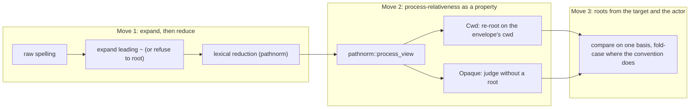

# Coding standards: the Claude Code plugin

The rules code in the `ss-magic-plugin` crate AND the packaged `plugin/` tree follows, adding to the repository-wide [CODING_STANDARDS.md](../../CODING_STANDARDS.md).
`plugin/` cannot hold its own copy of this file: every file there ships in the digest-pinned marketplace zip, so a doc placed there would move the pin and reach every user's machine.

Each rule is a defect class an author must avoid while writing and a reviewer can see in a diff. Code review checks every change against it.

## Hook posture

- **A hook fails open, structurally.** `hook::run` has no path to a non-zero exit, a handler panic is caught with `catch_unwind`, and an event name this binary does not know is a value (`HookEvent::Unknown` / `Missing`), never a parse error – a manifest from a newer build may name it, and the contract is "exit 0, print nothing, record the name". An error, a panic or a timeout must look to the harness exactly like a hook that decided to do nothing. Do not add a `?` or `bail!` that can escape `hook::run`, remove the panic catch, or turn an unroutable event into an error. (A source-scan test refuses a non-zero exit expression in `hook/mod.rs`.)
- **A gate that protects secrets or state fails closed.** The state-tree ignore gate refuses on "git says not ignored" AND on "git could not be asked"; the tracked-path check decides tracked-ness POSITIVELY, so a name git cannot enumerate counts as tracked and is skipped; the temp-root ownership check refuses a base it cannot verify (the general rule is in the root [CODING_STANDARDS.md](../../CODING_STANDARDS.md)). Fail-open hooks and fail-closed gates pull in opposite directions and both are load-bearing – never "simplify" either toward the other. A purely advisory gate (the Read size gate) is the opposite case: every uncertain stat, resolution or cache lookup falls through to allow.
- **Hook stdout carries the JSON response and nothing else.** A hook invocation runs with color forced off (`style::init_no_color`), because one ANSI escape makes the response unparseable. Handlers return a `Response`; they never print, and their diagnostics go through `HookContext::diagnostic`, flushed to stderr after dispatch. A `println!`, a progress line or unconditional color init on the hook path corrupts the answer.
- **A hook can deny, never grant or rewrite.** `PermissionDecision` has only a `Deny` variant, no `Response` carries an `updatedInput` rewrite, and the silent events (`PreCompact`, `SessionEnd`) have no `Response` variant at all. These are type-level guarantees; adding an `Allow`/`Ask` variant, a rewrite channel or a response for a silent event removes them.
- **Verbs and hooks keep their own contracts.** A named verb reports problems on stderr with a non-zero exit, like any CLI; a hook always exits 0. Nobody runs a verb in a terminal – the binary lives under `${CLAUDE_PLUGIN_DATA}`, off `PATH` – so no code writes a plugin tree onto the machine (a test pins that no install verb parses).
- **No network on the hook path.** `SessionStart` reads the plugin release cache from a file; when it is missing or stale it spawns `release-check --refresh --quiet` detached (own process group, every stream on `/dev/null`, child dropped) and returns without waiting. Never block on that child, and never spawn it on a quiet session, on any source but `startup`, or without a pin. (A source-scan test refuses an HTTP client or fetch function named in `hook/`.)
- **Operator notices go on `systemMessage`, decided by one quiet-mode verdict.** `hook::quiet_mode` is quiet only on `permission_mode` `bypassPermissions` / `dontAsk` or a `CLAUDE_CODE_ENTRYPOINT` other than `cli`; ABSENT signals mean NOT quiet, because a wrong "not quiet" costs one bounded line while a wrong "quiet" hides the notice from every harness that omits a field. Do not invert the default, add a headless heuristic on suspicion, or put an operator notice on the model-facing `additionalContext`.
- **Model-facing text names the `ss-magic-plugin` wrapper.** Every command a hook tells the model to run – deny reasons, nudges, `additionalContext` – and every verb's `Usage:` string spells `ss-magic-plugin`, never a bare `ss-magic`: the model runs it through the Bash tool, where `${CLAUDE_PLUGIN_DATA}` is not exported and only the wrapper resolves. A bare name reaches nothing on a marketplace install, so a conclusion is never recorded and a bypass never consumed. A test asserts it over every deny reason and CI greps skill bodies; any other new model-facing string needs the same care.
- **Repository-authored text reaching a model is enveloped and bounded.** Checklist prose, cached conclusions and salvaged transcripts go through the shared nonce-keyed untrusted-data envelope (`cache::envelope`, framing text BEFORE the quoted body). A list whose size the repository controls (for example the tracked-paths refusal at session start) is capped before it enters a hook response, so a repository cannot push the injection past its budget.
- **The commit nudge is advice only, narrowly matched.** It matches a command whose trailing words are `git commit`, `git push` or `gh pr create` – not `gh pr view` / `list` / `diff`, which open nothing – fires only when git status shows a candidate checklist untracked or edited-but-unstaged, sets `additionalContext` and NEVER a decision, and says the command was not blocked.

## Enablement and config writes

- **No hook may reach anything that can set `plugin.enabled`.** That, not "no hook writes configuration", is the property, because `seed-config` does write configuration from the `SessionStart` bootstrap. `HumanVerb::can_set_enabled` marks the verbs that can reach the key; `writes_config` is broader and must never be used to decide hook-reachability. A hook, or a script a hook runs, that starts invoking a new verb adds it to the hook-invoked list the `no_hook_invoked_verb_can_set_enabled` test asserts over.
- **`enabled` is read from the main checkout; `gate` from the cwd root.** A worktree's own `magic.local.json` is a forward-sync target, so resolving `enabled` from the worktree would let synced bytes switch the plugin on.
- **Config resolution never fails and never widens.** Every malformed field degrades to a safe default and an out-of-range number is CLAMPED, so a typo can neither hard-fail a session nor leave a gate more permissive than configured.
- **Every `magic.json` write goes through the one writer, under the one lock.** `write_plugin_key` is a load-modify-write on exactly ONE layer that preserves unknown keys (the typed config's flattened extras) and stays inside the `plugin` key; it takes the shared `magic-json.lock` under the per-machine temp root (human verbs block on it, `seed-config` uses the non-blocking variant and defers to the next session, because a hook must never wait) and replaces the file by rename. Without the lock, a seed that loaded the file an instant before `enable` wrote would write its copy back and drop `plugin.enabled`.
- **The outside-repository refusal lives inside the one writer.** `config::landing()` canonicalizes the repository root and the deepest EXISTING component of `.superset/<file>` (the file, else `.superset`, else nothing – a fresh create under the root cannot be redirected) and requires the second inside the first, so a repository behind a link such as macOS's `/tmp` still passes and an in-repo link is written through onto its target; and it runs inside `write_plugin_key`, so `enable`, `disable`, `config set`, the seed and any later verb cannot reach the file without it. A check placed in each verb instead left every writer but the seed uncontained: a repository committing `.superset/magic.json` as a link to a JSON file the person owns had that file rewritten with a `plugin` key folded in.
- **The seed is structurally unable to touch enablement.** `seed_block` is built field by field as a literal map from the gate defaults, never by serializing a config struct (a derive would follow whatever fields the struct grows next). Its other bounds – never stages, writes only when there is no `plugin` key at all, never creates or rebuilds the file, never writes through an outside-repository link, preserves every other key – are each pinned by a test. Every outcome is a normal value, never an error, because it runs unattended in repositories that mostly are not workspaces.
- **Machine-local state is owner-only.** Files the plugin writes into the state tree, its stores, its caches and the ledger are created 0600 in directories at 0700 – defense in depth, not the sync-exclusion control (that is the excluded-trees rule). Only committed content, such as the CI workflow `setup-ci` writes, is 0644.
- **State-tree writes wait for git's word and never rewrite.** Nothing is written under `.superset/.magic/` until git confirms the tree is ignored by its RULES (`git::is_ignored_no_index_str`, so a tracked file inside does not read as "unignored"). Model-owned state files are created with `create_new` only when missing and otherwise left byte-for-byte alone; a tracked path is never adopted; every path is containment-checked (canonicalizes inside the worktree root) before creation. Core's `state_tree::ensure_state_ignored` is the one writer of that ignore rule and no hook calls it (a source-scan test checks the hook side).
- **A report flag that callers read as "safe to write" is set only after the last refusal check.** A scratchpad report that said the state tree was written while a later containment check refused let a caller write a bypass claim through the very symlink that had been refused. Clear such a flag on every refusal path.
- **Whole-file writes go through `atomic::write_atomically`.** Temp file in the target's own directory, flush, optional chmod and fsync, rename. Never hand-roll that sequence in a module: hand-rolled copies drift, and a truncating settings write sat unnoticed beside them until a cleanup consolidated them all into this one helper.
- **Compaction advice is read-only; `compact-window --set` is the single settings write.** `--recommend`, `status`, `enable`'s tip and the `SessionStart` notice write nothing. `--set` writes only the gitignored `.claude/settings.local.json`, never over an existing value – an explicit `null` reads as unset, exactly as every reader treats it – and refuses a malformed file rather than rebuilding it. Nothing edits the user's, the tracked project's or a managed settings file, or removes the override. The recommendation arithmetic is integer (`(max * 5).div_ceil(4)`), because a float turns `1.25 × 80000` into 110,000. A test for a read-only report snapshots the tree before and after.

## Exactly-once claims

- **Never build "consume exactly once" on `unlink`'s result.** Concurrent `unlink`s of one path can each report success (measured: 8 threads racing to unlink one path produced up to 5 successes across 20 trials, while `claim::take` gave exactly one winner in every trial), while sequential testing shows exactly the `ENOENT` you expect – which is what makes it dangerous; the one-shot bypass token was built on it and would have admitted every concurrent Read that raced it. Claim with `claim::take` (rename onto a private landing file in the SAME directory – `rename` needs its source to exist, so one caller wins), with `create_new` where the claim is a file's creation, or under a lock. See [docs/solutions/logic-errors/unlink-is-not-an-exclusive-claim.md](../../docs/solutions/logic-errors/unlink-is-not-an-exclusive-claim.md).
- **A once-only marker is claimed, never checked then written.** `exists()` followed by a write lets two sessions starting together both announce; claim the marker with `create_new` and read `AlreadyExists` as "already shown". The same holds for a header or entry whose newness decides what is written (decide it from the open itself). Write such a marker only on the path where the notice actually went out, and withhold the notice when there is nowhere to record it.
- **Record, then announce.** The once-per-release suggestion is written to the cache's `suggested` field under the shared non-blocking `release-check.lock`, re-reading the cache inside the lock, and the notice goes out only when that write returned `Written`. Contention, a superseded tag, no lock root or a write error withholds it for that session. Quiet mode is decided BEFORE the write, so a headless session never spends the budget. Every cache write goes through the one atomic 0600 writer, because the file has two writers and a lock-free reader, and every refresh goes through core's one cache derivation, which carries `suggested` forward unless the selected tag changed (a wholesale rebuild would re-arm the notice daily).
- **Exclusivity is tested by racing it, never by repetition.** A test for a one-shot claim, a once-only marker or a lock runs N threads (or processes) at it at once and asserts exactly one winner. A sequential test passes on the broken `unlink` claim too, because each call alone sees the `ENOENT` you expect.

## Path gates

The checklist deny is only as good as its answer to "is this path that file". Eight bypasses came from one habit: classifying from the ACTOR (the hook's process, the envelope's cwd) instead of the TARGET, and recognizing SPELLINGS instead of the property behind them. A symlinked ancestor, a case difference, a relative target, a `..` component, a `/proc/self/cwd` prefix, a leading `..`, a decoy symlink in an opaque path's tail and a leading `~` were each patched one at a time, and each patch produced the next hole. Review every change to path classification against three moves, in this order.

- **Move 1 – perform every expansion the harness performs before rooting a path, or refuse to root it; then reduce lexically, before anything else looks at the path.** A leading `~` is expanded against `HOME` on the RAW spelling, ahead of the reduction – the normalizer treats `~` as an ordinary segment, so `~/../x` would otherwise lose its `~` and come out cwd-relative. `~name` (known only to a user database) and an unset or non-absolute `HOME` make the path unrootable, never a guess at `/home/<name>`. The phrasing matters: "never trust a process-dependent resolution" covers only resolutions the code performs, and cannot catch one it OMITS – which is what the tilde was.
- **Move 2 – decide process-relativeness as a PROPERTY of the component sequence (`pathnorm::process_view`), never a prefix list.** procfs is mountable anywhere, so a `proc` component followed by a process selector counts wherever it appears; only `…/proc/<selector>/cwd/<rest>` is re-rootable, and the FIRST selector wins so `/proc/self/root/proc/self/cwd/…` cannot re-root on another process's mount namespace. Never trust a resolution whose result depends on which process performs it: `canonicalize` may ADD a denial but never CLEAR one, so a wrong answer costs a redirect to the verbs, not the deny.
- **Move 3 – derive comparison roots from the target as well as the actor.** A comparison whose two sides come from one source cannot fail a basis bug: a fixture that canonicalized its own root hid a missing-file case on macOS's symlinked `/tmp`, and that shape hid three of the eight. Resolve a not-yet-existing target through its deepest existing ancestor.
- **The lexical reduction counts leading `..` and is never a `parent()`/`file_name()` walk.** A pushed leading `..` is poppable by the next one, so `../../x` collapses to `x` – an escaping path made to look contained; `file_name()` is `None` for `..`, so such a walk skips the hop instead of cancelling it.
- **Probe before adding an expansion.** The expansion surface is bounded by measurement: `~` diverges between harness and hook (handled), `$HOME` syntax was probed and both sides treat it literally (deliberately unhandled), `/proc` is Move 2. Adding spellings on suspicion is what produced the sequence. If a ninth bypass turns up, ask which of the three moves it escaped, not which spelling to add. Cover new classification behavior at the gate, not only in `pathnorm`'s own tests (the root standard's "test the gate the user reaches"): during one fix the helper's `..` test stayed green through a revert of the gate's call to it.

## Checklist

- **The verbs are the only write path, and each is a whole-document read-modify-write.** Read, mutate one field, `canonicalize`, re-stamp `updated`, write back by rename preserving the mode, so every level's extras survive; the advisory lock spans the whole read-mutate-write (and exist-check plus write for `init`), never just the write.
- **Canonical order is a pure function of content.** Items sort by done, priority rank and created, with the id as the final tie-break, so the order is idempotent; timestamps compare through the parsed instant, never as strings (a `+02:00` stamp can sort lexically after an earlier `Z` one); section order is author-declared and never re-sorted.
- **The schema is permissive and its defaults are strict.** Every field defaults so a hand-edited file parses, defects are the validator's job, a missing `kind` means the strictest kind, and `expected` keeps absent apart from an explicit null.
- **Exit codes and severities stay distinct.** Exit 2 means the command as typed cannot be carried out; exit 1 from `verify` means the document is invalid; a `Warning` is a shape defect the next write repairs and never fails CI.
- **The pointer is untrusted, and rendering has one path.** The `.superset/.magic/checklist.json` target is validated lexically against absolute paths and `..` before use. Every surface (list, verify, render-md, nudge, CI comment) goes through the one `render()`, with prose escaped, timestamps in fixed UTC and the untrusted-data envelope applied.

## Diagnostics and reports

- **Diagnostics create nothing.** `status` and the other read-only reports never scaffold the state tree, a store, a cache directory or a gitignore rule; they read through the non-creating lookups (the writers' directory helpers create as a side effect).
- **`status --json` versions its shape, and unknown is `null`.** `SCHEMA_VERSION` is bumped whenever a key changes meaning or goes away. An answer the report cannot determine is `null` with a non-null `note`, never `false` – a pin that is not a plain triple makes `update_available` unknown, as `release-check` reports it. `status` exits 0 whenever it produced a report, and an available update is information, not a `problems` line.
- **A status note describes the failure as it is now.** `status` is the one place that answers "why is nothing happening", so a note left describing an old failure mode (a missing hook command after the shim made it exist) is worse than none. Change the note in the same change that changes the behavior.
- **The `--version` line is a cross-language contract.** The bootstrap and `status` read the last field of its first line as the version; the line's shape and the first-token-only parse are pinned by tests in the crate root's `tests.rs` – change them only together with `hooks/bootstrap.sh`.
- **A release check reports; it never installs.** `release-check` and the `SessionStart` suggestion write one cache file and print one line; no path leads from them to a download (the crate links no updater, which `cargo tree` and `--check` assert). The remedy text ends in "start a new session", because `/reload-plugins` alone re-registers the plugin but keeps the old binary until a fresh session's bootstrap swaps it.
- **`file-changed` is not a shipped hook.** The manifest declares five events and no `FileChanged`; the handler is routable by argv and tested but inert. Do not describe it as active, and do not "fix" the manifest with an entry shaped like the others – that matcher is a watch-path list, so an entry without paths can never fire.

## Packaged plugin/ tree shell assets

`--check` asserts the manifest shape, the digest pin and the version bump, and `scripts/test-bootstrap.sh` (run under `/bin/bash` 3.2 on macOS CI) asserts the bootstrap's and the shim's exit 0, silent streams and untouched existing binary on every failure path, plus the per-repository seed; the rules below are what those checks cannot see.

- **The hook manifest invariant is asserted twice; change both or neither.** Every `hooks.json` entry spawns `bash` on a script under `${CLAUDE_PLUGIN_ROOT}` – the `SessionStart` bootstrap directly, every other entry through the shim – because the binary does not exist until the bootstrap fetches it (naming it made a first session die with `ENOENT`). `--check`'s `check_hooks_shim` and the suite both assert it, deliberately.
- **"Is this runnable" has one definition: `ss_magic_is_loadable_executable` in `plugin/lib/execguard.sh`.** A bare `[ -x ]` is true for a directory with the search bit and blind to ENOEXEC, where bash reinterprets a damaged binary as a shell script and exits with whatever those bytes parse to – about half the time 2, which from `PreToolUse` means BLOCK the tool call. Both the shim and the wrapper source the one file; an inline copy, or a fix applied to one caller only, is the drift that let the wrapper keep the weaker test for a release. Its failure directions are opposite on purpose: an unrecognized magic number fails CLOSED, a missing `od`/`tr` fails OPEN (refusing would disable the plugin on a machine merely lacking a utility). The bootstrap stays exempt because running the staged binary against the pin is stronger.
- **Keep `exec`, and never silence it.** `exec` makes the harness's child pid BE the binary, so a hook timeout kills the binary instead of orphaning it – which matters most on `SessionEnd`, the hook the CLI blocks on at exit. `exec … 2>/dev/null` applies to the success path too and swallows the binary's own diagnostics; callers set `shopt -s execfail` afterwards for the failures no file test sees.
- **Silence a redirection's failure by bracing it.** In `cmd <file 2>/dev/null` the `2>` covers the command, not the shell reporting that `<file` could not be opened, so a file removed between the test and the open still leaks a diagnostic; write `{ cmd <file; } 2>/dev/null`.
- **The bootstrap never fails a session and never trusts an unverified artifact.** No `set -e`, and nothing on stdout on success (a `SessionStart` hook's stdout enters the model's context every session); the suite asserts the failure paths, not a new path a change adds. It installs into `${CLAUDE_PLUGIN_DATA}` (braced, so the harness substitutes it), never the version-scoped `${CLAUDE_PLUGIN_ROOT}`; fetches the platform release archive and verifies it against its published `.sha256`; and never pipes the installer script into a shell, even as a fallback, since no published digest covers that script.
- **The bootstrap deletes nothing it did not stage.** A stale binary from an older layout is inert once the manifest and the wrapper name the current one; migration code that removes it would add a failure mode to a path that must never fail.
- **The wrapper keeps its name and passes argv verbatim.** It must stay `ss-magic-plugin`: a wrapper named `ss-magic` would resolve against a user's own install and hand a skill the sync CLI's update gate and TUI. A missing binary is a normal state – exit 0 with one stderr line.

## Maintaining this file

- A rule enters only with evidence – a review finding the author fixed, a fix commit, a cleanup that removed the defect across the codebase, or a `docs/solutions/` record – and only when no check (a `--check` assertion, `cargo tree`, a CI grep, a test that pins the invariant) already covers it; a checked rule gets at most a one-line mention.
- State each rule as a condition that stays true without volatile numbers or symbols, give its why, and file it under its area. Link the `docs/solutions/` record when it owns the detail.
- Update this file in the same change that establishes or retires a rule.
- [.cursor/BUGBOT.md](../../.cursor/BUGBOT.md) is self-contained and restates these rules inline; update it in the same change.
