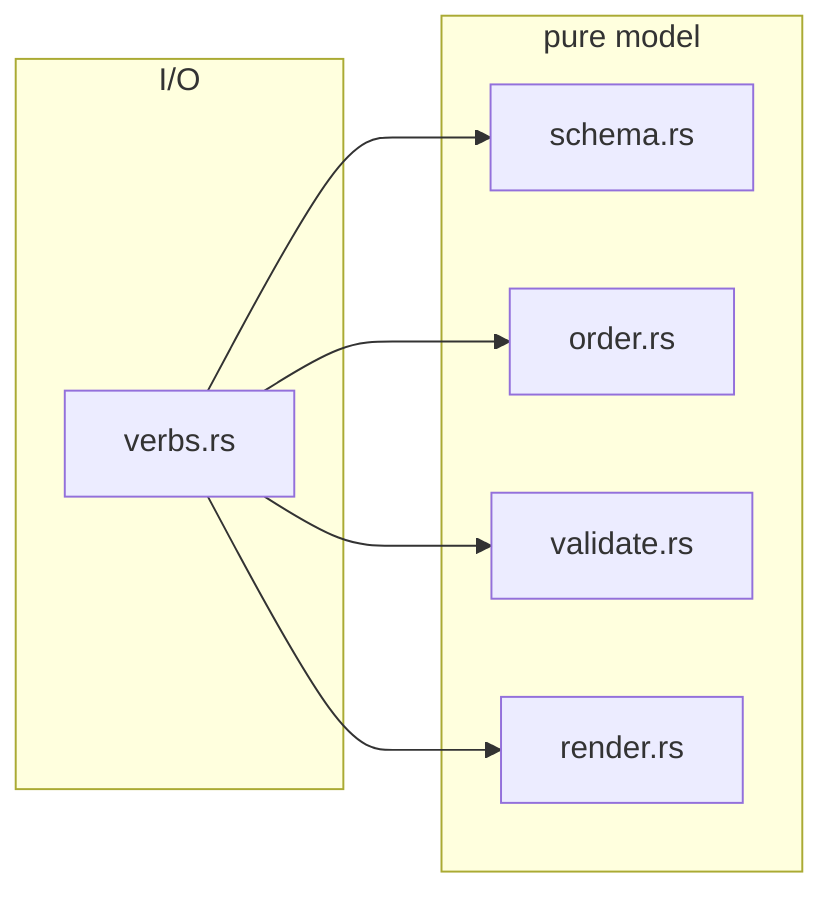

# Operator checklist (`checklist/`)

Scope: the typed document at `docs/actions/<YYYY-MM-slug>.checklist.json` and the verbs that read and write it.\
Repository-wide rules live in the root [CLAUDE.md](../../../../CLAUDE.md).

Code rules for this subtree: [CODING_STANDARDS.md](../../CODING_STANDARDS.md) – read it before writing or reviewing code here, and update it when a change establishes or retires a rule. The root [CODING_STANDARDS.md](../../../../CODING_STANDARDS.md) applies too.

## Shape

- Layered like [cache.rs](../cache.rs): a pure model, with the hook as one caller among several.
- The submodules are PRIVATE behind `checklist/mod.rs`, so no caller can bypass canonical ordering or validation.
- The `PreToolUse` checklist deny (see [hook/CLAUDE.md](../hook/CLAUDE.md)) makes these verbs the ONLY write path.

## Modules

- `checklist/schema.rs` – the `Document` / `Section` / `Item` model.
  - Every field is `#[serde(default)]`, so a hand-edited or partial file still parses (defects are the validator's job, not the parser's).
  - Every level carries a `#[serde(flatten)] extras` map, so a key from a newer build survives a rewrite.
  - `kind` defaults to the strictest `Check`, so a missing kind never silently disables verification.
  - `expected` is `Option<Option<String>>` because an absent key and an explicit null mean different things.
  - `parse_iso8601` (Hinnant's `days_from_civil`, no date crate) requires an explicit offset and rejects `24:00` and leap seconds.
  - `Timestamp` deliberately has no `Ord` – compare through `.instant()`, since `+02:00` can sort lexically after a `Z` stamp that is actually earlier.
- `checklist/order.rs` – `canonicalize` re-establishes the one arrangement a checklist is ever stored in, on every write, so a diff shows real changes.
  - Items sort by `(done, priority rank, created)` with the id as final tie-break, making order a pure function of content rather than of prior position.
  - An unreadable timestamp sorts to the end instead of aborting the sort.
  - Section order is never touched – author-declared order is render order.
- `checklist/validate.rs` – pure findings, no printing and no I/O.
  - `Severity::Error` blocks `verify` and the renderer.
  - `Warning` describes shape defects the next CLI write self-repairs and must NEVER fail CI.
- `checklist/render.rs` – the single `render()` behind `list`, `verify`, `render-md`, the commit nudge and the CI PR comment, so all five are byte-identical.
  - Every field of user-authored prose goes through `prose_inline` / `md_link` escaping.
  - The whole output is wrapped in `cache::envelope`, because checklist prose is repository-authored text that reaches a model's context.
  - Timestamps render through the shared UTC formatter, never a local clock, so output is identical across machines and timezones.
- `checklist/verbs.rs` – `init`, `add-item`, `add-entry`, `set`, `done`, `list`, `verify`, `render-md`.
  - Every mutating verb is read-modify-write over the WHOLE document (read, mutate one field, `canonicalize`, re-stamp `updated`, write back), so `extras` survive.
  - Writes are temp-file-then-rename, preserving the existing mode.
  - An advisory `tmproot::with_lock` spans the whole read-mutate-write, and for `init` spans exist-check plus write, so concurrent verbs cannot lose an update or duplicate a slug.
  - Exit codes are distinct on purpose: 2 for "the command as typed cannot be carried out", but 1 from `verify` for "the document is invalid", so CI can tell them apart.
  - The `.superset/.magic/checklist.json` pointer's contents are NOT trusted blindly: the target is validated lexically against absolute paths and `..` segments.
  - `resolve_active` falls back to the naming convention (unambiguous single match only) when no pointer exists.
