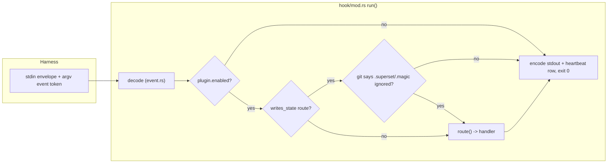

# Hook pipeline and handlers (`crates/ss-magic-plugin/src/hook/`)

Scope: the `ss-magic-plugin hook <event>` runtime – the one pipeline plus one handler per event. Repository-wide rules live in the root [CLAUDE.md](../../../../CLAUDE.md); the plugin crate's own overview (postures, state modules, verbs) is in [crates/ss-magic-plugin/CLAUDE.md](../../CLAUDE.md).

Code rules for this subtree: [CODING_STANDARDS.md](../../CODING_STANDARDS.md) – read it before writing or reviewing code here, and update it when a change establishes or retires a rule. The root [CODING_STANDARDS.md](../../../../CODING_STANDARDS.md) applies too.

The shipped `plugin/hooks/hooks.json` declares exactly five events: `SessionStart`, `PreToolUse`, `PreCompact`, `SubagentStop`, `SessionEnd`. There is no `FileChanged` entry (see `file_changed.rs` below).

## `mod.rs` – the pipeline

- The ONE pipeline: decode stdin, gate, dispatch, encode stdout, append a heartbeat row, always exit 0.
- `run` has no code path that produces a non-zero exit, so fail-open is structural. A handler panic is caught with `catch_unwind` so it cannot take the session down.
- Handlers never touch stdout or stderr themselves. Only `HookContext::diagnostic` is flushed to stderr, after dispatch; stdout carries only the harness JSON.
- `route()` is the whole routing table. Each `Route` has a `writes_state` flag.
- Two gates sit here, before dispatch, not in the handlers:
  - `plugin.enabled`, re-resolved from disk on every invocation.
  - For any route with `writes_state == true`, a fail-closed check that git reports `.superset/.magic/` ignored (git "could not be asked" refuses too). It runs only past the enablement gate and still asks git.
- The enablement gate's two roots (worktree root, main checkout) come from `git::discover::roots` (R20, the filesystem-only discovery described in core's `git/discover.rs`). On ordinary layouts it spawns nothing, so a hook that stops at that gate – nearly every `PreToolUse` – runs no `git` (a PATH-shim test proves it).
- When the walk declines, the `rev-parse` probes run and every heartbeat row from that invocation ends its `detail` with `discovery: fallback (<reason>)`, so the fallback rate is readable from `status`. `HookContext` carries the discovered `main_root` beside `repo_root`.
- `quiet_mode(envelope, entrypoint)` (KTD12 / R31: the operator-notice policy) is the shared "is anybody watching" verdict every operator notice consults.
  - Quiet when the envelope's `permission_mode` is `bypassPermissions` or `dontAsk`, or when `CLAUDE_CODE_ENTRYPOINT` (`ENTRYPOINT_ENV`) names an embedding other than `cli`.
  - ABSENT signals mean NOT quiet, deliberately: notices are one operator line each, bounded once-per-machine or once-per-release, so a wrong "not quiet" costs a line while a wrong "quiet" hides the notice from every harness that omits a field.
  - No further heuristic is layered on. The entrypoint is injected so the table is testable without touching the process environment.

## `event.rs` – the wire format

- Pure types. Decoding is permissive (unknown keys ignored, only `cwd` required) but routing is not: the argv token picks the `Payload` variant, never the envelope's own `hook_event_name`.
- Two guarantees live in the types, not in discipline:
  - `PermissionDecision` has only a `Deny` variant, so a hook can never GRANT a capability.
  - There is no `updatedInput` rewrite channel anywhere in `Response`.
- `PreCompact` and `SessionEnd` have no `Response` variant at all, so their silence is enforced by the compiler.
- `Common.permission_mode` is `Option<String>`: the harness stringifies the envelope and drops an undefined value, so absence is never read as any particular mode.
- `encode` emits the harness's field names: `hookSpecificOutput`, `hookEventName`, `additionalContext`, `permissionDecision`, `permissionDecisionReason`, `systemMessage`, and a top-level `{decision: "block", reason}` for a `SubagentStop` block.

## `session_start.rs` – scaffold plus three operator notices

- Scaffolds the scratchpad and returns the operating guidance as `additionalContext`. A hard scratchpad refusal still returns a response, just a short "not set up yet" explanation – it never claims a state file exists that does not.
- The three notices share the operator channel (`systemMessage`, never the model-facing one) and are joined a blank line apart by `join_system_messages`. Each is best-effort and silent on failure.

1. `version_drift_notice` – compares the running binary against the plugin root's pin and reports drift.
2. `compaction_advice` (R27: advise an `autoCompactWindow`):
   - Fires on a `startup` source only, when `CLAUDE_AUTOCOMPACT_PCT_OVERRIDE` is in the hook's environment (the harness copies every settings file's `env` block into its own), the session is not `quiet_mode`, and neither project settings file configures an `autoCompactWindow`.
   - One notice per machine, recorded by a `compact-advice-shown` marker in the `ss-magic` cache dir, CLAIMED with `create_new` (owner-only). Two sessions starting at once race for one creation and exactly one announces; `AlreadyExists` is the "already shown" answer.
   - The marker is written only by a notice that actually went out, and resolved LAST so a plain `resume` never touches the cache dir. With no directory to record in, the notice is withheld rather than repeated.
3. `release_suggestion` (R29–R31: tell the operator once per release that `/plugin` has a newer plugin). It reads a FILE, never the network:
   - On `startup` only, it reads the plugin line's release cache (`release_check::cache_file`) and decides through the pure `release_check::suggestion(pinned, cache, source, quiet)`. Skip reasons, in order: not startup, no pin, no cache, no plugin tag, not newer, already suggested, then quiet mode LAST – so a headless session with something to say records `release suggestion suppressed (quiet mode: …)` while one with nothing to say records "not newer".
   - When a newer release is due it RECORDS it before announcing: `release_check::record_suggested` takes the shared non-blocking `release-check.lock` under the temp root, re-reads the cache and writes `suggested = tag`. Contention (`Busy`), a tag the cache no longer names (`Superseded`), no lock root or a write failure all WITHHOLD the notice for this session, because the record is what makes it once-per-tag. Quiet mode is decided before the write, so a headless session never spends the budget.
   - Then (R30), still only on `startup`, only when someone is watching and a pin exists: if the cache is missing or older than 24 h it spawns `current_exe() release-check --refresh --quiet` detached (`release_check::spawn_detached`) and returns without waiting. The spawn happens AFTER the lock is released, so the refresh never contends with this invocation's own marker write.
   - A source-scan test in `hook/tests.rs` asserts no `hook/` module names `UreqReleaseClient`, `ureq`, `fetch_releases`, `refresh_cache`, `refresh_with`, `for_product` or `resolve_newest_uncached`: no hook constructs an HTTP client.
- Full detail of `record_suggested`, `spawn_detached` and the cache lives with `release_check.rs` in [crates/ss-magic-plugin/CLAUDE.md](../../CLAUDE.md).
- Test isolation: everything the handler reads from outside the envelope (plugin root, override, entrypoint, cache dir for both the compaction marker and release cache, lock root, spawner) arrives in one `Surroundings` value (`handle` = `handle_with(ctx, &Surroundings::from_process())`). No test can write a once-per-machine marker into the developer's own cache dir, and no test spawns a real refresh.

## `pre_tool_use.rs` – three jobs, fixed decision order

1. **Checklist deny.** A Read / Edit / Write / NotebookEdit of a checklist file (matched by the `docs/actions/<stem>.checklist.json` convention or by the pointer's recorded target) is denied with instructions to use the checklist verbs, which makes those verbs the only write path (see [../checklist/CLAUDE.md](../checklist/CLAUDE.md)). It deliberately does NOT suggest an Explore agent, unlike the size gate: dispatching an agent to read the checklist would leak it into that agent's context just the same.
   - `resolve_target` is the load-bearing part and runs in a FIXED order: (a) expand a leading `~` on the RAW spelling, ahead of the reduction (the normalizer treats `~` as an ordinary segment, so `~/../x` would otherwise have its `~` popped and come out cwd-relative); (b) reduce lexically; (c) ask `pathnorm::process_view`.
   - A `Cwd` view re-roots on the ENVELOPE's cwd (the agent's, not this process's). An `Opaque` view is judged WITHOUT a root by the shape test, which then canonicalizes and re-asks only to ADD a denial, never to remove one – so a wrong answer costs a redirect to the CLI rather than the deny itself.
   - The reasoning behind this order is the path-gate rule in [crates/ss-magic-plugin/CODING_STANDARDS.md](../../CODING_STANDARDS.md); `pathnorm.rs` itself is described in [crates/ss-magic-plugin/CLAUDE.md](../../CLAUDE.md).
2. **Read gate.** A `Read` past the configured byte threshold (`threshold_lines * BYTES_PER_LINE`) is denied and routed to an Explore agent, or answered with the cached conclusion when one exists.
   - It never emits an allow – only `Silent` or `Deny` – and every uncertain stat, path resolution or cache lookup falls through to allow.
   - Escape hatches: a bounded `offset`/`limit` window, a subagent's own read, the `.superset/.magic/` state tree, non-text extensions, configured exemption globs, and a one-shot `bypass` claim.
   - `GateTool::from_name` maps `Read`, then `Edit|MultiEdit|Write|NotebookEdit` (mutating), `Grep|Glob` (inert), and `Bash`.
3. **Commit nudge.** A `Bash` command whose trailing words are `git commit`, `git push` or `gh pr create` (NOT `gh pr view` / `list` / `diff`, which open nothing) gets `additionalContext` reminding the model to update the checklist – but ONLY when `git::status_porcelain` shows a candidate checklist untracked or edited-but-unstaged. It never sets a decision; the command is never blocked, and the text says so.

Command spelling: every command these jobs (and every verb `Usage:` string in the crate) put in front of the model is spelled `ss-magic-plugin`, the wrapper on the Bash tool's PATH, NEVER a bare `ss-magic`. The model runs them through Bash, where `${CLAUDE_PLUGIN_DATA}` is not exported and the bootstrapped binary cannot be named directly; nobody types a verb in a terminal. `no_model_facing_deny_text_names_the_sync_cli` asserts this over every deny reason (not per string) by checking each LINE for a leading `ss-magic ` (with the space), so it catches a command line without flagging prose or the conclusion cache's `# ss-magic conclusion` heading.

## `pre_compact.rs`

- Appends one timestamped entry to a tool-owned `PRE-COMPACT.md` in the session dir and returns silence.
- That file is deliberately NOT one of the six model-owned `STATE_FILES` (those are never rewritten by the tool), so it is a seventh file the model is never told to edit.
- It re-checks the tracked-path refusal for its own file, since `scratchpad::ensure` only guards the paths IT writes.
- Compaction is never blocked or slowed.

## `subagent_stop.rs` – two independent jobs

- **Artifact contract.** `expect_artifact::take_oldest` removes a pending declaration and, if the named file is missing / empty / not a file, blocks the stop once. With nothing declared, nothing is EVER blocked. "At most once" is guaranteed twice: by the `stop_hook_active` short-circuit and because taking the record IS the one-shot flag.
- **Salvage.** The agent's assistant-message text is pulled from its transcript, tail-kept to `SALVAGE_BYTE_BUDGET` and written to `research-salvage/<ts>-<slug>.md` with `create_new`, so an earlier salvage is never overwritten. It runs unconditionally and independently of the block decision (data loss is irreversible, a block is retriable) and can never fail the stop.

## `session_end.rs`

- The only moment the ledger row can be written, since the payload carries no usage data: it scans the session's transcript tree and appends one row, using the ledger's byte-offset store.
- Heavily budgeted against the hook timeout (the exact measurements are in the module doc). Raising the timeout is explicitly NOT the remedy – the CLI blocks on session exit waiting for this hook.
- `writes_state: false`, so it is exempt from the ignored-tree gate: the ledger is machine-level by design.

## `file_changed.rs` – present, tested, INERT

- Not in `plugin/hooks/hooks.json`, so nothing in a real session invokes it. It stays wired into `route()` and reachable by argv so the code stays exercised and landing the feature later is a manifest change, not a rewrite. Do not describe it as a shipped hook.
- What it WOULD do: on a watched `.env`/`.envrc` write, ask `direnv status --json` (read-only – it never runs `direnv allow`) whether the user already trusts that file, and only then append the exported environment to the harness-supplied `$CLAUDE_ENV_FILE`. It refuses if that target resolves inside the repo and writes nothing when the variable is unset.
