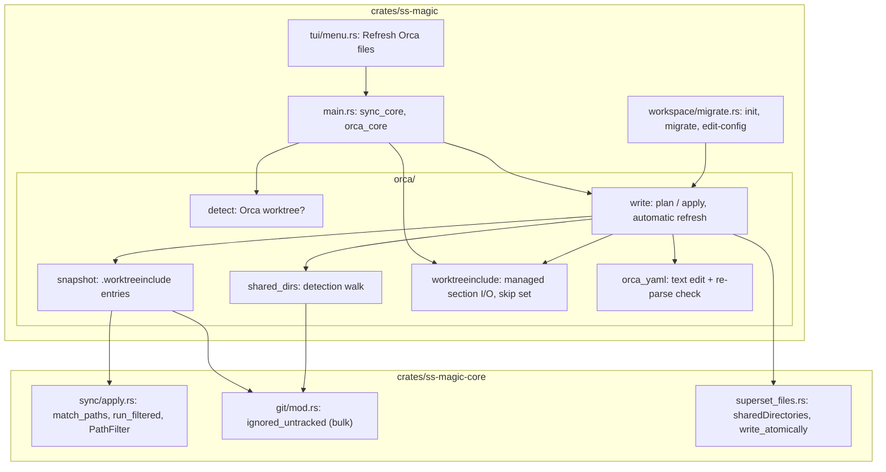

# Orca compatibility (`crates/ss-magic/src/orca/`)

Scope: the CLI's Orca module – generating `orca.yaml` and `.worktreeinclude`, detecting Orca worktrees, and the skip set forward sync uses there.\
Repository-wide rules live in the root [CLAUDE.md](../../../../CLAUDE.md).

Code rules for this subtree: [CODING_STANDARDS.md](./CODING_STANDARDS.md) – read it before writing or reviewing code here, and update it when a change establishes or retires a rule. The root [CODING_STANDARDS.md](../../../../CODING_STANDARDS.md) applies too.

Orca is a second worktree manager. It reads `orca.yaml` and `.worktreeinclude` from the repository root of the MAIN checkout, and ss-magic generates both from `magic.json`, which stays the single source of truth for both apps. Superset behavior is unchanged, and the plugin crate has no Orca code. `saphyr` (the YAML parser used here) is a dependency of the CLI crate alone, never core or the plugin crate; see [crates/ss-magic/CLAUDE.md](../../CLAUDE.md).

## What Orca does with the two files

Measured against the Orca 1.4.221 app bundle; the module's behavior rests on these facts.

- `worktree.sharedDirectories` and `.worktreeinclude` are read from the main checkout's working tree.
- `scripts.setup` is read from the NEW worktree's own `orca.yaml`, which is why that file is committed.
- Shared directories and the `.worktreeinclude` copies are materialized BEFORE the setup script runs.
- `.worktreeinclude` parsing:
  - Lines are split on `\r?\n` and trimmed; blank lines and lines starting with `#` are skipped.
  - `\` becomes `/`; one leading `./` and a trailing `/` are stripped.
  - Rejected: an entry starting with `!` or holding `*` or `?`, an absolute path, a `..` or empty segment, a path starting in `.git`.
  - A file over 256 KiB is ignored whole; only the first 1000 entries are used.
  - Orca runs its own `check-ignore` and drops entries that are not ignored.
- `orca.yaml` is parsed as YAML 1.2 with unique keys and ignored whole on any parse error. `sharedDirectories` keeps the first 100 entries.
- `ORCA_WORKTREE_PATH` is set for setup-script runs. `ORCA_WORKTREE_ID`, set in Orca's terminals, is `<repo id>::<worktree path>` with an optional `::workspace:<uuid>` suffix.

## Modules

### `detect.rs`

- `is_orca_worktree(cwd_root, main_root, env)` is true only when `cwd_root` differs from the main root AND either the canonicalized `ORCA_WORKTREE_PATH`, or the canonicalized path after the FIRST `::` of `ORCA_WORKTREE_ID` (minus the workspace suffix), equals the canonicalized `cwd_root`. Either match suffices.
- The variables merely existing is not the signal: an Orca terminal that changes into another repository's worktree must behave as a plain terminal does there. The main checkout is never an Orca worktree.
- `env` is an injected lookup (`EnvLookup`), the same shape `git::discover::discover_with_env` uses, so tests never read the process environment.

### `orca_yaml.rs`

The `orca.yaml` TEXT editor. `edit(current, shared_dirs, ensure_setup)` is pure: text in, text or a `Refusal { reason, manual_block }` out. The module's `//!` docs carry the scanning and ladder details; this is the summary.

- **Never re-serialized.** No Rust crate round-trips YAML with its comments, so `saphyr` only reports where the two managed keys sit (character offsets, not bytes), new text is spliced in, and the result is PARSED AGAIN.
- **The re-parse is the arbiter.** The result is accepted only when it is one YAML 1.2 document whose managed values are the intended ones and whose every other key, at the top level and beside the managed keys, is unchanged in value and order. A wrong position guess can therefore only ever produce a refusal.
- **`scripts.setup` is ENSURED.**
  - `SETUP_LINE` is prepended when no line of the script, trimmed, already equals it, so it is never duplicated. A test pins `SETUP_LINE` equal to `migrate::MAGIC_WRAPPER_ENTRY`.
  - Written as a `|` block scalar whose chomping indicator keeps the script's trailing newlines, or double-quoted when a block scalar cannot carry the string.
- **`worktree.sharedDirectories` is OWNED** and replaced outright.
- **Refusal ladder** (KTD3 of the Orca plan, the explicit ordered list of reasons to refuse). It describes the FILE, not the edit, so it holds even when both managed values are already right. Refuse on:
  - unparsable text (duplicate keys included);
  - more than one document;
  - a `%YAML 1.1` directive (`declares_yaml_1_1`, exactly that version: Orca's parser would switch to its rules while `saphyr` keeps reading 1.2);
  - a top level that is not a block mapping, or that carries a merge key;
  - a managed parent (`scripts`, `worktree`) that is a flow mapping, a null, an alias, not a mapping, or carries a merge key;
  - a managed value (`scripts.setup`, `worktree.sharedDirectories`) that is an alias.
- **Applying the ladder.** `Plan::ladder` applies it; only then does `Plan::locate` ask whether an edit is needed. `ensure_setup == false` (a refresh) stops the setup script from being compared or edited but does NOT narrow the ladder, so a flow-style `scripts` refuses a refresh too.
- **Beyond the ladder**, an edit that cannot be carried out refuses as well: a non-string `scripts.setup`, a block layout the editor has no rule for, a result that fails the re-parse check.
- **A missing parent key is never a refusal** – a block is appended.
- **Anchors and tags** on a managed node are not a refusal by themselves. `Source::skip_properties` steps over them and the replaced text starts after them, so they stay in the file; the re-parse check decides. When another key refers to the anchor, that key changes with the edit and the file is refused then.
- **Line endings follow the file; a BOM is preserved.**
- **Span ends are scanned by hand.** `saphyr`'s span ENDS are not all usable: a quoted scalar's can run over a trailing comment, a flow collection's stops before the closing bracket, block scalars and block sequences run to the next token. The editor scans for those ends itself (`Source::scan_*`, `trim_*_back`).
- `shared_directories(text)` is the lenient reader of the list a file holds now. `managed_block` is what a new file consists of and what a refusal shows to add by hand.

### `shared_dirs.rs`

Expands the `sharedDirectories` GLOBS stored in `magic.json` to LITERAL directories.

- `walk_candidates` walks the checkout BY NAME and records the seven known kinds only: `node_modules`, `.venv`, `venv`, `.cache`, `.turbo`, `.parcel-cache`, `.next/cache`. The list is deliberate and fixed (Rust's `target/` was considered and left out).
  - It NEVER descends into a directory it recorded – the only reason a nested `node_modules` never appears.
  - It follows no symlink and stays out of the excluded trees and of any directory holding a `.git` entry.
  - It prunes nothing else, so a kind is found at any depth.
- The stored globs are matched AGAINST those candidates: a pattern SELECTS among the detected kinds (`apps/*/node_modules` narrows `**/node_modules`) and cannot make a directory of another kind shareable.
- `expand` keeps only what `git::ignored_untracked` positively reports (queried with a trailing slash), sorts, and caps at `MAX_SHARED_DIRS` (100).
- `matches_by_pattern`, `picker_patterns` and `picker_preselected` feed the picker.
- `stored_or_detected` is the choice made when nobody is asked: a stored list as it is (an empty one included), else the detected default kinds, else `None`. The key stays ABSENT when nothing is stored and nothing is detected, so a scripted init run before dependencies exist does not record "chose none" on nobody's behalf.

### `snapshot.rs`

`compute` is "what forward sync would copy, filtered to what Orca would copy".

- `apply::match_paths` on main; directory matches are walked into FILES (the snapshot never lists a directory), with the excluded trees, the `DEFAULT_EXCLUDES` names and any directory holding a `.git` entry pruned.
- Dropped before git is asked: anything beneath a symlinked directory or inside a `.git`-holding one, and any path Orca would misread.
- A symlink that is ITSELF a match and points at a regular file is a candidate (`is_link_to_file`), because forward sync follows it and copies the target's content, and Orca's copier does the same (`realpath`, then a copy). Not candidates: a link to a directory, a dangling link, and a link met while walking a matched directory (the recursive copy skips those).
- Then ONE `git::ignored_untracked` call; a git failure or a non-git root yields an EMPTY snapshot.
- Files under a directory that made Orca's shared list are dropped; the rest is sorted and capped at what is left of Orca's budget.
- Leaving a file out is always safe, since forward sync still copies it.

### `worktreeinclude.rs`

The file has two owners: ss-magic's entries sit between two marker comments, and every other line survives each rewrite byte for byte.

- `Document::parse` / `render` do that split. A begin marker with no end marker does NOT swallow the rest of the file.
- `Document::budget` is Orca's 1000 entries / 256 KiB minus the person's own lines.
- `read` tells `Absent` from `Unreadable`; an unreadable file is never rewritten by any path.
- `entries` reads the whole file the way Orca does.
- `copied_by_orca` turns that list into forward sync's skip set: every listed line whose worktree path exists (no symlink followed). A listed directory that exists covers everything under it (the set holds the directory itself); a listed path absent from the worktree contributes nothing, so it is still synced.

### `write.rs`

The two writers: the explicit plan/apply path and the automatic end-of-sync refresh.

**Plan and apply** – `plan(main_root, patterns, shared_patterns, SetupPolicy)` + `Plan::apply`, shared by init, migrate, edit-config and `ss-magic orca`.

- The whole Orca output is COMPUTED in `plan`, BEFORE the finishing prompt, so the "This will:" list describes exactly what was confirmed (`Plan::summary_lines` feeds it): `orca.yaml` is read and edited in memory, the snapshot is computed, `.worktreeinclude` is rendered. Do not move the computation after the prompt.
- `apply` runs AFTER the `.superset` tree materializes and writes what was planned and nothing else: `orca.yaml`, the `.worktreeinclude` ignore rule (not when the file is tracked), then the planned snapshot. Nothing is recomputed at apply time.
- A file the same operation creates afterwards (the `magic.local.json` a first init bootstraps) is not in the snapshot and joins with the next refresh.
- `apply` returns `Notice`s and never fails the operation.
- `SetupPolicy::Ensure` is init/migrate/edit-config. `OnlyWhenCreating` is the explicit refresh, which never touches the `scripts.setup` of an existing file.
- All writes go through `write_contained`, which refuses a target that resolves OUTSIDE the repository through a symlink (`landing`) while writing through an in-repo link. Only this explicit path ever writes through a link.

**Drift across the finishing prompt** – the plan carries two things from planning to writing.

- Each planned write keeps its `Baseline`: the exact text `plan` read, or the fact that the file was absent. The planned text is that reading with ss-magic's parts replaced, and a prompt may stay open for minutes.
- `write_planned` re-reads the file right before writing and `drift` compares. Other bytes, a file where there was none, no file where there was one, or a file that cannot be read again (the unknown answer is the refusing one) all leave it byte-for-byte untouched, with a `Warn` notice saying that running the command again updates it (`ss-magic orca` for `.worktreeinclude`, whose ignore rule is still added).
- The window is NARROWED to the instant between that re-read and the rename, not closed.

**The ignore rule is asked once** – `plan_include` asks git ONCE (`ignore_rule`) and records an `IgnoreRule`:

- `Tracked` – positive determination; no rule is added.
- `Present` – `git check-ignore` (the same question `gitignore::ensure_path_ignored` asks) already ignores the file.
- `Add` – everything else, including every "could not be asked".
- `summary_lines` ends the line in "it is tracked by git, so no ignore rule is added", "it is already gitignored" or "+ add it to .gitignore".
- `apply_include` acts on the recorded value instead of probing again, so the confirmed list and the step that runs cannot disagree. For `Present` it still calls `ensure_path_ignored`, which adds nothing when the rule is there and puts it back if it was removed while the prompt was open.

**Automatic refresh** – `refresh_snapshot` is the end-of-sync refresh run from forward sync.

- It rewrites only the managed section of main's `.worktreeinclude`, only when that name is NOT A SYMLINK and git positively reports the file untracked AND ignored. It never touches `orca.yaml`.
- Every reason not to write is a `Skipped` value, not an error. An entry that cannot be inspected is a skip too; an absent file is created.
- Link check: `fs::symlink_metadata` (nothing followed) runs first, before git is asked and before the file is read. It does not look at where the link leads, because git answers for the link's NAME: an untracked, ignored link to a tracked file passes both git questions while the write lands on the tracked target.
- Tracked check: asked with the pathspec `:(icase).worktreeinclude`. Git matches a pathspec case-sensitively while the default macOS volume resolves `.worktreeinclude` to a file committed as `.WorktreeInclude`, so the exact name would answer "not tracked" for the very file the write lands on.
- Computing the snapshot takes time, so the link inspection (`symlink_refusal`) runs a SECOND time in `write_refreshed`, right before the write. The two git answers are still asked once, before the snapshot is computed.
- The write itself, `replace_refreshed` (the one place the refresh writes from), is core's `write_atomically_no_follow`: it renames onto the directory entry, so a link that appears even after the second look is replaced by a regular file and its target keeps its bytes. The no-link rule thus depends on no check staying true.
- Never route this write through `write_contained` or `write_atomically`.

The hard rules behind the Orca flows (git's positive word, text-only `orca.yaml` edits, the refresh's write bounds, skip-set timing, surviving user lines) live in [CODING_STANDARDS.md](./CODING_STANDARDS.md). The `main.rs` side (`orca_skip_filter`, `sync_summary_line`, `--no-orca-skip`, `run_orca_flow`) is described in [crates/ss-magic/CLAUDE.md](../../CLAUDE.md); the rest of the flow tests live in `crates/ss-magic/src/tests/orca_flow.rs`.
