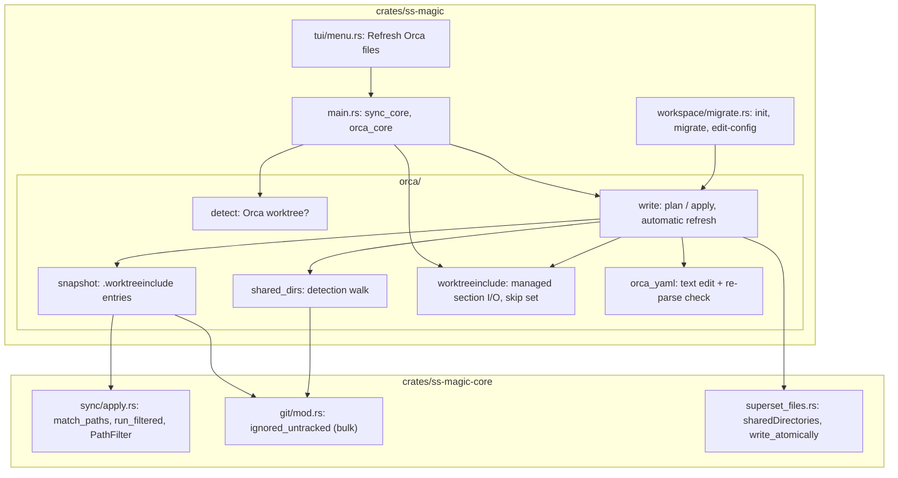

# Orca compatibility (`crates/ss-magic/src/orca/`)

Scope: generating `orca.yaml` and `.worktreeinclude`, detecting Orca worktrees, and forward sync's skip set there.\
Repository-wide rules: the root [CLAUDE.md](../../../../CLAUDE.md).\
Code rules: [CODING_STANDARDS.md](./CODING_STANDARDS.md) (read it first; update it with any rule change) and the root [CODING_STANDARDS.md](../../../../CODING_STANDARDS.md).

Orca is a second worktree manager reading `orca.yaml` and `.worktreeinclude` from the MAIN checkout's root; ss-magic generates both from `magic.json`. Superset behavior is unchanged; the plugin crate has no Orca code. `saphyr` is CLI-only ([crates/ss-magic/CLAUDE.md](../../CLAUDE.md)).

## What Orca does with the two files

Measured against the Orca 1.4.221 app bundle.

- `worktree.sharedDirectories` and `.worktreeinclude` are read from main's working tree; `scripts.setup` from the NEW worktree's own `orca.yaml`, which is why that file is committed.
- Shared directories and `.worktreeinclude` copies are materialized BEFORE the setup script runs.
- `.worktreeinclude` parsing:
  - Lines split on `\r?\n` and trimmed; blank and `#` lines skipped.
  - `\` becomes `/`; one leading `./` and a trailing `/` stripped.
  - Rejected: an entry starting with `!` or holding `*` or `?`, an absolute path, a `..` or empty segment, a path starting in `.git`.
  - A file over 256 KiB is ignored whole; only the first 1000 entries count. Orca's own `check-ignore` drops unignored entries.
- `orca.yaml`: YAML 1.2, unique keys, ignored whole on any parse error; `sharedDirectories` keeps the first 100 entries.
- `ORCA_WORKTREE_PATH` is set for setup-script runs; `ORCA_WORKTREE_ID` (Orca's terminals) is `<repo id>::<worktree path>` with an optional `::workspace:<uuid>` suffix.

## Modules

### `detect.rs`

- `is_orca_worktree(cwd_root, main_root, env)` is true only when `cwd_root` is not the main root AND the canonicalized `ORCA_WORKTREE_PATH`, or the canonicalized path after the FIRST `::` of `ORCA_WORKTREE_ID` (minus the workspace suffix), equals the canonicalized `cwd_root`. Either match suffices.
- `env` is an injected `EnvLookup` (the shape `git::discover::discover_with_env` uses).

### `orca_yaml.rs`

The `orca.yaml` TEXT editor. `edit(current, shared_dirs, ensure_setup)` is pure: text in, text or `Refusal { reason, manual_block }` out.

- `saphyr` locates the two managed keys (character offsets, not bytes); new text is spliced in and the re-parse decides ([CODING_STANDARDS.md](./CODING_STANDARDS.md)).
- **`scripts.setup` is ENSURED.** `SETUP_LINE` (pinned equal to `migrate::MAGIC_WRAPPER_ENTRY`) is prepended when no trimmed line equals it. Written as a `|` block scalar whose chomping indicator keeps trailing newlines, else double-quoted.
- **`worktree.sharedDirectories` is OWNED** and replaced outright.
- **Refusal ladder** (KTD3 of the Orca plan: the ordered reasons to refuse the FILE):
  - unparsable text (duplicate keys included);
  - more than one document;
  - a `%YAML 1.1` directive (`declares_yaml_1_1`; Orca's parser would switch to 1.1 rules while `saphyr` keeps reading 1.2);
  - a top level that is not a block mapping, or carries a merge key;
  - a managed parent (`scripts`, `worktree`) that is a flow mapping, a null, an alias, not a mapping, or carries a merge key;
  - a managed value (`scripts.setup`, `worktree.sharedDirectories`) that is an alias.
- `Plan::ladder` runs first, then `Plan::locate` asks whether an edit is needed. `ensure_setup == false` (a refresh) skips the setup script but does NOT narrow the ladder: a flow-style `scripts` refuses a refresh too.
- Also refused: a non-string `scripts.setup`, a block layout with no editor rule, a failed re-parse. A missing parent key is not a refusal – a block is appended.
- **Anchors and tags** on a managed node stay: `Source::skip_properties` steps over them; the re-parse refuses if a key referring to the anchor changes.
- **Span ends are scanned by hand** (`Source::scan_*`, `trim_*_back`): `saphyr`'s end for a quoted scalar can overrun a trailing comment, a flow collection's stops before the closing bracket, block scalars and sequences run to the next token.
- `shared_directories(text)` leniently reads the current list. `managed_block` is a new file's content and what a refusal shows to add by hand.

### `shared_dirs.rs`

Expands `magic.json`'s `sharedDirectories` GLOBS to LITERAL directories.

- `walk_candidates` walks BY NAME, recording seven kinds only: `node_modules`, `.venv`, `venv`, `.cache`, `.turbo`, `.parcel-cache`, `.next/cache` (Rust's `target/` was considered and left out).
  - It never descends into a recorded directory – the only reason a nested `node_modules` never appears.
  - No symlink followed; excluded trees and `.git`-holding directories skipped; nothing else pruned, so a kind is found at any depth.
- Stored globs SELECT among those candidates (`apps/*/node_modules` narrows `**/node_modules`).
- `expand` keeps only what `git::ignored_untracked` positively reports (queried with a trailing slash), sorts, and caps at `MAX_SHARED_DIRS` (100).
- `matches_by_pattern`, `picker_patterns`, `picker_preselected` feed the picker.
- `stored_or_detected` (nobody asked): a stored list (empty included), else detected default kinds, else `None` (key ABSENT, so a scripted init before dependencies exist records no "chose none").

### `snapshot.rs`

`compute` is "what forward sync would copy, filtered to what Orca would copy".

- `apply::match_paths` on main; directory matches walked into FILES, pruning excluded trees, `DEFAULT_EXCLUDES` names and `.git`-holding directories. Paths beneath a symlinked or `.git`-holding directory, or that Orca would misread, are dropped before git is asked.
- A symlink that is ITSELF a match and points at a regular file is a candidate (`is_link_to_file`): forward sync copies the target's content, and so does Orca's copier (`realpath`, then a copy).
- Then ONE `git::ignored_untracked` call; a git failure or non-git root yields an EMPTY snapshot.
- Files under a directory on Orca's shared list are dropped; the rest is sorted and capped at what is left of Orca's budget.

### `worktreeinclude.rs`

Two owners: ss-magic's entries sit between two marker comments; every other line survives byte for byte.

- `Document::parse` / `render` do the split; a begin marker without an end marker does NOT swallow the rest.
- `Document::budget`: Orca's 1000 entries / 256 KiB minus the person's lines. `read` tells `Absent` from `Unreadable` (never rewritten). `entries` reads the whole file as Orca does.
- `copied_by_orca` builds forward sync's skip set: listed paths that exist in the worktree (no symlink followed). A listed directory is held as itself and covers everything under it; an absent one is still synced.

### `write.rs`

**Plan and apply** – `plan(main_root, patterns, shared_patterns, SetupPolicy)` + `Plan::apply`, shared by init, migrate, edit-config and `ss-magic orca`.

- `plan` COMPUTES everything BEFORE the finishing prompt (edited `orca.yaml`, snapshot, rendered `.worktreeinclude`); `Plan::summary_lines` feeds the "This will:" list.
- `apply` runs AFTER the `.superset` tree materializes and writes only what was planned: `orca.yaml`, the `.worktreeinclude` ignore rule (not when tracked), then the snapshot. A file the operation creates afterwards (the `magic.local.json` a first init bootstraps) joins with the next refresh.
- `apply` returns `Notice`s, never fails. `SetupPolicy::Ensure`: init/migrate/edit-config. `OnlyWhenCreating`: the explicit refresh, never touching an existing `scripts.setup`.
- All writes go through `write_contained`, which refuses a target resolving OUTSIDE the repository through a symlink (`landing`) and writes through an in-repo link.

**Drift across the prompt** – a prompt may stay open for minutes.

- Each planned write keeps its `Baseline`: the exact text `plan` read, or "absent".
- `write_planned` re-reads right before writing and `drift` compares; any difference or failed re-read leaves the file untouched with a `Warn` notice that re-running updates it (`ss-magic orca` for `.worktreeinclude`, whose ignore rule is still added). The window is NARROWED to re-read→rename, not closed.

**The ignore rule is asked once** – `plan_include` asks git ONCE (`ignore_rule`) and records an `IgnoreRule`:

- `Tracked` (positive determination, no rule), `Present` (`git check-ignore`, the question `gitignore::ensure_path_ignored` asks, already ignores it), else `Add` (every "could not be asked" included).
- `summary_lines` ends in "it is tracked by git, so no ignore rule is added", "it is already gitignored" or "+ add it to .gitignore".
- `apply_include` acts on the record without probing again; for `Present` it still calls `ensure_path_ignored`, restoring a rule removed during the prompt.

**Automatic refresh** – `refresh_snapshot`, at the end of forward sync.

- Rewrites only the managed section of main's `.worktreeinclude`, only when that name is NOT A SYMLINK and git positively reports it untracked AND ignored. Every reason not to is a `Skipped` value (an uninspectable entry included); an absent file is created.
- Link check: `fs::symlink_metadata` runs first, before git is asked or the file read.
- Tracked check: pathspec `:(icase).worktreeinclude`, because git matches pathspecs case-sensitively while the default macOS volume resolves `.worktreeinclude` to a file committed as `.WorktreeInclude`.
- `write_refreshed` repeats the link inspection (`symlink_refusal`) right before the write, since the snapshot takes time; git is asked once, before it.
- `replace_refreshed`, the one write site, is core's `write_atomically_no_follow`: it renames onto the directory entry, so a late link is replaced and its target keeps its bytes.

The `main.rs` side (`orca_skip_filter`, `sync_summary_line`, `--no-orca-skip`, `run_orca_flow`): [crates/ss-magic/CLAUDE.md](../../CLAUDE.md). Flow tests: `crates/ss-magic/src/tests/orca_flow.rs`.
