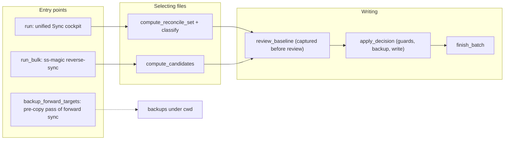

# sync/ – the interactive half of sync (`reverse_sync.rs`, `merge.rs`)

Repository-wide rules live in the root [CLAUDE.md](../../../../CLAUDE.md).

The pure half (`EXCLUDED_TREES`, `under_excluded_tree`, `apply`, `pattern`, `repo_scan`) lives in [ss-magic-core](../../../ss-magic-core/CLAUDE.md); this directory's `mod.rs` only declares `reverse_sync` and `merge` and re-exports core's pieces. The cockpit that drives `reverse_sync::run` is described in [tui/CLAUDE.md](../tui/CLAUDE.md).

**This is a secret-leak surface.** `apply_decision` is the one path that writes untracked (secret) files into the shared main checkout. The "Secret safety" rules in the root [CODING_STANDARDS.md](../../../../CODING_STANDARDS.md) apply to everything here.

## `reverse_sync.rs` – the sync engine

Reconciles the configured files between a worktree and main, safely, in BOTH directions.

### Entry points

- `run` – the interactive unified Sync cockpit (the worktree menu's single "Sync" entry).
  - Computes `compute_reconcile_set`: every overlaid-pattern match on EITHER root (patterns are expanded against both, so a main-only file is seen) whose worktree and main copies are not byte-identical. Directory matches and the tool's own `.superset/backups/` tree are dropped.
  - Classifies each file with the 4-way `classify`: `WorktreeOnly` / `MainOnly` / `Differs` / `Identical`. `(false,false)` (vanished on both sides) hides as `Identical`.
  - Refuses non-interactively (R16, the "no TUI without a terminal" requirement; exit 2), hands the offered set to the cockpit, then applies the returned per-file push / pull / merge / delete decisions via `apply_decision(&ApplyContext, rel, &Decision, Baseline)`. The cockpit writes nothing itself.
- `run_bulk` – the non-interactive `ss-magic reverse-sync` (worktree → main): bulk-pushes every git-untracked `compute_candidates` match that differs from main. No TUI; `source_untracked` is hard-coded `true`.
- `backup_forward_targets` – the pre-copy backup pass of forward `ss-magic sync` (main → worktree): backs up under `cwd`'s `.superset/backups/` every worktree file the copy will overwrite.
  - It takes the copy's own `PathFilter` and applies it at both enumeration points (each match, and inside a matched directory's recursive backup). A path the copy leaves to Orca is not overwritten, so it is not backed up either.

### Candidates and tracked determination

- Each `Candidate` carries `wt_untracked`, derived by POSITIVE tracked determination (`git::tracked_files`) and fail-closed: `true` for anything not positively known to be tracked.
- `wt_untracked` becomes `Baseline.source_untracked`, the gate for the gitignore-in-main step below.
- Candidate computation is one of the final-enumeration points of the excluded-trees filter (`sync::under_excluded_tree`), so neither a recovered secret under `.superset/backups/` nor the plugin's `.superset/.magic/` state is ever offered.

### The `apply_decision` seam

Backup-first; each step can only skip, never clobber.

1. **Path-safety guard.** Rejects unsafe relative paths before touching anything.
2. **Review-time baseline re-check** (`check_target`).
   - Per-file `(worktree, main)` `FileMeta` is captured by `review_baseline` BEFORE the cockpit opens (the `Baseline` passed into `apply_decision`) and re-compared at apply by `metas_match`. A file edited, created or deleted during review is skipped, not clobbered (`Guard::Changed`).
   - `metas_match` compares length + mtime. When the filesystem reports no mtime, a content hash is captured instead, so a bare length never passes as unchanged.
   - The baseline is COHERENT with the reviewed status: the reviewed-ABSENT side is pinned to `None` symmetrically (a `WorktreeOnly` candidate's main side and a `MainOnly` candidate's worktree side). A copy that materializes there between classify and apply is skipped instead of clobbered without having been listed in the confirm.
   - `review_baseline` never aborts the reconcile for one bad file: a side that fails to `stat` (or, on a mtime-less filesystem, to hash) degrades to `None` via `baseline_side`. Both `run` and `run_bulk` are covered because the degradation lives in `review_baseline` itself.
   - Folding to `None` is fail-closed: an unreadable-but-present side reads as baseline `None` vs a present target, so `Guard::Changed` → SKIP. Nothing the review could not see is overwritten; only a genuinely absent target is written (a create, no prior bytes to lose).
3. **Backup** (`backup_if_unchanged`). Takes a timestamped pre-write backup of the losing bytes under `.superset/backups/<YYYYmmdd-HHMMSS>/{worktree,main}/…` (`apply_timestamp` → pure `format_timestamp`, UTC civil-from-days, no date crate). Skipped when `ApplyContext.backup` is false (`--no-backup`); the baseline `Guard::Changed` skip is unaffected by it. Backup paths are printed so a mistaken overwrite is recoverable.
4. **Gitignore-in-main gate** (`ensure_gitignored_in_main`). Runs before any secret bytes land in main, but ONLY for an untracked source (`Baseline.source_untracked`). A tracked file is already committed and must NOT gain a `.gitignore` rule.
5. **Write**, per decision:
   - `Push` and `Merge` each carry a one-sided guard: a `Push` with no worktree baseline, or a `Merge` missing either side, skips rather than reading an absent side (defense in depth against an out-of-contract `MainOnly`).
   - `Decision::Delete` unlinks BOTH sides (whichever exist), each backed up first and baseline-guarded like an overwrite. Main is removed before the worktree, so a failure leaves the worktree candidate intact. No gitignore step, since nothing lands in main.

`ApplyContext` carries the two tree roots, the batch's shared backups root and timestamp, and the `backup: bool` toggle.

### Backups: location, ignore rule, retention

- `backups_root_for(root, ensure_ignore)` joins `.superset/backups` under the root being OVERWRITTEN: cockpit `run` → worktree, `run_bulk` → main, forward `backup_forward_targets` → cwd. With `ensure_ignore` it gitignores the tree via `ensure_backups_ignored` (a `gitignore::ensure_path_ignored` `Dir` rule).
- That is the ONE place the `.superset/backups` ignore rule is wired. Init/migrate's `ensure_bootstrap_gitignores` (see [crates/ss-magic/CLAUDE.md](../../CLAUDE.md)) calls the same helper eagerly, so a fresh `ss-magic init` protects the tree before any secret is backed up.
- After each apply, `prune_old_backups` keeps the `BACKUP_BATCHES_KEPT` (10) newest batch dirs and removes older ones.
  - Best effort: a failure warns, never fails the sync.
  - Only names matching `is_backup_batch_name` are touched (current or legacy epoch shape), never foreign entries.
  - Legacy epoch-named batches and legacy top-level `local/<epoch>` + `main/<epoch>` dirs count against the same 10-batch budget. An emptied side dir is removed only when this run pruned from it.
  - The batch written by the current run is protected by name, even under a backward clock jump.

### `finish_batch(label)`

The shared batch tail: prints recorded backups, runs best-effort `prune_old_backups`, prints the applied/skipped/failed summary prefixed with the direction `label` (bidirectional "Sync" for `run`, one-way "Reverse sync" for `run_bulk`), and picks the exit code (non-zero iff a file failed).

## `merge.rs` – decisions and the merge model

Pure, no I/O.

- `Decision` (`Undecided`, push, pull, `Merge(assembled)`, delete) and `FileState` (`ExistsBoth` / `WorktreeOnly` / `MainOnly`).
- `default_decision` returns `Decision::Undecided` for EVERY state. Nothing is pre-selected, because the unified set includes tracked worktree-only files that must not push on a bare keystroke.
- Backup naming: `backup_rel_path(ts, BackupSide, rel)` → `<ts>/<side>/<rel>`.
- The per-hunk merge model driving the cockpit's merge overlay: `merge_segments`, `assemble`, `diff_count`, `MergeSegment`, `MergeChoice`.
