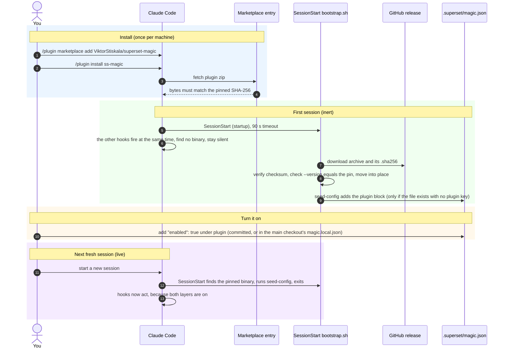
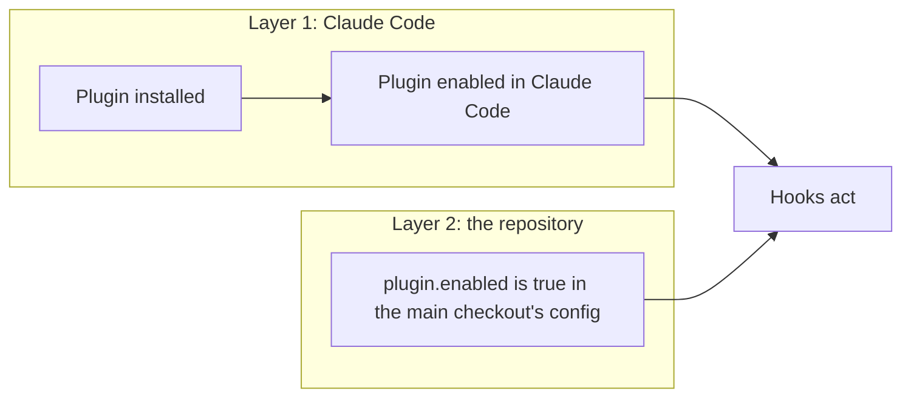
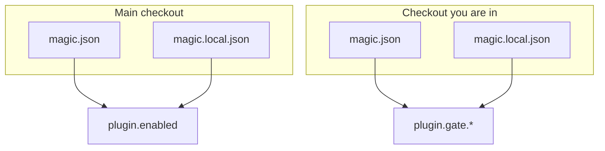
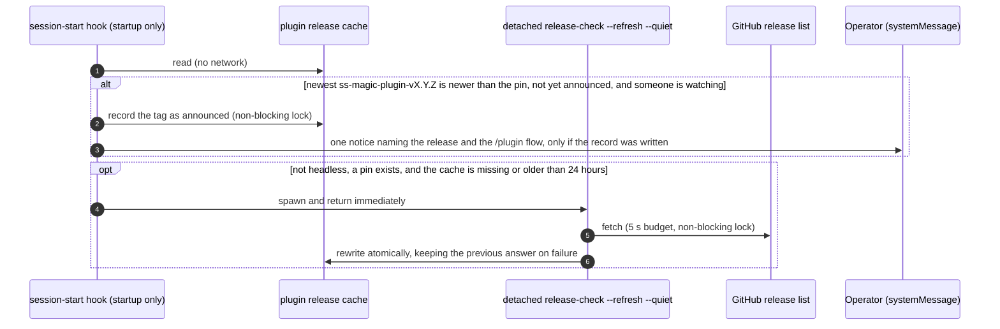

# The ss-magic Claude Code plugin: install, enable, configure

ss-magic also ships an optional [Claude Code](https://claude.com/claude-code) plugin, published from this repository and built on the same `.superset/magic.json` contract the sync CLI uses. This page covers how the plugin gets onto a machine, how you turn it on for a repository, which verbs it exposes, how its configuration resolves, and what it stores. For the sync CLI itself start at the [README](../../README.md).

> [!NOTE]
> The plugin is a second program beside the sync CLI. Its binary is `ss-magic-plugin`, released on its own `ss-magic-plugin-vX.Y.Z` tag line. It shares the git and `.superset/` plumbing with the CLI but links neither a self-updater nor a terminal-UI library, so it can neither update itself mid-session nor open a prompt. The CLI's own install and update story is in [installation-and-updates.md](./installation-and-updates.md).

## What the plugin is

The plugin is **off until you turn it on**, per repository. Once on, it does four things.

| Feature | In one sentence | Depth |
| --- | --- | --- |
| Durable session scratchpad | Each worktree gets `.superset/.magic/sessions/<repo>-<branch>/` holding `STATUS.md`, `TASKS.md`, `DECISIONS.md`, `LEARNINGS.md`, `CONTEXT.md` and `OPERATOR-CHECKLIST.md`, so working state survives a context compaction by living on disk. | [plugin-session-state.md](./plugin-session-state.md) |
| Read gate with conclusion cache | A `Read` of a file past the configured size threshold is denied and routed to an Explore agent, so a large file never lands whole in the context window. The agent's answer is recorded, and any later read of the same file is answered with that conclusion inline. | [plugin-hooks.md](./plugin-hooks.md) |
| Operator checklist | One JSON document per action under `docs/actions/`, with the steps a change needs before it is safe to ship. The plugin's own verbs are the only write path (direct reads and edits of the file are denied), which keeps the document canonically ordered and valid, and a GitHub Actions workflow can render it into a pull-request comment. | [plugin-session-state.md](./plugin-session-state.md) |
| Cost ledger | One row per ended session, read from that session's own transcript, using the harness's priced records where they exist and a versioned price table otherwise. A relative signal for comparing branches, never an authoritative bill. | [plugin-session-state.md](./plugin-session-state.md) |

Three properties hold across all four:

- The scratchpad directory name is derived from git alone, so the same worktree always resolves to the same place. It is gitignored, never committed, and the plugin refuses to write anything until git confirms that.
- The gate is advisory, not a security boundary. A timeout, a malformed envelope or a missing binary all leave the read to proceed.
- Every hook fails open: an error or a panic inside a handler ends in empty stdout and exit 0, so it looks to Claude Code exactly like a hook that decided to do nothing.

## From install to a live session



## Install

The marketplace is the only delivery path. There is no `install` verb, and `ss-magic sync` never installs anything. In Claude Code:

```plaintext
/plugin marketplace add ViktorStiskala/superset-magic
/plugin install ss-magic
```

### The SHA-256 pin

The marketplace entry in [.claude-plugin/marketplace.json](../../.claude-plugin/marketplace.json) points at a plugin archive (`ss-magic-plugin-v<version>.zip`) on the plugin's GitHub release and pins it by SHA-256, so the client refuses an archive whose bytes do not match. The pin is regenerated by `scripts/build-plugin-zip.py --update-manifest` whenever anything under `plugin/` changes, and a content change must come with a version bump, because the resolved version (not the digest) is the harness's update signal.

### The SessionStart bootstrap

The plugin ships **without a binary**. On a fresh session (`startup`), the first `SessionStart` entry in [plugin/hooks/hooks.json](../../plugin/hooks/hooks.json) runs [plugin/hooks/bootstrap.sh](../../plugin/hooks/bootstrap.sh) with a 90-second timeout. It is an ordinary hook that runs at the same time as the plugin's other session-start hook, not a detached background process. It:

1. Publishes the resolved data directory into a handoff file under the private temp root (on every run, because `/tmp` does not survive a reboot while the installed binary does). The Bash-tool wrapper reads this file, see [Environment variables](#environment-variables).
2. Reads the version pin from `ss-magic-plugin.version` beside `plugin.json` and rejects anything that is not a bare `MAJOR.MINOR.PATCH` literal, before the value is compared or put near a URL.
3. If the pinned binary is already installed (the install marker and the binary's `--version` must both agree with the pin), runs `seed-config` and exits. This is the path almost every session takes.
4. Picks the platform archive. Published targets are `{aarch64, x86_64}` on `{apple-darwin, unknown-linux-gnu}`. Any other platform installs nothing and says so once per machine, not on every session.
5. Takes a per-machine install lock (waiting up to 20 seconds, through `flock` or a `perl` stand-in) so concurrent sessions do not download the same archive twice, then re-checks step 3. Where neither lock tool exists the install proceeds unlocked, which is still safe because the final step is an atomic rename of identical, verified bytes.
6. Downloads `ss-magic-plugin-<triple>.tar.gz` and its `.sha256` from the `ss-magic-plugin-v<pin>` release with `curl` (or `wget`), HTTPS only, with bounded connect and transfer times and no retry loop.
7. Verifies the checksum, extracts, and runs the staged binary's `--version`, refusing unless it equals the pin (this catches a wrong-architecture binary that would pass the checksum).
8. Moves the verified binary into `${CLAUDE_PLUGIN_DATA}/bin/ss-magic-plugin` with one rename, and only then writes the install marker.
9. Runs `seed-config` (see below).
10. On the first successful install on a machine, prints a one-time disclosure on stderr naming the installed version, where it came from, and the five events the plugin registers hooks for (`SessionStart`, `PreToolUse`, `PreCompact`, `SubagentStop`, `SessionEnd`).

The binary goes into `${CLAUDE_PLUGIN_DATA}`, never `${CLAUDE_PLUGIN_ROOT}`: the plugin root is version-scoped and replaced wholesale on every plugin update.

> [!IMPORTANT]
> The bootstrap never fails a session. Offline, DNS failure, proxy, 404, checksum mismatch, unwritable data directory, missing `curl`/`wget`, missing SHA-256 tool, an unsupported platform, a bad pin: every one ends in "do nothing, one line on stderr, carry on", exit 0. The success path prints nothing on stdout, because a hook's stdout would be fed into the model's context. An already-installed binary is never touched by a failed install, and a failure removes the install marker so the next fresh session retries.

## Seeding the config block

Right after a successful install, and also on the already-installed path (which is how every repository after the first gets seeded), the bootstrap runs `ss-magic-plugin seed-config` in the session's repository, with both output streams discarded. It folds a `plugin` block of gate defaults into your repository's existing `.superset/magic.json`, so the knobs sit in a file you already track:

```json
{
  "files": [".env"],
  "plugin": {
    "gate": {
      "threshold_lines": 3000,
      "inline_byte_budget": 10000,
      "exemptions": []
    }
  }
}
```

The seed is deliberately narrow. Each bound below is covered by a test rather than being a convention.

| Bound | Why |
| --- | --- |
| Never writes `enabled`. | Enabling is a decision a person makes. A repository must not be able to arrange its own enablement by getting a hook to fire, so the writer has no code path to that key at all. |
| Never stages the change. | The block shows up in `git status` as an ordinary edit: it is surfaced, not slipped in. |
| Writes only when `magic.json` exists and has no `plugin` key at all. | At most once per repository, and it never fights a deliberate edit. The bootstrap invokes it every session, and this one check makes every call after the first a read and an exit. |
| Never writes through a symlink that leaves the repository (on the file or on `.superset`). | The seed runs unattended in whatever checkout you opened, and that path is one the checkout controls. A link that stays inside the repository is followed. |
| Never creates the file. | An absent or unparseable `magic.json` means this is not an ss-magic workspace (or it is mid-merge-conflict). Installing a plugin must not introduce a tracked file either way. Outside a git repository it does nothing at all. |
| Goes through the typed load-modify-write used by the rest of the tool. | Every other key survives, including one a newer build or a hand edit put there. It takes the same per-machine config lock as every other config write (the seed skips this session instead of waiting) and commits by rename, so two sessions starting at once cannot interleave and a write that dies half-way leaves the previous file rather than a truncated one. |

The file is rewritten in the tool's canonical form rather than patched in place, so a hand-ordered file comes back alphabetized. On a `magic.json` that `ss-magic init` wrote, which is every file that has one, the diff is exactly the added block. See [superset-contract.md](./superset-contract.md) for that file.

The seed targets the **current** checkout, not the main one, because the `gate` knobs resolve against the checkout you are in.

## Enabling the plugin

> [!IMPORTANT]
> The documented way to turn the plugin on is an **edit to the seeded `plugin` block**: add `"enabled": true` and commit it. No verb needs to be typed in a terminal.

```json
{
  "plugin": {
    "enabled": true,
    "gate": { "threshold_lines": 3000 }
  }
}
```

For "on for me alone", set it in the **main checkout's** gitignored `.superset/magic.local.json` instead. `enabled` is always read from the main checkout's overlay, so that is where a per-machine answer belongs. The same rule means an edit made only in a linked worktree's `magic.json` takes effect once that change reaches the main checkout's copy.

Inside a Claude Code session you can also ask Claude to run `ss-magic-plugin enable [--local]`, `disable [--local]` or `config set plugin.enabled true [--local]`. They make the same edit, and editing the file by hand is the path that needs no session at all.

> [!WARNING]
> The hooks also need git to report `.superset/.magic/` as ignored. Init, migration and edit config (the `ss-magic` menu flows, and scripted `ss-magic init`) write that rule, and so do `enable` and `config set plugin.enabled true`. A hand edit of `enabled` does **not**. In a repository whose `.gitignore` lacks the rule, every hook except `SessionEnd` refuses to act. `ss-magic-plugin status` reports this case.

### The two layers

Both must be on:



`ss-magic-plugin status` is the one place that reports both, plus whether the state tree is gitignored, whether the binary arrived, and whether its version matches the plugin's pin. Ask Claude to run it first whenever nothing seems to be happening. It reads only and creates nothing, and a value it cannot determine is printed as `unknown` with the reason rather than left blank. It exits 0 whenever it produced a report, and its `--json` keys are treated as a contract (the report carries a `schema` number, currently 2).

### First-session inertness and `/reload-plugins`

**The first session after installing does nothing, and that is expected.** Hooks on one event run at the same time, so that first session is already underway before the download lands. Every ss-magic hook is deliberately inert while there is no binary, silently and without failing anything. Start a new session and the plugin is live. The `ss-magic-plugin` wrapper that skills use behaves the same way: with no binary it exits 0 with one explanatory line (for example "start a new session to install it") instead of failing a skill mid-run.

`/reload-plugins` alone is not enough. It re-registers the plugin but emits no session-start event, so nothing fetches or updates the binary:

| Situation | What a reload alone gives you |
| --- | --- |
| After a fresh install | No binary at all, so every hook stays inert until the next real session. |
| After a version bump | The previously installed binary is still there and keeps serving hooks, so the session runs the old binary against the new manifest and skills until a fresh session's bootstrap swaps it. |

`ss-magic-plugin status` tells the two apart: it reports whether the binary arrived at all, and whether its version matches the plugin's pin (the `drift` row under `Versions`).

> [!NOTE]
> Only the bootstrap entry is restricted to `startup`. The plugin's own `session-start` hook also fires on `resume`, `clear`, `compact` and `fork`, but the release notice described below is carried by a fresh `startup` only.

## Verbs

**You are not expected to type any of these in a terminal.** The plugin's binary is installed under Claude Code's own plugin data directory and is deliberately kept off your `PATH`, so it cannot collide with an `ss-magic` you installed yourself. Every verb is `ss-magic-plugin <verb>` reached from *inside* a Claude Code session: the shipped skills invoke them, the hooks' own messages point the model at them, and you can ask Claude to run one directly. The session's Bash tool carries a `ss-magic-plugin` wrapper ([plugin/bin/ss-magic-plugin](../../plugin/bin/ss-magic-plugin)) on its `PATH`, so the spelling below is exactly what runs there. The wrapper forwards its arguments verbatim to the pinned binary and can reach nothing else.

The vocabulary is closed (`HumanVerb` in [main.rs](../../crates/ss-magic-plugin/src/main.rs)): an unknown verb is an error that prints the usage and exits 2, so a typo never silently does nothing.

| Verb | What it does |
| --- | --- |
| `status [--all] [--json]` | What the plugin sees and why it is or is not acting. Exits 0 whenever a report was produced. `--all` reports every heartbeat row, not just this worktree's. |
| `cost [--here] [--backfill <REF>] [--json]` | What recorded sessions cost, grouped by worktree, across every worktree including deleted ones. `--here` limits it to this worktree; `--backfill` records a session that never left a row (`<REF>` is a session id or a transcript `.jsonl` path). |
| `spill-index [--json]` | Lists the harness's own oversized-tool-output files for this worktree. Read-only. |
| `scratchpad ensure` | Creates or refreshes any missing part of this worktree's state tree, leaving existing state files untouched. |
| `conclude <FILE> [--from BODY_FILE]` | Records a conclusion about a file (the body comes from stdin without `--from`). |
| `conclusions [KEY\|FILE]` | Lists recorded conclusions, newest first, or shows one. |
| `gc` | Prunes expired plugin state: conclusions whose source file changed or vanished, then a trim to the retention bounds. |
| `bypass <FILE>` | Lets exactly the next gated Read of that file through, once. Claims older than 24 hours are discarded unused. |
| `expect-artifact <FILE> [--note TEXT]` | Requires the next subagent to produce a file: its stop is blocked once if the file is missing or empty. Declarations expire after six hours, and the file must be inside this worktree. |
| `enable [--local]` / `disable [--local]` | Sets `plugin.enabled` to true or false. `disable` stops the hooks acting and leaves the install alone. |
| `config get <plugin.DOTTED.KEY>` | Prints one key, for example `plugin.gate.threshold_lines`, from the overlaid `magic.json` plus `magic.local.json` of the checkout you are in. It prints the stored value, not the clamped one. |
| `config set <plugin.DOTTED.KEY> <VALUE> [--local]` | Writes one key. `VALUE` is parsed as JSON when it parses, otherwise taken as a string. Only keys rooted at `plugin` are accepted. |
| `seed-config` | Folds the gate defaults into an existing `magic.json`. What the bootstrap runs. Takes no arguments. |
| `compact-window --recommend [--json]` | Sizes an auto-compaction window from this repository's recorded sessions. Writes nothing. |
| `compact-window --set <TOKENS>` | Opts into an absolute window (100000–1000000) in the gitignored `.claude/settings.local.json` (gitignoring that file if needed), never over a value already there. |
| `release-check [--refresh] [--json] [--quiet]` | Newest known plugin release versus the pin. `--refresh` re-reads GitHub's list once. See [Release notices](#release-notices). |
| `setup-github-ci [--check] [--force]` | Writes the checklist PR-comment workflow to `.github/workflows/ss-magic-checklist.yml`, pinning the running binary's version. `--check` reports without writing; only a locally edited workflow needs `--force`. |
| `checklist <SUBVERB>` | `init`, `add-item`, `add-entry`, `set`, `done`, `list`, `verify`, `render-md`: the only write path for the checklist. |
| `--help` / `-h` | Usage text. |
| `--version` / `-V` | Prints `ss-magic-plugin <version>` on one line. The bootstrap gates every install on it. |

`status`, `cost`, `spill-index` and `release-check` also take `--json`.

There is also a `hook <event>` entry point that only the harness uses (envelope on stdin, JSON on stdout, always exit 0). Verbs report problems on stderr with a non-zero exit instead (2 for a usage error).

### Config writes are bounded too

`enable` / `disable` / `config set` are still the precise way to flip `plugin.enabled` or a gate knob when you have a session open, and they keep the seed's symlink bound: if `.superset/magic.json` (or `.superset` itself) is a symlink that leaves the repository, they refuse with an error and write nothing, so a checkout cannot point them at a file of yours outside it. A link that stays inside the repository is followed.

- Each write is a one-file load-modify-write that keeps every other key, under the same per-machine config lock the seed uses. These verbs wait for the lock, and a malformed existing file is an error rather than being rebuilt.
- Without `--local` they write the `magic.json` of the checkout you are in. `config set` replaces a non-object value on the path (a stray `"plugin": "oops"`) with an object rather than erroring.
- `enable` and `config set plugin.enabled true` also gitignore `.superset/.magic/` in the checkout you are in if it is not already. Nothing ever removes that rule.
- `enable` prints a one-line tip pointing at `compact-window --recommend` when no auto-compact window is configured.

> [!NOTE]
> `--local` always targets the **main checkout's** `magic.local.json`, resolved from any worktree, because a worktree's own local overlay is itself a forward-sync target and cannot hold the per-machine toggle.

### Sizing the auto-compact window

`compact-window --recommend` reports whether `CLAUDE_AUTOCOMPACT_PCT_OVERRIDE` is set and where it came from, the window each project settings file configures, and a recommendation sized from this repository's own recorded sessions (1.25 times the largest peak context among the newest twenty usable rows, rounded up to the next 10,000 and clamped to 100000–1000000; which rows count is spelled out in [plugin-session-state.md](./plugin-session-state.md#the-sizing-formula)). With nothing recorded it prints the accepted range instead of a made-up number. It never edits your `~/.claude/settings.json`, the tracked project file or a managed settings file, and never removes the override for you. The full story is in [plugin-session-state.md](./plugin-session-state.md).

## Configuration

The plugin reads a `plugin` block from the same overlaid `magic.json` / `magic.local.json` pair the sync patterns live in:

```json
{
  "files": [".env"],
  "plugin": {
    "enabled": true,
    "gate": {
      "threshold_lines": 3000,
      "inline_byte_budget": 10000,
      "exemptions": ["docs/reference/*.md"]
    }
  }
}
```

The `gate` half is what the bootstrap seeds, so in a repository that already has a `magic.json` you should find it there without doing anything. `enabled` is the one key it will never write, and the one you add by hand.

### Resolution rules



- **`enabled`** is read from the main checkout's overlaid config, because a worktree's own `magic.local.json` is itself a forward-sync target. Only a literal JSON `true` counts: an absent key, `null`, a string or a non-object `plugin` all read as off. It is re-read from disk on every hook invocation, so turning it off takes effect on the next hook.
- **`gate` knobs** resolve against whichever checkout you are in, since they are tuning, not a per-machine safety switch.
- If no main checkout can be found (outside a git repository, or git fails), the current root's overlay is used for `enabled` too.
- Every field is optional and every malformed value falls back to a safe default rather than failing. One bad field never invalidates the rest of the block.

| Key | Default | Accepted range | Notes |
| --- | --- | --- | --- |
| `plugin.enabled` | off | `true` | Anything but a literal `true` is off. |
| `plugin.gate.threshold_lines` | 3000 | 500–20000 | An out-of-range number is **clamped**, not rejected. A value that is not a non-negative integer falls back to the default. |
| `plugin.gate.inline_byte_budget` | 10000 | 1000–100000 | Clamped the same way. The byte budget for a conclusion delivered inline. |
| `plugin.gate.exemptions` | empty | list of strings | Patterns the gate's threshold never applies to. A non-string entry is dropped, never kept, so a bad value can only shrink the list. |

The defaults come from measured costs. The threshold sits at the lower of two measured read sizes: a 3,000-line read cost about 32,000 tokens, an 8,000-line read about 60,000. The 10,000-byte inline default matches the measured 10,000-character limit of the hook's `additionalContext` channel.

Edit the file directly, or from inside a session use `ss-magic-plugin config get` / `config set`, which preserve every other key in the file.

### Cheap when off

The repository roots are found by walking the filesystem, not by spawning `git`. A hook that stops at the `enabled` check, which is every hook in a repository that has not turned the plugin on, spawns no `git` subprocess on ordinary layouts. The walk hands back to `git rev-parse` whenever a layout is unusual (a symlinked `.git`, a `GIT_DIR`-style variable in the environment, a submodule, a bare repository), and a fast answer is always the same answer git would give. The hook pipeline itself is covered in [plugin-hooks.md](./plugin-hooks.md).

## Release notices

The plugin never updates itself. Updating it is a `/plugin` action, and the new binary lands at the next fresh session start, when the bootstrap installs the version the updated plugin pins (`/reload-plugins` alone re-registers the plugin but keeps the old binary until then). What the plugin does do is tell you, once per release, that a newer one exists.



- The notice goes on the `systemMessage` channel, so it never enters the model's context.
- It is never shown in a headless session: a `permission_mode` of `bypassPermissions` or `dontAsk`, or a non-empty `CLAUDE_CODE_ENTRYPOINT` other than `cli` (an SDK or IDE entrypoint). A headless session also spawns no refresh.
- It is never repeated for the same release on the same machine. The "announced" record is written before the notice is shown; when it cannot be written (another session holds the lock, or a refresh just changed the newest tag), the notice waits for a later startup rather than risk showing twice.
- The remedy text tells you to run `/plugin`, update ss-magic, then start a new session, because `/reload-plugins` alone keeps the old binary.
- Session start never waits on the network. The refresh is a detached process in its own process group, and a concurrent refresh is skipped rather than waited for.
- Like every hook, this only runs in a repository where the plugin is acting (both layers on).
- Draft and pre-release GitHub releases are not counted, and a tag outside the `ss-magic-plugin-vX.Y.Z` line (such as a CLI `vX.Y.Z` tag) never produces a notice.

You can ask Claude to run the same verb by hand:

```plaintext
ss-magic-plugin release-check            # what the cache knows, vs. the pin
ss-magic-plugin release-check --refresh  # re-read GitHub's list once (5 s budget)
```

It reports the newest known release and when the list was last checked, the version the plugin pins and where that pin was read from, the binary answering, whether an update is available, and whether the notice was already shown. `--refresh` exits 0 whether or not GitHub could be reached, and a failed fetch keeps the previous answer (it still counts as a check, so the next automatic refresh is 24 hours later); only an argument the verb cannot interpret exits 2. `ss-magic-plugin status` shows the same "newest release" row in its `Versions` section and never refreshes anything. The CLI has its own update path, covered in [installation-and-updates.md](./installation-and-updates.md).

## What it stores, and where

| Location | Contents | Properties |
| --- | --- | --- |
| `.superset/.magic/` in each worktree | The scratchpad, the conclusion cache, and the one-shot bypass and expected-artifact records. | Gitignored (the plugin refuses to write until git says so), owner-only, and excluded from sync and pack, so it never travels between trees or into an archive. |
| Per-machine plugin data directory outside any repository (`~/Library/Application Support/ss-magic/plugin` on macOS, `~/.local/share/ss-magic/plugin` on Linux) | The hook heartbeat log (`hooks.jsonl`) and the cost ledger (`cost.jsonl`). | In the data directory rather than the cache directory so a disk cleanup does not sweep the history, which has to outlive the worktrees it describes. The heartbeat keeps the newest 2000 rows and drops rows older than 30 days. |
| Per-machine cache directory (`~/Library/Caches/ss-magic` on macOS, `~/.cache/ss-magic` on Linux) | The plugin release cache, `plugin-release-check.json`, beside the CLI's own. | Written atomically, mode 0600. |
| `${CLAUDE_PLUGIN_DATA}` (the binary at `bin/ss-magic-plugin`) | The pinned binary, plus the bootstrap's install, one-time-disclosure and unsupported-platform marker files in the directory itself. | Installed by the bootstrap, never into the version-scoped plugin root. |
| A private per-machine temp root (`/tmp/ss-magic-plugin/<id>/`, where `<id>` is the first 16 hex characters of the SHA-256 of `$HOME`, falling back to `$TMPDIR`) | The install, config and release-check locks, and the `data-root` handoff file that lets the Bash-tool wrapper find the binary. | Each level must be a real directory owned by you at mode 0700; a root that fails those checks is refused. |

Nothing is sent anywhere. Every file above is local, and the only network accesses the plugin makes are the bootstrap's download of the pinned binary from this repository's GitHub releases and `release-check --refresh` reading GitHub's release list.

### Environment variables

| Variable | Role |
| --- | --- |
| `CLAUDE_CONFIG_DIR` | Read (never set) by `ss-magic-plugin` to locate Claude Code's own state when it is not at `~/.claude`: transcripts for the cost ledger, spill files, the user settings file `compact-window --recommend` inspects, and the fallback plugin data directory the bootstrap and `status` compute when `CLAUDE_PLUGIN_DATA` is absent. |
| `CLAUDE_PLUGIN_ROOT` | Set by Claude Code for a running plugin; read to find the version pin (`ss-magic-plugin.version`). Not meant to be set by hand. |
| `CLAUDE_PLUGIN_DATA` | Set by Claude Code for hook processes; where the bootstrap installs `bin/ss-magic-plugin`. It is *not* exported to the Bash tool, which is why skills reach the binary through the `ss-magic-plugin` wrapper. The wrapper finds the data directory through the `data-root` handoff file under the private temp root. |

## Where this lives in the code

- [crates/ss-magic-plugin/src/main.rs](../../crates/ss-magic-plugin/src/main.rs) – argv parse, the `HumanVerb` and `HookEvent` vocabularies, usage text
- [crates/ss-magic-plugin/src/config.rs](../../crates/ss-magic-plugin/src/config.rs) – `plugin` block resolution, clamps, `enable` / `disable` / `config`, `seed-config`
- [crates/ss-magic-plugin/src/status.rs](../../crates/ss-magic-plugin/src/status.rs) – the `status` report
- [crates/ss-magic-plugin/src/release_check.rs](../../crates/ss-magic-plugin/src/release_check.rs) and [hook/session_start.rs](../../crates/ss-magic-plugin/src/hook/session_start.rs) – release cache, `release-check`, the notice decision and the detached refresh
- [crates/ss-magic-plugin/src/hook/mod.rs](../../crates/ss-magic-plugin/src/hook/mod.rs) – the enablement and ignored-tree gates, and the quiet (headless) decision
- [crates/ss-magic-plugin/src/heartbeat.rs](../../crates/ss-magic-plugin/src/heartbeat.rs), [identity.rs](../../crates/ss-magic-plugin/src/identity.rs), [tmproot.rs](../../crates/ss-magic-plugin/src/tmproot.rs) – the per-machine store, the session slug, the private temp root
- [crates/ss-magic-core/src/release.rs](../../crates/ss-magic-core/src/release.rs) – the shared release-line filter, cache and 24-hour rule
- [plugin/hooks/bootstrap.sh](../../plugin/hooks/bootstrap.sh), [plugin/hooks/hooks.json](../../plugin/hooks/hooks.json), [plugin/hooks/run-hook.sh](../../plugin/hooks/run-hook.sh), [plugin/bin/ss-magic-plugin](../../plugin/bin/ss-magic-plugin), [plugin/lib/tmproot.sh](../../plugin/lib/tmproot.sh) – the bootstrap, hook manifest, hook launcher, the Bash-tool wrapper and the shared temp-root helper
- [.claude-plugin/marketplace.json](../../.claude-plugin/marketplace.json) – the marketplace entry and SHA-256 pin
- [crates/ss-magic-plugin/CLAUDE.md](../../crates/ss-magic-plugin/CLAUDE.md) and [CODING_STANDARDS.md](../../crates/ss-magic-plugin/CODING_STANDARDS.md) – contributor-facing design notes and rules
