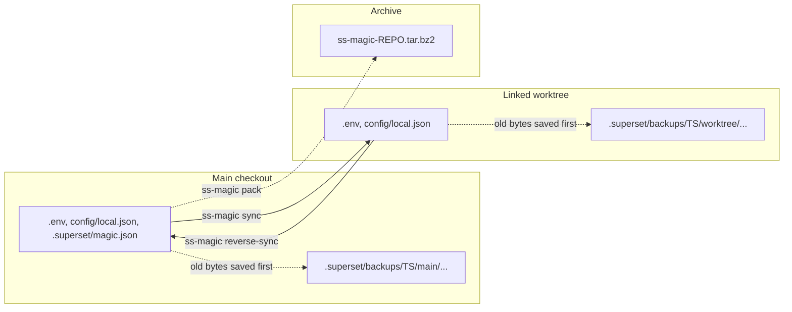
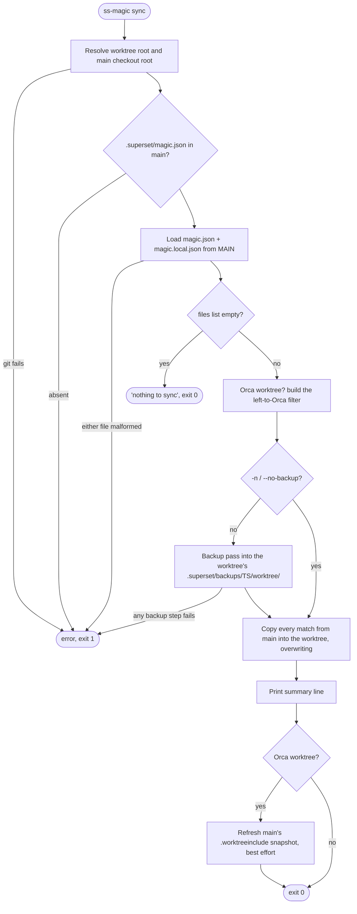
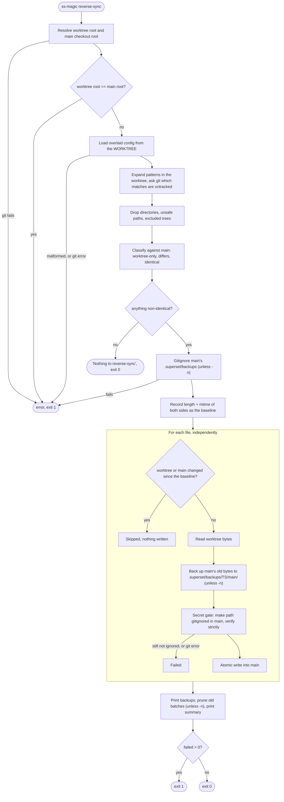
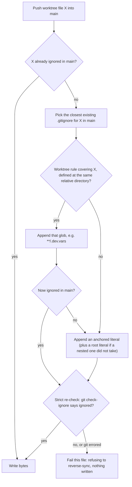

# Forward sync and reverse-sync: the non-interactive commands

You declare the files once, as glob patterns in a committed `.superset/magic.json`. ss-magic then keeps that one file set in step across a repository's main checkout and its linked worktrees. Two scriptable commands move those files without any prompts:

| Command | Direction | Typical caller |
|---|---|---|
| `ss-magic sync` | main checkout to the current worktree | the Superset and Orca setup hooks, or you in a fresh worktree |
| `ss-magic reverse-sync` | current worktree to main checkout | you or a script, after creating a secret in a worktree |

Both are *files-only*. They make no commits, pushes or `gh` calls (git is only queried, and reverse-sync appends `.gitignore` rules), and they run no setup commands: those live in Superset's own `config.json` and Superset runs them.

Tracked files are out of scope by design, because they already travel through ordinary commits and merges. ss-magic is not a secrets manager either: the files stay ordinary files on disk, and you decide which paths may be copied or packed.

> [!NOTE]
> Related operations over the same file set:\
> The interactive **Sync** entry of the worktree menu reconciles in both directions through a merge cockpit. It is how a secret created in a worktree reaches everywhere else, and how a file added directly to main reaches a worktree: [interactive-sync.md](./interactive-sync.md).\
> `ss-magic pack` archives the whole set into `ss-magic-<repo>.tar.bz2`: [pack.md](./pack.md).\
> How the globs in `magic.json` are expanded: [sync-patterns.md](./sync-patterns.md).\
> Orca-specific behaviour of forward sync: [orca.md](./orca.md).

## The big picture



Each command backs up the bytes it is about to overwrite on the *destination* side, then writes. Forward sync overwrites the worktree, so its backups live in the worktree. Reverse-sync overwrites main, so its backups live in main.

## `ss-magic sync` – forward sync

Run it from inside a linked worktree. Under Superset and under Orca it runs automatically the moment a workspace or worktree is created: each app's setup-script hook runs `./.superset/magic.sh sync`, a committed wrapper that hands over to `ss-magic sync` (and, when the binary is not installed, prints an install hint and exits 0 so the setup continues). Without either app it is one command to run in a fresh worktree. The wrapper and the rest of the `.superset/` layout are covered in [superset-contract.md](./superset-contract.md).



### Step by step

1. **Resolve roots.** The worktree root comes from `git rev-parse --show-toplevel` (so running from a subdirectory still targets the whole worktree). The main checkout root is the parent of `git rev-parse --git-common-dir`. If either fails (for example, outside a git repository) the command prints an error and exits 1.
2. **Require `.superset/magic.json` in main.** If it is absent, or vanishes between the check and the load, the command prints `error: no .superset/magic.json in <main root>; expected <path>` and exits 1. This is deliberate: a visible failure beats a silent no-copy inside Superset setup.
3. **Load the overlaid config from main.** `magic.json` plus the per-machine `magic.local.json` (the overlay rules are in [sync-patterns.md](./sync-patterns.md)). A malformed file in either is a hard error, exit 1.
4. **Empty `files` list.** Prints that `files` is empty and there is nothing to sync, and exits 0.
5. **Orca filter.** In an Orca worktree, the paths Orca already copied from main's `.worktreeinclude` are left alone unless you pass `--no-orca-skip`. Outside Orca this step does nothing. Details: [orca.md](./orca.md).
6. **Backup pass** (skipped with `-n`/`--no-backup`). Any failure here, including failing to gitignore the backups tree, exits 1 *before anything is copied*. See [Backups](#backups).
7. **Copy.** Every match is copied from main to the same relative path in the worktree, creating parent directories as needed. Matched directories are copied recursively (symlinks inside them are skipped); existing destination files are overwritten. Pattern rules (absolute and `..` patterns rejected, `node_modules` and `.venv` dropped at any depth, the excluded trees never walked, de-duplication across patterns) are in [sync-patterns.md](./sync-patterns.md).
8. **Summary line**, then, in an Orca worktree only, a best-effort refresh of main's `.worktreeinclude` snapshot. Whatever that refresh reports, the exit status stands.

Config is read from **main**, not from the worktree. A `magic.json` edit made only in a worktree does not affect `sync` until it reaches main.

### Output and exit status

Each copied match prints `Copied: <path>`. A matched directory prints one line and counts as one in the summary, not once per file inside it. Skips print `Skipped (<reason>): <pattern or path>`:

| Skip | Reason label | Where it prints | Counts toward `skipped` |
|---|---|---|---|
| Absolute path or empty pattern | `absolute path rejected` | stderr, error style | yes |
| Pattern with a `..` segment | `".." not allowed` | stderr, error style | yes |
| Glob that does not compile | `bad glob` | stderr, error style | yes |
| Literal pattern that does not exist in main | `missing` | stderr, error style | yes |
| Match that is neither file nor directory | `not a file or dir` | stderr, error style | yes |
| A copy that failed | `copy failed` | stderr, error style | yes |
| Glob that matched nothing | `no matches` | stdout, plain | no |
| Match inside `node_modules`, `.venv` or an excluded tree | `excluded` | stdout, info style | no |
| Path Orca already copied | printed as `Left to Orca: <path>` | stdout, info style | no (counted separately) |

The last line is `Sync done: copied N files, skipped M files`, with `, left K paths to Orca` appended when the Orca filter kept anything out. It is green when `skipped` is 0 and a warning otherwise; paths left to Orca never turn it into a warning.

> [!IMPORTANT]
> The exit code is 0 whenever the run got as far as copying, **even if some items were skipped or a single file failed to copy**. Only the hard errors in steps 1–3 and a failed backup pass exit 1. A script that needs to know about per-file skips must read the summary line, not the exit code.

Forward sync is not offered from the worktree menu; the menu's single **Sync** entry covers pulling from main too.

## `ss-magic reverse-sync` – bulk push

Pushes every configured file that is git-**untracked** in the current worktree and differs from main. "Untracked" includes **gitignored** files, which is the point: the command exists for secrets such as `.env` and `.dev.vars` (and the gitignored `magic.local.json`) that never merge through git. Tracked files are never touched by this command. They reach main through a normal merge; to push a tracked file's local edits into main's working copy, use the interactive **Sync** entry ([interactive-sync.md](./interactive-sync.md)).



### Step by step

1. **Resolve roots.** Same as forward sync. If the worktree root *is* the main checkout, the command refuses with an error saying it must run from a worktree, not the main checkout, because there is nothing to push. It exits 1 without touching anything (no backups directory is created).
2. **Compute candidates.** The overlaid config is read from the **worktree**, unlike forward sync, which reads main. A worktree with no `magic.json` or an empty `files` list yields no candidates; a malformed `magic.json` or `magic.local.json` is an error, exit 1. The patterns are expanded in the worktree, then git is asked which of those matches are untracked with `git ls-files --others`, scoped to the matched paths. `--exclude-standard` is deliberately not passed, since that would drop exactly the gitignored files this command exists to find.
3. **Filter.** Matched directories contribute nothing, because reverse-sync copies single files. Paths that could escape the tree (absolute or containing `..`) are dropped. Anything inside one of the four excluded trees (`.superset/backups`, `.superset/.magic`, `.scratchpad`, `.git`) is dropped; why those four, and why the filter runs during the walk, is in [sync-patterns.md](./sync-patterns.md).
4. **Compare with main.** Candidates byte-identical to main are skipped. A file absent from main is *worktree-only*: the push creates it there, with any missing parent directories. A file that cannot be read on either side is treated as differing, so it is pushed rather than silently hidden.
5. **Nothing left?** Prints that there is nothing to reverse-sync because no untracked candidates differ from main, and exits 0.
6. **Prepare backups.** Unless `-n` is given, main's `.superset/backups/` is gitignored first. A failure here is an error, exit 1, before any file is written.
7. **Back up and write**, file by file, behind the guards described next. Each file prints `Applied <path> [worktree → main]`, with ` (gitignore rule added)` when the secret gate appended a rule, or `Skipped <path>: <reason>`, or `Failed <path>: <error>` on stderr.
8. **Report.** Lists the backups taken, prunes old batches, and prints `Reverse sync done: applied A, skipped S, failed F`: green when all applied, a warning when some were skipped, an error when any failed.

### Exit status

| Situation | Exit |
|---|---|
| Git cannot resolve a root, run from the main checkout, malformed worktree config, git error while listing untracked files, main's backups tree could not be gitignored | 1 |
| Nothing to push | 0 |
| Every file applied | 0 |
| Some files skipped (changed during the run) and none failed | 0, summary printed as a warning |
| Any file failed (read, backup, gitignore or write error, or the strict gitignore re-check refused) | 1 |

One failing file never aborts the batch: the others are still applied, and the failure shows in the summary and the exit status.

### Per-file guards

- **Concurrent-edit guard.** Just before the batch starts, the command records each side's length and mtime (plus a content hash when the filesystem reports no mtime). Immediately before writing a file it re-checks both the source and the target against that record. A file absent from main is pinned "absent", so a copy that appears in main meanwhile is not clobbered. If either side changed, or cannot be re-read, the file is skipped with `<path> changed since review`, and nothing is written for it. In the cockpit the record is taken when you *review*; this command has no review window, so the record is taken right before applying.
- **Atomic write.** Bytes are staged in a temp file in the target's directory and renamed over it, so an interrupted write cannot leave a truncated secret. On Unix an existing target's permission bits are preserved.
- **Order of side effects.** The source is read first, so a read failure leaves main untouched, with no stray backup and no stray `.gitignore` rule. Then main's old bytes are backed up, then the ignore rule lands, and only then the secret bytes.

## Backups

Both commands snapshot the bytes they are about to lose, unless you pass `-n` / `--no-backup`. The flag is recognised anywhere in argv, before or after the subcommand.

> [!WARNING]
> `--no-backup` removes the only recovery path for an overwritten untracked secret: there is no git history for it and no backup. It skips *only* the backup copy (and, with it, the backups-tree ignore rule and pruning); reverse-sync still runs the concurrent-edit guard and the gitignore gate.

### Layout

```plaintext
<root>/.superset/backups/
  20260716-153000/            batch directory, UTC time of the run (YYYYmmdd-HHMMSS)
    worktree/                 the worktree's old bytes (written by forward sync)
      .env
      apps/api/.dev.vars
    main/                     main's old bytes (written by reverse-sync)
      .env
```

The listing is illustrative: a real run fills only the side it overwrites, under the root it overwrites.

| Command | Backed up | Lands under |
|---|---|---|
| `sync` | each existing worktree file (or directory, copied recursively) the copy will overwrite | `<worktree>/.superset/backups/<ts>/worktree/<rel>` |
| `reverse-sync` | main's existing copy of each file being pushed | `<main>/.superset/backups/<ts>/main/<rel>` |

Details that matter in practice:

- A file that does not yet exist at the destination has nothing to lose, so no backup is created for it. `sync` into a fresh worktree therefore writes no backup files. The forward backup pass still adds the `.superset/backups/` ignore rule to the worktree whenever the patterns match anything in main.
- Paths left to Orca (the forward-sync filter) are not overwritten, so they are not backed up. A directory whose every file is left to Orca leaves no empty backup directory behind.
- The excluded trees are never backed up.
- The backups tree is **gitignored before the first backup is written**, at the closest existing `.gitignore` (or the repository root's), so recovered secrets cannot be committed by accident.
- Each run prints the backup paths so you can recover a mistake straight away.
- **Retention:** after each backing-up run the newest 10 batch directories are kept and older ones pruned. Only directories named like a batch (`YYYYmmdd-HHMMSS`, or the legacy all-digits epoch form, including those inside the legacy top-level `local/` and `main/` directories) are ever pruned; foreign entries are left alone. The batch just written is never pruned, even under a backwards clock jump. A pruning failure is a warning and never changes the exit status.

## Keeping a pushed secret uncommittable in main

Reverse-sync writes untracked bytes into the shared main checkout, the one place where a careless write could end up in a commit. Three rules guard that.



### 1. The gate runs before the bytes land, and is verified strictly

The path is first made ignored in main, then git is asked again. The helper that appends rules is git-*tolerant*: when git itself fails it writes a literal anyway, so bootstrap can still seed a `.gitignore`. The secret boundary therefore adds a strict second check. A git error, or a path that is still not ignored after the append, fails that file (the message starts `refusing to reverse-sync <path>: it is still not gitignored in main after appending an ignore rule`). No unignored secret is ever left committable in main. The check is ordinary code, not a debug assertion, so it runs in release builds.

### 2. How the closest `.gitignore` is chosen

When the path is not already ignored in main:

1. Walk down the path's parent directories inside main and take the **deepest directory that already contains a `.gitignore`**. If none does, use main's repository root. A nested `.gitignore` thus keeps ownership of its subtree and a rule never leaks to the root.
2. **Prefer a covering glob.** Ask git (`git check-ignore -v --no-index`) in the *worktree* which rule covers the file. That glob (for example `**/.dev.vars`) is reused only if the `.gitignore` defining it sits at the *same relative directory* as the one chosen in step 1, and only if it then really ignores the path in main. A rule's meaning depends on where its `.gitignore` sits: a bare `*` in a nested `.scratchpad/.gitignore` ignores only that subtree, but copied to main's root it would ignore the whole repository. Rules from outside the tree (`.git/info/exclude`, a global excludes file) and negations (`!...`) are never copied.
3. Otherwise append an **anchored literal**. At the repository root the rule is the relative path verbatim; a bare top-level name such as `.env` is intentionally left unanchored, so it matches at any depth. That only widens the ignore, which is the safe direction for secrets. In a nested `.gitignore` the rule is `/`-anchored relative to that directory.
4. If a nested `.gitignore` still does not cover the path, add a root-level literal as a last resort.

Existing `.gitignore` content is never reordered or rewritten. A rule is appended on its own line only if that exact line is not already present, and the file is created if missing. Directory rules (used for `.superset/backups`) get a trailing slash.

### 3. "Is it a secret?" is answered positively, failing closed

The project rule is that a gate asks the question whose *unknown* answer is the refusing one. A path counts as untracked only when it is **absent from a positively enumerated tracked set** (`git ls-files --cached`), never because it showed up in an untracked list. A name git reports oddly (non-UTF-8, NFD versus NFC) then misses the tracked lookup and lands on the secret side, so it still gets the gitignore gate instead of slipping past it. In the same spirit, a file with no recorded baseline defaults to "untracked".

Where this applies:

| Path | How "secret" is decided |
|---|---|
| Interactive Sync cockpit | positive tracked set over the worktree matches; a candidate is untracked when it is not in that set. A tracked file is already committed in main and never gains a `.gitignore` rule |
| `ss-magic reverse-sync` | candidates come from `git ls-files --others`, so every candidate is untracked by construction, and the gate is applied to every one unconditionally. Tracked files cannot become candidates at all |

For the bulk command the two safeguards combine: a tracked file is never a candidate, and every candidate goes through the gitignore gate. A name git does not report as untracked is simply not pushed.

## Related behaviour and flags

- **`--no-orca-skip`** (no short form) applies to `sync` only and is recognised anywhere in argv. In an Orca worktree, forward sync normally leaves alone the files Orca already copied from `.worktreeinclude`; this flag copies them too. It has no effect outside Orca. Even with the flag, the end-of-run snapshot refresh still happens. See [orca.md](./orca.md).
- **Auto-update gate.** Both commands pass through the daily (24-hour cached) self-update check before doing any work. `SS_MAGIC_NO_UPDATE=1` disables it (any value other than empty or `0` counts); the explicit `ss-magic update` ignores that variable and always checks. See [installation-and-updates.md](./installation-and-updates.md).
- **The worktree menu** opened by bare `ss-magic` offers a single interactive **Sync** entry that reconciles files in both directions through the merge cockpit. There is no separate forward or reverse choice there. See [interactive-sync.md](./interactive-sync.md).
- **No `plugin` subcommand.** The Claude Code plugin is a separate binary, `ss-magic-plugin`, delivered by the marketplace and reached from inside a Claude Code session. The old `plugin` token was removed outright rather than aliased, so typing it produces the ordinary unknown-command error (exit 2). See [claude-code-plugin.md](./claude-code-plugin.md).

## Gaps and unknowns

- `ss-magic sync` has no guard like reverse-sync's "must run from a worktree" check. When it is run from the main checkout itself, source and destination are the same tree. No code comment specifies that case and no test covers it, so this document makes no claim about the outcome. Run `sync` from a linked worktree.
- End-to-end tests cover the reverse-sync happy path, the from-main refusal and the outside-a-repo error ([reverse_sync_flow.rs](../../crates/ss-magic/src/tests/reverse_sync_flow.rs)). The per-file guards, `run_bulk` with and without backups, and pruning are covered by unit tests in [reverse_sync/tests.rs](../../crates/ss-magic/src/sync/reverse_sync/tests.rs).

## Where this lives in the code

| Concern | File |
|---|---|
| Argument parsing, `-n` and `--no-orca-skip` scanning | [cli.rs](../../crates/ss-magic/src/cli.rs) |
| `sync_core`, `run_reverse_sync_flow`, root resolution, `load_magic_or_exit`, the update-gate inclusion list, output lines | [main.rs](../../crates/ss-magic/src/main.rs) |
| Overlaid config loading (`load_overlaid`) | [superset_files.rs](../../crates/ss-magic-core/src/superset_files.rs) |
| Glob expansion, copy engine, `PathFilter`, skip reasons and summary | [apply.rs](../../crates/ss-magic-core/src/sync/apply.rs) |
| `EXCLUDED_TREES` and `under_excluded_tree` | [sync/mod.rs](../../crates/ss-magic-core/src/sync/mod.rs) |
| `run_bulk`, `compute_candidates`, `compute_reconcile_set`, `backup_forward_targets`, retention, apply guards, `ensure_gitignored_in_main` | [reverse_sync.rs](../../crates/ss-magic/src/sync/reverse_sync.rs) |
| Backup path layout (`backup_rel_path`, `BackupSide`) | [merge.rs](../../crates/ss-magic/src/sync/merge.rs) |
| Closest-`.gitignore` selection, covering-rule scoping, `ensure_path_ignored` | [gitignore.rs](../../crates/ss-magic-core/src/git/gitignore.rs) |
| `cwd_repo_root`, `main_checkout_root`, `untracked_files`, `tracked_files`, `is_ignored` | [git/mod.rs](../../crates/ss-magic-core/src/git/mod.rs) |
| The `.superset/magic.sh` wrapper the setup hooks run | [magic.sh](../../assets/magic.sh) |
| Forward-sync tests | [sync.rs](../../crates/ss-magic/src/tests/sync.rs) |
| Rules behind the gates | [CODING_STANDARDS.md](../../CODING_STANDARDS.md) (Secret safety and sync), [CONCEPTS.md](../../CONCEPTS.md) |
