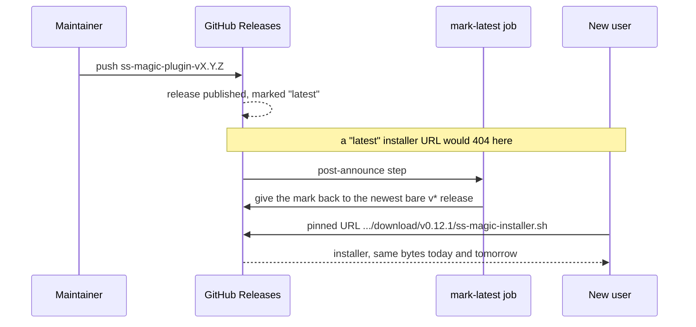
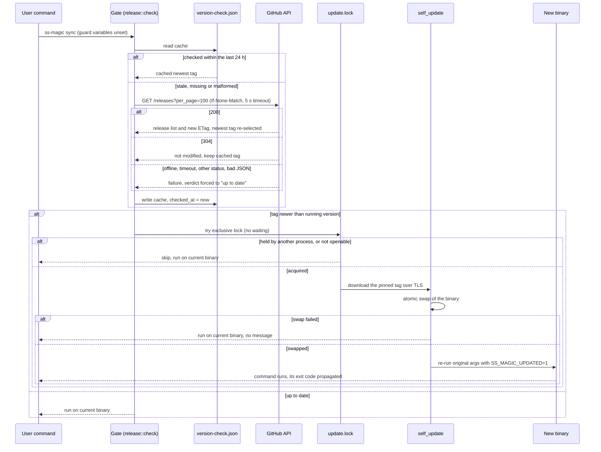
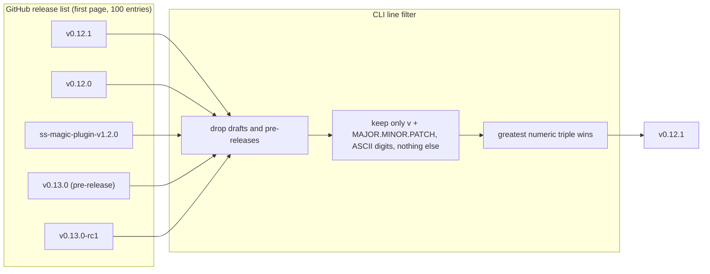

# Installing, verifying and updating ss-magic

This page covers how the `ss-magic` CLI reaches your machine, how to check that what you downloaded was built by this repository, and how the binary keeps itself current afterwards. For the project overview see the [README](../../README.md).

> [!NOTE]
> Everything here is about the `ss-magic` CLI. The Claude Code plugin ships its own binary through the marketplace and never self-updates; see [claude-code-plugin.md](./claude-code-plugin.md) and [Why the plugin is different](#why-the-plugin-is-different).

## Install

### One-line installer (recommended, macOS and Linux)

```sh
curl -sSfL https://github.com/ViktorStiskala/superset-magic/releases/download/v0.12.1/ss-magic-installer.sh | sh
```

The script fetches the right prebuilt binary for your platform and puts `ss-magic` on your `PATH`. cargo-dist is configured with `install-path = "CARGO_HOME"`, so the binary goes into Cargo's bin directory (`$CARGO_HOME/bin`, by default `~/.cargo/bin`). From then on the binary keeps itself current, as described in [Self-update](#self-update).

| Target | Platform |
|---|---|
| `aarch64-apple-darwin` | macOS, Apple Silicon |
| `x86_64-apple-darwin` | macOS, Intel |
| `aarch64-unknown-linux-gnu` | Linux, arm64 |
| `x86_64-unknown-linux-gnu` | Linux, x86-64 |

Windows is not in the release matrix yet.

### Why the URL names a version instead of `latest`

One workspace publishes two release lines:

| Line | Package | Tag shape | Ships |
|---|---|---|---|
| CLI | `ss-magic` | `vX.Y.Z` | per-target archives, `.sha256` checksums, the installer script |
| Plugin | `ss-magic-plugin` | `ss-magic-plugin-vX.Y.Z` | per-target archives, `.sha256` checksums, the marketplace zip; no installer script |

GitHub's "latest" mark is repository-wide. Right after a plugin release it points at that release, which publishes no installer script at all, so a `latest`-based install command would 404.



The release workflow hands the mark back to the newest CLI release in a post-announce step (`post-announce-jobs = ["./mark-latest"]` in [dist-workspace.toml](../../dist-workspace.toml)), so the window is minutes. A pinned URL never depends on it, and it is also reproducible: the command you copy today installs the same bytes tomorrow.

> [!NOTE]
> The pinned tag is allowed to lag the newest CLI version, and usually does by one release. Releases follow bump, merge, tag, so a README forced to name the current crate version would name an unreleased tag (and 404) for the whole window between a merged version bump and the published release. A slightly older tag is harmless: it exists, it installs, and the binary then updates itself to the newest release within a day, or immediately with `ss-magic update`.

The mark matters for a second reason. Every `ss-magic` binary older than 0.11.0 polls the repository-wide "latest" and parses only a bare `vX.Y.Z`, so a plugin release left holding the mark would make those installs report "up to date". Current binaries do not consult the mark at all (see [How a release is chosen](#how-a-release-is-chosen)).

### Manual download

1. Open the [v0.12.1 release](https://github.com/ViktorStiskala/superset-magic/releases/tag/v0.12.1).
2. Download the archive for your target plus its `.sha256` sibling. CLI archives are named `ss-magic-<target>.tar.gz` and contain `ss-magic-<target>/ss-magic`.
3. Verify the checksum, extract, and move `ss-magic` onto your `PATH`.

The plugin's own `ss-magic-plugin-<target>.tar.gz` archives sit on the plugin's releases and are not installed by hand: its `SessionStart` bootstrap fetches the one it pins and checks it against the published `.sha256` sibling.

Building from source is covered in [CONTRIBUTING.md](../../CONTRIBUTING.md).

## Verify a release

Releases after v0.2.0 attest their platform archives with signed build provenance (cargo-dist `github-attestations = true`, via `actions/attest`): `ss-magic-<target>.tar.gz` on the CLI's `vX.Y.Z` releases (v0.3.0 is the first) and `ss-magic-plugin-<target>.tar.gz` on the plugin's `ss-magic-plugin-vX.Y.Z` releases. The repository is public, so attestations are recorded in Sigstore's public [Rekor](https://docs.sigstore.dev/logging/overview/) transparency log. Verify a downloaded archive with the [GitHub CLI](https://cli.github.com/):

```sh
gh attestation verify ss-magic-aarch64-apple-darwin.tar.gz -R ViktorStiskala/superset-magic
gh attestation verify ss-magic-plugin-aarch64-apple-darwin.tar.gz -R ViktorStiskala/superset-magic
```

The first line checks a CLI archive, the second a plugin archive. Release notes also carry a `gh attestation verify --bundle` variant generated by cargo-dist; both commands are equivalent checks.

> [!IMPORTANT]
> A passing check proves the archive was built by this repository's release workflow from a specific commit. It is provenance, not a security audit of the contents.

Only the `.tar.gz` archives are attested. What protects each artifact on the path that actually consumes it:

| Artifact | Attested | What checks it |
|---|---|---|
| `ss-magic-<target>.tar.gz`, downloaded by hand | yes | you, with `gh attestation verify` and the `.sha256` sibling |
| `ss-magic-<target>.tar.gz`, downloaded by the self-updater | yes, but the updater does not read attestations | TLS only (see [Integrity model](#integrity-model)) |
| `ss-magic-plugin-<target>.tar.gz`, fetched by the plugin bootstrap | yes, but the bootstrap does not read attestations | the published `.sha256` sibling |
| Installer script | no | TLS, plus the checksummed archives it downloads |
| `.sha256` files | no | they are the checksums for the archives |
| Plugin marketplace zip | no | the SHA-256 pin in `.claude-plugin/marketplace.json` |

Attestation happens in cargo-dist's default `build-local-artifacts` phase on purpose: it signs same-job build output before it transits Actions artifact storage. Changing the phase is a security decision (see [.github/CLAUDE.md](../../.github/CLAUDE.md)).

## Self-update

### Which commands check

| Invocation | Daily gate | Notes |
|---|---|---|
| `ss-magic` (bare, the menu) | yes | the gate runs before the terminal check, so it also runs when the menu then refuses to open |
| `sync`, `reverse-sync`, `pack`, `orca` | yes | the non-interactive "do work" commands |
| `init` | no | one-time setup should not depend on a network round-trip |
| `-V` / `--version` anywhere on the line | no | answered before the gate, with no network call |
| `-h` / `--help` before the subcommand (or after `orca`) | no | answered before the gate, with no network call |
| an unknown subcommand | no | prints usage and exits 2 |
| `update` | no | takes its own forced path, see [`ss-magic update`](#ss-magic-update) |

> [!NOTE]
> A `--help` typed after `sync`, `reverse-sync` or `pack` is not treated as a help request; the command runs, and the gate with it. Only `orca` honours a trailing `--help`.

The list in `should_run_update_gate` is an inclusion list on purpose: a new command self-updates only when someone names it there.

The gate also covers the non-interactive `sync` inside Superset's pipeline. Two things keep it from breaking an unattended caller: every check failure falls through silently, and after an update the parent blocks until the re-run child finishes and passes on its exit code. The release-list check is bounded by a 5 second timeout. The archive download itself is not: `self_update` 0.44.0 builds its own HTTP client with no timeout and exposes no setter for one, so a stalled download can delay the run.

### The daily gate



Step by step:

1. **Loop guard.** If `SS_MAGIC_UPDATED` or `SS_MAGIC_NO_UPDATE` is set (see [Environment variables](#escape-hatches-and-environment-variables)), the gate does not run at all.
2. **Cache.** The version cache is `version-check.json` in the OS cache directory for the project name `ss-magic` (`~/Library/Caches/ss-magic` on macOS, `$XDG_CACHE_HOME/ss-magic` or `~/.cache/ss-magic` on Linux), next to `update.lock`. It stores `checked_at`, the newest CLI tag, and the ETag. If it was checked less than 24 hours ago, no network call is made. A missing or malformed file, or one with `checked_at` of 0, counts as stale. If no cache directory resolves at all (no home directory), the gate does nothing.
3. **Fetch.** Otherwise one unauthenticated request reads the first page of `GET /releases` (100 entries), with `If-None-Match` set to the cached ETag and a 5 second timeout covering connect, send and receive.
4. **Failure is silent.** Offline, timeout, any status other than 200 or 304 (a 403 rate limit included), or a body that is not a JSON array falls through on the installed version, with no output. This holds even if the previously cached tag was newer: an answer that cannot be confirmed now is not acted on. A failed attempt still stamps `checked_at`, so an offline machine retries once a day rather than on every invocation, and it keeps the previously cached tag and ETag.
5. **Verdict.** "Newer" means the cached tag's `MAJOR.MINOR.PATCH` is strictly greater than the running version, compared numerically.
6. **Lock.** The updater takes a non-blocking advisory lock (`fd-lock`) on `update.lock`. If another process holds it, this run skips and proceeds on the current binary; it never waits. If the lock file cannot even be opened (for example a read-only cache directory), the run also skips. The OS releases the lock when its holder exits or crashes, so a crashed updater cannot block later updates. A 60 second mtime TTL is extra defence: a lock file untouched that long is treated as stale and re-tried, but a lock that is still held makes the run skip all the same.
7. **Swap.** `self_update` fetches that exact release by tag, downloads its archive for your target over TLS, extracts `ss-magic-<target>/ss-magic`, and atomically replaces the running binary. The tag is always the one the gate resolved; the updater never asks GitHub for "latest" itself.
8. **Re-exec.** The original command is re-run on the new binary, resolved through the running executable's path (never `argv[0]` or `PATH`), with the same arguments and `SS_MAGIC_UPDATED=1`. The parent blocks until the child finishes and exits with the child's exit code; a child killed by a signal maps to exit code 1.

If the swap itself fails for any reason (download, extraction, replacement), the run continues on the current binary without a message. If the swap succeeded but the new executable cannot be resolved or started, ss-magic prints an error saying the requested work did not run and exits 1, so an unattended caller never mistakes a skipped `sync` for a successful one.

### How a release is chosen



- Drafts and pre-releases are dropped.
- Only tags of the exact shape `vMAJOR.MINOR.PATCH` count, with each part a non-empty run of ASCII digits. The plugin's `ss-magic-plugin-vX.Y.Z` tags and every other spelling (`ss-magic-v1.0.0`, `v1.0.0-rc1`, a fourth component, `V1.0.0`, `vv1.0.0`) are ignored by an anchored parse, not a prefix search.
- The greatest version wins, not the most recently created entry, so a patch release of an older minor created after a newer minor does not win.
- Only the first page is read. A CLI release that is not among the 100 most recently created releases reads as "no update", which is a missed update, never a wrong one.
- The repository-wide "latest" mark is never consulted, which is what keeps a plugin release from ever looking like a CLI one.

### Integrity model

The self-updater's only integrity check is the TLS-authenticated download from GitHub. It does not fetch or compare the published `.sha256` files, adds no SHA-256-versus-GitHub-asset-digest check, and does not consume the release attestations. `self_update` 0.44.0 is built without its `signatures` feature, which is the only verification it offers, so nothing runs between download and extraction. Binary signing is a deferred future item. cargo-dist's checksums and the attestations exist for manual downloads (see [Verify a release](#verify-a-release)).

Archives are `.tar.gz` because `self_update` is built with `archive-tar` and `compression-flate2` (gzip) only, and cargo-dist 0.32 would default to `.tar.xz` on Unix, hence `unix-archive = ".tar.gz"`. The installer's own updater is disabled (`install-updater = false`), so there is exactly one update path.

### `ss-magic update`

The explicit force path. It ignores the 24 hour cache, reads and writes no cache file, sends no ETag, and asks GitHub for the release list directly. It then:

1. stops with a warning if the list could not be fetched, or contains no CLI-line tag; being offline is never reported as being up to date;
2. reports "already latest" if the newest tag is not newer than the running binary, before any download;
3. otherwise takes the same lock and pinned `self_update` swap as the gate (unlocked only in the defensive case where no cache directory resolves), and reports the resulting version.

Unlike the gate it does not re-exec, because the update is the requested work. `SS_MAGIC_NO_UPDATE` and `SS_MAGIC_UPDATED` do not affect it.

| Output (under a "Self-update" heading) | Meaning |
|---|---|
| `Updated to v<version>.` | a newer release was installed |
| `Already on the latest release.` | the newest CLI release is not newer than this binary |
| `Could not check for a release; try again.` | the list was not fetched (offline, timeout, any non-200 status, malformed body) or holds no CLI tag |
| `Another update is already in progress; skipped. Try again in a moment.` | another updater holds the lock |

All four exit with status 0.

> [!WARNING]
> Two outcomes are reported under a message that does not describe them. A swap that fails after the lock is taken (download, extraction or replacement error) prints `Already on the latest release.`, not an error. A lock file that cannot be opened (for example a read-only cache directory) prints `Another update is already in progress`. This is how the code maps those results today.

## Escape hatches and environment variables

| Variable | Effect |
|---|---|
| `SS_MAGIC_NO_UPDATE` | Skips the auto-update gate entirely. `ss-magic update` still checks, because it is an explicit request. |
| `SS_MAGIC_UPDATED` | Set to `1` internally on the re-exec'd child so it cannot start another update (a loop guard). Not meant to be set by hand. |
| `NO_COLOR` | Disables ANSI colour output. |

Details that the names alone do not tell you:

- Both update variables count as set when the value is non-empty and not `0`. `SS_MAGIC_NO_UPDATE=1` works; `SS_MAGIC_NO_UPDATE=0` and an empty value do not.
- `NO_COLOR` counts as set whenever it exists, even with an empty value, and it wins over everything else. Without it, colour follows the `supports-color` crate's detection on stdout: off when stdout is not a terminal (for example when piping) or `TERM=dumb`, and forced on by `FORCE_COLOR` or `CLICOLOR_FORCE`. The decision is made once per process.
- To stop checks for good on a machine, export `SS_MAGIC_NO_UPDATE=1` in your shell profile. To update on demand, run `ss-magic update`.

## Why the plugin is different

The plugin binary never installs an update. It is pinned alongside the skills, hooks and Markdown the marketplace ships with it, and a silent mid-session swap would leave the two describing different behaviour. It links no updater, so this is a property of the binary rather than a rule about it. Updating the plugin through `/plugin` is what replaces its binary.

The plugin does check, on its own `ss-magic-plugin-vX.Y.Z` line and with its own cache file (`plugin-release-check.json`, in the same cache directory), only to tell you once that a newer release exists. Details: [claude-code-plugin.md](./claude-code-plugin.md).

## Where this lives in the code

| What | Where |
|---|---|
| Gate decision (which commands check) and dispatch, `ss-magic update` output | [main.rs](../../crates/ss-magic/src/main.rs) |
| Argument parsing, where `--help` and `--version` are recognised | [cli.rs](../../crates/ss-magic/src/cli.rs) |
| `auto_update`, `update_command`, report mapping | [update/mod.rs](../../crates/ss-magic/src/update/mod.rs) |
| Lock, `self_update` call, re-exec, guard variables, the `self_update` gaps it records | [update/apply.rs](../../crates/ss-magic/src/update/apply.rs) |
| Release lines, cache, ETag fetch, anchored tag filter | [release.rs](../../crates/ss-magic-core/src/release.rs) |
| `NO_COLOR` and colour detection | [style.rs](../../crates/ss-magic-core/src/style.rs) |
| Release matrix, archive format, attestations, mark-latest hook | [dist-workspace.toml](../../dist-workspace.toml) |
| The mark-latest script | [mark-latest.sh](../../scripts/mark-latest.sh) |
| CI gate, attestation and mark-latest notes | [.github/CLAUDE.md](../../.github/CLAUDE.md) |

Related explainers: [claude-code-plugin.md](./claude-code-plugin.md), [forward-and-reverse-sync.md](./forward-and-reverse-sync.md), [interactive-sync.md](./interactive-sync.md).
