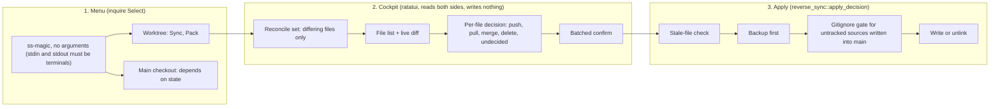
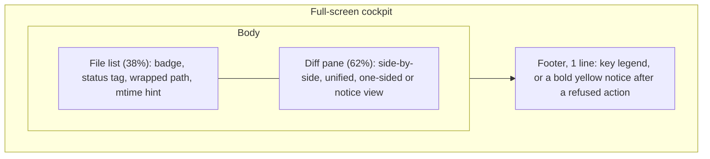
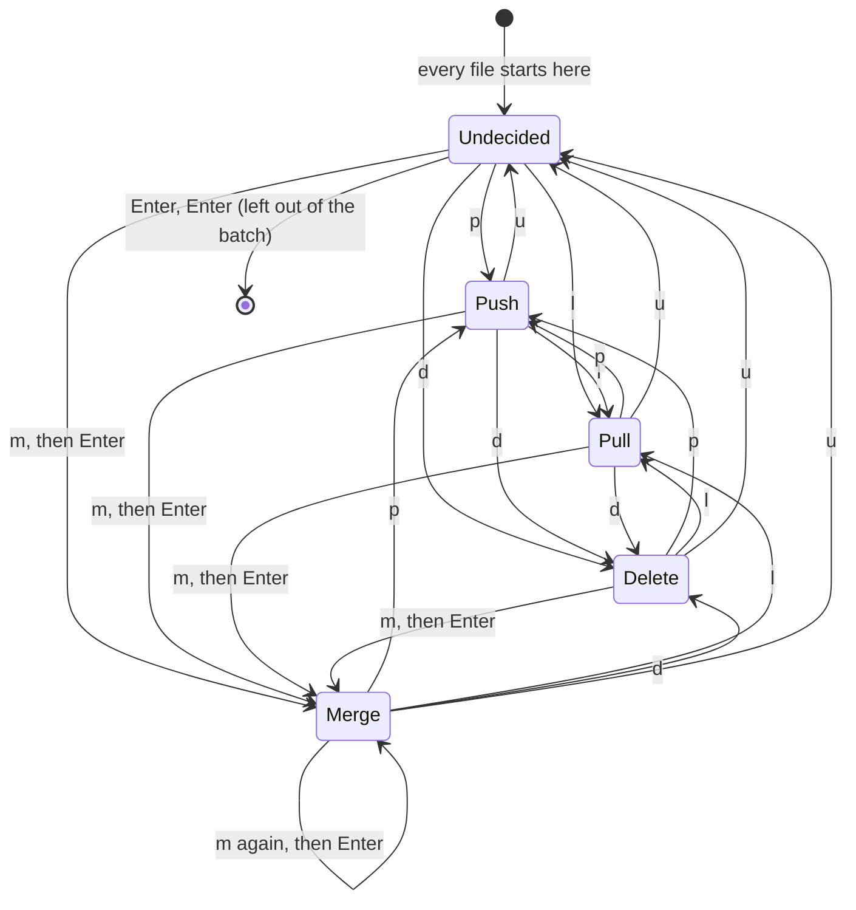
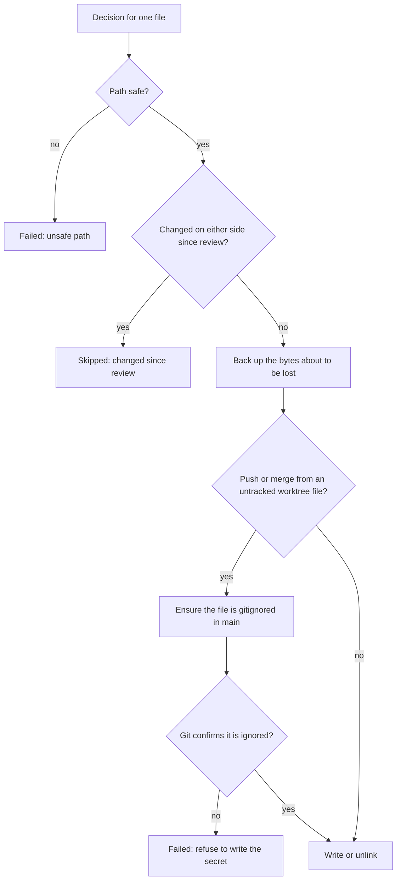

# The interactive menu and the Sync merge cockpit

Running `ss-magic` with no arguments opens a menu. From a worktree, its main entry is **Sync**: a full-screen cockpit where you look at every configured file that differs between the worktree and the main checkout, decide what happens to each one, and apply all decisions in one reviewed batch.

Sync works in **both directions** and covers tracked and untracked files alike. Nothing is pre-selected and nothing is written until you confirm. This page covers both layers, from the menu to the safety rails around the final write.

> [!NOTE]
> The menu and the cockpit need a real terminal. For scripts and CI use the non-interactive commands described in [forward-and-reverse-sync.md](./forward-and-reverse-sync.md).

Messages quoted on this page are copied from the source, except that the long dash the program prints is written here as an en dash (–).

## At a glance



The split matters for safety: the cockpit only collects decisions and returns either *apply* or *cancel*. All writes happen afterwards in the sync engine, which has its own guards.

## The menu

The bare invocation asks "What would you like to do?" and offers entries that depend on where you run it. Nothing runs until you pick an entry. Navigation is `↑↓` and Enter; Esc or Ctrl-C prints "Cancelled – nothing changed." and exits 0, leaving the tree untouched.

On the main checkout, the state comes from the `setup` array in `.superset/config.json`:

| Where you run it | State | Entries offered |
|---|---|---|
| Worktree | any | **Sync with main** (interactive push, pull, merge or delete per file), **Pack configured files into a tar.bz2 archive** |
| Main checkout | an entry references the old `setup.sh` (wins even if a new marker is present too) | **Migrate to the magic.json layout** |
| Main checkout | no `config.json`, or no entry references `setup.sh`, `magic.sh` or `ss-magic sync` | **Initialize ss-magic** |
| Main checkout | an entry references `magic.sh` or `ss-magic sync` (already migrated) | **Edit synced files (magic.json)**, **Pack configured files into a tar.bz2 archive**, **Refresh Orca files (orca.yaml, .worktreeinclude)** |

A few details worth knowing:

- On the main checkout the menu offers one lifecycle operation chosen from the detected state: init the contract, migrate an old `setup.sh` layout, or edit the synced-files config. Once the contract exists, **Pack** and **Refresh Orca files** are offered next to edit config. Refresh Orca files is the menu form of `ss-magic orca` (see [orca.md](./orca.md)).
- **Pack** is offered wherever an initialized `magic.json` exists: any worktree, or the main checkout once set up (see [pack.md](./pack.md)). The init and migrate states have nothing to archive yet, so it is not listed there.
- **Refresh Orca files** is not in the worktree menu. The `ss-magic orca` command itself still works from a worktree.
- A malformed `config.json` on the main checkout is a hard error naming the file (exit 1), not a menu.
- If stdin or stdout is not a terminal, the menu does not open at all. It prints "error: cannot open the interactive menu – stdin is not a terminal." (or "stdout is not a terminal", or "neither stdin nor stdout is a terminal"), points at `ss-magic --help`, and exits **2**.
- The bare invocation runs the auto-update check before the menu opens; see [installation-and-updates.md](./installation-and-updates.md).
- Init, migration and the edit-config flow are covered in [superset-contract.md](./superset-contract.md).

## Which files appear in the cockpit

When you pick **Sync**, ss-magic reads the worktree's sync patterns (`magic.json` plus the per-machine `magic.local.json` overlay), expands them against **both** roots (so a file that exists only in main is found too) and classifies every match. Tracked and untracked files are both offered; tracked-ness only matters for the gitignore gate described below. How patterns expand is explained in [sync-patterns.md](./sync-patterns.md).

| Class | Meaning | What push does | What pull does | Shown in list as |
|---|---|---|---|---|
| **Differs** | Exists on both sides with different bytes | Overwrites main | Overwrites the worktree copy | `(differs)` in yellow |
| **Worktree-only** | Absent in main | Creates it in main | Unavailable (nothing to pull) | `(new)` in green |
| **Main-only** | Absent in the worktree | Unavailable (no worktree copy to push) | Creates it locally | `(main only)` in cyan |
| **Identical** | Same bytes on both sides | – | – | Hidden, nothing to reconcile |

Some paths never reach the list, because they are dropped before classification:

- Directory matches, so a directory pattern is never offered as a unit (Sync reconciles single files).
- Anything under the tool's own `.superset/backups/` tree, so a recovered backup copy is never offered back to you.
- The rest of the excluded trees: the plugin's `.superset/.magic/` state, `.scratchpad/` and `.git/`.
- Paths that are absolute or contain `..` (a defence-in-depth check; the pattern syntax already rejects them).

Two edge cases in classification:

- A path that has vanished from both sides between enumeration and classification is treated as identical and hidden.
- If a file exists on both sides but either copy cannot be read (permissions, I/O), it is listed as **Differs** rather than hidden, and the diff pane shows the read error (see [The diff pane](#the-diff-pane)).

If nothing needs reconciling (including when the worktree has no `magic.json`, or its pattern list is empty), ss-magic prints "Everything configured is already in sync with main." and exits 0 without opening the cockpit.

## Non-interactive refusal

The cockpit needs a terminal on both stdin and stdout. In normal use this is already enforced one step earlier: the bare menu refuses to open without a terminal (exit 2, see [The menu](#the-menu)), so Sync cannot be picked from a pipe.

Sync repeats the check itself as a second guard. After the "already in sync" check (so an empty set still exits 0) and before capturing anything or opening the cockpit, a missing terminal makes it write nothing and exit **2**:

```plaintext
error: interactive sync needs a terminal – the merge cockpit cannot run piped or in CI.
Use the non-interactive `ss-magic sync` (main → worktree) or `ss-magic reverse-sync` (worktree → main) instead.
```

Exit code 2 lets a script tell "could not run, wrote nothing" apart from a real success. Unlike Sync, the non-interactive `ss-magic reverse-sync` pushes untracked files only; see [forward-and-reverse-sync.md](./forward-and-reverse-sync.md).

## The cockpit layout

The screen is two panes plus a one-line footer. The file list takes the left 38% of the width and the diff the right 62%.



### The file list

Each row has three parts:

1. A decision **badge** and the status tag from the table above.
2. The repo-relative path. Long paths **wrap onto extra lines** instead of being clipped.
3. Two dim lines: the label "mtime hint (unreliable):" and the values, for example `local 5m ago · main 2d ago`. Values read `just now`, `Nm ago`, `Nh ago` or `Nd ago`; a missing side shows a dash placeholder, an unreadable timestamp shows `unknown`, and a timestamp ahead of the clock shows `in the future`. Treat it as a hint only: it is never used to decide anything.

Badges always pair a symbol with words, so direction never depends on position alone:

| Badge | Colour | Decision |
|---|---|---|
| `? undecided` | yellow | Nothing will happen to this file |
| `→ push to main` | green | Copy the worktree file into main |
| `← pull from main` | cyan | Copy main's file into the worktree |
| `⇄ merge (assembled)` | magenta | Write the merged text to both sides |
| `✗ delete (worktree + main)` | red | File on both sides: remove both copies |
| `✗ delete (worktree copy)` | red | Worktree-only file: remove the worktree copy |
| `✗ delete (main copy)` | red | Main-only file: remove main's copy |

The delete badge and the batched confirm use the same function to name the affected sides, so they always agree. The in-app help describes `d` loosely as "delete from both sides (backed up first)"; in fact it removes only the copies that exist, as the badge says.

### The diff pane

The pane is chosen by file type and terminal width.

- **Side-by-side** when the diff pane is wide enough for two columns: "Local file" on the left, "Main branch" on the right, with a faint vertical divider between them. The threshold is 91 inner columns (two columns of 40 content columns plus a 5-column line-number gutter each, plus the divider). Because the pane is 62% of the screen, that is roughly a 150-column terminal.
- **Unified** when it is narrower: `-` rows are present in main but missing locally, `+` rows are local additions.
- Both text views fold unchanged runs, keeping 3 lines of context around each change, and highlight the changed part of a line.
- **Whole-file notice** instead of a diff for binary files (contains a NUL byte or is not valid UTF-8) and for oversized files (either side over 2 MiB, checked from file metadata before reading). Such files offer push and pull only.
- **"Line endings only" notice** when the two sides differ only by line endings or a trailing newline, instead of an empty diff. The notice says that `p`/`l` overwrite the raw bytes, while `m` then Enter converges both sides to the normalized text.
- An **unreadable** side (permissions or I/O error, not "missing") shows the error verbatim and keeps the cockpit open, with a hint naming what is still possible (for example "push only (pull/merge disabled)"). An empty buffer is never invented.

**Colours** follow one rule in both the split and unified views: main is the base, the worktree is the working copy.

| Colour | Meaning |
|---|---|
| Green | Local (worktree) additions and changes |
| Red | Main additions and changes |

A worktree-only file instead shows its content as numbered `+` lines under a green header, "new file – will be created in main". A main-only file shows the same under a cyan header, "main only – will be created in this worktree". These headers sit in a fixed row and do not scroll with the content.

**Long lines.** Content scrolls horizontally under fixed line-number gutters. When any line extends past the pane edge, the pane title adds "lines continue → (←/→ scrolls)"; after scrolling right it shows "→ col N" instead. The horizontal offset resets when you move to another file. This exists so a change hiding in a trailing comment or long value is never silently invisible.

**Line endings.** Diffs and merges are computed on EOL-normalized text: CRLF becomes LF, a trailing lone CR counts as an EOL, and a final newline is ensured. Hunks therefore show content changes only. Push and pull still copy the raw bytes, and a byte-level EOL difference still makes the file count as *differs*.

## Key map

Keys are checked by mode. Only Press events are handled.

### File list (normal mode)

| Key | Action |
|---|---|
| `↑` / `k` | Previous file |
| `↓` / `j` | Next file |
| `PgDn` / `Space` | Scroll the diff down |
| `PgUp` / `b` | Scroll the diff up |
| `→` | Scroll long lines right |
| `←` | Scroll long lines left |
| `p` | Decision: push worktree → main |
| `l` | Decision: pull main → worktree |
| `m` | Open the per-hunk merge overlay |
| `d` | Decision: delete |
| `u` | Decision: undecided |
| `?` | Toggle the help overlay |
| `Enter` | Open the batched confirmation |
| `Esc` | Cancel the whole cockpit, nothing written |

Notes on the table:

- Every file starts **undecided**, including a worktree-only file, so a bare Enter never pushes anything. Only files with a decision are handed to apply.
- Arrow keys left and right scroll in normal mode; `h` and `l` are *not* scroll keys there (`l` is pull).
- The page-scroll step is the terminal height minus 4 rows; horizontal scroll moves 8 columns per press.
- Any keypress in the file list clears the previous footer notice.
- Ctrl-C is not bound in the cockpit (the terminal is in raw mode, so it arrives as an ordinary, ignored key): `Esc` is the way out.
- The footer shows a one-line legend of these keys whenever no notice is displayed.

Some decisions are refused with a footer notice rather than silently ignored:

| Key | Refused when | Notice |
|---|---|---|
| `p` | Main-only file | "push unavailable – this file exists only in main (l pulls it)" |
| `p` | The worktree copy is unreadable | "push unavailable – the worktree copy is unreadable" |
| `m` | Not a differing text file | "merge unavailable here – only differing text files can be merged" |

`l` on a worktree-only file, or on a file whose main copy is unreadable, is a quiet no-op (decision unchanged). Direction gates are side-aware: a file whose *main* copy is unreadable can still be pushed (the worktree source is fine), and a file whose *worktree* copy is unreadable can still be pulled, which is the natural recovery.

### Merge overlay

| Key | Action |
|---|---|
| `↑` / `k` | Previous hunk |
| `↓` / `j` | Next hunk |
| `→` / `l` | Cycle the hunk choice forward |
| `←` / `h` | Cycle the hunk choice backward |
| `PgDn` / `Space` | Scroll the assembled preview down |
| `PgUp` / `b` | Scroll the assembled preview up |
| `Enter` | Accept: set this file's decision to merge |
| `Esc` | Cancel: the file's decision is unchanged |

Inside the overlay `h` and `l` cycle choices, so `l` does **not** mean pull there.

### Help and confirm

| Mode | Keys |
|---|---|
| Help overlay | `?` or `Esc` closes it; other keys do nothing. It is sized to fit an 80×24 terminal and also restates the backup location and the EOL rule |
| Confirm popup | `Enter` applies; `Esc` returns to the file list; every other key does nothing (there is no `y`/`n`) |

## Deciding what happens to each file

Each file moves between five states. The diagram shows the transitions from the file list and the merge overlay; `u` is always available to go back to undecided.



Not every edge exists for every file. Push needs a readable worktree source, pull needs a readable main source, merge needs a differing text file with both sides readable, and `d` (always available) removes whichever copies exist. Opening the merge overlay again on a file already set to merge starts over from keep-local on every hunk; `Esc` there keeps the earlier merge.

## The per-hunk merge overlay

`m` on a **differing text file** opens a centred overlay (about 88% wide, 90% tall). It splits the diff into hunks and lets you pick, per hunk, which side wins.

For each hunk the choice cycles between:

| Choice | Result in the merged text |
|---|---|
| keep-local | The worktree side of the hunk (the default for every hunk) |
| keep-main | Main's side of the hunk |
| keep-both | Local text, then main text (labelled "keep-both (local, then main)"; a newline is inserted between them if the local side lacks one) |

Cycling forward goes keep-local → keep-main → keep-both → keep-local; backward is the reverse.

The overlay shows, top to bottom: a header with `Hunk N/M` and the current choice, the focused hunk's local side (cyan border, "Local file (keep-local)"), its main side (green border, "Main branch (keep-main)"), the list of every hunk's current choice, and a live **assembled preview**. An empty side of a pure insertion or deletion is shown as an explicit placeholder rather than blank. If the files have no differing hunks (the "line endings only" case), the header says "No differing hunks – Enter accepts the shared text", and accepting writes the normalized text to both sides.

> [!IMPORTANT]
> The accepted bytes are written to **both** sides on apply, so the two files stop differing. They are assembled from the normalized text, so a merged file ends up with LF line endings and a trailing newline on both sides.

Merge is unavailable, with the footer notice above, for binary, oversized, unreadable, worktree-only and main-only files. Those offer only the push or pull that applies.

> [!NOTE]
> The overlay's side borders are cyan for local and green for main, which differs from the diff pane, where local is green and main is red. The labels in each box name the side, so rely on those rather than the border colour.

## Batched confirmation

`Enter` in the file list does not write anything. It opens one popup, titled "Confirm apply" and headed "Apply changes?", that lists every **existing** file the batch will overwrite or delete, each with its direction, under "These existing files will be OVERWRITTEN or DELETED (a backup is taken first):":

| Listed as | Cause |
|---|---|
| `worktree → main` | A push onto a file that already exists in main |
| `main → worktree` | A pull over an existing worktree file |
| `merged → both` | A merge (overwrites both sides) |
| `delete (worktree + main)`, `delete (worktree copy)`, `delete (main copy)` | A delete, naming exactly the sides removed |

Creating a file is non-destructive and is not listed: a worktree-only push creates a file in main, and a main-only pull creates one locally. If nothing in the batch overwrites or deletes, the popup says "No existing files will be overwritten or deleted." It always closes with "N file(s) will be written." (N counts every decided file, deletes included) and the legend "Enter = apply · Esc = back".

The popup is sized to its content. If the list is too long for the screen it truncates with an explicit "… and N more – review the file list before confirming" line, never silently.

Then:

- `Enter` applies.
- `Esc` goes back to the file list and changes nothing.

Pressing `Esc` in the file list, or applying with every file still undecided, leaves both sides fully untouched ("Nothing selected – worktree and main untouched.").

## What apply does to each file

After the cockpit returns, the engine processes the decided files one at a time, in list order. Each guard can only skip or fail a file, never clobber it. A failure on one file is reported and counted but does not abort the rest of the batch, and does not roll back files already written.



A push reads its worktree source before the backup step, so an unreadable source fails before anything happens to main (see [Write ordering](#write-ordering)).

### Stale-file skip

Before the cockpit opens, ss-magic records each offered file's size and modification time on both sides. At apply time it compares again. A file that was edited, created or deleted on either side while you were reviewing is **skipped with "changed since review"** instead of being overwritten. The check covers both the side being overwritten and the side being read from, so stale content is never pushed or pulled.

Details of that comparison:

- It compares length and mtime. If the filesystem reports no mtime, a content hash is used instead, so a bare length never counts as unchanged.
- The side that was absent at review is pinned as absent, so a copy that appears there meanwhile is skipped rather than overwritten without having been listed in the confirmation.
- A side that cannot be stat'ed is treated as changed (fail-closed): only a genuinely absent target is ever written blindly, because there are no prior bytes to lose.

### Backups and pruning

Before each destructive write or unlink, the **losing bytes** are copied to a batch directory named with the current UTC time, under the worktree's gitignored backups folder. Both sides' backups go there, including copies of main's files:

```plaintext
.superset/backups/<YYYYmmdd-HHMMSS>/worktree/<repo-relative path>
.superset/backups/<YYYYmmdd-HHMMSS>/main/<repo-relative path>
```

- Which side gets a backup follows what is overwritten: a push backs up main's copy, a pull backs up the worktree copy, and a merge or delete backs up whichever sides exist. Creating a file has nothing to back up.
- Sync takes these backups unconditionally; the `-n`/`--no-backup` flag belongs to the non-interactive commands (see [forward-and-reverse-sync.md](./forward-and-reverse-sync.md)).
- After the batch, the paths of the recorded backups are printed under "Backups of overwritten files (recover a mistake here):", so a mistake can be undone by copying the file back.
- Before the batch, the worktree's `.superset/backups/` is gitignored if it is not already (a rule in the closest existing `.gitignore`), so a recovered secret can never be committed. Init and migration add the same rule up front.
- Retention: the **10 newest** batch directories are kept and older ones are pruned after each apply, with a "Pruned N old backup batch(es), keeping the newest 10." message. Pruning is best effort: a failure prints a warning but never fails the sync, only recognisable batch names are touched, and the batch just written is always protected.

> [!WARNING]
> A deleted untracked secret has no git history to restore it. The backup is the only recovery path, which is why delete backs up every existing side before it unlinks.

### Write ordering

- **Merge** and **delete** check both sides before touching either, so a skip writes and backs up nothing. They then back up, add any ignore rule, and touch main first and the worktree second, so a failure early in the sequence leaves the worktree copy intact and the file is offered again on the next run.
- **Push** reads the worktree source before changing anything in main, so an unreadable source leaves main untouched with no stray backup and no stray ignore rule.
- Writes go through a temporary file in the target directory that is then renamed into place, so a failure cannot leave a truncated file. On Unix an overwritten file keeps its permission bits.

### Gitignore safety on push

Pushing into main is the one path that writes untracked files, possibly secrets, into the shared checkout. The gate depends on whether the worktree source is tracked by git:

| Worktree source | What happens to main's `.gitignore` | Recovery |
|---|---|---|
| **Untracked** (or not provably tracked) | A rule is added if main does not already ignore the file | Pre-write backup |
| **Tracked** | Untouched; main's working copy is updated in place | Pre-write backup and ordinary `git restore` |

Tracked-ness is determined **positively** and fails closed: a path that cannot be confirmed tracked is treated as a secret. The same gate applies to a merge (which also writes main) from an untracked source. Pull and delete never add ignore rules, since nothing secret lands in main.

When a rule is needed, the cockpit uses the same gate as `ss-magic reverse-sync`: the rule goes into the closest existing `.gitignore` in main, the worktree's own covering rule (for example `**/.dev.vars`) is reused only where it keeps its meaning, otherwise an anchored literal is written, and git is then asked again. If git errors or the file is still not ignored, the push **fails** instead of writing a secret that could be committed. How the `.gitignore` and the rule are chosen is explained in [forward-and-reverse-sync.md](./forward-and-reverse-sync.md#keeping-a-pushed-secret-uncommittable-in-main).

One cockpit-specific detail: when that re-check fails, a backup of main's copy may already be on disk (it is not listed in the printed backup paths), but main's copy itself is not touched.

The per-file line after apply shows "(gitignore rule added)" when a rule was added.

### The final summary

Each file prints one of:

- `Applied <path> [direction]`, where the direction is `worktree → main`, `main → worktree`, `merged → both` or `deleted from both sides` (the delete label is the same even when only one copy existed).
- `Skipped <path>: <reason>`, for example `<path> changed since review`.
- `Failed <path>: <error>`.

Then come the backup paths and any pruning message, and the batch ends with a line of this shape:

```plaintext
Sync done: applied 3, skipped 1, failed 0
```

It is green when everything applied, yellow if anything was skipped, and red with exit code **1** if any file failed. Skips alone do not change the exit code.

## Quick reference

| Question | Answer |
|---|---|
| How do I open it? | Run `ss-magic` inside a worktree and pick **Sync** |
| What gets listed? | Configured files that differ, exist only in the worktree, or exist only in main |
| Is anything pre-selected? | No, every file starts undecided |
| How do I leave without changes? | `Esc` in the file list, or `Esc` in the confirm popup |
| Where are backups? | `.superset/backups/<YYYYmmdd-HHMMSS>/{worktree,main}/…` in the worktree; 10 newest batches kept |
| What if a file changed while I was reviewing? | It is skipped, not overwritten |
| Exit codes | 0 success (also cancel, nothing to do, everything undecided), 1 if a file failed (or a setup error such as an unresolvable repo root), 2 if no terminal |

## Unknowns

- The terminal-restore path (a `Drop` guard plus a panic hook) and the event loop are exercised only by manual smoke testing; the render path and key dispatch are unit-tested with a test backend. No guarantee is made here beyond that.
- Menu routing is unit-tested as a pure function; the `inquire` prompt and handlers are manual smoke only.

## Where this lives in the code

| Area | File |
|---|---|
| Bare-invocation terminal check, update gate, dispatch | [main.rs](../../crates/ss-magic/src/main.rs) |
| Menu routing and handlers | [menu.rs](../../crates/ss-magic/src/tui/menu.rs) |
| Main-checkout state detection (init, migrate, normal) | [migrate.rs](../../crates/ss-magic/src/workspace/migrate.rs) |
| Cockpit state, key dispatch, rendering | [cockpit.rs](../../crates/ss-magic/src/tui/cockpit.rs) |
| Diff model, EOL normalization, size and binary limits | [diffmodel.rs](../../crates/ss-magic/src/tui/diffmodel.rs) |
| Decisions, hunk model, backup naming | [merge.rs](../../crates/ss-magic/src/sync/merge.rs) |
| Reconcile set, apply, guards, backups, pruning | [reverse_sync.rs](../../crates/ss-magic/src/sync/reverse_sync.rs) |
| Closest-`.gitignore` placement | [gitignore.rs](../../crates/ss-magic-core/src/git/gitignore.rs) |
| Excluded trees (`EXCLUDED_TREES`) | [sync/mod.rs](../../crates/ss-magic-core/src/sync/mod.rs) |
| Maintainer notes | [tui/CLAUDE.md](../../crates/ss-magic/src/tui/CLAUDE.md), [sync/CLAUDE.md](../../crates/ss-magic/src/sync/CLAUDE.md) |
| Vocabulary | [CONCEPTS.md](../../CONCEPTS.md) |

Related explainers: [forward-and-reverse-sync.md](./forward-and-reverse-sync.md), [sync-patterns.md](./sync-patterns.md), [superset-contract.md](./superset-contract.md), [pack.md](./pack.md), [orca.md](./orca.md). Back to the [README](../../README.md).
