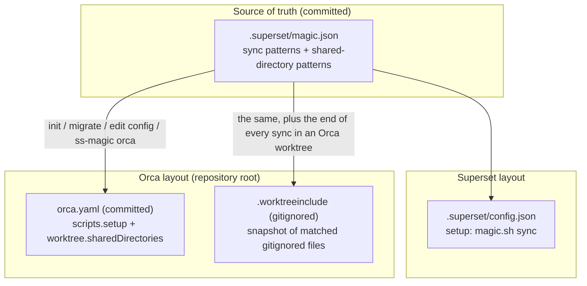
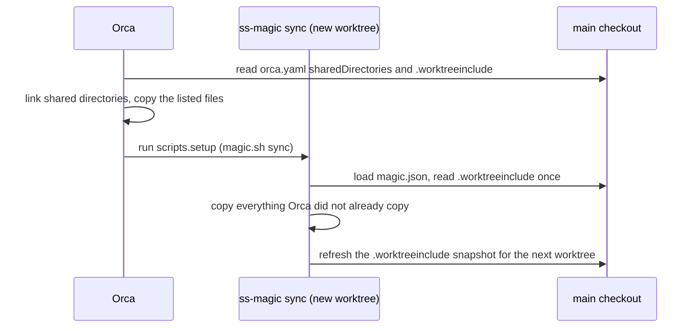
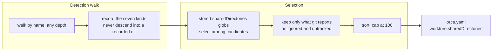
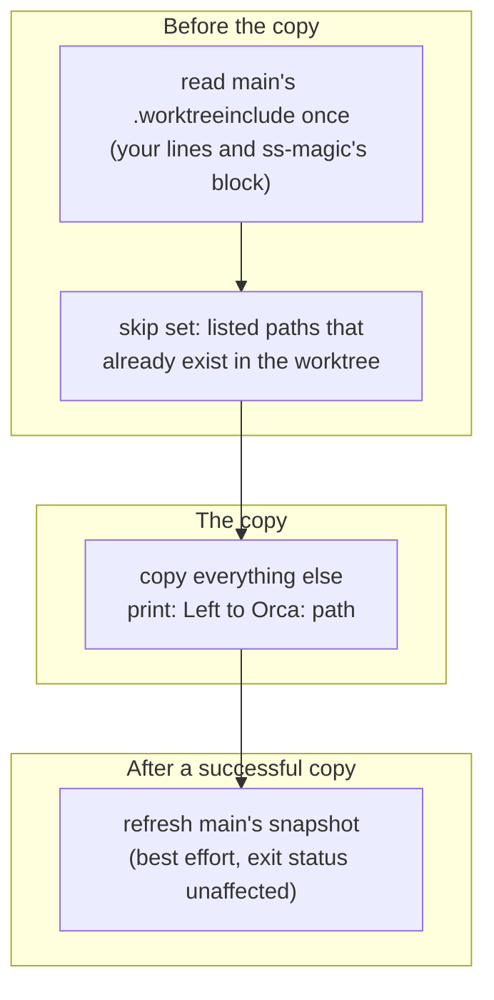

# Orca integration: orca.yaml, .worktreeinclude and Orca-mode sync

Orca creates git worktrees too, but it reads its own two files from the repository root. ss-magic generates both from the same `magic.json`, so one maintained list serves both Superset and Orca and nobody hand-writes or hand-syncs Orca's configuration.

Related reading:\
[sync-patterns.md](./sync-patterns.md) for how `magic.json` globs are expanded\
[forward-and-reverse-sync.md](./forward-and-reverse-sync.md) for the non-interactive `sync` command\
[superset-contract.md](./superset-contract.md) for init, migrate and edit config\
[CONCEPTS.md](../../CONCEPTS.md) for the shared vocabulary

## The two files at a glance

| File | Committed? | What it holds |
| --- | --- | --- |
| `orca.yaml` | yes | `scripts.setup`, which runs `./.superset/magic.sh sync` in a new worktree, and `worktree.sharedDirectories`, the dependency directories Orca links or clone-copies |
| `.worktreeinclude` | no (gitignored) | a per-machine snapshot: the literal, gitignored files your sync patterns match in the main checkout right now |

Both live at the repository root, outside `.superset/`, and Orca reads both from the **main checkout**.



## Division of labour

Orca's native mechanisms only partly overlap with ss-magic's, so each does what it is good at.

| Mechanism | Who runs it | What it is good at |
| --- | --- | --- |
| Shared directories | Orca | `node_modules`, Python virtualenvs and JS build caches are dependency trees, not configuration. ss-magic's sync drops any pattern match inside `node_modules` or `.venv` and is not meant to carry the others (see [sync-patterns.md](./sync-patterns.md)). Orca links or clone-copies them, so a new worktree starts with dependencies already there. |
| `.worktreeinclude` | Orca | Orca copies these files itself, before the setup script runs. It takes literal paths only (no globs) and copies once, at creation. |
| Setup script | ss-magic (`magic.sh sync`) | Fills the gaps: files added since the snapshot was written, tracked files your patterns match, and anything Orca's copy budget left out. It skips the files Orca already copied. |

## What happens when a worktree is created

The order is fixed.



`worktree.sharedDirectories` and `.worktreeinclude` come from the main checkout's working tree. `scripts.setup` comes from the **new worktree's own** `orca.yaml`.

> [!IMPORTANT]
> Commit `orca.yaml`. Because Orca reads the setup script from the new worktree's own copy of the file, an uncommitted `orca.yaml` never runs it. The snapshot is the opposite: it describes one machine's files, is gitignored by ss-magic, and is never committed. The commit / push final action of init and migrate stages `.superset`, `.gitignore` and `orca.yaml`, and never `.worktreeinclude`.

> [!NOTE]
> A teammate without ss-magic installed still gets Orca's own copies and links. `magic.sh` exits 0 with an install hint, so only the gaps go unfilled.

## Ownership rules: your lines are safe

ss-magic edits only what it owns and leaves everything else as it found it.

| File | ss-magic owns | Everything else |
| --- | --- | --- |
| `orca.yaml` | `scripts.setup` (gains a line) and `worktree.sharedDirectories` (replaced outright) | Other keys, comments and formatting are left exactly as they were |
| `.worktreeinclude` | The block between its two marker comments | Lines outside the block are yours and survive each rewrite byte for byte (only a stray begin marker with no end marker is dropped) |

A file that cannot be edited safely is left untouched, and the lines to add by hand are printed instead.

## orca.yaml

ss-magic manages two keys:

```yaml
scripts:
  setup: |
    ./.superset/magic.sh sync
worktree:
  sharedDirectories:
    - node_modules
    - apps/web/node_modules
```

### scripts.setup is ensured

An existing `scripts.setup` keeps its commands and gains the `magic.sh sync` line in front of them, so secrets are in place before a `pnpm install` in the same script. The line is added only when no trimmed line already equals it.

The script is written as a literal block scalar whose chomping indicator matches the script's own trailing line breaks (`|-` for none, `|` for one, `|+` for more). When a block scalar cannot carry the script (it is empty, holds a control character, has a line starting with a tab, or its first line starts with a space), it is written double-quoted instead. Each candidate is checked by the re-parse, and the first one that reads back as the intended script wins.

### worktree.sharedDirectories is owned

The list is replaced by whatever the `sharedDirectories` patterns in `magic.json` match now, so an entry someone added by hand does not survive. Add a directory through `magic.json` (edit config), not by hand.

Only the committed `magic.json` decides this list. A `sharedDirectories` key in `magic.local.json` is ignored, because the list lands in the committed `orca.yaml` and a per-machine file must not decide what the whole team's Orca worktrees share. (The `.worktreeinclude` snapshot, by contrast, uses the overlaid sync patterns of both files.)

### Layouts ss-magic refuses to edit

The file is edited as text (so comments survive) and then re-parsed to check the result. ss-magic does not edit the file at all, and prints the lines to add by hand, when `orca.yaml`:

- does not parse (duplicate keys included), holds more than one document, or declares `%YAML 1.1` (Orca's parser would switch to 1.1 rules while ss-magic's keeps reading 1.2);
- has a top level that is not a block mapping, or carries a merge key (`<<`) there;
- uses an alias (`*name`) or a merge key (`<<`) on the way to either key;
- writes `scripts` or `worktree` as a flow mapping (`{ ... }`) or another flow collection, as an empty value, or as anything that is not a mapping.

Also refused: a `scripts.setup` that is not a string, and a layout the editor has no rule for or whose edited text fails the re-parse.

> [!WARNING]
> Refusal holds even when both keys already say the right thing, and for the `ss-magic orca` refresh as well. A refresh does skip the setup script, but that does not narrow the refusal rules: a flow-style `scripts` refuses a refresh too.

A file without a `scripts` or `worktree` key is fine: the block is added at the end. Anchors and tags on a managed node are kept. If a key referring to the anchor would change, the re-parse refuses the edit.

A refusal prints `orca.yaml was not changed: <reason>.` followed, where it applies, by the block to add by hand. When the file is edited, the notice reads `Created orca.yaml` or `Updated orca.yaml` with a reminder to commit it.

## Shared directories

### The seven kinds

ss-magic detects directories by name, and these are the kinds offered by default:

| Pattern | Typical content |
| --- | --- |
| `**/node_modules` | JS dependencies |
| `**/.venv` | Python virtualenv |
| `**/venv` | Python virtualenv |
| `**/.cache` | tool caches |
| `**/.turbo` | Turborepo cache |
| `**/.parcel-cache` | Parcel cache |
| `**/.next/cache` | Next.js build cache |

Rust's `target/` is deliberately not detected.

### How candidates become the list



- A `sharedDirectories` pattern **selects among what was detected**. A narrower pattern such as `apps/*/node_modules` shares only some of them. A pattern cannot make a directory of another kind shareable.
- A `node_modules` nested inside another `node_modules` is never listed, because the walk does not descend into a recorded directory.
- A directory that is tracked or not gitignored is never shared. Git must positively report it as ignored and untracked.
- Symlinks are not followed (a symlinked directory is neither recorded nor entered, since sharing it would hand Orca a path outside the checkout). Excluded trees and directories holding a `.git` (submodules, nested repositories) are skipped, and nothing else is pruned, so a kind is found at any depth.
- Outside a git repository, or when git cannot answer, nothing is positively ignored and the list is empty.
- Only the first 100 directories in sorted order are kept (Orca's limit). The rest are not shared, and forward sync is no substitute for them (it drops matches inside `node_modules` and `.venv`), so a warning tells you to narrow the `sharedDirectories` patterns in `magic.json`.

**Which patterns get stored in `magic.json`:**

- Interactive init and edit config show a picker of the seven default kinds plus any stored pattern that is not one of them. What starts checked is the stored list when the key exists (a stored "none" included), otherwise every kind that matches something.
- When nobody is asked (a scripted `ss-magic init`, and migrate, which asks nothing about shared directories), a stored list is kept, empty included. Otherwise every default kind that matches something is stored. When none matches, the key is left absent, so a scripted init before dependencies exist does not record a "chose none".

> [!WARNING]
> A shared Python virtualenv still points at the main checkout. A venv records absolute interpreter paths, so its scripts run the main checkout's interpreter even when Orca clone-copies the directory. Leave `**/.venv` unticked in the picker if that matters to you.

## .worktreeinclude

ss-magic's entries sit between two marker comments. Lines outside them are yours:

```plaintext
# >>> ss-magic: generated from .superset/magic.json - do not edit this section; lines outside it are kept >>>
.env
.superset/magic.local.json
apps/api/.env
# <<< ss-magic <<<
```

Markers are recognised by their start (`# >>> ss-magic`, `# <<< ss-magic`), so the wording after them can change between releases.\
A begin marker without an end marker does not swallow the rest of the file: only the stray marker line is dropped, and the lines after it stay yours.\
A file with no block gains one at the end, and a missing file is created holding only the block. The block uses the file's own line ending (`\r\n` when the file has one).\
A file that is present but unreadable (not UTF-8, a directory, an I/O error) is never rewritten.

### What is listed

- Individual files, never a directory, and only files git reports as ignored **and** untracked.
- A tracked file your patterns match stays out of it and is still copied by ss-magic's own sync.
- A file under a directory Orca shares is left out as well, since Orca brings the whole directory.
- A matched symlink that points at a regular file is listed like a file, because Orca copies what it points at, just as forward sync does. A link to a directory is not listed.
- The excluded-trees and default exclusions of forward sync apply exactly as they do there, see [sync-patterns.md](./sync-patterns.md). A matched directory is walked into its files with the same pruning, and directories holding a `.git` are skipped.
- A file whose name Orca would read back differently (leading or trailing white space, a leading `#` or `!`, a `*`, `?`, backslash or line break), or that is not valid UTF-8, is left out and copied by ss-magic's own sync instead.
- Outside a git repository, or when git cannot answer, the snapshot is empty, and forward sync keeps copying everything itself. Leaving a file out is always safe for the same reason.

### Limits

Orca reads at most 1000 entries and ignores a file larger than 256 KiB whole. ss-magic counts **your own lines first** and fills the rest of the budget with its snapshot. Whatever does not fit is copied by ss-magic's own sync, with a warning.

How Orca parses the file, as measured against the Orca 1.4.221 bundle:

- lines are split on `\r?\n` and trimmed, and blank and `#` lines are skipped;
- `\` becomes `/`, and one leading `./` and a trailing `/` are stripped;
- rejected: an entry starting with `!` or holding `*` or `?`, an absolute path, a `..` or empty segment, a path starting in `.git`;
- entries are de-duplicated, and Orca's own `check-ignore` drops entries that are not ignored.

## Orca-mode forward sync

### Detecting an Orca worktree

An Orca worktree is recognised by `ORCA_WORKTREE_PATH` (set for setup scripts) or by the path inside `ORCA_WORKTREE_ID` (set in Orca's terminals, shaped `<repo id>::<worktree path>`, optionally followed by `::workspace:<uuid>`) naming the worktree ss-magic runs in.

| Variable | Set by | How ss-magic reads it |
| --- | --- | --- |
| `ORCA_WORKTREE_PATH` | Orca, for setup-script runs | read, never set; when it names the current worktree, that worktree is an Orca worktree |
| `ORCA_WORKTREE_ID` | Orca, in its terminals | read the same way, by the path after the first `::` (minus any workspace suffix) |

- Either variable matching is enough, and paths are compared canonicalized (macOS `/var` vs `/private/var`). A relative path in either variable never matches.
- In `ORCA_WORKTREE_ID`, the path is everything after the first `::` (the path itself may contain `::`). A trailing `::workspace:<uuid>` is stripped only when the suffix has the shape of a UUID (36 characters, each a lowercase hex digit or a hyphen). An id with no `::` at all (how Orca identifies a folder workspace that is not a git worktree) never matches.
- The variables merely existing is not enough. An Orca terminal that changes into another repository's worktree behaves exactly as a plain terminal does there.
- The main checkout never counts as an Orca worktree, even when a variable names it.
- A root or variable that cannot be resolved means "not an Orca worktree".

### What changes



**It skips what Orca already copied.**

- Every path listed in the main checkout's `.worktreeinclude` (ss-magic's block and your own lines alike, read the way Orca reads them) that already exists in the worktree is left alone. Existence is checked without following a symlink. The list is read once, before anything is copied, so a path the end-of-sync refresh adds is never skipped on its strength.
- Each such path is printed as `Left to Orca: <path>`, and counted apart from skips in the summary line (`Sync done: copied N files, skipped N files, left N paths to Orca`, the last part only when something was left). Paths left to Orca never turn the summary into a warning.
- A `.worktreeinclude` in the main checkout that cannot be read produces a warning and an empty skip set, so the sync copies everything itself.
- A listed path that is not in the worktree (Orca's copy budget ran out, or the file is new) is copied as usual.
- A listed directory that exists in the worktree counts as a whole: everything under it is left to Orca.
- Skipped paths are not backed up, since nothing overwrites them.
- `--no-orca-skip` copies the listed paths too.

**It refreshes the snapshot afterwards.** Once the copy has succeeded, ss-magic regenerates its block of the main checkout's `.worktreeinclude`, so the next worktree gets newly added files from Orca directly. This also runs with `--no-orca-skip`. The step is best-effort, and whatever it reports, the sync's exit status stands. A successful write prints ``Orca: refreshed `.worktreeinclude` in the main checkout (N files listed).``; a skipped one prints ``Orca: `.worktreeinclude` was not refreshed: <reason>`` on stderr.

The refresh leaves out files under the directories that the `orca.yaml` **on disk** shares, not what `magic.json` would expand to today, since that is the list Orca uses until someone runs the explicit refresh.

### Snapshot refresh safety rules

The refresh writes only when all of these hold:

- the file name in the main checkout is not a symlink (checked first, and again right before the write);
- git positively reports the file as both gitignored and untracked (the tracked check is case-insensitive, because the default macOS volume would resolve `.worktreeinclude` to a file committed as `.WorktreeInclude`); "git could not be asked" counts as a no, and git is asked once, before the snapshot is computed;
- the file is readable text, or absent (an absent file is created).

Consequences:

| Situation in the main checkout | What the sync does |
| --- | --- |
| No ignore rule for `.worktreeinclude` yet | Says so. Run `ss-magic orca` there once. |
| `.worktreeinclude` is tracked by git (under any spelling of the name) | Says so and never rewrites it. Run `ss-magic orca` there to update it. |
| `.worktreeinclude` is a symlink, wherever it points | Says so and leaves it alone, because the file behind the link could be a tracked one. Run `ss-magic orca` there to update it. |
| Anything else that prevents a safe write (git cannot answer, the file cannot be inspected or read) | Reported as a skipped refresh, nothing written |

The refresh never touches `orca.yaml`. The final write replaces the directory entry atomically, so a link that appears at the last moment is replaced and its target keeps its bytes.

> [!TIP]
> A later `ss-magic sync` in an Orca worktree still skips any listed file that exists. To pull an updated secret from main, use the **Sync** menu or `--no-orca-skip`.

## ss-magic orca

Regenerates the main checkout's Orca files from `magic.json`. Run it after adding a package, a virtualenv or a new secret file that you want Orca to handle natively, and once in a repository that was set up with ss-magic before it knew about Orca. The interactive menu offers the same refresh in the main checkout, once it is set up, as "Refresh Orca files (orca.yaml, .worktreeinclude)". Like `sync` and `pack`, it runs behind the automatic update check described in [installation-and-updates.md](./installation-and-updates.md).

- It works from any directory of the repository, a worktree included, and always writes into the main checkout, because that is where Orca reads both files from.
- It needs `.superset/magic.json` there. If it is absent, or it or `magic.local.json` is malformed, that is a hard error, with a non-zero exit and nothing written.
- An `orca.yaml` that cannot be edited safely is a notice, not a failure: the refresh still exits 0.
- `ss-magic orca --help` prints help instead of running the refresh, because the command rewrites files in the shared main checkout.

| Target | What the refresh does |
| --- | --- |
| `orca.yaml` `worktree.sharedDirectories` | Replaced by what the `sharedDirectories` patterns match now. With no `sharedDirectories` key stored yet, the list is written empty, `magic.json` is not changed, and the output points you at edit config ("Edit synced files" in the main checkout's menu). |
| `orca.yaml` `scripts.setup` | **Not touched** in an existing file. A `magic.sh sync` line someone removed comes back only through init, migrate or edit config. When the refresh *creates* `orca.yaml`, it does include the line, so one command makes an older repository work in Orca. |
| `.worktreeinclude` | ss-magic's block gets a fresh snapshot, and the file is added to `.gitignore` unless it is tracked. A tracked file gets a notice suggesting `git rm --cached .worktreeinclude`, since its contents are a per-machine snapshot. Adding the rule is what lets the automatic end-of-sync refresh run in a repository that never had it. |

Any change to `orca.yaml` shows up as an ordinary diff to commit.

Unlike the automatic refresh, this explicit path (`ss-magic orca`, and init, migrate and edit config) writes through a symlinked `orca.yaml` or `.worktreeinclude` when the link stays inside the repository. A link that resolves outside the repository is reported and the file is neither read nor written.

### The same plan serves init, migrate and edit config

Init, migrate, edit config and `ss-magic orca` share one plan/apply path:

- Everything is **computed before the finishing prompt** (edited `orca.yaml`, snapshot, rendered `.worktreeinclude`), so the "This will:" list says whether `orca.yaml` is created, updated or cannot be edited, how many files Orca will copy, and whether `.worktreeinclude` gains an ignore rule, is already gitignored, or is tracked and gets none.
- It is **written after** the `.superset` tree materializes. A file created by that same operation (the `magic.local.json` a first init bootstraps) joins on the next refresh.
- A prompt may stay open for minutes, so each planned write remembers the text it read. Right before writing, the file is re-read, and if it changed (or cannot be re-read) it is left untouched with a warning that re-running updates it (`ss-magic orca` for `.worktreeinclude`, whose ignore rule is still added). The window is narrowed to the instant between that re-read and the write, not closed.
- Only init, migrate and edit config ensure the `scripts.setup` line. The explicit refresh adds it only when creating the file.

### Limits and warnings

Orca's limits are respected, with a warning when something is left out:

| Limit | Behaviour |
| --- | --- |
| `sharedDirectories`: 100 directories | The first 100 in sorted order are kept. The rest are not shared. |
| `.worktreeinclude`: 1000 entries, 256 KiB | Your own lines count first. The rest are copied by ss-magic's own sync. |

## Unknowns

- The 100, 1000 and 256 KiB limits and the file parsing rules were measured against Orca 1.4.221 per the in-repo notes. Later Orca releases were not checked.

## Where this lives in the code

| Area | File |
| --- | --- |
| Module overview and rules | [crates/ss-magic/src/orca/CLAUDE.md](../../crates/ss-magic/src/orca/CLAUDE.md), [CODING_STANDARDS.md](../../crates/ss-magic/src/orca/CODING_STANDARDS.md) |
| Orca-worktree detection | [detect.rs](../../crates/ss-magic/src/orca/detect.rs) |
| `orca.yaml` text editor and refusal ladder | [orca_yaml.rs](../../crates/ss-magic/src/orca/orca_yaml.rs) |
| Shared-directory detection | [shared_dirs.rs](../../crates/ss-magic/src/orca/shared_dirs.rs) |
| Snapshot computation | [snapshot.rs](../../crates/ss-magic/src/orca/snapshot.rs) |
| `.worktreeinclude` block I/O and skip set | [worktreeinclude.rs](../../crates/ss-magic/src/orca/worktreeinclude.rs) |
| Plan/apply and automatic refresh | [write.rs](../../crates/ss-magic/src/orca/write.rs) |
| Sync engine pieces reused (`match_paths`, `PathFilter`) | [apply.rs](../../crates/ss-magic-core/src/sync/apply.rs) |
| CLI wiring (`--no-orca-skip`, `orca` command) | [main.rs](../../crates/ss-magic/src/main.rs), [cli.rs](../../crates/ss-magic/src/cli.rs) |
| Init, migrate and edit config calling the plan, final-action staging | [migrate.rs](../../crates/ss-magic/src/workspace/migrate.rs) |
| "Refresh Orca files" menu entry | [menu.rs](../../crates/ss-magic/src/tui/menu.rs) |
| `sharedDirectories` overlay rule, atomic writers | [superset_files.rs](../../crates/ss-magic-core/src/superset_files.rs) |
| End-to-end flow tests | [orca_flow.rs](../../crates/ss-magic/src/tests/orca_flow.rs) |
