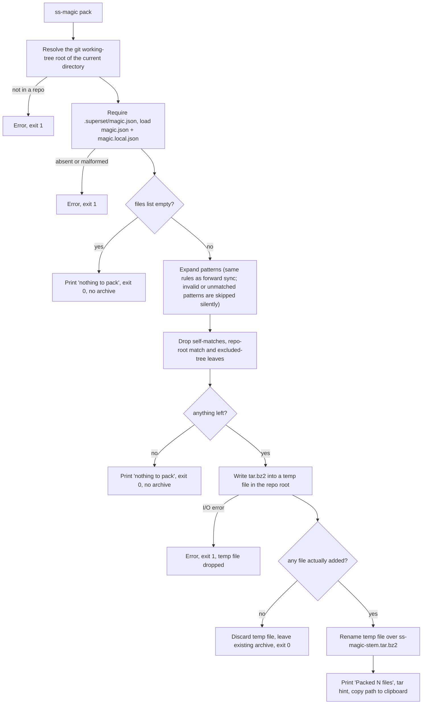
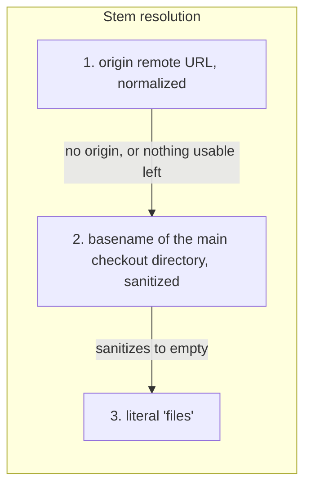

# `ss-magic pack`: archiving the configured files

`ss-magic pack` snapshots the files named by your `.superset/magic.json` into one portable `.tar.bz2` archive. Use it for a backup, a move to a new machine, or to hand the bundle to a teammate.

It is non-interactive and takes no flags of its own. The interactive menu offers it too (as "Pack configured files into a tar.bz2 archive") wherever an initialized `magic.json` exists: in any linked worktree, and in the main checkout once it is initialized. Like `sync`, `reverse-sync` and `orca`, `ss-magic pack` passes through the daily auto-update check first; see [installation-and-updates.md](./installation-and-updates.md).

> [!NOTE]
> Pack reads the same config and the same [sync patterns](./sync-patterns.md) as forward sync, so what you would sync is what you pack. The archive can hold untracked secret files (`.env` and similar), so treat it like the secrets it contains.

## The flow



In words:

1. **Resolve the root.** Pack asks git for the working-tree root of the current directory. Inside a linked worktree that is the worktree's own root, not the main checkout. The config source, the match target and the archive destination are all this one directory.
2. **Load the config.** `.superset/magic.json` must exist there, and `magic.json` plus `magic.local.json` are overlaid. A missing or malformed file is a hard error with a non-zero exit.
3. **Expand the patterns.** The same expansion, syntax checks, default excludes (`node_modules`, `.venv`) and de-duplication as forward sync. A pattern that fails the syntax checks (absolute path, `..` segment, bad glob) or matches nothing is skipped **without a warning**: pack prints no per-pattern skip lines, unlike `ss-magic sync`. A matched directory is included recursively.
4. **Filter** the matches (see [Self-exclusion](#self-exclusion-and-excluded-trees)).
5. **Write** each remaining match, keeping its repo-relative path, into `ss-magic-<repo>.tar.bz2` at the root.
6. **Report.** One `Added: <path>` line per match actually written (a directory match prints one line, not one per file inside it), then the summary.

> [!NOTE]
> In a linked worktree, the archive lands in **that worktree's** root, but its name still comes from the main checkout when there is no `origin` (see [Archive naming](#archive-naming)).

## Output format

* Archive: a standard tar stream compressed with bzip2, so any `tar` can read it.
* Compression level: the bzip2 default (6), chosen as a speed/size balance for what are usually small config files.
* Compression is pure Rust, so no system `libbz2` or C toolchain is needed.
* Paths inside the archive are relative to the repo root, so extraction recreates the layout.
* On Unix the archive has mode `0600` (owner read/write only): it is written as a `tempfile` temp file, which defaults to that mode, and the final rename keeps it.

On success pack prints (after the `Added:` lines and a blank line):

```plaintext
Packed 12 files → /abs/path/to/repo/ss-magic-viktorstiskala_upx-cz.tar.bz2
Extract into a repo root with: tar -xjvf ss-magic-viktorstiskala_upx-cz.tar.bz2 -C /path/to/repo
full path copied to clipboard
```

The path is the archive's canonical absolute path (symlinks in it resolved). The `12` is a count of **unique file paths** (files and symlinks) actually written. It is not the number of matches and not the number of tar entries: a directory match contributes every file beneath it, two overlapping matches naming the same file count once, and bare directory headers are not counted.

## Archive naming

The archive is called `ss-magic-<stem>.tar.bz2`. The stem identifies the repository and comes from three sources, tried in order.



1. **The `origin` remote**, normalized so every URL form of the same repository gives the same name.
2. **The primary worktree's directory basename**, sanitized the same way. This is the main checkout's directory (the parent of git's common dir) even when you run pack from a linked worktree, so all worktrees of one repo agree. If git cannot report the main checkout, the current root's basename is used.
3. **The literal `files`**, giving `ss-magic-files.tar.bz2`, the fixed name every pack used before 0.3.

### Normalization rules

For an origin URL, ss-magic:

* strips the scheme (`https://`, `ssh://`, `git://`, ...), user info, host and port;
* drops a trailing slash and a trailing `.git`;
* lowercases, and turns every run of characters other than ASCII letters and digits inside a path segment into a single `-`, dropping such runs at the segment's edges (`upx.cz` becomes `upx-cz`, `my_repo..name` becomes `my-repo-name`, `.env` becomes `env`);
* joins the path segments with `_` (which is why a `_` inside a segment becomes `-`).

The scp-like form (`git@host:owner/repo`) and the scheme forms of the same remote give identical stems. Nested paths such as GitLab groups keep every segment. A local-path origin, bare or `file://`, contributes only its final segment, so a local directory hierarchy never leaks into the archive name. If nothing usable remains, resolution falls through to the next source.

### Origin URL forms to archive names

| Origin URL (example) | Archive name |
|---|---|
| `https://github.com/ViktorStiskala/upx.cz.git` | `ss-magic-viktorstiskala_upx-cz.tar.bz2` |
| `https://github.com/ViktorStiskala/upx.cz` | `ss-magic-viktorstiskala_upx-cz.tar.bz2` |
| `https://github.com/ViktorStiskala/upx.cz/` | `ss-magic-viktorstiskala_upx-cz.tar.bz2` |
| `git@github.com:ViktorStiskala/upx.cz.git` | `ss-magic-viktorstiskala_upx-cz.tar.bz2` |
| `ssh://git@github.com/ViktorStiskala/upx.cz.git` | `ss-magic-viktorstiskala_upx-cz.tar.bz2` |
| `ssh://git@github.com:22/ViktorStiskala/upx.cz` | `ss-magic-viktorstiskala_upx-cz.tar.bz2` |
| `git://github.com/ViktorStiskala/upx.cz.git` | `ss-magic-viktorstiskala_upx-cz.tar.bz2` |
| `https://gitlab.com/group/sub.group/repo.git` | `ss-magic-group_sub-group_repo.tar.bz2` |
| `git@gitlab.com:group/sub/repo.git` | `ss-magic-group_sub_repo.tar.bz2` |
| `/srv/git/upx.cz.git` (local path) | `ss-magic-upx-cz.tar.bz2` |
| `file:///srv/git/upx.cz.git` | `ss-magic-upx-cz.tar.bz2` |
| `file:///Users/alice/client/repo.git` | `ss-magic-repo.tar.bz2` |
| no `origin`, primary checkout at `.../upx.cz` | `ss-magic-upx-cz.tar.bz2` |
| no `origin`, directory name with no letters or digits | `ss-magic-files.tar.bz2` |

> [!TIP]
> The same stem also names the Claude Code plugin's per-worktree session directory (`<stem>-<branch>`). Both call one function in core, so the archive and the plugin can never disagree about what the repository is called. Only the last resort differs: the plugin falls back to `repo` where pack uses `files`. See [plugin-session-state.md](./plugin-session-state.md).

## Self-exclusion and excluded trees

Pack never packs its own output, and never packs the paths that hold recovered or session secrets.

### Pack archives

Every match at the **repo root** shaped `ss-magic-*.tar.bz2` is dropped before archiving. That covers:

* the current derived name;
* the legacy fixed name `ss-magic-files.tar.bz2` used before 0.3;
* archives left under a **previous** derived name (the `origin` remote can change between packs, and an old snapshot of secrets must not nest inside a new archive).

So a broad pattern such as `*.bz2` cannot recurse into the output. Only root-level files are skipped: `sub/ss-magic-x.tar.bz2` is not a pack output and stays packable.

A pattern that resolves to the repo root itself (for example `.`) is also dropped. Walking it would pull in the whole tree live, including the half-written temp archive and `.git`.

### Excluded trees

These trees, anchored at the repo root, are never packed, whichever match reaches them. The rule is shared with sync and explained in [sync-patterns.md](./sync-patterns.md#the-four-excluded-trees); this section covers how pack enforces it.

| Tree | Holds |
|---|---|
| `.superset/backups` | timestamped copies of files a sync overwrote (recovered secrets) |
| `.superset/.magic` | the plugin's machine-local state |
| `.scratchpad` | scratch files |
| `.git` | repository internals |

Matching is by whole path component from the root (so `.superset/.magicked` and a nested `sub/.git` are not covered), and `.superset` itself is not excluded, so the contract files (`magic.json` and friends) still pack.

Several layers enforce this. Pattern expansion, shared with sync, never lists a path inside an excluded tree. Pack then re-checks every **leaf** match with a flat filter. Directory matches that sit **above** an excluded tree, such as a bare `.superset` pattern or a broad `**`, are handled while walking: the recursive walk prunes each excluded subtree as it meets it. One directory match can sit above several excluded trees at once (`.superset` is the ancestor of both `backups` and `.magic`), and each is pruned.

> [!WARNING]
> The directory walk prunes only the four trees above. The default excludes (`node_modules`, `.venv`) are applied to the matches themselves, not inside a matched directory, so a pattern like `apps/web` packs `apps/web/node_modules` if it exists. Prefer file globs over broad directory patterns.

> [!IMPORTANT]
> This is a secret-safety rule, not a cosmetic one. See [Secret safety and sync](../../CODING_STANDARDS.md#secret-safety-and-sync) in the coding standards and the write-up in [pack-backups-exclusion-must-guard-the-directory-walk.md](../solutions/logic-errors/pack-backups-exclusion-must-guard-the-directory-walk.md).

## Symlinks

Symlinks are **stored as symlink entries and never followed.**

* A matched entry that is a symlink, even to a directory, becomes one symlink entry in the archive. Its target is not read, so a link cannot pull in a file or tree outside the repo (for example a link to `~/.aws/credentials`).
* Inside a matched directory, links met during the walk are stored the same way.
* A broken link found by a glob or inside a matched directory is archived as a link instead of aborting the pack. A **literal** pattern that names a broken link is treated as missing and skipped, because the existence check follows the link.
* Symlinks count toward the "Packed N files" total.

Sockets, FIFOs and other special files are skipped. So is an entry that vanished between pattern expansion and packing.

## Atomic write

The archive is never written in place:

1. A temp file is created **inside the repo root** (same filesystem, so the final step is a true rename).
2. The tar and bzip2 streams are finished, and the file is synced to disk (best effort: a failed sync does not stop the pack).
3. The temp file is renamed over `ss-magic-<stem>.tar.bz2`.

A crash or error mid-pack leaves any previous archive intact. A second run replaces the earlier archive of the same name.

## When nothing is packed

Pack never replaces a good archive with an empty one. All of these exit with **status 0**, write **no archive**, and leave an existing archive untouched. The tool prints an em dash where the messages below show `–`:

| Situation | Message |
|---|---|
| `files` in the config is empty | ``magic.json `files` is empty – nothing to pack.`` |
| Patterns are all invalid or match nothing, or every match is filtered out (self-archives, repo root, excluded trees) | `No files matched the config patterns – nothing to pack.` |
| Matches exist but none is packable (all special files or vanished, or a directory holding only excluded or empty content) | `No packable files remained – nothing to pack.` |

By contrast, these are errors with exit status 1: not inside a git repo, no `.superset/magic.json` in the resolved root, a malformed `magic.json` or `magic.local.json`, or an I/O failure while reading a matched file or writing the archive. An invalid pattern is **not** an error; it is skipped silently (see [The flow](#the-flow)).

## Clipboard

After a successful pack, ss-magic copies the archive's canonical absolute path to the clipboard, so it pastes correctly from any directory. Tools are tried in this order and the first one that accepts the text wins:

| Order | Tool | Platform | Invocation |
|---|---|---|---|
| 1 | `pbcopy` | macOS | `pbcopy` |
| 2 | `wl-copy` | Linux, Wayland | `wl-copy` |
| 3 | `xclip` | Linux, X11 | `xclip -selection clipboard` |
| 4 | `xsel` | Linux, X11 | `xsel --clipboard --input` |

A tool that is not installed, or that exits unsuccessfully, is skipped. If none works, pack stays silent about it: it just omits the `full path copied to clipboard` line. The copy never affects the exit status.

The clipboard step lives in the rendering layer, not the pack engine, so tests that drive the engine never touch a developer's clipboard.

## Extracting

Extract with the hint pack prints. It names the archive by file name only, so run it from the directory that holds the archive (the repo root you packed), or substitute the full path from the clipboard:

```bash
tar -xjvf ss-magic-viktorstiskala_upx-cz.tar.bz2 -C /path/to/repo
```

Because paths are repo-relative, extracting into a repo root puts every file back where it was. Pointing `-C` at an existing checkout overwrites files of the same name.

## What pack does not do

* It does not add the archive to `.gitignore`; no code in the repository writes an ignore rule for `ss-magic-*.tar.bz2`. Check your ignore rules so the archive, which may hold secrets, is not committed by accident.
* It has no size limit and no special handling for large or unreadable files. An I/O error while reading one fails the whole pack (exit 1) and leaves the previous archive in place.

## Where this lives in the code

* [pack.rs](../../crates/ss-magic/src/pack.rs) – the engine: `pack_core`, `write_archive`, `append_dir_excluding_trees`, self-exclusion, `copy_to_clipboard`
* [pack/tests.rs](../../crates/ss-magic/src/pack/tests.rs) – engine tests
* [main.rs](../../crates/ss-magic/src/main.rs) – `run_pack_flow`, `print_pack_event` (summary line, `tar` hint, clipboard call), `load_magic_or_exit`
* [reponame.rs](../../crates/ss-magic-core/src/reponame.rs) – `repo_name_stem`, `stem_from_origin`, `sanitize_segment`
* [reponame/tests.rs](../../crates/ss-magic-core/src/reponame/tests.rs) – the URL-form cases behind the table above
* [sync/mod.rs](../../crates/ss-magic-core/src/sync/mod.rs) – `EXCLUDED_TREES` and `under_excluded_tree`
* [sync/apply.rs](../../crates/ss-magic-core/src/sync/apply.rs) – `match_paths`, the pattern expansion pack shares with sync, and `DEFAULT_EXCLUDES`
* [git/mod.rs](../../crates/ss-magic-core/src/git/mod.rs) – `cwd_repo_root`, `main_checkout_root`, `origin_url`
* [menu.rs](../../crates/ss-magic/src/tui/menu.rs) – when the menu offers Pack
* [crates/ss-magic/CLAUDE.md](../../crates/ss-magic/CLAUDE.md) – contributor notes for the CLI crate

Related: [sync-patterns.md](./sync-patterns.md) for how `files` globs expand, [superset-contract.md](./superset-contract.md) for `magic.json` and `magic.local.json`, and [interactive-sync.md](./interactive-sync.md) for the menu. Project overview in [README.md](../../README.md).
