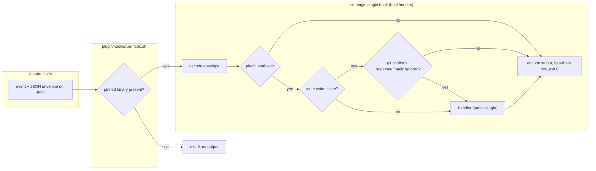
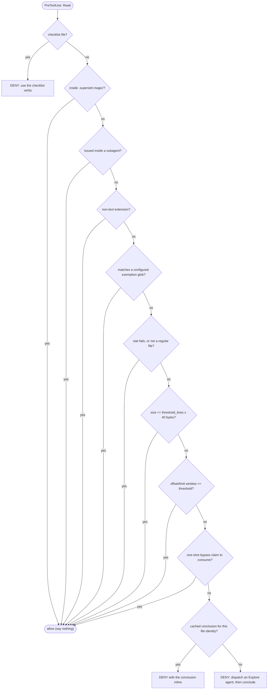
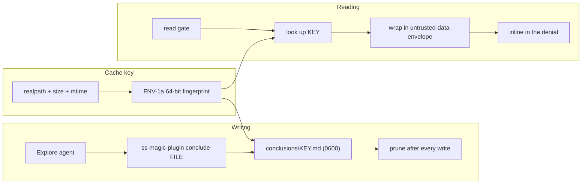
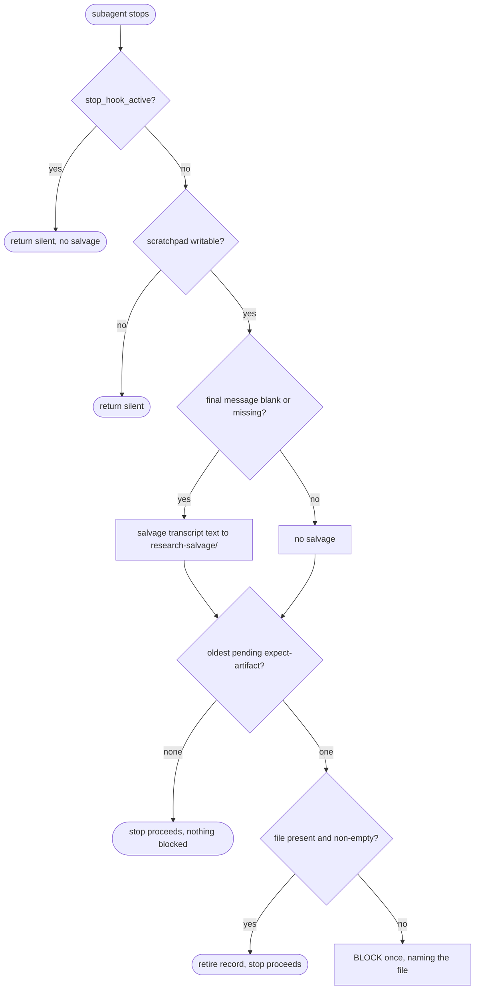

# Plugin hooks: the read gate, conclusion cache and subagent salvage

The ss-magic Claude Code plugin is a set of small hooks that Claude Code runs around a session. They keep large files out of the context window, rescue subagent output that would otherwise be lost, and leave notes on disk that survive a compaction. None of them is a security boundary. Every one fails open.

This page covers the hook runtime. For installing and configuring the plugin see [claude-code-plugin.md](./claude-code-plugin.md); for the scratchpad, checklist, cost ledger and compaction window that some hooks write into see [plugin-session-state.md](./plugin-session-state.md). The project-wide view is in [README.md](../../README.md).

## The five registered events

[plugin/hooks/hooks.json](../../plugin/hooks/hooks.json) declares exactly five events, in six entries: `SessionStart` has two. Every entry except the `SessionStart` bootstrap goes through [run-hook.sh](../../plugin/hooks/run-hook.sh), which runs `ss-magic-plugin hook <event>` if the pinned binary exists and exits 0 with no output if it does not.

| Event | Matcher | Timeout | What it does |
| --- | --- | --- | --- |
| `SessionStart` (bootstrap) | `startup` | 90 s | Runs `bootstrap.sh`: installs or refreshes the pinned binary and, once, seeds the `plugin` block into an existing `.superset/magic.json`. It names the script directly, not `run-hook.sh`, because `run-hook.sh` is inert until the binary it would run exists. |
| `SessionStart` (handler) | `startup\|resume\|clear\|compact\|fork` | 10 s | Scaffolds the scratchpad, returns the operating guidance as context, and may carry up to three operator notices (below). |
| `PreToolUse` | `Read\|Edit\|MultiEdit\|Write\|NotebookEdit\|Grep\|Glob\|Bash` | 5 s | The checklist-file deny, the read gate and the commit nudge. |
| `PreCompact` | `manual\|auto` | 10 s | Appends a note that a compaction is about to happen. Never blocks or slows it. |
| `SubagentStop` | none (every subagent) | 10 s | Salvages a subagent that ended without a result, and blocks the stop once if a declared output file is missing. |
| `SessionEnd` | none | none set (harness default) | Writes the session's cost-ledger row. |

> [!NOTE]
> `FileChanged` is parsed and routed by the binary ([file_changed.rs](../../crates/ss-magic-plugin/src/hook/file_changed.rs)) and unit-tested, but it is **not** in `hooks.json`, so nothing in a real session invokes it. It would, on a watched `.env` or `.envrc` write, ask `direnv status --json` whether the file is already trusted (it never runs `direnv allow`) and only then append the exported environment to the harness-supplied `$CLAUDE_ENV_FILE`. It refuses if that target resolves inside the repository and writes nothing when the variable is unset. Treat it as dormant code, not a shipped hook.

### The `SessionStart` operator notices

All three go to the operator (`systemMessage`), never to the model, are best-effort, and are silent on any failure. When more than one is due they are joined a blank line apart.

- **Version drift.** On any source, when the running binary's version differs from the plugin's pin file (`ss-magic-plugin.version` under the plugin root). The bootstrap reinstalls the binary only on `startup`, so a session resumed right after a plugin update can run the previous binary; the notice says to start a brand-new session.
- **Compaction window advice.** On `startup` only. Shown once per machine when `CLAUDE_AUTOCOMPACT_PCT_OVERRIDE` is set, neither project settings file configures an `autoCompactWindow`, and the session is not quiet (below). It points at `compact-window --recommend`. The once-per-machine marker is claimed with an exclusive create, so two sessions starting at once produce exactly one notice; with no cache directory to record it in, the notice is withheld rather than repeated.
- **Newer plugin release.** On `startup` only. Shown once per release tag, telling the operator that `/plugin` has a newer release. The hook reads a cache file and never touches the network, and records the tag as shown before announcing it, so a notice it could not record is withheld. When the session is not quiet and a pin exists, a cache that is missing or older than 24 hours makes it spawn a detached `release-check --refresh --quiet` and return without waiting. Details in [claude-code-plugin.md](./claude-code-plugin.md).

"Quiet" means the envelope's `permission_mode` is `bypassPermissions` or `dontAsk`, or `CLAUDE_CODE_ENTRYPOINT` names an embedding other than `cli`. A missing signal counts as not quiet, because a wrong "not quiet" costs one line while a wrong "quiet" hides the notice.

## Every hook fails open

Every hook is built so that an error, a panic or a timeout looks to Claude Code exactly like a hook that chose to do nothing, because a tool that is only advisory must never break a session in progress. For the read gate that means a timeout, a malformed envelope or a missing binary all leave the `Read` to proceed: the gate is a context-economy measure, not a security boundary.

- The runtime has no code path that exits non-zero. A handler panic is caught. An event name the binary does not know, an envelope that fails to decode and a handler error all end the same way: empty stdout, exit 0, one heartbeat row saying what happened. (Exit 2 from a `PreToolUse` hook would be a block, so a crash must never produce it.)
- A missing binary is handled one layer up, in `run-hook.sh`, because the runtime cannot protect against its own absence. That is the first-install case: hooks on one event run concurrently, so they can fire before the bootstrap has fetched the binary.
- Handlers never print. Only a collected diagnostic reaches stderr, after dispatch, and stdout carries only the harness JSON.
- Routing follows the event token on the command line, not the envelope's own `hook_event_name`. Decoding is permissive: unknown keys are ignored and only `cwd` is required.
- A hook can only ever **take away or add words**: deny a tool call, block a subagent stop, add model context or an operator notice. The response types have no "allow" decision, so a hook can never grant a capability, and no `updatedInput` rewrite channel. `PreCompact` and `SessionEnd` have no response variant at all, so their silence is enforced by the compiler.
- The plugin does nothing in a repository until `plugin.enabled` is `true`. That flag is read from the main checkout's `magic.json` overlay and re-read from disk on every invocation, so turning it off takes effect on the next hook, not the next session.
- Events that write state (`SessionStart`, `PreToolUse`, `PreCompact`, `SubagentStop`) additionally require git to confirm that `.superset/.magic/` is ignored, and refuse otherwise, including when git cannot be asked. This check runs only past the enablement gate, and it does spawn `git`. `SessionEnd` (and the dormant `FileChanged`) skip it.

Every invocation also appends a heartbeat row, which is what `ss-magic-plugin status` reads. See [plugin-session-state.md](./plugin-session-state.md).

## Cheap root discovery

`PreToolUse` fires on nearly every tool call, so the hook has to be cheap when the plugin is off. Before it can read `plugin.enabled` it needs two roots: the worktree root and the main checkout root. [discover.rs](../../crates/ss-magic-core/src/git/discover.rs) finds both by walking the filesystem, so on an ordinary layout a hook that stops at the `enabled` check spawns no `git` process. That is every hook in a repository that has not turned the plugin on. A test with a shimmed `PATH` proves it.

The walk **hands back to `git rev-parse`** whenever the layout is not ordinary. It declines when:

- one of `GIT_DIR`, `GIT_WORK_TREE`, `GIT_COMMON_DIR`, `GIT_CEILING_DIRECTORIES`, `GIT_DISCOVERY_ACROSS_FILESYSTEM` or `GIT_OBJECT_DIRECTORY` is set
- `.git` is a symlink, or `cwd` sits inside a git directory or a bare repository
- the `.git` file belongs to a submodule (a `gitdir:` file with no `commondir`)
- the repository config uses `core.worktree`, `core.bare = true`, or a format git would refuse
- the next parent is on a different filesystem, or ownership could trip git's "dubious ownership" check

The rule is that a fast answer equals git's answer byte for byte, or there is no fast answer. When the walk declines, every heartbeat row from that invocation ends with `discovery: fallback (<reason>)`, so the fallback rate is visible in `status`. The CLI's own commands keep using the git probes.

> [!NOTE]
> "No subprocess" describes the Rust runtime. The `bash` wrapper that launches it is itself a process, and the `SessionStart` bootstrap runs a script, so the claim holds for `git` and for the hook binary's own work, not for the launcher.

## `PreToolUse`: three jobs in a fixed order

One handler makes three decisions, always in this order:

1. **Checklist-file deny** – for `Read`, `Edit`, `MultiEdit`, `Write` and `NotebookEdit`.
2. **Read gate** – for `Read` only.
3. **Commit nudge** – for `Bash` only.

`Grep` and `Glob` are in the matcher but the handler treats them as inert and says nothing.

### The read gate

The harness never truncates a `Read`. Other tools spill oversized output to disk and return a short pointer, but `Read` has no ceiling, which made it the largest un-spilled context cost. The gate denies an oversized `Read` and tells the model to send an Explore agent instead. The agent reads the file in its own window and records a conclusion. The next attempt to read the same file is still denied, but the denial now quotes that conclusion.

The gate emits only a denial or silence. Silence hands the call back to the ordinary permission flow untouched, so the gate can never grant anything the user did not already allow. Every uncertainty (a failed `stat`, a vanished file, an unreadable cache directory) falls through to silence.

| Step | Behaviour |
| --- | --- |
| Threshold | `threshold_lines` defaults to 3,000 and clamps to 500–20,000. One `stat` is compared against `threshold_lines x 40` bytes (120,000 at the default). 40 bytes per line is the measured average for source files; prose runs longer, so the gate errs towards gating it. |
| Bounded window | A `Read` with `offset` and `limit` is priced in bytes using the file's own average line length and allowed if that is within the threshold. A missing, negative or unparseable `limit` means "to the end"; an `offset` past the end costs nothing. |
| Exemptions | The `.superset/.magic/` state tree (the scratchpad's `STATUS.md` can be large, and the skill tells the model to read it on resume); any read issued inside a subagent; non-text extensions `png jpg jpeg gif bmp webp ico tiff tif pdf ipynb`; and the configured `exemptions` globs, matched against the path relative to the worktree (the nearest ancestor holding `.superset/magic.json`) and against the absolute path. The extension list is compiled into the binary: configured globs can add exemptions, but nothing in configuration removes one, and a glob that does not compile is dropped. A bare `.superset/` path is not exempt, so an oversized `.superset/magic.json` is still gated. |
| Explore routing | A miss denial explains the file, its size and a rough token estimate (size / 4), then gives the steps: dispatch an Explore agent, have it run `ss-magic-plugin conclude <file>`, and read again. It names where the entry will land and adds that a `Read` with `limit` at or under the threshold line count goes through. The subagent exemption is what stops the agent itself from being routed to another agent, forever. |
| Inline byte budget | A hit quotes the stored conclusion inside the denial. `inline_byte_budget` defaults to 10,000 bytes and clamps to 1,000–100,000. The budget covers the whole denial, so only the agent's body shrinks; the header and the untrusted-data wrapper are never cut. |
| Bypass | Every size-gate denial, hit or miss, ends with the exact command `ss-magic-plugin bypass <file>`. The checklist deny does not offer it. |

> [!IMPORTANT]
> The same read is never denied empty twice. A miss sends the work to an Explore agent; once it has concluded, every later attempt gets the answer. A narrower window, a subagent read and the bypass are three further ways around the gate.

The gate deliberately **denies instead of rewriting** the call. A rewritten `Read` would leave the transcript showing the original call, so the model would believe it had read the file it asked for. Concurrent hooks' input rewrites are also folded last-write-wins, which would silently discard another tool's rewrite.

Command spelling in every model-facing denial is `ss-magic-plugin`, the wrapper on the Bash tool's `PATH`, never a bare `ss-magic`, which could resolve to the user's own sync CLI install.

### The conclusion cache

Conclusions live in `.superset/.magic/conclusions/<key>.md`, written by `ss-magic-plugin conclude <file>` (body on stdin or via `--from`).

- **Keyed on file identity, not on the read.** The key fingerprints the resolved path, size and modification time and nothing else (on a filesystem that reports no mtime, an FNV-1a hash of the file's bytes stands in for it). A windowed read and a whole-file read of the same bytes therefore share one entry. Keying on the window was tried and produced a cache that never hit.
- **Invalidation is implicit.** Editing the file changes its size or mtime, so the key changes and the old entry is simply never looked up again. `ss-magic-plugin gc` removes entries whose source file has changed or gone, then trims to the retention bounds.
- **Retention.** After every write the cache is pruned to at most 200 entries and 30 days; failure to prune warns rather than failing the write.
- **Framing.** A conclusion is an agent's summary of a file the repository controls, so it is treated as untrusted. Each entry opens with a stamped header saying it is ss-magic-generated, and the whole entry is wrapped in an untrusted-data envelope whose instruction to treat it as evidence comes first. The same envelope frames salvaged subagent text.
- **Inspecting.** `ss-magic-plugin conclusions` lists entries newest first; with a key or a file path it prints one.

### Bypass and declared artifacts

Both are one-shot claims stored as files, taken with a single atomic `rename`. A plain delete was measured on macOS to let five to eight of eight racing callers "succeed", so it cannot be used as a claim. See [claim.rs](../../crates/ss-magic-plugin/src/claim.rs).

| | `bypass` | `expect-artifact` |
| --- | --- | --- |
| Command | `ss-magic-plugin bypass <file>` | `ss-magic-plugin expect-artifact <file> [--note TEXT]` |
| Stored in | `.superset/.magic/bypass/` | `.superset/.magic/expect-artifact/` |
| Consumed by | The next gated `Read` of that file; the read after it is gated again | The next `SubagentStop` |
| Expires after | 24 hours (expired claims are consumed but do not open the gate) | 6 hours (every stop sweeps expired records) |
| Constraint | The path must resolve (it is canonicalized, so a symlink and its target share one claim) | The file must be inside the worktree; it ordinarily does not exist yet |
| Write guard | Refuses unless git confirms the state tree is ignored; written atomically at mode 0600 | Same |

### The checklist-file deny

A `Read`, `Edit`, `Write`, `MultiEdit` or `NotebookEdit` of an operator checklist file (the `docs/actions/<stem>.checklist.json` convention, or the file a pointer names) is denied with instructions to use the checklist verbs, so those verbs are the only write path. The classification runs before every exemption, including the subagent and state-tree ones; otherwise an Explore agent could pull the raw document into its context. For the same reason the message does not suggest an Explore agent, and it applies whatever the file's size. The target path is resolved in a fixed order: a leading `~` is expanded, the path is reduced lexically, and then `/proc/<pid>/cwd/...`-style process views are recognised. A late canonicalizing re-check may only add a denial, never remove one. See [plugin-session-state.md](./plugin-session-state.md).

### The commit nudge

`PreToolUse[Bash]` runs on most tool calls, so the check is a single string scan with no filesystem or subprocess work until it matches. It matches when the words `git commit`, `git push` or `gh pr create` appear consecutively anywhere in the command, so a wrapper prefix (`rtk git commit`) or a preceding chained command (`a && git push`) still matches. Quoted spans and heredoc bodies are skipped, while a `$( ... )` substitution is inspected. Words are compared whole, so `git-commit` does not match, and `gh pr view`, `list` and `diff` do not match either.

On a match, and only if the repository has a checklist at all (a pointer target, or a file under `docs/actions/` matching the naming convention), the hook checks whether the checklist looks left out: named by the pointer but not written yet, or reported by `git status` as untracked or edited in the worktree but not staged. If so, an advisory note is added to the model's context. The command is never blocked, the text says so, and the check runs fresh every time with no memory of earlier nudges.

## `SubagentStop`: block at most once, salvage an empty result

A subagent's report is tail-truncated by the harness when long, with the marker that the earlier part is not retrievable. This event addresses that data loss. It does two independent things.

- **Artifact contract.** Before dispatching, the parent runs `expect-artifact`. At stop, the hook takes the oldest pending record (taking it is the one-shot flag). If the named file is missing, empty or not a file, the stop is blocked once with a message naming the file. With nothing declared, nothing is ever blocked. A declaration names a file, not an agent, so with several dispatches in flight the pairing can cross; the guarantee is per record: each declaration causes at most one block and each stop is blocked at most once. `stop_hook_active` is a second, independent guard.
- **Salvage.** If the agent reported no final message (absent or whitespace only), the hook recovers the assistant text from `agent_transcript_path` into `research-salvage/<timestamp>-<slug>.md` in the session directory. It reads at most the first 16 MiB of the transcript, pulls out the assistant messages (falling back to the raw text when none parse) and keeps the last ones that fit in 64 KiB, noting how many earlier ones were dropped. It creates the file with an exclusive create so an earlier salvage is never overwritten, wraps it in the untrusted-data envelope, and marks it incomplete. Salvage runs before the block decision, because lost text cannot be redone while a block can be retried; if the same stop is also blocked, the block message points at the recovered file. A salvage failure is recorded in the heartbeat and never fails or blocks the stop.

> [!NOTE]
> The hook's own `CLAUDE.md` says salvage "runs unconditionally". The code gates it on a blank final message, and it is skipped on a `stop_hook_active` re-entry. This page follows the code.

## `PreCompact` and `SessionEnd`

**`PreCompact`** appends one timestamped entry to `PRE-COMPACT.md` in the session directory and returns nothing. It fires for both `manual` and `auto`, and also when a `/compact` ends up not compacting, since the payload cannot tell the cases apart. The file is the tool's own: the six model-owned state files are never rewritten by the tool, so the note goes in a seventh file the model is never told to edit. The model-facing side of compaction lives on `SessionStart` with the `compact` source.

**`SessionEnd`** is the only moment the cost row can be written: the payload carries no usage numbers, but the transcript is complete when the event fires.

- The hook scans the session's transcript tree and appends one row to a machine-level ledger, using a byte-offset store so repeat scans only read new bytes.
- The ledger keeps one row per session id, and a repeat for a session whose transcript has not changed writes nothing. That repeat is the ordinary case: `/clear` fires this event more than once per CLI process, and the harness is free to spawn a hook twice.
- The manifest sets no timeout, so the scan runs inline against the harness default (1,500 ms nominal, about 1.15 s usable). Raising the timeout is explicitly not the remedy for a slow scan, since the CLI blocks on exit waiting for this hook.
- It is exempt from the ignored-tree check because the ledger is machine-level, not per-worktree.

The `cost` verb and ledger details are in [plugin-session-state.md](./plugin-session-state.md).

## `spill-index`: finding the harness's own spill files

This is a verb, not a hook, but it serves the same context-economy goal. When a tool's output is too large, Claude Code writes it in full to `~/.claude/projects/<encoded-cwd>/<session-uuid>/tool-results/<id>.txt` (under `$CLAUDE_CONFIG_DIR/projects` when that is set) and returns a pointer. The leaf names are unguessable and nothing indexes them. `ss-magic-plugin spill-index [--json]` lists them for the current worktree: it derives the per-project directory from the repository root (so a subdirectory finds the same tree) and enumerates every session's `tool-results/` folder with path, size and modification time. It is strictly read-only. ss-magic builds no spill mechanism of its own; it makes the harness's output findable. The full verb list is in [claude-code-plugin.md](./claude-code-plugin.md).

## Unknowns

- `FileChanged` is withheld because a gating probe is not satisfied: the event has to be shown, on the pinned harness version, to fire on an `.envrc` write and report a usable `cwd` with two worktrees of one repository open ([file_changed.rs](../../crates/ss-magic-plugin/src/hook/file_changed.rs)). The module notes that a `FileChanged` entry's `matcher` is its watch-path list, so a manifest entry would have to name the paths, and that the cross-worktree case is still unmeasured.
- The `SessionEnd` default timeout figures are taken from comments in [session_end.rs](../../crates/ss-magic-plugin/src/hook/session_end.rs), not from Claude Code's documentation.

## Where this lives in the code

| Area | Files |
| --- | --- |
| Manifest and launcher | [plugin/hooks/hooks.json](../../plugin/hooks/hooks.json), [plugin/hooks/run-hook.sh](../../plugin/hooks/run-hook.sh) |
| Pipeline, routing, fail-open | [hook/mod.rs](../../crates/ss-magic-plugin/src/hook/mod.rs), [hook/event.rs](../../crates/ss-magic-plugin/src/hook/event.rs) |
| Filesystem root discovery | [git/discover.rs](../../crates/ss-magic-core/src/git/discover.rs) |
| Read gate, checklist deny, commit nudge | [hook/pre_tool_use.rs](../../crates/ss-magic-plugin/src/hook/pre_tool_use.rs) |
| Gate tunables and bounds | [config.rs](../../crates/ss-magic-plugin/src/config.rs) |
| Conclusion cache | [cache.rs](../../crates/ss-magic-plugin/src/cache.rs) |
| One-shot claims | [claim.rs](../../crates/ss-magic-plugin/src/claim.rs), [bypass.rs](../../crates/ss-magic-plugin/src/bypass.rs), [expect_artifact.rs](../../crates/ss-magic-plugin/src/expect_artifact.rs) |
| Other handlers | [session_start.rs](../../crates/ss-magic-plugin/src/hook/session_start.rs), [pre_compact.rs](../../crates/ss-magic-plugin/src/hook/pre_compact.rs), [subagent_stop.rs](../../crates/ss-magic-plugin/src/hook/subagent_stop.rs), [session_end.rs](../../crates/ss-magic-plugin/src/hook/session_end.rs), [file_changed.rs](../../crates/ss-magic-plugin/src/hook/file_changed.rs) |
| Spill index | [spill_index.rs](../../crates/ss-magic-plugin/src/spill_index.rs) |
| Contributor notes | [hook/CLAUDE.md](../../crates/ss-magic-plugin/src/hook/CLAUDE.md) |
