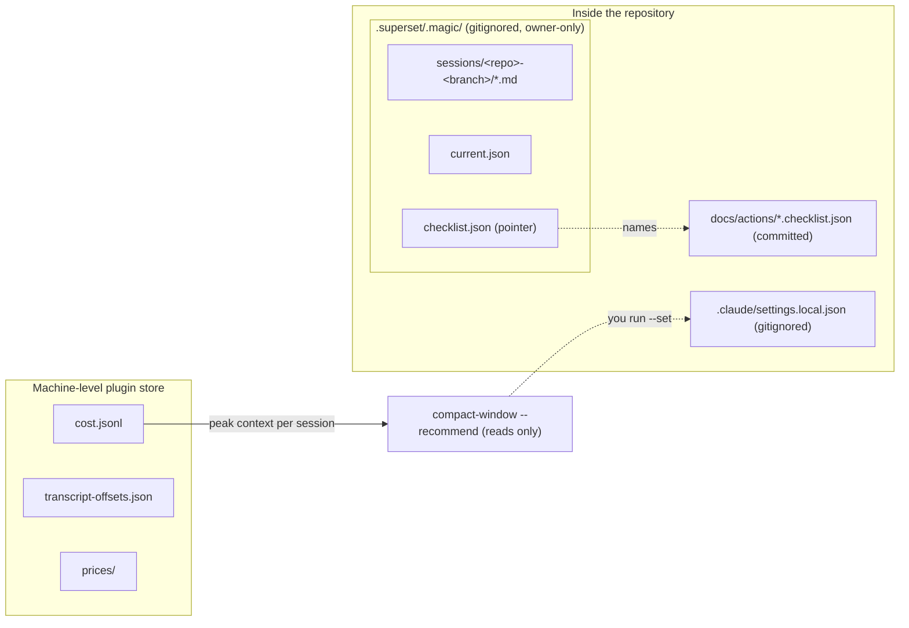
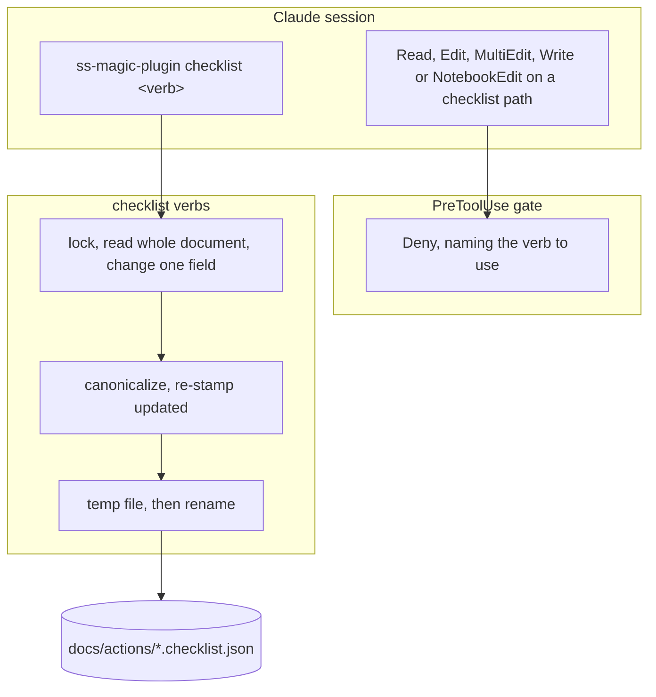
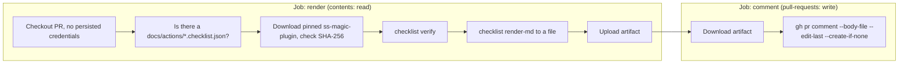
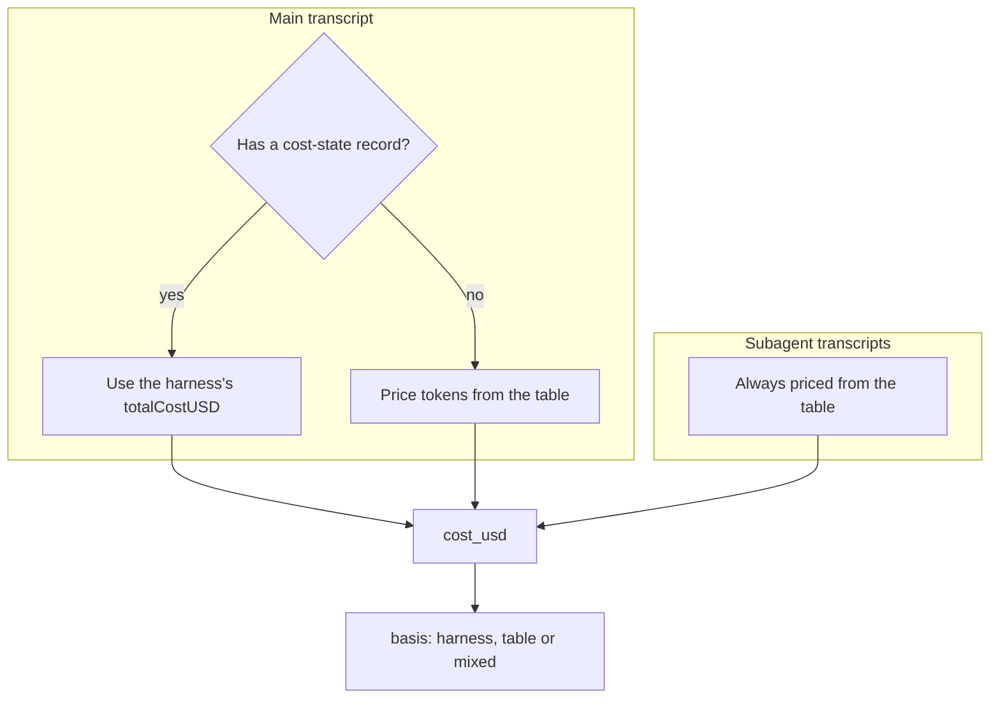
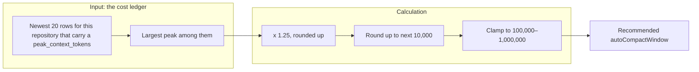

# Plugin session state

The ss-magic Claude Code plugin (binary `ss-magic-plugin`) keeps four kinds of state.
They sit in three different places and have three different lifetimes, which is the first thing worth getting straight.

| State | Lives in | Committed? | Lifetime |
|---|---|---|---|
| [Session scratchpad](#the-session-scratchpad) | `.superset/.magic/sessions/<repo>-<branch>/` in each worktree | Never (gitignored) | Deleted with the worktree |
| [Operator checklist](#the-operator-checklist) | `docs/actions/<YYYY-MM-slug>.checklist.json` | Yes, reviewed in the PR | Lives with the repository |
| [Cost ledger](#the-cost-ledger) | The plugin's machine-level store (outside every repository) | Never | Outlives worktrees |
| [Compaction window](#sizing-the-auto-compact-window) | `autoCompactWindow` in `.claude/settings.local.json`, written only when you ask | Never (gitignored) | Per machine, per repository |

The compaction window is a Claude Code setting rather than plugin state, but the plugin sizes it from the cost ledger, so it is covered here.

This page covers only that state.
The read gate, the conclusion cache and subagent salvage are in [plugin-hooks.md](./plugin-hooks.md); installing and enabling the plugin is in [claude-code-plugin.md](./claude-code-plugin.md).
The `.superset/` contract the state tree hangs off is in [superset-contract.md](./superset-contract.md).



---

## The session scratchpad

Claude Code compacts a long session, and whatever was only in the context window is gone.
The scratchpad is the fix: working state lives on disk, so the next context can read it back.

### Layout

`ss-magic-plugin scratchpad ensure` creates the following under the worktree root.
It is the only `scratchpad` subverb.
You rarely need to type it: the `SessionStart` hook runs the same bootstrap on every session source (`startup`, `resume`, `clear`, `compact` and `fork`) and injects guidance naming the session directory, so after a compaction the model is told again where its notes live.
The `scratchpad` skill tells the model to run it at the start of substantial work and to read `STATUS.md` first when the directory already has content.

```plaintext
.superset/.magic/
  README.md            what this tree is, for anyone who stumbles on it
  current.json         which session directory is active (rewritten on every run)
  current.lock         lock guarding the current.json write
  sessions/
    <repo>-<branch>/
      STATUS.md
      TASKS.md
      DECISIONS.md
      LEARNINGS.md
      CONTEXT.md
      OPERATOR-CHECKLIST.md
      PRE-COMPACT.md   appended by the PreCompact hook, not created by ensure
  conclusions/         Read-gate conclusion cache (see plugin-hooks.md)
  bypass/              per-file Read-gate bypass tokens
  expect-artifact/     pending subagent-output declarations
  checklist.json       active-checklist pointer, written by `checklist init`
  checklist.lock       lock held by the checklist verbs
```

`PRE-COMPACT.md` is the plugin's own bookkeeping, not one of the model's files: each time a compaction boundary is crossed, the `PreCompact` hook appends one block (trigger and timestamp) to it and never edits an earlier one.

`ensure` exits 0 when the tree is in shape, 1 when a refusal (below) stopped it, and 2 when there is no repository or no session identity to work with.

The six state files are a floor, not a schema.
The agent is free to add `research-<topic>/` directories or a `REPORT.md`, and the plugin never prunes them.

| File | Intended use |
|---|---|
| `STATUS.md` | Where the work stands now. Newest block first under a `CURRENT STATE` heading; older blocks are demoted to `HISTORY`, never deleted |
| `TASKS.md` | The task list and where each item stands, including follow-ups from the user |
| `DECISIONS.md` | Settled decisions, with the alternative they beat and why |
| `LEARNINGS.md` | Append-only; each entry is a `## <timestamp> - <label>` block that is never edited later |
| `CONTEXT.md` | Context that would be expensive to rediscover, grouped by topic rather than by time |
| `OPERATOR-CHECKLIST.md` | The model's own running notes on operational steps |

> [!IMPORTANT]
> The scratchpad's `OPERATOR-CHECKLIST.md` is not the [operator checklist](#the-operator-checklist).
> It is a free-form notes file in the gitignored tree.
> The real checklist is committed JSON under `docs/actions/` and is written only through the `checklist` verbs.

### How the directory is named

The name is `<repo>-<branch>`, derived from git alone.
It is never taken from the Superset workspace name or the worktree directory name, because a workspace can be renamed at any time with no signal, which would orphan the scratchpad.
The same worktree therefore always resolves to the same directory, across days and across renames.

| Half | Source |
|---|---|
| `<repo>` | The `origin` remote, normalized, falling back to the main checkout directory's name – the same derivation `ss-magic pack` uses for archive names (see [pack.md](./pack.md)). A last-resort constant `repo` applies if neither yields usable characters |
| `<branch>` | The current branch short name, slugified: every character that is not an ASCII letter or digit (including `/`) becomes `-`, runs of `-` collapse, the result is trimmed of leading and trailing `-`, lowercased and truncated to 40 characters. Common accented Latin letters are reduced to their ASCII base first (precomposed or decomposed), so `Ünïcödé Nàme` becomes `unicode-name`; other scripts become `-` like any unsafe character |
| Detached HEAD, or a branch name that slugifies to nothing (such as `---`) | `detached-<short-sha>` |

Outside a git repository there is no identity, and the plugin does nothing.
The one other case with no identity is a HEAD that names no usable branch and has no commit yet to abbreviate; an unborn branch with an ordinary name still resolves, because the name comes from `git symbolic-ref`, not from a commit.

### The gitignore precondition

The plugin refuses to write anything under `.superset/.magic/` until git confirms the tree is ignored.
If git does not report the tree ignored, or cannot be asked, nothing at all is written and the reason is recorded for the heartbeat log.
An unanswerable question counts as "not ignored".

The single `.superset/.magic/` ignore rule is written by a person-run command, never by a hook:

- Init, migration and edit config (the `ss-magic` menu flows, and scripted `ss-magic init`) write it eagerly, so a repository is protected before any state exists.
- The plugin's `enable` (and `config set plugin.enabled true`) writes it lazily, for repositories initialized before the plugin existed.

A hook that could edit `.gitignore` would dirty the working tree behind your back, so no hook does.

### Safety rules in `ensure`

- **Scaffold, never rewrite.** A state file that already exists is left byte for byte alone; only missing files are created. Only `current.json`, which is a pointer rather than content, is rewritten on each run.
- **Never adopt a tracked path.** The slug is predictable, so a public repository could commit `sessions/<repo>-<branch>/STATUS.md`. Because the Read gate exempts the state tree, such a file would otherwise be handed to the model as its own prior notes. Any path under the tree that git positively reports as tracked (`git ls-files`) is left untouched and named in the report, while its untracked siblings are scaffolded as usual. If git cannot answer the question, that is a hard stop rather than an assumption that nothing is tracked.
- **Containment.** An existing entry that is a symlink must resolve back inside the worktree, or the write is refused. This covers a `.superset/.magic` planted as a symlink to somewhere else.
- **Owner-only modes.** Directories are created `0700` and files `0600`. This is defence in depth: what actually keeps the tree out of a sync is the `EXCLUDED_TREES` filter in core, so neither `ss-magic sync` nor `ss-magic pack` ever copies it (see [sync-patterns.md](./sync-patterns.md) and [pack.md](./pack.md)).
- **No symlinks.** `current.json` is a plain JSON file, not a symlink, because forward sync skips symlinks and a symlinked pointer would vanish from every copy.
- **Locking.** The pointer write takes a lock file beside it (`current.lock`) and lands through a temp file plus rename, so two sessions starting together do not interleave and a reader never sees a half-written pointer.

### Cleaning up

> [!NOTE]
> The scratchpad has no garbage-collection step, and `scratchpad` has no `gc` subverb.
> The tree is machine-local and goes away with the worktree.
> The `ss-magic-plugin gc` verb that exists sweeps the Read-gate conclusion cache (entries are also pruned by count and age as they are written) and does not touch session directories.
> See [plugin-hooks.md](./plugin-hooks.md).

---

## The operator checklist

The scratchpad is private working memory.
The operator checklist is the opposite: the steps a change needs before it is safe to ship (verification, rollout, open decisions, follow-ups that outlive the diff), kept as **committed repository content** so a reviewer sees them on the pull request.

### The document

One JSON file per action, at `docs/actions/<YYYY-MM-slug>.checklist.json`.
Its shape is owned by the binary: `ss-magic-plugin checklist init <slug>` writes a real one, and `checklist verify` is the schema's enforcement.

| Concept | Rules |
|---|---|
| Sections | An **ordered array** of `{ id, title, items }`. Declared order is render order. `init` always starts a document with the binary's default set: `verification`, `rollout`, `decisions` ("Open decisions") and `follow-ups`. There is no verb that adds or removes a section; a set declared by hand renders in exactly its own order |
| Changelog | Entries added with `add-entry`; ascend by `created` |
| Ids | Kebab-case (lowercase letters, digits, single hyphens), start with a letter, and unique across sections, items and changelog entries together, because the verbs address a record by id alone. Ids are permanent: an item that stops mattering gets a non-blocking state and a stated reason, never a rename or deletion |
| Item kind | `check` (the default and the strictest), `record` or `decision`. A missing kind reads as `check` so omission can never switch verification off |
| Priority | `blocking`, `decision-blocking` or `follow-up`. Omitted entirely when unset; unranked sorts last |
| Action steps | Every item needs at least one |
| `expected` | Always-present key that may be null, and null is valid only on `record` and `decision` items |
| Timestamps | ISO-8601 with an explicit offset; a done item must carry a completion timestamp |
| References | Absolute URLs only, because the render is read outside the repository where a relative path points nowhere |

**Priorities, defined by what they block:**

| Priority | Meaning |
|---|---|
| `blocking` | The change is not safe to ship until this is done |
| `decision-blocking` | A decision is still open, and shipping commits to an answer by default |
| `follow-up` | Real work that outlives the change and must not be lost, but does not gate it |

### Canonical ordering

Every write re-sorts the document so a diff shows what changed rather than where things moved.
Items sort by `(done, priority rank, created)` with the id as the final tie-break, so order is a function of content, not of earlier position.
Timestamps compare as parsed instants rather than text, since `2026-08-29T09:00:00+02:00` is earlier than `2026-08-29T08:00:00Z` but sorts after it lexically.
Section order is never touched.

### The verbs

```plaintext
ss-magic-plugin checklist init <slug>
ss-magic-plugin checklist add-item <section> <id> [TITLE]
ss-magic-plugin checklist add-entry <id> [SUMMARY]
ss-magic-plugin checklist set <id> <dotted-key> [VALUE]
ss-magic-plugin checklist done <id>
ss-magic-plugin checklist list
ss-magic-plugin checklist verify
ss-magic-plugin checklist render-md
```

| Verb | What it does |
|---|---|
| `init <slug>` | Creates `docs/actions/<YYYY-MM>-<slug>.checklist.json` (the current UTC year and month are prefixed unless the slug already starts with `YYYY-MM-`) and records it as the active checklist in `.superset/.magic/checklist.json`. It runs the scratchpad bootstrap first and writes nothing (exit 1) if the state tree is not gitignored or not safe to write. Re-running it on an existing document never overwrites it; it only re-points, which is also how you pick the live one of several |
| `add-item`, `add-entry` | Add an item to a section, or a changelog entry. A new item is a `check` with an explicit `"expected": null`, which `verify` reports until you fill it in |
| `set` | Sets one field. The id may name an item, an entry, a section, or `document` for the header. Setting the document's `slug` does not rename the file |
| `done` | Marks an item done and stamps the completion time. Running it again on a done item keeps the original timestamp |
| `list` | The checklist, rendered, in canonical order; truncated at 24,000 bytes with a pointer to the file. Also warns on stderr if the document has errors |
| `verify` | Reports every error and warning, renders nothing, and exits 1 on any error. Warnings alone pass |
| `render-md` | The Markdown CI posts; unbounded |

Details worth knowing:

- **Multi-line text comes from stdin.** Leave the trailing text argument off and the body is read from stdin, so newlines and shell metacharacters survive. Stdin is read only when something is piped in: typed at a terminal, `add-item` and `add-entry` proceed with an empty title or summary (for `set` to fill later), while `set` refuses because it has nothing to set.
- **Clearing a field.** The literal argument `null` clears a field that may be cleared (`priority`, `why`, `description`, `expected`, `completed`, `refs`). To store the four letters as text, pass them on stdin.
- **Dotted keys** follow the `config set` convention: `steps` replaces the whole list (one step per line), `steps.-` appends, `steps.2` replaces the third step (`null` removes it), `refs.-` appends a reference with that URL, `refs.0.label` re-labels the first.
- **Exit codes differ on purpose.** 2 means the command as typed cannot be carried out (a usage mistake, an unknown id, no checklist to work on); `verify` returns 1 for "the document is invalid", so CI can tell the two apart. Two cases outside that split also exit 1: `init` refusing because the state tree is unusable, and any unexpected error (for example several checklists and no pointer, below).
- **Errors vs warnings.** Validation errors fail `verify`. Warnings describe shape defects the next CLI write repairs (an absent `expected` key, an empty step, a reference with no label) and never fail it. A mutating verb still saves a document that has errors, because a freshly added item legitimately has no steps yet; it prints how many things are left to fill in.

### Why the verbs are the only write path



The `PreToolUse` hook denies `Read`, `Edit`, `MultiEdit`, `Write` and `NotebookEdit` on any checklist path, and the denial text names the verbs to use instead.
The check runs ahead of every exemption, so a dispatched agent told to "go read the checklist" is not waved through by the state-tree exemption.
A checklist is recognised through the pointer in `.superset/.magic/checklist.json` or by the `docs/actions/<stem>.checklist.json` naming convention. The directory and suffix are always compared case-insensitively, on every filesystem: on case-insensitive macOS and Windows filesystems `DOCS/actions/x.checklist.json` is the same file, and over-matching costs only a redirect to the verbs.

The point of this is that a hand edit is invisible until the render breaks: an item reordered by hand, or a required field dropped, looks fine in a diff.
Going through the verbs guarantees:

- **Whole-document read-modify-write.** Each mutating verb reads the file, changes the one field, canonicalizes, re-stamps `updated` and writes everything back. Keys the current build does not know about (from a newer ss-magic, or typed by a person) survive because every level keeps an `extras` map.
- **Atomic writes.** The bytes land in a sibling temp file and are renamed over the target, keeping the existing file mode. A reader sees the whole old document or the whole new one.
- **Serialized writers.** An advisory lock at `.superset/.magic/checklist.lock` spans the whole read-modify-write, so concurrent verbs cannot lose an update or create a duplicate slug. Where the state tree does not exist the write still happens, unlocked but atomic, because the checklist is repository content and must stay manageable on a repository that never bootstrapped the plugin.
- **Distrusted pointer.** The pointer's contents are validated lexically (no absolute paths, no `..`), since an unchecked pointer would turn a `set` into a write anywhere on the filesystem.

> [!NOTE]
> The deny is only in force while the plugin is installed and running.
> The document is plain JSON and can be edited by hand without it, which is why the parser tolerates missing keys and `verify` reports all problems at once.

Because the pointer sits in the gitignored tree, a fresh clone or new worktree has a committed checklist and no pointer.
The verbs then fall back to the naming convention when exactly one document matches.
With several matching documents and no pointer they refuse and ask you to run `init` with the one you mean.

> [!WARNING]
> CI never has a pointer, so a branch carrying more than one `docs/actions/*.checklist.json` fails the workflow's `verify` step.

### Rendering

A single `render()` produces the output of `list` and `render-md`, and the CI comment is `render-md`'s output, so all three are byte-identical for the same document.
`verify` does not render at all, and the commit nudge is a fixed advisory text rather than a render.
Timestamps use a UTC formatter, never the local clock, so two machines in two timezones produce the same output.
When the `origin` remote can be turned into an `https://` URL, the render's metadata links the repository.

Checklist prose is text authored by whoever edited the repository, and it reaches a model's context.
Every authored field is escaped, and the output is wrapped in an untrusted-data envelope that says the body is quoted for review and is not something to act on.

### The commit-time nudge

A `Bash` call that looks like `git commit`, `git push` or `gh pr create` gets an advisory note when the checklist looks left behind.
It never denies and never changes the command.
The checklist counts as left behind when its pointer names a file that was never written, or when it has a git-visible edit that is not staged (untracked, or modified or deleted in the worktree relative to the index).
A checklist that is staged, or simply unchanged since its last commit, is not flagged, and a repository that never adopted a checklist is never nudged.

### The GitHub Actions pull-request comment

`ss-magic-plugin setup-github-ci` writes `.github/workflows/ss-magic-checklist.yml`.
The bytes come from a template compiled into the binary rather than from a model's description, because the parts an approximation loses are exactly the security-relevant ones.



What the workflow does and deliberately avoids:

- **Trigger.** `pull_request`, never `pull_request_target`, which would combine a base-branch write token with a fork's code.
- **Two jobs.** `render` checks out the PR with `contents: read` and nothing else. `comment` holds `pull-requests: write` and checks out nothing. A workflow-level `permissions: {}` denies everything else.
- **Pinned and verified binary.** It downloads the plugin's own `x86_64-unknown-linux-gnu` release archive for the pinned version (the `ss-magic-plugin-vX.Y.Z` release line, not the sync CLI's) and checks it with `sha256sum --check` against the release's `.sha256` file before running it. The pin is the version of the `ss-magic-plugin` binary that wrote the workflow, so there is no second copy of it to maintain.
- **No checklist text in a shell.** The Markdown travels as a file and is read by `gh` through `--body-file`, never interpolated into a command line.
- **One comment per PR.** `--edit-last --create-if-none` rewrites the same comment on each push. A concurrency group cancels superseded runs so two cannot race on the comment.
- **Fork PRs.** GitHub gives fork pull requests a read-only token, so the comment job is skipped for them. The `render` job still runs, so an invalid checklist is still caught.
- **Quiet without a checklist.** If the branch has no checklist, the `render` job skips every step after the probe and the `comment` job is skipped, so the workflow can be installed before the first checklist exists.

`setup-github-ci` classifies the existing file into one of four states, printed as the first line (`state: <token>`):

| State | Meaning | What a bare run does |
|---|---|---|
| `absent` | No workflow file | Writes it |
| `identical` | Byte for byte what this build would write | Writes nothing, reports success |
| `pin-stale` | This exact workflow, pinning a different plugin version | Writes the running binary's pin |
| `differs` | Anything else, possibly a deliberate local edit | Prints a diff and refuses (exit 1); `--force` overwrites |

`--check` (or `-n`) reports the state and writes nothing; `--force` can also be spelled `-f`.
If the repository has no checklist yet, the verb says so but still writes: the workflow sits quiet until one appears.
Pin-stale is detected by re-rendering the template at the version the file itself names and comparing, which separates "only the pin moved" from "somebody edited it".

---

## The cost ledger

The ledger answers "did the branch I spent Tuesday on cost three times what Wednesday's did?".
It holds **one row per ended session**, read from that session's own transcript.

### Where it lives

In the plugin's machine-level store, not in any repository, so a row outlives the worktree it describes:

| Platform | Directory |
|---|---|
| macOS | `~/Library/Application Support/ss-magic/plugin` |
| Linux | `~/.local/share/ss-magic/plugin` (the XDG data directory, so `$XDG_DATA_HOME/ss-magic/plugin` when that is set) |

| File | Role |
|---|---|
| `cost.jsonl` | The ledger itself |
| `transcript-offsets.json` | Where each transcript file was left off, so a re-scan reads only what was appended. Keyed by path, guarded by inode and size so a truncated or replaced file is not read from a stale position |
| `prices/` | One snapshot of the price table per version ever used to price a row |
| `cost.lock` | Lock guarding the commit |

The same store holds the hooks' heartbeat log (`hooks.jsonl`), covered in [plugin-hooks.md](./plugin-hooks.md).
The store is owner-only (`0700` directories, `0600` files) because a row names repository paths.

### How a row is written

The `SessionEnd` hook payload carries six keys and none is a token count, so the figure can only come from the transcript tree.
The hook walks the main transcript and every subagent transcript beneath it, adds the usage up and leaves one row for that session id.

- **Idempotent.** `/clear` mints a new session id within one process, and the harness may spawn duplicate hooks. The scan runs outside the lock and the commit inside it, where the ledger is re-read. A row for the same session that already describes the same tree (same file count and bytes) means nothing is written.
- **Fast on purpose.** The scan runs inline within the harness's default hook timeout, because the CLI blocks on exit waiting for these hooks. The offsets store is what keeps it cheap.
- **Fails open.** A missing or unreadable transcript, or a platform with no application data directory, ends as a silent success with a note in the heartbeat log. A session never fails to end because of the ledger.
- **Backfill.** A `SIGKILL`ed CLI runs no hook. `ss-magic-plugin cost --backfill <session-id-or-transcript-path>` records such a session through the same path, so running it on a session that already has a row is harmless. It does not label the row with the backfiller's worktree; the label comes from the transcript's own `cwd`.

### Where the dollar figure comes from



1. **The harness's priced records.** Main-session transcripts carry `cost-state` lines with a cumulative `totalCostUSD`. Where one exists it is believed over anything computed here.
2. **The bundled price table**, for what `cost-state` cannot answer: subagent transcripts (which never carry one) and transcripts written before the harness emitted them.

Each row records a `basis` of `harness`, `table` or `mixed` (the harness priced the main thread and the table priced subagents), shown as "harness-priced", "table-priced" or "harness + table".

**The price table** is stamped with a version (currently `2026-06-24`), which is the date the rates were published rather than the build date.
It is snapshotted into `prices/` the first time it is used, so a row keeps its meaning after a later release ships different prices.
Rates are list prices in USD per million tokens, matched by longest model-id prefix so a dated snapshot prices as its family.

| Cache accounting | Multiplier on base input |
|---|---|
| Cache read | 0.10x |
| 5-minute cache write | 1.25x |
| 1-hour cache write | 2.00x |

The two write TTLs are read from the nested `cache_creation` fields rather than the flat total, because the flat total understates cost (about 13% on the main thread of the session this was measured against).
A model the table does not know is listed in the row's `unpriced_models`: its tokens are counted and its dollars are not, so the shortfall is declared rather than hidden.

> [!WARNING]
> The figures are a relative signal for comparing branches, never a bill.
> A transcript cannot know negotiated rates, discounts or billing reconciliation, and the fallback table goes stale when prices move.
> The `cost` output says so on its face.

### Reading it back: `cost`

```plaintext
ss-magic-plugin cost [--here] [--json] [--backfill <REF>]
```

| Option | Effect |
|---|---|
| (none) | Every recorded root, grouped by the worktree the sessions ran in, including worktrees that have since been deleted |
| `--here` | Only the worktree the command is run in |
| `--json` | Machine-readable output |
| `--backfill <REF>` | Record a session that never left a row; `<REF>` is a session id or a transcript `.jsonl` path |

A session that genuinely spanned two worktrees records the extra roots in `also_roots` rather than attributing everything to the busier one.
Each row also carries `peak_context_tokens`, which feeds the next section.

---

## Sizing the auto-compact window

Claude Code compacts a session once its context nears the model's window.
The knob most people reach for is the `CLAUDE_AUTOCOMPACT_PCT_OVERRIDE` environment variable, but it is a percentage that can only **lower** that point and means a different absolute cap on every model.
The better knob is the first-class `autoCompactWindow` setting, an absolute token count from 100,000 to 1,000,000 – the same key Claude Code's own `/autocompact` writes.
Claude Code reads it from the tracked `.claude/settings.json` and the gitignored `.claude/settings.local.json`, with the local file winning.
`ss-magic-plugin compact-window` helps you pick a value and, if you ask, write it.

### `--recommend`: read-only advice

Ask Claude to run it in a session on the repository you want sized:

```plaintext
ss-magic-plugin compact-window --recommend [--json]
```

It reports three things:

- **The override.** Whether `CLAUDE_AUTOCOMPACT_PCT_OVERRIDE` is set and where it came from: your shell, `~/.claude/settings.json`, the project's `.claude/settings.json` or `.claude/settings.local.json`, or a managed settings file.
- **The configured window.** What `autoCompactWindow` each of the two project files sets.
- **A recommendation** sized from this repository's own recorded sessions, with the exact `--set` command to apply it.

`--json` gives the same report for scripts.
It writes nothing, does not even create the plugin store if it is missing, and exits 0.

### The sizing formula



- **Population.** Ledger rows are first filtered, then the newest twenty are kept. A row qualifies when it carries a `peak_context_tokens` figure (older rows without one are left out, not read as zero) and its `root`, or one of its `also_roots`, is still a worktree of the same main checkout. A worktree directory that no longer exists attributes to nobody, so its sessions drop out. A repository whose main checkout git cannot name gets no recommendation, because its sessions could not be told apart from another repository's; neither does a platform with no application data directory, since it keeps no ledger.
- **The peak.** For each session, the largest context any single request on the **main** transcript carried: `input_tokens + cache_read_input_tokens + cache_creation_input_tokens` of one assistant message, maximized over the session. Subagent transcripts are excluded because each runs in its own window and the auto-compact window governs the main thread.
- **Headroom.** 1.25x the largest peak, so auto-compaction does not fire at exactly the point the biggest session needed.
- **Rounding.** Up to the next 10,000, so it reads as a setting rather than a measurement, then clamped to the accepted range.
- **Confidence.** `high` with three or more sessions, `low` with one or two.
- **Nothing recorded.** The report says so and prints the accepted range instead of a made-up number.

### `--set`: the only write

```plaintext
ss-magic-plugin compact-window --set <TOKENS>
```

`--recommend` prints the exact `--set` command and stops.
A bare `compact-window` with no flag is a usage error that names both forms.
`<TOKENS>` is a plain integer in 100,000–1,000,000 (no `k` or `M` shorthand); anything else is refused before a file is touched.
It writes into the repository root of the directory you run it in (the directory itself when that is not inside a repository).

| `--set` does | `--set` never does |
|---|---|
| Writes `autoCompactWindow` into `.claude/settings.local.json`, the gitignored per-machine file | Edit your `~/.claude/settings.json` |
| Gitignores that file in the same step if it is not already | Edit the tracked `.claude/settings.json` |
| Inserts the key alongside whatever the file already holds (load, modify, write) | Edit a managed settings file |
| Reports and changes nothing if the key is already set there (an explicit `null` counts as unset) | Overwrite a value already in the local file |
| Refuses to proceed if the file is not valid JSON or not a JSON object, and tells you to fix it by hand | Remove the `CLAUDE_AUTOCOMPACT_PCT_OVERRIDE` override |

A context budget is a per-machine preference, so the local file is the right home: writing the tracked file would commit one developer's setting to everyone who clones.
The report names the file the override lives in, and removing the key is yours to do.

### Where else the plugin mentions it

All of these advise only; none writes a setting.
"The repository configures a window" means either `.claude/settings.json` or `.claude/settings.local.json` sets a non-null `autoCompactWindow`.

- **`ss-magic-plugin status`** shows the same picture in its `Compaction` section (override, both windows, recommendation), and lists the override as a problem while no window replaces it.
- **`enable`** prints a one-line tip pointing at `--recommend` when no window is configured, and stays silent when one is.
- **The operator notice.** On a fresh `startup` session (never `resume`, `clear`, `compact` or `fork`), when the override is in the hook's environment and the repository configures no window, the plugin shows one notice per machine on the `systemMessage` channel. That channel reaches you, never the model's context. The notice is withheld in quiet mode: a session whose permission mode is `bypassPermissions` or `dontAsk`, or whose `CLAUDE_CODE_ENTRYPOINT` names something other than `cli` (a headless or embedded session). It is claimed with an exclusive-create marker file (`compact-advice-shown` in the ss-magic cache directory), so two sessions starting at once produce exactly one notice. If there is no cache directory to record the marker in, the notice is withheld rather than repeated every session.

---

## Where this lives in the code

| Area | Files |
|---|---|
| Scratchpad bootstrap and `ensure` | [scratchpad.rs](../../crates/ss-magic-plugin/src/scratchpad.rs), [identity.rs](../../crates/ss-magic-plugin/src/identity.rs) |
| Hooks that run the bootstrap | [hook/session_start.rs](../../crates/ss-magic-plugin/src/hook/session_start.rs) (bootstrap and guidance), [hook/pre_compact.rs](../../crates/ss-magic-plugin/src/hook/pre_compact.rs) (`PRE-COMPACT.md`) |
| State-tree path and gitignore rule | [state_tree.rs](../../crates/ss-magic-core/src/state_tree.rs) |
| Checklist model, ordering, validation, rendering | [checklist/](../../crates/ss-magic-plugin/src/checklist/) with its [CLAUDE.md](../../crates/ss-magic-plugin/src/checklist/CLAUDE.md) |
| Checklist verbs | [checklist/verbs.rs](../../crates/ss-magic-plugin/src/checklist/verbs.rs) |
| Checklist deny and commit nudge | [hook/pre_tool_use.rs](../../crates/ss-magic-plugin/src/hook/pre_tool_use.rs) |
| CI workflow verb and template | [setup_ci.rs](../../crates/ss-magic-plugin/src/setup_ci.rs), [assets/workflow/checklist.yml](../../assets/workflow/checklist.yml) |
| Cost ledger and `cost` verb | [ledger.rs](../../crates/ss-magic-plugin/src/ledger.rs), [hook/session_end.rs](../../crates/ss-magic-plugin/src/hook/session_end.rs), [heartbeat.rs](../../crates/ss-magic-plugin/src/heartbeat.rs) (store location) |
| Compaction window | [compact_window.rs](../../crates/ss-magic-plugin/src/compact_window.rs), [hook/session_start.rs](../../crates/ss-magic-plugin/src/hook/session_start.rs) (the notice), [status.rs](../../crates/ss-magic-plugin/src/status.rs) (the `Compaction` section) |
| Skills that drive these verbs | [scratchpad](../../plugin/skills/scratchpad/SKILL.md), [operator-checklist](../../plugin/skills/operator-checklist/SKILL.md), [setup-github-ci](../../plugin/skills/setup-github-ci/SKILL.md) |

Back to the [README](../../README.md).
