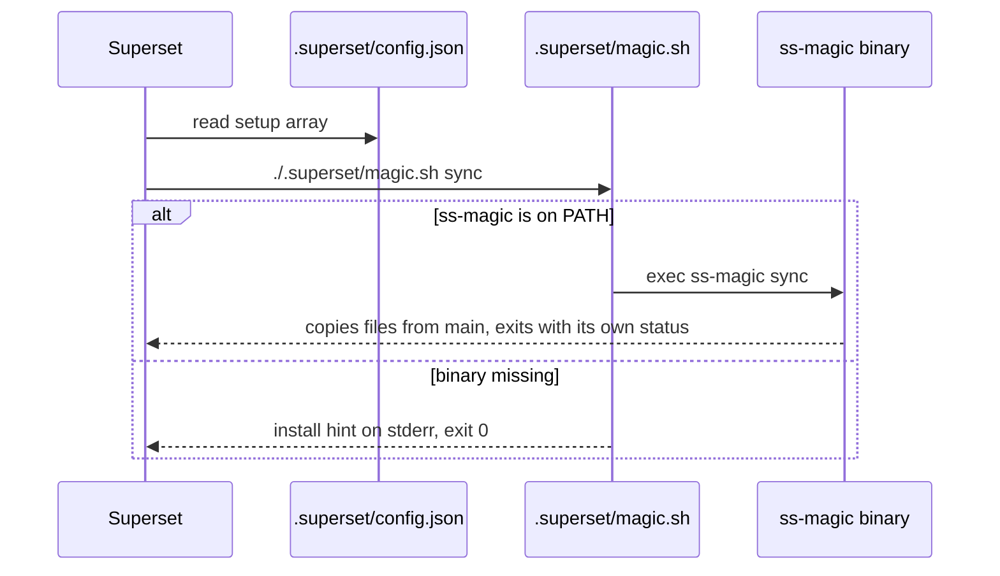
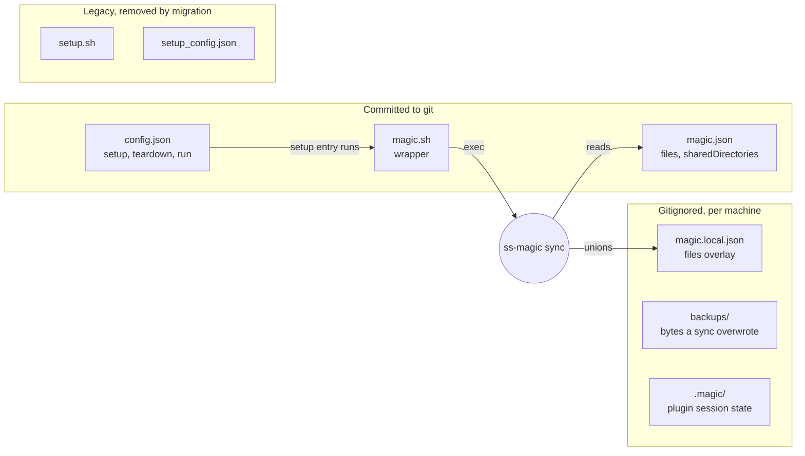
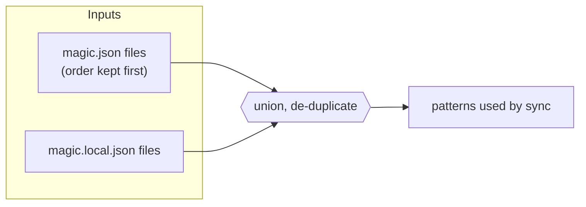
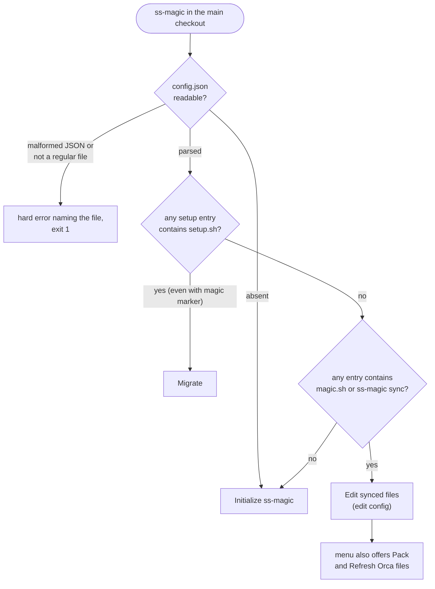
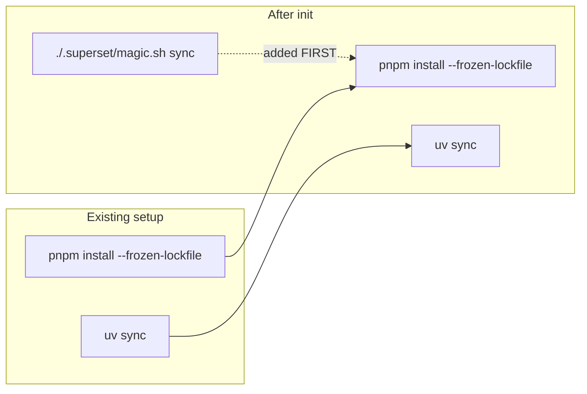
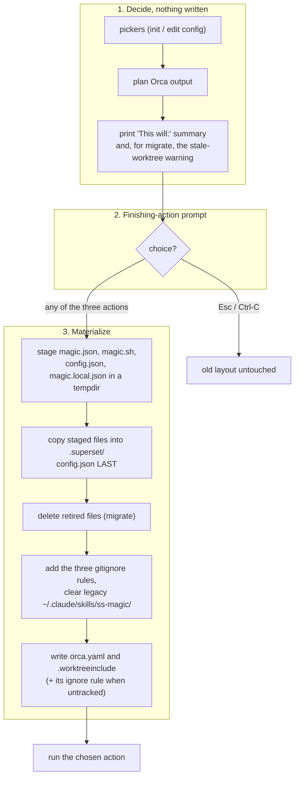

# The `.superset/` contract: init, migration and edit config

A repository that uses ss-magic carries a small set of files under `.superset/`. Together they tell [Superset](https://docs.superset.sh/setup-teardown-scripts) to run ss-magic when it creates a workspace, and tell ss-magic which files to copy. This page covers every file in that contract, how Superset reaches ss-magic, how the main-checkout menu decides between **init**, **migrate** and **edit config**, and what each flow writes.

The Orca half (`orca.yaml`, `.worktreeinclude`, shared directories) is written by the same flows but is explained in [orca.md](./orca.md). Glob syntax is in [sync-patterns.md](./sync-patterns.md), and the copy itself in [forward-and-reverse-sync.md](./forward-and-reverse-sync.md).

> [!NOTE]
> Vocabulary such as "main checkout", "forward sync" and "pattern" is defined in [CONCEPTS.md](../../CONCEPTS.md).

## How it works with Superset

Superset workspaces are isolated git worktrees. When Superset creates one, it runs the `setup` commands from `.superset/config.json` one after another inside the new worktree (see Superset's [setup & teardown scripts docs](https://docs.superset.sh/setup-teardown-scripts)). Init writes this hook for you:

```json
{
  "setup": ["./.superset/magic.sh sync"]
}
```



Because the wrapper exits `0` when the binary is missing, a machine without ss-magic never blocks Superset's setup pipeline. When the binary is present, its real exit status reaches Superset; what Superset then does with a non-zero status is Superset's behaviour, not ss-magic's.

ss-magic's role in the hook is the file copy only. Dependency installation, migrations and dev servers stay as ordinary commands in Superset's own `config.json`. The result is that every new workspace starts with your secrets and local config already in place.

## The files of the contract



| File | Owner | Tracked by git | Purpose |
|---|---|---|---|
| `.superset/config.json` | Superset | yes | `{ setup, teardown, run }`. The `setup` array runs `./.superset/magic.sh sync`. |
| `.superset/magic.sh` | ss-magic | yes | Wrapper Superset invokes. Rewritten (always overwritten, mode 0755) on every init (interactive or scripted), migrate and edit config. |
| `.superset/magic.json` | ss-magic | yes | `{ files, sharedDirectories }`. The sync patterns and the Orca shared-directory patterns. |
| `.superset/magic.local.json` | the developer | no (gitignored) | Per-machine overlay of `files`. Never overwritten once it exists. |
| `.superset/backups/` | ss-magic | no (gitignored) | Where a sync stores the bytes it overwrites. Can contain recovered secrets. |
| `.superset/.magic/` | the Claude Code plugin | no (gitignored) | Per-worktree plugin state, see [plugin-session-state.md](./plugin-session-state.md). |
| `.superset/setup.sh`, `.superset/setup_config.json` | retired | – | The pre-`magic.json` layout. Migration carries the `files` of `setup_config.json` into `magic.json` and deletes both files. ss-magic never writes `setup_config.json`. |

### `config.json`

Superset owns this file. ss-magic changes only the `setup` array and keeps `teardown` and `run` exactly as they were. Your own `setup` commands stay too, see [The setup array](#the-setup-array-preservation-and-order). A missing `setup`, `teardown` or `run` key reads as an empty array, and the rewritten file always carries all three.

> [!WARNING]
> `config.json` is rewritten from its three known arrays. A top-level key other than `setup`, `teardown` and `run` is not carried over when init, migrate or edit config rewrites the file. (`magic.json` behaves differently: unknown keys survive, see below.)

### `magic.sh`

A small committed wrapper, embedded in the binary from [assets/magic.sh](../../assets/magic.sh).

- If `command -v ss-magic` finds the binary, it runs `exec ss-magic "$@"`, so the binary's real exit code reaches Superset.
- If the binary is absent, it prints an install hint to stderr (the releases page and the installer command) and exits `0`, so a missing ss-magic never blocks Superset's setup pipeline. The first line, "ss-magic is not installed.", is bold red only when stderr is a terminal and `NO_COLOR` is unset.
- It is a pure pass-through. The `sync` subcommand comes from the `setup` entry (`./.superset/magic.sh sync`), not from the script.

### `magic.json`

Committed, and it travels with git:

```json
{
  "files": [
    ".superset/magic.local.json",
    ".env",
    "**/.dev.vars"
  ]
}
```

| Key | Meaning |
|---|---|
| `files` | Glob patterns of files to sync from the main checkout into each worktree. |
| `sharedDirectories` | Glob patterns of dependency directories Orca shares with a new worktree. ss-magic expands them into `orca.yaml`. Optional. |
| any other key | Kept verbatim. A `magic.json` written by a newer ss-magic can carry keys this build does not know, and every writer here round-trips them. |

Details worth knowing:

- Every `files` list written by init (interactive, scripted or edit config) starts with `.superset/magic.local.json`, so the local overlay is itself copied into each worktree. Chosen patterns follow, de-duplicated. Migration is the exception, see [Migrate](#migrate).
- `sharedDirectories` has three states. Absent means nobody has chosen yet, `[]` means "chose none", and a non-empty list is the choice. Writers keep these apart so an empty choice is not silently refilled.
- `sharedDirectories` is read from the committed file only, never from the local overlay. The list ends up in the committed `orca.yaml`, so a per-machine file must not be able to change what the team shares.
- The direct `magic.json` writer (used, for example, by the plugin's `seed-config` at session start) writes a private temporary sibling and renames it over the target, so a reader never sees a half-written file. Init and migrate build their `magic.json` the same way, but in the staging directory; the final step into `.superset/` is a plain file copy (see [Staged first, then materialized](#staged-first-then-materialized)).

### `magic.local.json` and the overlay

The gitignored overlay has the same shape. At sync time its `files` are unioned with `magic.json`:



| Rule | Behaviour |
|---|---|
| `files` | `magic.json` order first, then local entries not already present, in local order. A duplicate keeps the base position. |
| `sharedDirectories` | Base value only. |
| Other keys | The local value wins per key. |
| Missing `magic.json` | Treated as "not initialised". |
| Malformed `magic.json` or `magic.local.json` | Hard error naming the file. There is no silent fallback. |
| Missing `magic.local.json` | Base only. |

Init (interactive or scripted), edit config and migration bootstrap the overlay as a small JSON object: a `_comment` string explaining that the file is a gitignored per-machine overlay, plus `"files": []`. It is created only when absent: the file is gitignored, so an existing one is unrecoverable and is kept. A developer adds machine-specific patterns here without committing them.

## What gets gitignored up front

Init (interactive or scripted), migration and edit config add three ignore rules before any sync has run:

| Rule | Why it is eager |
|---|---|
| `.superset/magic.local.json` | Per-machine overlay, unrecoverable if committed. |
| `.superset/backups/` | Backups can contain recovered secret bytes. Without this rule the first sync would add it lazily. |
| `.superset/.magic/` | The plugin's hooks refuse to write any state while git does not report that tree as ignored, so a repository without this rule gets no plugin state at all. `ss-magic sync` runs no plugin step, so the rule is written only by init and migrate here, and by the plugin's `ss-magic-plugin enable` and `ss-magic-plugin config set` verbs when they turn the plugin on. No hook writes it. |

Each rule is a no-op when git already ignores the path. Otherwise it is added to the closest existing `.gitignore` on the path's way down from the repository root (a `.superset/.gitignore`, if there is one), or else to the root `.gitignore` (created if absent). A fourth rule, for the per-machine `.worktreeinclude` snapshot, is added afterwards by the Orca step of the same run and only when git does not track that file, see [orca.md](./orca.md).

## Which flow runs: state detection

Running `ss-magic` with no arguments opens the interactive menu. Run it in the repository's **main checkout** (the primary checkout your worktrees are linked to) to set up the contract. The menu needs a real terminal on both stdin and stdout, otherwise it exits with status 2 and points to `ss-magic --help`. Outside a git repository it prints an error and exits 1. The menu is location-aware:

- In a linked worktree it offers **Sync** and **Pack**, see [interactive-sync.md](./interactive-sync.md) and [pack.md](./pack.md).
- In the main checkout it reads `.superset/config.json` and picks one of the three flows below.



| `config.json` | `setup` contents | Menu offers |
|---|---|---|
| absent | – | Initialize ss-magic |
| present | an entry containing `setup.sh` (alone, or together with a magic marker) | Migrate to the magic.json layout |
| present | an entry containing `magic.sh` or `ss-magic sync`, none containing `setup.sh` | Edit synced files, Pack, Refresh Orca files |
| present | neither marker | Initialize ss-magic |

The match is a substring test on each `setup` entry. Migrate wins whenever a `setup.sh` reference is present, so a half-migrated array is repaired instead of treated as done. Pressing Esc or Ctrl-C at the menu itself prints a "Cancelled, nothing changed" message and exits 0.

> [!NOTE]
> Edit config is not a separate code path. It reuses the init flow against a repository whose `setup` already runs the wrapper, which makes init idempotent: the custom patterns already in `magic.json` are offered again, preselected, so they survive the rewrite.

## The three flows

### Init

1. A picker, "Files to copy automatically", lists the built-in patterns `.env`, `**/.env`, `.env.local` and `**/.dev.vars`, plus any custom pattern already in `magic.json`. A built-in row starts checked when it matches a file on disk or is already configured; custom rows are always checked. A row that matches nothing is marked as such. You can add your own pattern; it is syntax-checked (no absolute path, no `..` segment, a glob that compiles, not a duplicate), and Esc in that prompt returns to the list.
2. A second picker, "Directories Orca shares with new worktrees", lists the default dependency kinds (`node_modules`, Python virtualenvs, JS build caches) with the directories each currently matches. It is explained in [orca.md](./orca.md).
3. A "This will:" summary lists what is about to happen, including the `setup` array that will be written and whether `magic.local.json` is bootstrapped or kept.
4. You choose a finishing action.
5. ss-magic writes everything.

Init writes `config.json` with the setup hook, the `magic.sh` wrapper, `magic.json` with your patterns (and `sharedDirectories`, the picker's answer, an empty one included), the gitignored `magic.local.json` overlay, and the two Orca files next to the contract.

### Migrate

Migration asks nothing about patterns. It converts the old layout:

1. Writes the `files` of `setup_config.json`, verbatim and in order, as `magic.json`'s `files` (in effect a rename). A `files` list already in `magic.json` is replaced, while its unknown keys are preserved. Without a `setup_config.json` the list is empty.
2. Writes `magic.sh`.
3. Replaces the first `setup.sh` entry in the `setup` array, in place, with `./.superset/magic.sh sync`. Further `setup.sh` entries are dropped. When another entry already runs a sync (the wrapper, or a direct `ss-magic sync`), every `setup.sh` entry is simply dropped so the copy never runs twice in a new workspace. All other commands keep their position.
4. Deletes `setup.sh` and `setup_config.json`.
5. Bootstraps `magic.local.json` (only if absent) and the three gitignore rules.

Before the finishing prompt it prints a warning that worktrees created before the migration keep the old `setup.sh` and `setup_config.json` and must be recreated. For Orca it keeps a stored `sharedDirectories` choice and otherwise takes every default kind it detects (leaving the key out when nothing is detected).

> [!NOTE]
> Unlike init, migration does not put `.superset/magic.local.json` at the front of `files`; it carries the old list as it was. Running **Edit synced files** afterwards rewrites `files` with that default first, so the overlay is copied into worktrees too.

### Edit config

The same flow as init, started from the **Edit synced files (magic.json)** entry. Use it to add or remove patterns or shared directories. It never replaces an existing `magic.local.json`.

## The `setup` array: preservation and order

Init and edit config keep your own `setup` commands, such as `pnpm install --frozen-lockfile`, in the order you wrote them.



- When no entry runs the wrapper yet, `./.superset/magic.sh sync` is inserted at the front, so the configured files are copied before your own commands run.
- An array that already contains a wrapper or sync marker is left exactly as it is.
- A missing `config.json` yields the wrapper alone.
- `teardown` and `run` are copied through verbatim in every flow.

## Staged first, then materialized

All `.superset/` changes are built in a temporary directory and copied into the repository only after the finishing-action prompt returns a choice.



- **Cancel is the only path that writes nothing.** Esc or Ctrl-C at either picker or at the finishing prompt leaves the old layout intact, never a half-migrated tree. The command then ends with an `error: … cancelled` message and exit status 1.
- Choosing **Done** still writes the files; it only skips the git operations.
- `config.json` is copied last. Superset reads it to find the wrapper, so a failure mid-copy can never leave `config.json` pointing at a `magic.sh` that was not written yet.
- The copy only ever writes the staged files and deletes explicitly named retired files. It never prunes anything else under `.superset/`, which is what keeps the live `.superset/.magic/` plugin state safe across a re-run.
- Init (interactive or scripted) and migrate also remove a leftover pre-marketplace plugin copy at `~/.claude/skills/ss-magic/` if one exists. The marketplace install outranks it, so it does no work but is reported as a permanent conflict in Claude Code's plugin-errors view. Only that exact path is touched (a symlink there has the link removed, not its target), and a failure to remove it only warns.

The Orca files are computed before the prompt and written after the `.superset/` tree. If `orca.yaml` or `.worktreeinclude` changes on disk while the prompt is open (you add a key, a comment or a line of your own, or create or delete the file), ss-magic does not write its prepared version over yours. It leaves that file as it found it, warns, and still writes everything else. Run the same command again to update `orca.yaml`, or `ss-magic orca` to refresh `.worktreeinclude`. See [orca.md](./orca.md).

A `magic.local.json` that cannot be parsed does not stop init, edit config or migrate: its patterns are left out of the files listed for Orca, with a warning, and forward sync still copies them once the file is fixed.

## Finishing actions

The prompt is "What next?" with three choices:

| # | Menu label | What happens |
|---|---|---|
| 1 | Commit and push to main branch | Stage, commit, then `git push origin <main>`, where `<main>` is the local `main` branch, or `master` when there is no `main`. |
| 2 | Create feature branch, commit and open a PR | Create branch `chore/ss-magic-init-<YYYYMMDD-HHMMSS>` (init, edit config) or `chore/ss-magic-migrate-<YYYYMMDD-HHMMSS>` (migrate), commit, push with upstream, then `gh pr create --fill --base <main>`. Without `gh` on `PATH`, or when `gh pr create` fails, the branch stays pushed and a warning tells you to open the PR yourself. |
| 3 | Done for now | No git operations. Changes stay on disk; run `git status` to review. |

Commit messages are `chore(superset): initialize ss-magic layout` and `chore(superset): migrate to ss-magic layout`.

A committing action stages `.superset/`, `.gitignore` and `orca.yaml`, and never `.worktreeinclude`, which is a per-machine snapshot. If nothing is staged afterwards (the files already match what is tracked), the commit step is skipped with a message, and action 2 creates no branch.

The init and edit config summary printed before the prompt is specific about reruns. It says whether `magic.local.json` is bootstrapped or kept and whether it is already gitignored. For both init and migrate it also says whether `orca.yaml` will be created, updated, kept or cannot be edited, how many files `.worktreeinclude` will list, and whether that file gets an ignore rule (a file git tracks gets none, and neither does a file an earlier run already ignored). The migration summary's `magic.local.json` line always reads "Bootstrap … + add it to .gitignore", even when the file and its rule already exist; neither is overwritten or duplicated.

## Scripted init: `ss-magic init [PATTERN...]`

The non-interactive form for CI and automated provisioning:

```sh
ss-magic init '.env' '**/.dev.vars' 'config/local/*'
```

Quote glob patterns so your shell does not expand them first.

| Aspect | Behaviour |
|---|---|
| Patterns | Positional arguments become the `files` patterns, after the default `.superset/magic.local.json`, de-duplicated. Arguments starting with `-` are ignored (but `--version`/`-V` anywhere prints the version, and `-h`/`--help` before `init` prints usage). |
| Existing `files` | Replaced. Unlike the interactive picker, the scripted form does not carry over patterns already in `magic.json`; pass every pattern you want. Unknown top-level keys and a stored `sharedDirectories` are kept. |
| Prompts | None. The pickers and the finishing action are skipped, so no terminal is needed. |
| Git | No git or `gh` operations. Files are left uncommitted, like choosing Done. |
| Update gate | Skipped, so one-time setup never waits on a network call. |
| Where it runs | Inside any git repository; outside one it prints an error and exits 1. It writes into the root of the checkout it is run from (`git rev-parse --show-toplevel`), which is a linked worktree's own root when run from one. |
| `magic.local.json` | Preserved if it exists, bootstrapped otherwise. |
| Gitignore | The same three rules as the interactive flows. |
| Existing `setup` | Kept and ordered as described above. |

Orca files are written too. With nobody to ask, the shared-directory patterns are those `magic.json` already stores (an empty list included) or, failing that, every default kind detected in the checkout. When nothing is stored and nothing is detected, such as a fresh clone before `npm install`, the `sharedDirectories` key is left out so a later run can still detect directories that did not exist yet.

Init works out the Orca files before it writes the contract, so the snapshot describes the checkout as it was at that moment. The `magic.local.json` a first init creates is therefore not in the first snapshot; it joins at the next refresh, which the first Orca worktree's sync performs on its own.

> [!IMPORTANT]
> The scripted init is not a migration. If it meets a `setup.sh` entry it replaces it in the `setup` array, but it does not carry `setup_config.json` patterns across and does not delete the retired files. Use the interactive menu for a legacy repository.

## After init

Once the contract is committed, every worktree created through the Superset app or through Orca gets the matching files copied in automatically. In a worktree created any other way, run `ss-magic sync` yourself. What `sync` does is covered in [forward-and-reverse-sync.md](./forward-and-reverse-sync.md).

## Unknowns

- The `~/.claude/skills/ss-magic/` cleanup is skipped in the unit-test build by design, so its behaviour against a real home directory is covered by testing the removal helper against a temporary home, not by an end-to-end test.
- The interactive prompts themselves (pickers, finishing-action select, `gh pr create`) are manual-smoke only in this repository.

## Where this lives in the code

| Area | File |
|---|---|
| Contract types, overlay, atomic writers, `copy_into_repo` | [superset_files.rs](../../crates/ss-magic-core/src/superset_files.rs) |
| Branch detection, init, migrate, `setup` ordering, finishing actions | [migrate.rs](../../crates/ss-magic/src/workspace/migrate.rs) |
| Wrapper script body | [assets/magic.sh](../../assets/magic.sh) |
| Main-checkout menu and `operations_for` | [menu.rs](../../crates/ss-magic/src/tui/menu.rs) |
| Pickers and finishing-action prompt | [ui.rs](../../crates/ss-magic/src/tui/ui.rs) |
| Argument parsing for `init` | [cli.rs](../../crates/ss-magic/src/cli.rs) |
| Scripted init entry point, menu gating | [main.rs](../../crates/ss-magic/src/main.rs) |
| Finishing-action git and `gh` calls | [git/mod.rs](../../crates/ss-magic-core/src/git/mod.rs) |
| Orca plan, summary lines and apply | [write.rs](../../crates/ss-magic/src/orca/write.rs) |
| Built-in file pattern options | [repo_scan.rs](../../crates/ss-magic-core/src/sync/repo_scan.rs) |
| Shared-directory defaults and detection | [shared_dirs.rs](../../crates/ss-magic/src/orca/shared_dirs.rs) |
| Gitignore helpers and the `.superset/.magic/` rule | [gitignore.rs](../../crates/ss-magic-core/src/git/gitignore.rs), [state_tree.rs](../../crates/ss-magic-core/src/state_tree.rs) |
