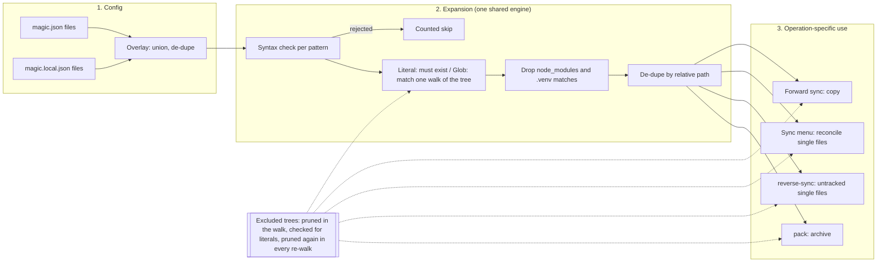
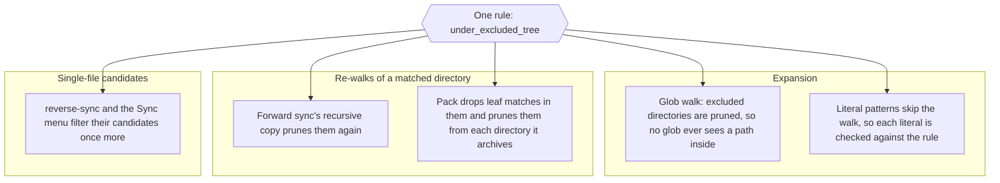

# Sync patterns: how magic.json globs are expanded

`magic.json` holds a list of patterns under `files`. Forward sync, the Sync menu's reconcile set, `ss-magic reverse-sync` and `ss-magic pack` all turn that list into a set of repo-relative paths with one shared expansion engine and the same rules. This page describes those rules, what each operation does with the result, and the four directory trees that no operation ever yields.

Vocabulary (main checkout, forward and reverse sync, candidates) is in [CONCEPTS.md](../../CONCEPTS.md).\
Where the config files come from and how they are created is in [superset-contract.md](./superset-contract.md).

> [!NOTE]
> Everything below describes `files`. The `sharedDirectories` list in `magic.json` is a separate list for Orca; it is read from the committed file only and is covered in [orca.md](./orca.md).

## The pipeline at a glance



## Step 1: the overlay

`ss-magic` reads `.superset/magic.json` (committed) and, if present, `.superset/magic.local.json` (gitignored, per machine), and builds one `files` list.

- `magic.json` entries come first, in their own order.
- Entries from `magic.local.json` that are not already in the list are appended in local order.
- A local entry that repeats a base entry is dropped silently; the base position is kept.
- A missing `magic.local.json` means the base list only.
- A malformed `magic.json` or `magic.local.json` (bad JSON, or a path that exists but is not a regular file) is a hard error naming the file; there is no silent fallback.
- Any other top-level key both files carry (one this build does not know) takes the local value; this does not affect `files`.

This lets a developer add machine-specific patterns without committing them. Init, edit config and the scripted `ss-magic init` put `.superset/magic.local.json` itself first in `magic.json`'s `files`, so forward sync copies the local overlay into each worktree too. Migration does not add it: it carries the old `setup_config.json` list verbatim (see [superset-contract.md](./superset-contract.md)).

An example `magic.json` (example only):

```json
{
  "files": [
    ".superset/magic.local.json",
    ".env",
    "**/.dev.vars"
  ]
}
```

> [!IMPORTANT]
> The overlay applies to `files` only. A `sharedDirectories` key in `magic.local.json` is ignored, because that list ends up in the committed `orca.yaml` and a per-machine file must not decide what the whole team shares.

### Whose config is read, and a missing magic.json

Each operation reads the overlay from one checkout, and they do not all treat a missing `magic.json` the same way:

| Operation | Config read from | No `magic.json` there | Empty `files` |
|---|---|---|---|
| `ss-magic sync` (forward) | The main checkout | Error, exit 1 | "nothing to sync", exit 0 |
| `ss-magic pack` | The current repo root (worktree or main) | Error, exit 1 | "nothing to pack", exit 0 |
| `ss-magic reverse-sync` | The current worktree | No candidates (nothing configured) | No candidates |
| Sync menu | The current worktree | Empty reconcile set | Empty reconcile set |

## Step 2: the pattern rules

Each pattern is handled independently, in list order. A rejected pattern does not stop the patterns after it.

### Syntax checks

| Pattern | Outcome | Counted as skipped? |
|---|---|---|
| Absolute (starts with `/`), e.g. `/etc/foo` | Rejected, label `absolute path rejected` | Yes |
| Has a `..` path segment, e.g. `../x` or `a/../b` | Rejected, label `".." not allowed` | Yes |
| Empty string | Rejected, reported with the `absolute path rejected` label | Yes |
| Glob that does not compile, e.g. `foo[bar` | Rejected, label `bad glob` | Yes |

The `..` check is per `/`-separated segment, so `..foo` and `foo..bar` are not rejected.

The pattern pickers in the interactive UI run the same check before a typed pattern is accepted (and also refuse a duplicate of a pattern already in the list), so the editor and the engine agree on what is valid. See [superset-contract.md](./superset-contract.md) for the pickers themselves.

### Literal versus glob

A pattern is a **glob** if it contains `*`, `?` or `[`. Everything else is a **literal** path. Braces alone do not make a pattern a glob: `*.{js,ts}` is a glob because of the `*`, but a bare `{a,b}` is looked up as a literal file name.

| Kind | Rule | Missing or empty result |
|---|---|---|
| Literal | Must exist under the root (a file or a directory) | Counted as skipped, label `missing` |
| Glob | Matched against every file and directory found by one walk of the tree | Zero matches is non-fatal and not counted, label `no matches` |

- The walk is done once, lazily, and shared by every glob pattern in the list.
- The walk includes dotfiles and directories, so `apps/*/config` can match a directory.
- The walk does not follow symlinks into other directories.
- `no matches` is reported only when the glob matched nothing at all. A glob whose every match was then dropped as `excluded` gets no `no matches` line.

### Dropped matches

A match is dropped, logged gray as `excluded` and not counted, when any component of its path is `node_modules` or `.venv`. This applies at any depth and to both globs and literals, so `**/.env` never picks up `node_modules/pkg/.env`. The same `excluded` label is used for a literal that names a path inside one of the [four excluded trees](#the-four-excluded-trees).

> [!WARNING]
> The `node_modules` / `.venv` rule is applied to the **match list**, not inside a matched directory. When a directory match is copied (forward sync) or archived (pack) recursively, only the four excluded trees are pruned from it. A literal pattern `apps` therefore copies `apps/web/node_modules/` along with everything else. Use a narrower pattern if that is not what you want.

### De-duplication

Matches are de-duplicated by relative path across all patterns. A file matched by both `.env` and `**/.env` is processed once.

### Matching ignores git state

Expansion looks only at the filesystem. It does not read `.gitignore` and does not ask git whether a match is tracked, so forward sync and pack act on tracked files too if a pattern matches them. Only reverse-sync and the Sync menu bring git state in afterwards (see [below](#what-each-operation-does-with-the-matches)).

### What "skipped" means

The skip count and its summary line belong to forward sync (`ss-magic sync`), which prints every event as it goes:

```plaintext
Copied: <path>
Skipped (<label>): <pattern or path>
Sync done: copied N files, skipped M files
```

- These reasons count toward `skipped`: absolute or empty pattern, `..` segment, bad glob, missing literal, a match that is neither a regular file nor a directory (`not a file or dir`), and a failed copy (`copy failed`).
- Counted skips are printed in red on stderr. `excluded` is printed gray, `no matches` in the default color.
- The summary line is green when `skipped` is 0 and an orange warning otherwise. The exit code is 0 either way; counted skips do not fail the command.
- In an Orca worktree, paths Orca already copied are printed as `Left to Orca: <path>` and added to the summary as `, left K paths to Orca`. They are never counted as skipped and never turn the line into a warning. See [orca.md](./orca.md).

`ss-magic pack`, `ss-magic reverse-sync` and the Sync menu use the same expansion but discard its skip events; they report only what they act on.

## globset semantics

Matching uses the Rust [`globset`](https://docs.rs/globset) crate with default options. The important difference from a POSIX shell: `*` can cross path separators.

An example taken from a test in the core crate (`single_star_matches_across_path_separators_in_globset`): with `apps/api/.env` and `apps/api/nested/.env` on disk, the pattern `apps/*/.env` matches both. The test exists so callers do not rely on `*` meaning "one path component".

Practical consequences:

- `**/name` matches `name` at any depth, including the repository root (`**/.dev.vars` matches `.dev.vars`, `apps/api/.dev.vars` and deeper).
- `*` is broader than you may expect; prefer a literal or a more specific prefix when you only want one level.
- Patterns are matched against paths relative to the tree root, never absolute paths.

> [!TIP]
> Quote patterns when you pass them on a command line, for example `'**/.dev.vars'`. Otherwise your shell expands `*` first, using its own rules, and `ss-magic` receives the already-expanded list instead of the pattern. Patterns inside `magic.json` need no quoting.

## The four excluded trees

Four directory trees are excluded from every operation – forward sync's copy walk, the Sync menu's reconcile set, `ss-magic reverse-sync` and pack:

| Tree | Why it is excluded |
|---|---|
| `.superset/backups/` | The tool's own timestamped copies of files a sync overwrote. They are recovered secrets, so re-offering or re-archiving them would leak the very bytes the backup exists to protect. |
| `.superset/.magic/` | The ss-magic Claude Code plugin's gitignored, machine-local state. It must never be committed, pushed into main or packed. |
| `.scratchpad/` | A scratch tree that ss-magic does not own but must never push into the shared main checkout. |
| `.git/` | Git's object store: pointless to walk and corrupting to copy. |

Matching is by exact path components from the tree root, not by string prefix or bare name:

- `.superset/.magicked/` and `.superset/backupsfoo/` are not excluded (look-alike names are different components).
- A root-level `.magic/` or `backups/` is not excluded (the rule needs the `.superset` parent).
- The rules are anchored at the root: `vendor/.superset/.magic/` is not excluded.
- `.superset/` itself is never excluded, so `config.json`, `magic.sh`, `magic.json` and `magic.local.json` still sync and pack normally.
- A `./` component is ignored when classifying a path, so `./.superset/.magic/x` is excluded like `.superset/.magic/x`.

### Why the exclusion happens during the walk

The rule is applied at every point where files are actually enumerated, not only on the list of matches. Filtering the match list alone would not be enough: a directory match is re-walked on the live filesystem afterwards and would find the excluded subtree again. For example, the pattern `.superset` (a literal) or `**` (a glob) matches a directory that contains `backups/`.



So even a bare `.superset` pattern copies or archives the contract files but not `backups/` or `.magic/`.

## What each operation does with the matches

All four operations call the same expansion. They differ in how they use a **directory** match and which files they act on.

| Operation | Directory match | Which files | Writes to |
|---|---|---|---|
| Forward sync (`ss-magic sync`) | Copied recursively, excluded trees pruned | Everything matched in main; existing destination files are overwritten | The worktree, after a pre-write backup under the worktree's `.superset/backups/` unless `--no-backup` |
| Sync menu | Dropped: it yields no candidate of its own | Patterns expanded against both the worktree and main; each file classified as differs, worktree-only, main-only or identical, identical ones dropped | Either side, through the merge cockpit, with a batched confirm and a backup before each overwrite |
| `ss-magic reverse-sync` | Dropped, same reason | Matched worktree files that git lists as untracked and that differ from main | Main, after backing up each overwritten main file unless `--no-backup` |
| `ss-magic pack` | Archived recursively, excluded trees pruned | Everything matched in the current repo root | `ss-magic-<repo>.tar.bz2` at the repo root |

Details worth knowing:

- reverse-sync and the Sync menu copy single files. A directory match is skipped; the files inside it are reached only if some pattern matches them directly (for example `config/**`, whose matches include the files).
- reverse-sync's "untracked only" rule is a secret-safety gate: it pushes only paths that `git ls-files --others` reports, gitignored ones included.
- The Sync menu instead records, per candidate, whether the worktree copy is tracked, by positive tracked determination: a path that cannot be confirmed as tracked is treated as untracked (a secret), and that flag decides whether a push into main must be gitignored there.
- Pack additionally drops matches that would put an archive inside itself (any root-level `ss-magic-*.tar.bz2`) and any match that resolves to the repo root, such as a `.` pattern.

The commands themselves are covered in [forward-and-reverse-sync.md](./forward-and-reverse-sync.md), the menu and cockpit in [interactive-sync.md](./interactive-sync.md), and archiving in [pack.md](./pack.md).

## Worked examples

All examples are illustrative; the paths are invented.

| Pattern | On disk | Result |
|---|---|---|
| `.env` | `.env` exists | Literal, matched |
| `.env.production` | file missing | Counted as skipped (`missing`) |
| `**/.env` | `.env`, `apps/web/.env`, `node_modules/x/.env` | First two matched; the third is dropped as `excluded` |
| `apps/*/.env` | `apps/api/.env`, `apps/api/nested/.env` | Both matched, because `*` crosses `/` |
| `apps/*/config` | `apps/api/config/` is a directory | Directory matched: forward sync and pack take it with its contents; the menu and reverse-sync ignore the directory itself |
| `/etc/hosts` | n/a | Rejected, counted as skipped |
| `../secrets` | n/a | Rejected, counted as skipped |
| `**/*.nope` | no such files | `no matches`: logged, not counted |
| `.superset` | contains `config.json`, `backups/`, `.magic/` | `config.json` and the other contract files travel; `backups/` and `.magic/` do not |
| `.superset/backups/old.env` | file exists | Dropped as `excluded`, not counted |

## Related: the init-time scan

The pattern picker offers four default patterns (`.env`, `**/.env`, `.env.local`, `**/.dev.vars`). A small separate scan checks which of them currently match a file: a default row is preselected when it has a match or is already in `magic.json`, and a row with no match is flagged as such. That scan skips `node_modules`, `.venv`, `.git` and `target` directories by name and looks at files only. It only informs the suggestions in the UI; it does not change which files sync uses.

## Unknowns

- The code records the `node_modules` / `.venv` name list as carried over from the original `setup.sh`; it does not say why a name list was chosen over reading `.gitignore`.
- `?` and character classes follow globset defaults, which per globset's documentation can also match a path separator; only the `*` behaviour is pinned by a test here.

## Where this lives in the code

- [sync/mod.rs](../../crates/ss-magic-core/src/sync/mod.rs) – `EXCLUDED_TREES` and `under_excluded_tree`; tests in [sync/tests.rs](../../crates/ss-magic-core/src/sync/tests.rs)
- [sync/pattern.rs](../../crates/ss-magic-core/src/sync/pattern.rs) – `check_syntax`, `has_glob_meta`, `has_parent_segment`
- [sync/apply.rs](../../crates/ss-magic-core/src/sync/apply.rs) – expansion (`expand_patterns`, `match_paths`, `walk_source`), `DEFAULT_EXCLUDES`, `SkipReason`, the forward copy and the recursive directory copy; behaviour pinned in [apply/tests.rs](../../crates/ss-magic-core/src/sync/apply/tests.rs)
- [sync/repo_scan.rs](../../crates/ss-magic-core/src/sync/repo_scan.rs) – the init-time preselect scan
- [superset_files.rs](../../crates/ss-magic-core/src/superset_files.rs) – `load_overlaid`, the overlay rules
- [main.rs](../../crates/ss-magic/src/main.rs) – forward sync's event printing and summary line, `load_magic_or_exit`
- [reverse_sync.rs](../../crates/ss-magic/src/sync/reverse_sync.rs) – `compute_candidates` and `compute_reconcile_set`
- [pack.rs](../../crates/ss-magic/src/pack.rs) – archive walk and self-exclusion
- [crates/ss-magic-core/CLAUDE.md](../../crates/ss-magic-core/CLAUDE.md) – contributor notes
