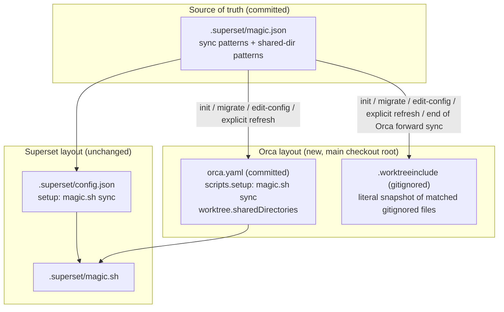
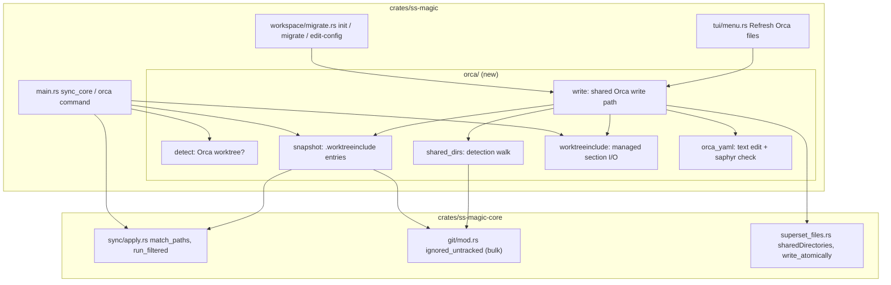
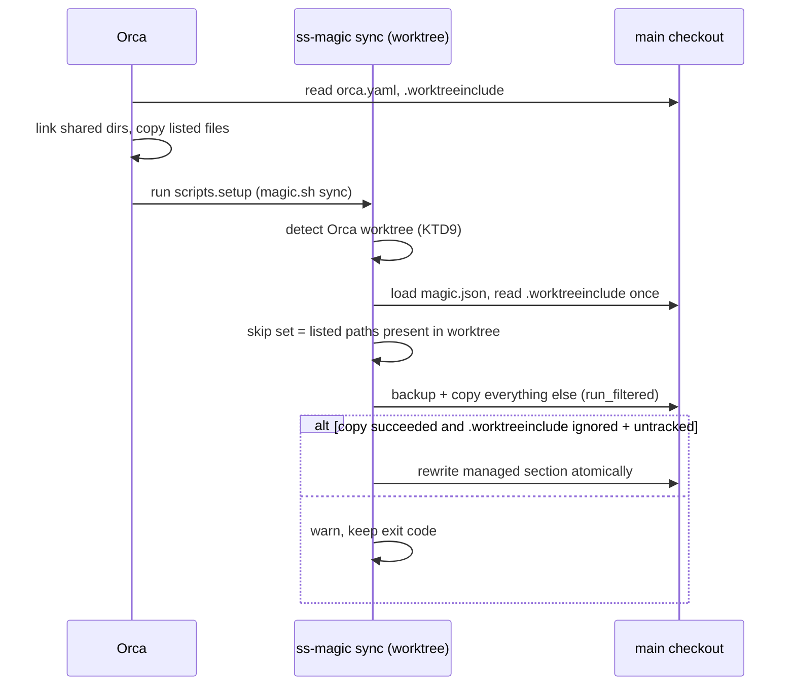
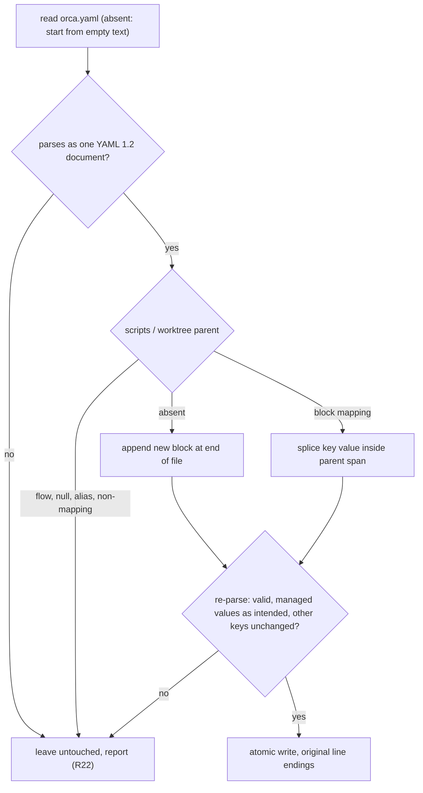

# Orca Compatibility - Plan

## Goal Capsule

- **Objective:** A repository set up with ss-magic gives a new Orca worktree the same gitignored files (secrets, local overlays, dependency trees) a new Superset workspace gets, from the one `magic.json` the team already maintains, without anyone hand-writing or hand-syncing Orca's configuration.
- **Means:** ss-magic generates Orca's `orca.yaml` and `.worktreeinclude` from `magic.json`, lets Orca copy and link what it handles natively, and fills only the gaps itself (KTD1, KTD5, KTD9).
- **Product authority:** The Product Contract below wins on behavior; the Planning Contract's KTDs win on mechanism within it. Superset behavior stays as it is today; the plugin crate (`ss-magic-plugin`) is untouched.
- **Stop conditions:** Stop and ask if implementation shows that Orca rejects a file shape this plan relies on (a `|` block scalar in `scripts.setup`, `#` comment lines in `.worktreeinclude`), or that `saphyr` cannot be built for the release targets.
- **Execution profile:** Rust workspace, CLI crate plus two additive changes in `ss-magic-core`; the work ships as one CLI release (`ss-magic` 0.12.0).
- **Open blockers:** None.

---

## Product Contract

Product Contract preservation: changed – R21-R26 added. They record behavior confirmed in the plan-time scoping synthesis (file-only snapshot, Orca-limit warnings, main-checkout exclusion, best-effort background refresh, ownership of `sharedDirectories`, refusal on uneditable `orca.yaml`, refresh never touching `scripts.setup`). R1-R20, F1-F3 and AE1-AE6 are unchanged; AE7-AE9 added. The brainstorm's Outstanding Questions are resolved in place by KTD2-KTD12.

### Summary

Every ss-magic init, migrate and edit-config writes the Orca files next to the Superset layout.
A committed `orca.yaml` runs `magic.sh sync` on worktree creation and shares dependency directories, and a gitignored `.worktreeinclude` lists a snapshot of the gitignored files the sync patterns match.
Inside an Orca worktree, forward sync skips what Orca already copied and refreshes the snapshot for the next worktree.

### Problem Frame

ss-magic knows only Superset's workspace contract (`.superset/config.json`, `magic.sh`, `magic.json`).
Orca creates git worktrees too, but it reads its own configuration: `orca.yaml` and `.worktreeinclude` at the repo root of the main checkout.
Without them, an Orca worktree starts with no `.env`, no `magic.local.json` and no `node_modules`, and today the only remedy is writing both files by hand and keeping them in step with `magic.json` as patterns and files change.

Orca's native mechanisms only partly overlap with ss-magic's.
`.worktreeinclude` copies literal, gitignored paths once at creation (no globs).
`worktree.sharedDirectories` clone-copies or links literal, gitignored directories, which covers `node_modules` and `.venv` – trees ss-magic's sync deliberately never copies.
Neither syncs anything after creation, and neither understands glob patterns.

### Key Decisions

- **`magic.json` stays the single source of truth for both apps.** One file, two apps; the Orca files are derived output. Governs R1, R4, R8, R9, R21. (session-settled: user-directed – chosen over an init-time "Superset or Orca" mode and over hand-edited Orca files that ss-magic only reads: one maintained list avoids two lists drifting apart.)
- **Every init, migrate and edit-config writes both layouts.** No opt-in switch and no environment-based gating of the write. Governs R1, R2. (session-settled: user-directed – chosen over writing only when ORCA_* vars are present and over an `orca` section in `magic.json` acting as the switch: the user wants every repo ready for both apps.)
- **`.worktreeinclude` holds an expanded snapshot, not only the literal patterns.** Orca then copies as much as possible natively, at the cost of the list going stale between refreshes. Governs R9, R10, R23. (session-settled: user-directed – chosen over writing only the literal `magic.json` entries and over a hand-curated file seeded once.)
- **Snapshot refresh is automatic in Orca worktrees and also explicit.** Governs R12, R13. (session-settled: user-approved – chosen over explicit-only and automatic-only refresh.)
- **The automatic refresh rewrites only `.worktreeinclude`.** A background setup script must never leave the main checkout's tracked `orca.yaml` modified. Governs R12, R25. (session-settled: user-approved – chosen over refreshing both files, and over additive-only `orca.yaml` updates.)
- **Commit `orca.yaml`, gitignore `.worktreeinclude`.** `orca.yaml` carries the team-shared setup script and a stable directory list; the snapshot is per-machine and churns. Governs R5, R11. (session-settled: user-approved – chosen over committing both and over ignoring both.)
- **Only forward sync skips `.worktreeinclude` paths.** Orca copies them once and never syncs afterwards, so the Sync cockpit and `reverse-sync` still offer them. Governs R14, R17. (session-settled: user-approved – chosen over skipping in every sync operation and over skipping in both non-interactive copies.)
- **Shared-directory detection covers `node_modules`, Python venvs and JS build caches – not Rust `target/`.** Governs R6. (session-settled: user-directed – the user picked these three kinds from four offered and left out `target/`, noting that Orca's APFS clone-copy on macOS makes updates to shared directories safe.)
- **An Orca worktree is recognized by an ORCA_* path that matches the worktree ss-magic runs in, not by the variables merely existing.** An Orca terminal that changes into another repository's worktree must not trigger Orca behavior. Governs R15, R24.

### How the files relate

### Requirements

**Writing the Orca layout**

- R1. Interactive init, non-interactive `ss-magic init [PATTERN...]`, migrate and edit-config write `orca.yaml` and `.worktreeinclude` at the main checkout root alongside the Superset layout, through the same staged, finishing-prompt flow those operations already use.
- R2. `orca.yaml`'s `scripts.setup` runs `./.superset/magic.sh sync`, so a new Orca worktree gets ss-magic's forward sync exactly as a Superset workspace does.
- R3. An existing `orca.yaml` keeps every key ss-magic does not manage (such as `defaultTabs`, `environmentRecipes`, `issueCommand`), and an existing `scripts.setup` gains the `magic.sh sync` line rather than being replaced.
- R4. Lines in an existing `.worktreeinclude` that ss-magic did not generate survive every rewrite.
- R5. `orca.yaml` is left as an ordinary tracked file for the team to commit, and `.worktreeinclude` is added to `.gitignore` by the same bootstrap step that ignores `magic.local.json` and `.superset/backups/`.
- R21. ss-magic owns `worktree.sharedDirectories` in `orca.yaml` outright: every write replaces the list with the expansion of the `magic.json` shared-directory patterns, so a directory is added through `magic.json`, not by hand.
- R22. When `orca.yaml` uses a layout ss-magic cannot edit safely, ss-magic leaves the file byte-for-byte untouched, prints why, and still writes everything else.

**Shared directories**

- R6. Init detects, at any depth in the main checkout, gitignored `node_modules` directories (root and per-package, never one nested inside another `node_modules`), Python virtualenvs, and JS build caches, and offers them for `worktree.sharedDirectories`.
- R7. Interactive init presents the detected directories in a picker, preselected; non-interactive init writes every detected one.
- R8. The chosen shared-directory patterns are stored in `magic.json`, and `orca.yaml` receives them expanded to the literal, repo-relative directory paths Orca requires.

**The `.worktreeinclude` snapshot**

- R9. The snapshot lists every path the overlaid sync patterns (`magic.json` plus `magic.local.json`) match in the main checkout that git ignores, as literal repo-relative paths, applying the same excluded trees and default excludes as forward sync.
- R10. Paths that are tracked or not gitignored never enter the snapshot; ss-magic's own forward sync keeps copying them.
- R11. The snapshot is per-machine output: it reflects the files present in this machine's main checkout and is never committed.
- R23. The snapshot lists individual files only, never a directory, and when it or the shared-directory list would exceed Orca's limits ss-magic drops the excess with a warning naming how many entries were left to its own sync.

**Refresh**

- R12. At the end of forward sync in an Orca worktree, ss-magic regenerates the main checkout's `.worktreeinclude` (and only that file), so the next worktree starts from a current list.
- R13. An explicit refresh, offered both as a main-checkout menu entry and as a subcommand, regenerates `orca.yaml`'s shared directories and `.worktreeinclude` together; this is also how a repository initialized before this release gains the Orca files.
- R25. Neither refresh touches `scripts.setup`; only init, migrate and edit-config add the `magic.sh sync` line.
- R26. The automatic refresh (R12) is best-effort: it writes only when git positively reports main's `.worktreeinclude` as ignored and untracked, otherwise it warns and skips, and it never changes the forward sync's exit status.

**Forward sync inside Orca**

- R14. In an Orca worktree, forward sync skips each path listed in the main checkout's `.worktreeinclude` whose worktree copy already exists; a listed path that Orca did not copy (over Orca's copy budget, or missing) is still synced.
- R15. ss-magic treats the current worktree as an Orca worktree only when `ORCA_WORKTREE_PATH` (set for Orca setup scripts) or the path inside `ORCA_WORKTREE_ID` (set for Orca terminals) names the worktree root ss-magic is running in.
- R16. The skip set is read before the end-of-sync refresh (R12) rewrites `.worktreeinclude`, so a path added to the snapshot by that refresh is never skipped on the strength of a list Orca did not use.
- R17. A forward-sync flag opts back into copying `.worktreeinclude` paths; without it, skipping is the default in an Orca worktree.
- R18. Outside an Orca worktree (Superset, plain git), forward sync behaves exactly as today.
- R24. The main checkout is never an Orca worktree for these purposes, even when an ORCA_* path names it.

**Release and documentation**

- R19. The change ships as a minor version bump of the `ss-magic` CLI line; the plugin line does not change.
- R20. README, CLAUDE.md, `.cursor/BUGBOT.md` and CONCEPTS.md (whose "Workspace contract" entry currently describes only the `.superset/` directory) describe the Orca files and behavior.

### Key Flows

- F1. Setting up a repository
  - **Trigger:** A developer runs init (or migrate, or edit-config) in the main checkout.
  - **Steps:** ss-magic offers sync patterns as today, then the detected shared directories; the finishing prompt lists the Superset files and `orca.yaml` / `.worktreeinclude`; on confirm, all are materialized and `.worktreeinclude` is gitignored.
  - **Outcome:** The repository works in both Superset and Orca; `orca.yaml` shows up as a new file to commit.
  - **Covered by:** R1-R11, R21-R23
- F2. Creating an Orca worktree
  - **Trigger:** A developer creates a worktree in Orca.
  - **Steps:** Orca links or clone-copies the shared directories and copies the `.worktreeinclude` paths, then runs `scripts.setup`; `magic.sh sync` recognizes the Orca worktree, skips the paths Orca already copied, copies the rest, then refreshes main's `.worktreeinclude`.
  - **Outcome:** The worktree has every configured file, and main's snapshot includes anything new for the next worktree.
  - **Covered by:** R2, R12, R14-R16, R24, R26
- F3. Explicit refresh
  - **Trigger:** A developer adds a package, a venv or a new secret file and wants Orca to cover it natively.
  - **Steps:** The developer runs the refresh from the menu or the subcommand.
  - **Outcome:** Both Orca files are regenerated; any change to `orca.yaml` appears as a diff to commit.
  - **Covered by:** R13, R21, R25

### Acceptance Examples

- AE1. **Covers R14.** **Given** `.worktreeinclude` lists `.env` and `apps/api/.env`, and Orca copied only `.env` because `apps/api/.env` exceeded its copy budget, **when** forward sync runs in that Orca worktree, **then** `.env` is skipped and `apps/api/.env` is copied.
- AE2. **Covers R12, R16.** **Given** `services/billing/.env` was created in main after the snapshot was last written, **when** a new Orca worktree runs its setup sync, **then** sync copies `services/billing/.env` itself, and afterwards main's `.worktreeinclude` lists it so the next worktree gets it from Orca.
- AE3. **Covers R15, R18.** **Given** an Orca terminal (with `ORCA_WORKTREE_ID` naming worktree A) changes directory into a Superset worktree B of another repository, **when** forward sync runs in B, **then** nothing is skipped and no `.worktreeinclude` is refreshed.
- AE4. **Covers R3.** **Given** an existing `orca.yaml` whose `scripts.setup` is `pnpm install` and which defines `defaultTabs`, **when** init runs, **then** `scripts.setup` runs both `pnpm install` and `magic.sh sync`, and `defaultTabs` is unchanged.
- AE5. **Covers R9, R10.** **Given** the pattern `**/.env` matches a gitignored `apps/web/.env` and a tracked `fixtures/.env`, **when** the snapshot is written, **then** it lists `apps/web/.env` only, and forward sync still copies `fixtures/.env`.
- AE6. **Covers R12.** **Given** a new workspace package's `node_modules` appeared in main since `orca.yaml` was written, **when** an Orca worktree's setup sync refreshes, **then** `orca.yaml` is unchanged and main's `git status` shows no modification to it; only the explicit refresh (R13) adds the directory.
- AE7. **Covers R23.** **Given** `magic.json` lists the pattern `config/local` and that path is a gitignored directory holding `a.json` and `b.json`, **when** the snapshot is written, **then** it lists `config/local/a.json` and `config/local/b.json`, not `config/local`.
- AE8. **Covers R24.** **Given** an Orca terminal whose `ORCA_WORKTREE_ID` names the primary checkout, **when** `ss-magic sync` runs there, **then** nothing is skipped and no refresh runs.
- AE9. **Covers R22.** **Given** an `orca.yaml` whose `scripts` value is a flow mapping (`scripts: {setup: make}`), **when** edit-config runs, **then** `orca.yaml` is left untouched, the output says it could not be edited and shows the line to add by hand, and `magic.json`, `config.json` and `.worktreeinclude` are still written.

### Scope Boundaries

- No `scripts.archive` entry; Superset's teardown is empty today and nothing needs it.
- No `setupAgentStartupPolicy` setting (for example `wait-for-setup`); Orca copies `.worktreeinclude` before setup starts, so agents already see the common secrets.
- No changes to Orca's per-user settings (Settings → Repository shared paths); ss-magic writes only repository files.
- No handling of the `CONDUCTOR_ROOT_PATH` / `GHOSTX_ROOT_PATH` aliases Orca also exports, or of other worktree managers.
- No change to the Sync cockpit, `reverse-sync`, or `pack`.
- No Rust `target/` in shared-directory detection.
- No plugin (`ss-magic-plugin`) changes.
- Considered and not built: a lock around the automatic refresh. Concurrent Orca worktree creations compute the same content from the same main checkout and each write is an atomic rename, so the last writer wins with no torn file; a lock becomes worth it only if the snapshot starts depending on per-worktree state.
- Considered and not built: refreshing stale copies during a later manual forward sync in an Orca worktree. R14 skips any listed path that exists, so an updated `.env` in main reaches that worktree through the Sync cockpit or the R17 flag; reconsider if users report stale secrets after creation.

### Dependencies / Assumptions

- Orca reads `orca.yaml` and `.worktreeinclude` from the main checkout's working tree, not from a git ref, so an untracked `.worktreeinclude` is honored (verified against the Orca 1.4.221 bundle).
- During Orca worktree creation, shared directories and `.worktreeinclude` copies are materialized before `scripts.setup` runs (verified against the same bundle's create pipeline).
- Orca's limits: `sharedDirectories` keeps the first 100 entries; `.worktreeinclude` reads at most 1000 entries from a file of at most 256 KiB, accepts `#` comment lines, and stops copying past 2 GiB / 50,000 files, reporting the rest as not copied.
- Orca parses `orca.yaml` with the JS `yaml` package (YAML 1.2 core schema, `uniqueKeys: true`) and ignores the whole file on any parse error.
- A shared Python venv keeps absolute interpreter paths pointing into the main checkout, so its scripts run main's interpreter even when Orca clone-copies the directory. This is a known caveat, not a blocker.
- `magic.sh` already exits 0 when ss-magic is not installed, so a teammate without ss-magic still gets Orca's own copies and links, just not the gaps ss-magic fills.
- `magic.json` missing from main makes the setup sync exit non-zero exactly as it does under Superset today; the refresh does not run on that path.

### Sources / Research

- Orca worktree docs: https://www.onorca.dev/docs/model/worktrees
- Orca's `orca.yaml` parser (supported keys, `sharedDirectories` normalization): `Contents/Resources/app.asar.unpacked/out/shared/orca-yaml.js` in the Orca.app bundle
- Orca's create pipeline and `.worktreeinclude` resolver: `orcad-template/orcad.js` and `app.asar` in the same bundle; phase order in `app.asar.unpacked/out/shared/worktree/create-timing-vocabulary.js`
- Domain vocabulary (Workspace contract, Forward sync, Sync patterns): [CONCEPTS.md](../../CONCEPTS.md)

---

## Planning Contract

### Key Technical Decisions

- KTD1. **All Orca logic lives in a new `orca` module of the CLI crate; core gains only generic plumbing.** The YAML parser must not reach the plugin binary, which links core, and nothing in the plugin needs Orca. Core gets a path filter on the copy engine, a bulk ignored-path probe, a public atomic writer and the `sharedDirectories` field of `MagicConfig`. Governs R1, R19.
- KTD2. **`orca.yaml` is edited as text, validated by re-parsing with `saphyr` before every write.** No Rust crate round-trips YAML while keeping comments: `yaml-edit` emitted invalid YAML for most tested shapes, and the serde family drops comments. ss-magic locates the two managed keys through `saphyr`'s marked spans (character offsets, not bytes), splices new text in, re-parses the result and compares the managed values, and only then writes atomically. Line endings follow the file (CRLF stays CRLF), and a leading BOM is preserved. `saphyr` (MIT OR Apache-2.0, YAML 1.2, duplicate keys rejected like Orca's parser) costs about 145 KB in the stripped CLI binary. Governs R2, R3, R21, R22.
- KTD3. **The refusal ladder for `orca.yaml` is explicit.** Refuse (R22) when the file fails to parse, holds more than one document, declares `%YAML 1.1`, uses an alias or merge key on a managed path, or has a managed parent (`scripts`, `worktree`) that is a flow collection, a null or not a mapping. Detect flow style from the source text, since the parsed data model hides it. A missing parent key is not a refusal: ss-magic appends a new block at the end of the file. Governs R22.
- KTD4. **`scripts.setup` is ensured, never rewritten wholesale.** When it is absent, ss-magic writes it as a `|` block scalar holding the `magic.sh sync` line. When it is present without that line, ss-magic prepends the line, so secrets land before any `pnpm install` in the same script. The value is re-emitted as a block scalar, choosing a chomping indicator that keeps the original trailing newlines. A script containing control characters is emitted as a double-quoted scalar instead. A line whose trimmed text equals `./.superset/magic.sh sync` counts as present, so no write ever duplicates it. Governs R2, R3, R25.
- KTD5. **The snapshot is "what forward sync would copy, filtered to what Orca would copy".** It expands the overlaid patterns against main with `apply::match_paths` and expands each directory match into its files, pruning `sync::EXCLUDED_TREES` and the `DEFAULT_EXCLUDES` names (`node_modules`, `.venv`) at any depth during that walk, so a broad pattern such as `**` never lists dependency trees (anything the snapshot leaves out is still copied by forward sync). It then keeps only paths git positively reports as ignored and untracked, and drops files under a selected shared directory, since Orca would link them anyway. The result is sorted and capped at Orca's 1000-entry / 256 KiB budget, after counting the hand-written lines. Governs R9, R10, R23.
- KTD6. **One `git check-ignore --stdin -z` call answers "ignored and untracked" for a whole candidate list, failing closed.** By default `check-ignore` does not report tracked files, so a single call gives the positive set; a git failure or a non-git root yields an empty set, so nothing is listed and ss-magic keeps copying those files itself. The helper builds its own `Command` because `git_raw` nulls stdin. Directory candidates are queried with a trailing slash. Git aborts the whole batch (exit 128) on a pathspec inside a submodule or beneath a symlinked directory, so callers drop such candidates before the call: the KTD5 and KTD7 walks stop at any directory holding a `.git` entry, and a candidate with a symlinked ancestor (checked with `symlink_metadata`) is removed. Governs R10, R6.
- KTD7. **Shared directories come from a name-based walk that records a candidate and never descends into it.** The walk records `node_modules`, `.venv`, `venv`, `.cache`, `.turbo`, `.parcel-cache` and `.next/cache` directories, prunes `.git` and the excluded trees, and does not follow symlinks. The chosen globs (stored in `magic.json` as `sharedDirectories`, for example `**/node_modules`) are then matched against the candidates, and KTD6 keeps only ignored directories. Because the walk never enters a recorded `node_modules`, nested ones never appear. The list is sorted and capped at 100. The picker rows are these pattern kinds, preselected when they match something, with the matched directories shown as a dim suffix. `sharedDirectories` is read from the committed `magic.json` only, never the `magic.local.json` overlay, so per-machine settings cannot reach the committed `orca.yaml`. The field distinguishes absent (never chosen) from an empty list (chose none). Non-interactive init and migrate use the stored list when the key is present and otherwise store every default kind that matched. The explicit refresh uses only the stored list (R21); when the key is absent it writes an empty list and points to edit-config to choose. Governs R6, R7, R8, R21.
- KTD8. **`.worktreeinclude` has an ss-magic section between marker comment lines; everything outside it is the user's.** Every write replaces only the section, keeps the user's lines in place, and appends the section to an existing file that has none. When the file is tracked in main, init and the explicit refresh still write the section but do not add an ignore rule, and they say so. The automatic refresh never writes a tracked file (R26). An existing `.worktreeinclude` that cannot be read or is not UTF-8 is never rewritten by any path: init and the explicit refresh leave it untouched and say why, because rewriting it from an empty parse would drop the user's lines. Governs R4, R5, R11.
- KTD9. **Orca detection is a pure function over an injected environment lookup.** The lookup returns an Orca worktree only when `cwd_root` differs from the main root and the canonicalized `ORCA_WORKTREE_PATH`, or the canonicalized text after the first `::` of `ORCA_WORKTREE_ID`, equals the canonicalized `cwd_root`. Either match suffices. The lookup shape mirrors `git::discover::discover_with_env`, so tests never set process-wide variables that parallel `sync_core` tests would inherit. Governs R15, R24.
- KTD10. **Forward sync filters by path through a new `apply::run_filtered`, and the backup pass applies the same filter.** The skip set holds every line of main's `.worktreeinclude` (managed and hand-written) whose worktree path exists, checked without following symlinks, read once right after `magic.json` loads. A listed directory covers everything under it. The filter applies at final enumeration – inside the recursive directory copy as well – and emits a new non-counting skip reason that prints as info, with the summary reporting how many paths were left to Orca. An unreadable file reads as an empty list plus a warning. `apply::run` keeps its signature and delegates with an empty filter. Governs R14, R16, R17.
- KTD11. **The automatic refresh runs only after a successful copy, rewrites only main's `.worktreeinclude` section, and is guarded by a strict check.** The check (`git::is_ignored_str` plus positive untracked) runs before writing; any failure prints a warning and leaves the exit code alone. Writes are atomic (temp file plus rename in the same directory). Governs R12, R26.
- KTD12. **CLI surface: `ss-magic orca` (explicit refresh) and `sync --no-orca-skip` (opt back in); a "Refresh Orca files" menu entry on the main checkout's normal branch.** `orca` resolves the main checkout from any directory of the repository, needs `magic.json` there like `pack`, and joins the update gate's inclusion list like `pack`. The flag is a `Command::Sync` field scanned anywhere in argv, like `--no-backup`. Edit-config and the explicit refresh share one Orca write path with init. Governs R13, R17, R25.
- KTD13. **Init-time Orca output is computed before the finishing prompt and written after the Superset tree materializes.** The current `orca.yaml` is read and edited in memory up front, so the "This will:" list can say "update", "create" or "cannot edit (reason)". After `copy_into_repo`, ss-magic writes `orca.yaml` and `.worktreeinclude` atomically through the shared Orca write path, which also adds the `.worktreeinclude` ignore rule (skipped when the file is tracked, per KTD8) so init, migrate, edit-config and `ss-magic orca` all reach it; `execute_final_action` stages `orca.yaml`, never `.worktreeinclude`. Before reading either file, the write path canonicalizes the main checkout root and the deepest existing component of the target, like the plugin's `config::landing`: a target that resolves outside the repository through a symlink is left untouched and reported, R22-style, while an in-repo symlink is written through. The three write paths share one staging helper for this instead of a third and fourth inline copy. Governs R1, R5.

### High-Level Technical Design

Module map – the new CLI module and the core seams it reaches:

Forward sync in an Orca worktree (F2):

`orca.yaml` edit decisions (KTD2-KTD4), directional:

### Assumptions

- Orca reads `#` lines in `.worktreeinclude` as comments, which the KTD8 markers rely on (stated in Orca's docs and resolver).
- `saphyr` 0.2.x builds on every release target with the workspace's toolchain; it is pure Rust.

### Deferred to Implementation

- Exact marker text for the `.worktreeinclude` section and exact module/function names under `crates/ss-magic/src/orca/`.
- Whether the CLI's `Command::Sync` field churn (about nine literal patterns in tests) is cheaper than introducing a small options struct; either is acceptable.
- Exact warning wording for the Orca-limit and refusal messages.

---

## Implementation Units

### U1. Core path filter for forward sync

**Goal:** Let forward sync and its backup pass skip a given set of paths without changing any existing caller.

**Requirements:** R14, R16, R17 (via KTD10)

**Dependencies:** None

**Files:**
- `crates/ss-magic-core/src/sync/apply.rs`
- `crates/ss-magic-core/src/sync/apply/tests.rs`
- `crates/ss-magic/src/sync/reverse_sync.rs` (`backup_forward_targets` gains the filter)
- `crates/ss-magic/src/main.rs` (`print_event` arm for the new skip reason)

**Approach:**
1. Add `run_filtered` taking the patterns plus a path filter; `run` delegates with an empty filter.
2. Apply the filter after pattern expansion and inside the recursive directory copy, where each entry's repo-relative path is already computed.
3. Add a non-counting skip reason for filtered paths, labelled so the summary can count paths left to Orca.
4. Thread the same filter through `backup_forward_targets` so skipped files are not backed up.

**Patterns to follow:** `sync::under_excluded_tree` applied at final enumeration in `apply::copy_dir_recursive`; `SkipReason::counts` / `label`.

**Test scenarios:**
- Happy path: patterns `.env` and `apps/api/.env`, filter holds `.env` → only `apps/api/.env` copied, one filtered event, `summary.skipped` unchanged.
- A directory match `config/` with the filter holding `config/a.json` → `config/b.json` copied, `config/a.json` not touched in the destination.
- A filter entry that is a directory (`config`) → nothing under `config/` copied.
- Empty filter → behavior and events identical to `run` (existing tests keep passing unchanged).
- Backup pass with the filter → no backup is taken for a filtered file that differs in the worktree.

**Verification:** Existing `apply` tests pass untouched; new tests show filtered paths neither copied nor backed up.

### U2. Core plumbing: bulk ignore probe, `sharedDirectories`, public atomic writer

**Goal:** Give the Orca module the git probe and config field it needs, in core where the sync engine lives.

**Requirements:** R6, R8, R10, R26 (via KTD6, KTD7)

**Dependencies:** None

**Files:**
- `crates/ss-magic-core/src/git/mod.rs`
- `crates/ss-magic-core/src/git/tests.rs`
- `crates/ss-magic-core/src/superset_files.rs`
- `crates/ss-magic-core/src/superset_files/tests.rs`

**Approach:**
1. Add a bulk "ignored and untracked" probe: one `git check-ignore --stdin -z` call over the candidates, its own `Command` with piped stdin, exit 1 read as "none", any other failure an error that callers turn into an empty set.
2. Add a named optional `shared_directories` list to `MagicConfig` (serialized `sharedDirectories`): absent stays absent on write, an empty list is written as `[]`. `load_overlaid` takes it from the base `magic.json` only (KTD7), and `merge_files_into_magic_config` takes the chosen list as a parameter and replaces the field, the way it replaces `files`.
3. Make `write_atomically` public for the CLI's `orca.yaml` and `.worktreeinclude` writers.

**Patterns to follow:** `git::nothing_to_commit` (custom `Command`), `git::tracked_files` (NUL parsing via `parse_ls_files_z`), the existing `files` overlay in `load_overlaid`.

**Test scenarios:**
- Probe over `.env` (ignored), `src/main.rs` (tracked), `notes.txt` (untracked, not ignored), `node_modules/` (ignored dir, trailing slash) → returns exactly `.env` and `node_modules/`.
- A tracked file that also matches an ignore rule → not returned.
- Non-git directory → error, and the Orca caller's empty-set fallback is covered in U4.
- Candidates that include a path inside a submodule or beneath a symlinked directory, after the caller's pre-filter (KTD6) → the remaining candidates' answers are intact.
- A path with a non-ASCII (NFD) name that is ignored → returned byte-exact.
- `magic.json` and `magic.local.json` both holding `sharedDirectories` → the overlaid config carries the base list only.
- `sharedDirectories: []` round-trips as an empty list, distinct from an absent key.
- Merging a chosen list that drops a pattern → the rewritten `magic.json` no longer holds it.
- A `magic.json` without the key round-trips byte-identically through load and write.

**Verification:** Core tests pass; a fixture repo shows the probe needs one process regardless of candidate count.

### U3. `orca.yaml` text editor

**Goal:** Ensure `scripts.setup` contains the `magic.sh sync` line and set `worktree.sharedDirectories`, preserving everything else, or refuse.

**Requirements:** R2, R3, R21, R22, R25 (via KTD2, KTD3, KTD4)

**Dependencies:** None

**Files:**
- `crates/ss-magic/Cargo.toml` (`saphyr` dependency)
- `Cargo.lock`
- `crates/ss-magic/src/orca/mod.rs`
- `crates/ss-magic/src/orca/orca_yaml.rs`
- `crates/ss-magic/src/orca/orca_yaml/tests.rs`

**Approach:**
1. A pure function from current text (or none) plus the desired directory list plus a "ensure setup line" switch to either new text or a refusal; no I/O. A refusal carries the reason and the exact managed block (the setup line and the directory list) for the user to add by hand.
2. Parse with `saphyr` marked spans; apply the KTD3 ladder; splice or append per KTD3/KTD4; emit the directory list as a block sequence at the parent's indentation.
3. Re-parse the result, compare the two managed values with what was intended, and require every other top-level key to parse to the same value as before; any mismatch is a refusal.
4. The explicit refresh calls it with the setup switch off (R25).

**Technical design:** Directional: treat the file as text with parser-provided spans; never re-serialize the whole document.

**Patterns to follow:** Pure-core-plus-thin-I/O split used by `pack::pack_core` and `migrate::stage_migration`.

**Execution note:** Implement test-first against a fixture table; the re-parse check is what caught a broken flow-mapping insertion during research.

**Test scenarios:**
- No file → output has `scripts.setup` as a `|` block with the line and `worktree.sharedDirectories` with the given list, and it re-parses.
- Covers AE4. `scripts.setup: pnpm install` plus `defaultTabs` → setup holds `./.superset/magic.sh sync` then `pnpm install`; `defaultTabs` text byte-identical.
- Setup already containing the line (with surrounding whitespace) → setup untouched, no duplicate.
- Rich comments, 4-space indentation, blank lines → every comment and blank line survives.
- CRLF file → all inserted lines use CRLF.
- File without a trailing newline → appended block starts on a new line.
- Existing `worktree.sharedDirectories` with a hand-added entry → replaced by the given list (R21).
- Covers AE9. `scripts: {setup: make}` → refusal naming the flow mapping and carrying the managed block to add by hand.
- `scripts:` with null value, an alias on `worktree`, two documents, `%YAML 1.1`, duplicate keys, unparsable text → each refused, input text unchanged.
- Setup switch off with the line absent → setup untouched.
- Script containing a tab-started first line or a control character → emitted form re-parses to the same string.

**Verification:** Every fixture either re-parses to the intended values with unrelated bytes identical, or is refused.

### U4. Snapshot, shared-directory detection and `.worktreeinclude` section I/O

**Goal:** Produce the two Orca lists from `magic.json` and the main checkout, and read or write `.worktreeinclude` without disturbing hand-written lines.

**Requirements:** R4, R6, R8, R9, R10, R11, R21, R23 (via KTD5, KTD6, KTD7, KTD8)

**Dependencies:** U2

**Files:**
- `crates/ss-magic/src/orca/snapshot.rs`
- `crates/ss-magic/src/orca/snapshot/tests.rs`
- `crates/ss-magic/src/orca/shared_dirs.rs`
- `crates/ss-magic/src/orca/shared_dirs/tests.rs`
- `crates/ss-magic/src/orca/worktreeinclude.rs`
- `crates/ss-magic/src/orca/worktreeinclude/tests.rs`

**Approach:**
1. Snapshot: overlaid `files` → `apply::match_paths` on main → expand directory matches into files, pruning excluded trees, `DEFAULT_EXCLUDES` names and directories holding a `.git` entry → drop candidates with a symlinked ancestor → U2 probe → drop paths under shared directories → sort → cap per R23, counting hand lines toward the budget.
2. Shared directories: KTD7 walk → glob match against the stored patterns → U2 probe with trailing slashes → sort → cap at 100.
3. `.worktreeinclude`: parse into hand lines plus the managed section; render by replacing or appending the section; read every literal entry (both parts) for the skip set; unreadable or non-UTF-8 content reads as "no entries" with a warning for the skip set, and is reported as not writable so no caller rewrites it (KTD8).

**Patterns to follow:** `pack::append_dir_excluding_trees` (walk pruning excluded trees, symlink classification without following); `repo_scan::matches_for_patterns` (name-based pruned walk).

**Test scenarios:**
- Covers AE5. `**/.env` matching ignored `apps/web/.env` and tracked `fixtures/.env` → snapshot is `apps/web/.env` only.
- Covers AE7. Pattern `config/local` (ignored directory with two files) → two file lines, no directory line.
- Pattern `.superset` → snapshot contains `.superset/magic.local.json` (ignored) but nothing under `.superset/backups/` or `.superset/.magic/`.
- Pattern `**` → nothing under `.git`, the excluded trees or `node_modules` appears.
- `.env` under a selected shared directory `apps/web/node_modules/` → dropped from the snapshot.
- Non-git root → empty snapshot, no error.
- A submodule holding `.env` and `node_modules`, plus a literal pattern under a symlinked directory → both skipped, every other ignored match still listed.
- 1,100 matching ignored files plus 5 hand lines → 995 managed entries and a warning reporting 105 left to ss-magic's sync.
- Shared dirs: `node_modules`, `apps/web/node_modules`, `apps/web/node_modules/x/node_modules`, `.venv`, `apps/web/.next/cache`, a symlinked `node_modules` → detected set excludes the nested one and the symlink.
- Shared dirs: a `node_modules` that is not gitignored → excluded.
- Shared dirs: 120 detected → first 100 sorted kept, warning names 20 dropped.
- Section I/O: file with hand lines above and below an existing section → only the section changes.
- Section I/O: file with no section → section appended, hand lines byte-identical; absent file → file holds only the section.
- Section I/O: rendering twice with the same entries → identical bytes.
- Section I/O: an existing non-UTF-8 file → reported not writable; its bytes are never replaced.

**Verification:** Snapshot and shared-dir outputs match the fixtures; `.worktreeinclude` round-trips hand lines exactly.

### U5. Orca detection and the forward-sync integration

**Goal:** Make `ss-magic sync` in an Orca worktree skip what Orca copied, then refresh main's snapshot.

**Requirements:** R12, R14, R15, R16, R17, R18, R24, R26; realizes F2 (via KTD9, KTD10, KTD11, KTD12)

**Dependencies:** U1, U4

**Files:**
- `crates/ss-magic/src/orca/detect.rs`
- `crates/ss-magic/src/orca/detect/tests.rs`
- `crates/ss-magic/src/main.rs`
- `crates/ss-magic/src/cli.rs`
- `crates/ss-magic/src/cli/tests.rs`
- `crates/ss-magic/src/tests/mod.rs`
- `crates/ss-magic/src/tests/orca_flow.rs` (new)
- `crates/ss-magic/src/tests/sync.rs`
- `crates/ss-magic/src/tests/update_gate.rs`

**Approach:**
1. Detection per KTD9 with an injected lookup; `sync_core` receives the lookup so tests stay pure, and production passes the process environment.
2. In `sync_core`, after `magic.json` loads: when Orca-detected and the flag is absent, read main's `.worktreeinclude` once and build the skip set; pass it to the backup pass and `run_filtered`.
3. After a successful copy in an Orca worktree, run the guarded refresh of the managed section (KTD11); never on the empty-files return or an error path.
4. Add `--no-orca-skip` to `Command::Sync` and the usage text.

**Patterns to follow:** `git::discover::discover_with_env` (injected lookup); `testutil::run_ignored_test_in_child` for the one real-environment test; `reverse_sync::prune_old_backups` (best-effort step that warns).

**Test scenarios:**
- Detection: `ORCA_WORKTREE_PATH` equal to the worktree through a `/var` vs `/private/var` alias → detected.
- Detection: only `ORCA_WORKTREE_ID=<uuid>::<worktree path>` → detected; an ID naming another path → not detected (Covers AE3).
- Covers AE8. The ID names the main checkout while running in main → not detected.
- No ORCA_* variables → not detected, and sync output and copies identical to today (R18).
- Covers AE1. `.worktreeinclude` lists `.env` and `apps/api/.env`, worktree holds only `.env` → `.env` untouched, `apps/api/.env` copied, summary reports one path left to Orca.
- Covers AE2. A new ignored `services/billing/.env` exists in main but not in the listing → copied, and afterwards main's section lists it.
- R16: the refresh adds a path that also exists in the worktree → that path was still copied in this run because the skip set came from the pre-refresh file.
- Covers AE6. The refresh leaves `orca.yaml` byte-identical even when a new `node_modules` exists in main.
- `--no-orca-skip` → every listed path copied; the refresh still runs.
- Main's `.worktreeinclude` tracked → no refresh, warning printed, exit 0.
- `.gitignore` in main lacks the rule → no refresh, warning, exit 0.
- Main's `.worktreeinclude` unreadable → nothing skipped, warning, no refresh over it.
- Empty `files` in `magic.json` → early return; no refresh.
- Child-process test with real `ORCA_WORKTREE_PATH` set → skip and refresh both happen.
- CLI: `sync --no-orca-skip`, `--no-orca-skip sync`, combined with `--no-backup` → parsed fields; help lists the flag.

**Verification:** The full `sync` suite passes with the new lookup parameter; Orca flow tests cover AE1-AE3, AE6 and AE8.

### U6. Orca output from init, migrate and edit-config

**Goal:** Every layout-writing operation writes both Orca files, with a shared-directory picker in interactive init.

**Requirements:** R1, R2, R3, R5, R6, R7, R8, R21, R22; realizes F1 (via KTD7, KTD8, KTD13)

**Dependencies:** U3, U4

**Files:**
- `crates/ss-magic/src/orca/write.rs`
- `crates/ss-magic/src/orca/write/tests.rs`
- `crates/ss-magic/src/workspace/migrate.rs`
- `crates/ss-magic/src/workspace/migrate/tests.rs`
- `crates/ss-magic/src/tui/ui.rs`
- `crates/ss-magic/src/tui/ui/tests.rs`

**Approach:**
1. A shared Orca write path: compute the shared-dir list and snapshot, edit `orca.yaml` (U3) in memory, render `.worktreeinclude` (U4), report a plan for the "This will:" list, then write after confirmation.
2. Interactive init and edit-config: after the sync-pattern picker, run a shared-directory picker built on `ui::pick_with_actions`, with existing `sharedDirectories` preselected.
3. Non-interactive init and migrate: use the stored list when the key is present, else store every detected default kind (KTD7).
4. Write the Orca files after `copy_into_repo` through the shared write path, which adds the `.worktreeinclude` rule unless the file is tracked and applies the KTD13 containment check; add `orca.yaml` to both `stage_paths` lists in `execute_final_action`.
5. Factor the init/non-interactive staging duplication into one helper while threading this through.

**Patterns to follow:** `migrate::build_pattern_options` / `ui::pick_patterns`; `ensure_bootstrap_gitignores`; `migration_summary` (pure, testable summary lines).

**Test scenarios:**
- Non-interactive init in a git repo with `node_modules` and `apps/web/node_modules` ignored → `magic.json` gains `sharedDirectories`, `orca.yaml` lists both directories and the setup line, `.worktreeinclude` holds the section, `.gitignore` gains `.worktreeinclude`.
- Non-interactive init in a non-git tempdir → succeeds, `orca.yaml` written with an empty directory list, `.worktreeinclude` holds an empty section.
- Covers AE4 at the flow level: existing `orca.yaml` with `pnpm install` and `defaultTabs` → both preserved after init.
- Covers AE9 at the flow level: uneditable `orca.yaml` → untouched, summary line explains and prints the block to add by hand, other files written, exit 0.
- `orca.yaml` committed as a symlink to a file outside the repository → the target is byte-identical afterwards, the refusal is reported, other files written; an in-repo symlink is written through.
- Existing non-UTF-8 `.worktreeinclude` → left untouched with a notice.
- Interactive choice of no shared directories → `magic.json` stores `[]`, and a later non-interactive init keeps it empty.
- Tracked `.worktreeinclude` → section written, no ignore rule added, notice printed.
- Migrate from the legacy `setup.sh` layout → Orca files written alongside the migrated tree.
- Summary helper lists "create orca.yaml" vs "update orca.yaml" vs "cannot edit orca.yaml" correctly.
- Shared-dir picker validator rejects absolute paths and `..` like the sync-pattern validator.
- Picker interaction itself: manual smoke (consistent with the existing pickers).

**Verification:** Migrate tests pass in both git and non-git fixtures; a manual init in a sample Node monorepo produces files Orca accepts.

### U7. Explicit refresh: `ss-magic orca` and the menu entry

**Goal:** Let a developer regenerate both Orca files on demand, including in repositories initialized before this release.

**Requirements:** R13, R21, R25; realizes F3 (via KTD12)

**Dependencies:** U6

**Files:**
- `crates/ss-magic/src/cli.rs`
- `crates/ss-magic/src/cli/tests.rs`
- `crates/ss-magic/src/main.rs`
- `crates/ss-magic/src/tui/menu.rs`
- `crates/ss-magic/src/tui/menu/tests.rs`
- `crates/ss-magic/src/tests/update_gate.rs`

**Approach:**
1. Add `Command::Orca`, its dispatch arm and update-gate membership; resolve the main checkout from cwd.
2. Call the U6 write path with the setup switch off, writing `orca.yaml` shared directories and `.worktreeinclude`; print what changed and remind that `orca.yaml` is to be committed.
3. Add `MenuOp::RefreshOrca` to the main checkout's normal-branch list and its handler.

**Patterns to follow:** `Command::Pack` (parse, gate, dispatch, "needs magic.json" error); `operations_for` truth table.

**Test scenarios:**
- `ss-magic orca` from a worktree → main's files updated, the worktree's files untouched.
- Refresh after a new `packages/x/node_modules` appears → `orca.yaml` lists it; `scripts.setup` byte-identical, even when the user removed the `magic.sh` line.
- No `magic.json` in main → error and non-zero exit, nothing written.
- Repository with no `.worktreeinclude` ignore rule → the refresh adds it, and a following automatic refresh (U5) succeeds.
- `magic.json` without a `sharedDirectories` key → `orca.yaml` gets an empty list and the output points to edit-config.
- Parser: `orca` → `Command::Orca`; `orca --help` → help.
- Menu: normal branch offers edit config, pack and refresh Orca files; init and migrate branches do not offer refresh; worktree list unchanged.
- Update gate: `Command::Orca` is in the inclusion list.

**Verification:** CLI, menu and update-gate tests pass with the new variant; a manual run in an old-layout repository creates both files.

### U8. Version bump and documentation

**Goal:** Ship the change as `ss-magic` 0.12.0 with docs that describe the code as it now is.

**Requirements:** R19, R20

**Dependencies:** U5, U6, U7

**Files:**
- `crates/ss-magic/Cargo.toml`
- `Cargo.lock`
- `README.md`
- `CLAUDE.md`
- `.cursor/BUGBOT.md`
- `CONCEPTS.md`

**Approach:**
1. Bump the CLI crate and its `Cargo.lock` entry to 0.12.0; leave the README installer pin alone, since it names the last published release.
2. README: Orca section, the `orca` subcommand, `--no-orca-skip`, the menu entry, the environment-variable table (`ORCA_WORKTREE_PATH`, `ORCA_WORKTREE_ID`) and the venv caveat.
3. CLAUDE.md: the `orca/` module, the core additions and the `saphyr` dependency rule (CLI only).
4. BUGBOT.md: restate the new rules inline (snapshot lists files only, positive ignored check, Orca mode never in main, the automatic refresh writes only `.worktreeinclude`).
5. CONCEPTS.md: widen "Workspace contract" to the Orca files, and add a definition for "Orca worktree".

**Test expectation:** none – documentation and version surfaces; `--check` covers the version group.

**Verification:** `--check` reports the CLI and plugin version groups distinct and consistent; docs name every new command, flag and module.

---

## Verification Contract

| Gate | Command | Applies to |
|---|---|---|
| Workspace tests | `cargo test --workspace --locked` | U1-U7 |
| Release surfaces | `python3 scripts/build-plugin-zip.py --check` | U8 (CLI version group, distinct release lines) |
| YAML stays out of the plugin | `cargo tree --locked -p ss-magic-plugin -i saphyr` reports no match | U3 |
| Plugin dependency guard (unchanged) | `cargo tree --locked -p ss-magic-plugin -i self_update`, `-i inquire`, `-i ratatui` report no match | U3 |
| Manual smoke | Interactive init with both pickers; an Orca worktree created from a repo set up this way, checking Orca's setup log for skipped and copied files | U5, U6 |

## Definition of Done

- Every R1-R26 is met, and AE1-AE9 are covered by named tests or the manual smoke above.
- All gates in the Verification Contract pass, with no new test depending on the date or a hard-coded version string.
- README, CLAUDE.md, `.cursor/BUGBOT.md` and CONCEPTS.md describe the shipped behavior.
- No experimental or abandoned code from tried approaches (for example an unused YAML crate) remains in the diff or `Cargo.lock`.
- Per unit: its Verification line holds.
