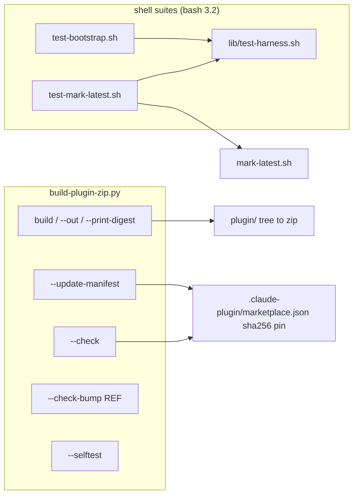

# scripts/

The plugin zip builder, its release assertions, and the shell test suites and release helper.
Repository-wide rules live in the root [CLAUDE.md](../CLAUDE.md).

Code rules for these files (shell portability, release/CI shape) live in the Shell section of [CODING_STANDARDS.md](../CODING_STANDARDS.md); rules for the shipped `plugin/` shell assets these scripts test live in [crates/ss-magic-plugin/CODING_STANDARDS.md](../crates/ss-magic-plugin/CODING_STANDARDS.md).

## build-plugin-zip.py

Standard library only, so one file runs on a developer machine and on the Linux CI runner.

### What it packs

`plugin/` is the packaged marketplace tree: `.claude-plugin/plugin.json`, `hooks/{hooks.json,bootstrap.sh,run-hook.sh}`, `bin/ss-magic-plugin`, `lib/{tmproot.sh,execguard.sh}`, `skills/`, `ss-magic-plugin.version`.\
The builder packs it into a zip; `.claude-plugin/marketplace.json` pins that zip by SHA-256.

The zip is **byte-reproducible**, because the digest is a pin:

- sorted entries
- fixed 1980-01-01 timestamps
- normalized modes
- STORED, not deflated
- `create_system` forced to unix
- `.DS_Store` excluded
- symlinks and non-ASCII names refused loudly

`.gitattributes` marks `plugin/**` as `-text`, so a checkout's line-ending conversion can never move the digest.

### Modes

- *(no flag)* / `--out FILE` – build to the default path or to `FILE`.
- `--print-digest` – compute only, print the digest.
- `--update-manifest` – write the current digest into `marketplace.json`. Run it after ANY change under `plugin/`, then re-run `--check`.
- `--selftest` – the builder's own reproducibility and refusal tests.
- `--check` – the release assertions (below).
- `--check-bump REF` – R98, "plugin contents changed without a version bump": compares the digest and declared version at baseline `REF` against the working tree and fails when the bytes changed under an unchanged (or lower) version. CI's `plugin` job runs it. The resolved VERSION, not the digest, is the harness's update signal (the plugin cache path is keyed on version), so new bytes under an old version leave every installed user silently on the cached copy.

### `--check` assertions

`--check` is the authority; do not work from a remembered count. At the time of writing it prints eight lines:

- `R101 marketplace sha256 key`
- `R95 version surfaces (ss-magic)` – R95 is "every version surface agrees"
- `R95 version surfaces (ss-magic-plugin)`
- `distinct release lines` – the two groups' versions must differ
- `hooks spawn through the shim` – every `hooks.json` entry except the `SessionStart` bootstrap goes through `run-hook.sh`
- `workspace shape` – no `self_update`/`inquire`/`ratatui`/`saphyr` in the plugin or core manifest, and `publish = false` on core
- `release gate blocks publishing` – the generated `release.yml` host job waits for and checks the test gate
- `R96 committed digest pin` – the committed `marketplace.json` digest equals the built zip's

### Version surfaces

Surfaces are grouped by release line, and each belongs to exactly one group (the full table lives in the root [CLAUDE.md](../CLAUDE.md)). `--check` enumerates them.

The README installer pin is the one non-equality surface: it names the last PUBLISHED CLI release, so `--check` requires only a well-formed `v` + triple not exceeding the crate version. Equality would be wrong: the release procedure is bump, merge, tag, so main's README would name an unreleased tag (404 on the documented install command) for the whole window between a merged bump and a published release.

## Shell suites

Both suites run under `/bin/bash` (3.2 on macOS) in CI's `plugin` job on Linux, and again on the macOS leg of the `test` job.\
Their `pass`/`fail` counters and every `assert_*` helper live in `lib/test-harness.sh`, sourced by both so the two cannot drift. The caller sets `VERBOSE` (`-v`) before sourcing, names each case in `current_case`, and prints its own summary from `passed`/`failed`.

### bash 3.2 rules

- No associative arrays, no `mapfile`, no `${var^^}`.
- A `case` arm cannot sit inside `$( ... )`.
- A `read` loop must handle an unterminated last line, or it drops the newest item when that item is listed last.
- BSD `sort` has no numeric mid-field key (see mark-latest below).

### test-bootstrap.sh

Failure-path tests for `plugin/hooks/bootstrap.sh` and `plugin/bin/ss-magic-plugin`. Nothing touches the network: a `curl` shim on PATH serves a locally built fake release and records every URL requested, so "no URL composed from a hostile pin" and "the URL composed is exactly `.../download/ss-magic-plugin-v<pin>/ss-magic-plugin-<triple>.tar.gz`" are assertions.

- Scenarios: offline, corrupted download, hostile pin, unwritable data dir, unsupported platform, concurrent sessions. Each asserts exit 0, empty stdout, and a pre-existing binary left untouched.
- Seeding: a second repository on an already-provisioned machine IS seeded; a failed install (or failed upgrade over a working install) seeds nothing.
- Shim inertness: drives `plugin/hooks/run-hook.sh` directly and asserts exit 0, both streams empty, and the binary un-invoked when it cannot resolve one.
- Manifest invariant: asserted over EVERY `hooks.json` entry, not the bootstrap group alone (a deliberate duplicate of `--check`'s shim line; change both or neither).

### test-mark-latest.sh

Drives `mark-latest.sh` against a fake `gh` over a fixed tag list (AE1). Cases:

- the plugin tag, a draft, a prerelease and a wrongly-prefixed CLI tag are never chosen
- `v0.11.10` beats `v0.11.3` numerically
- a bare `v*` tag never invokes `gh`
- a dry run edits nothing
- a mark that did not take is exit 1

## mark-latest.sh

After a PLUGIN release, the repository-wide `releases/latest` mark must name a bare `v*` release again (R12): `gh release create` marks whatever it just published as latest, and every `ss-magic` binary released before the per-line check (0.11.0) polls that mark and parses only a bare `vX.Y.Z`. Wiring (cargo-dist post-announce job, workflow) is described in [.github/CLAUDE.md](../.github/CLAUDE.md).

The script:

1. Exits 0 at once for a bare `v*` tag.
2. Otherwise lists releases with `--limit 200` (the default 30 truncates).
3. DROPS drafts and prereleases and keeps only exact `v` + triple tags.
4. Picks the numerically greatest, sorting on the bare triple (a mid-field sort key was not numeric on BSD sort).
5. Runs `gh release edit <tag> --latest`.
6. Reads `releases/latest` back and FAILS the job if it does not name that tag, so a token that cannot edit shows up red.

`MARK_LATEST_DRY_RUN=1` prints the chosen tag instead of editing.
